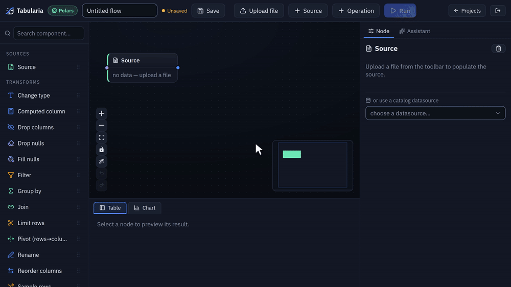
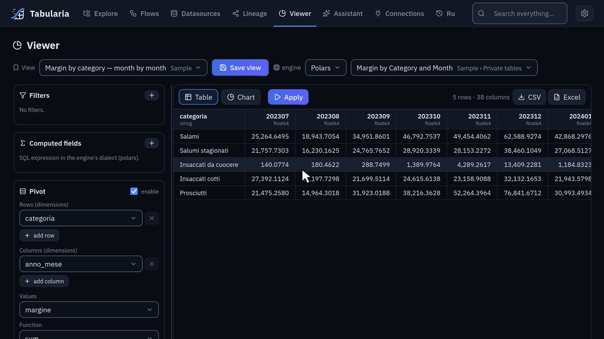
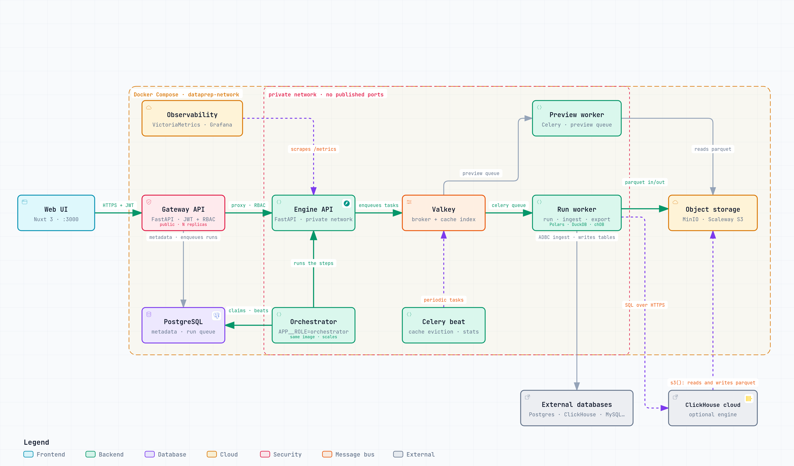
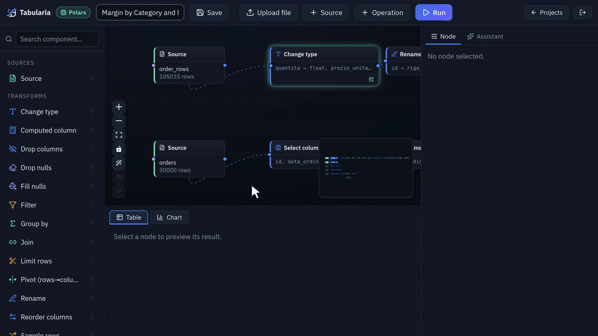
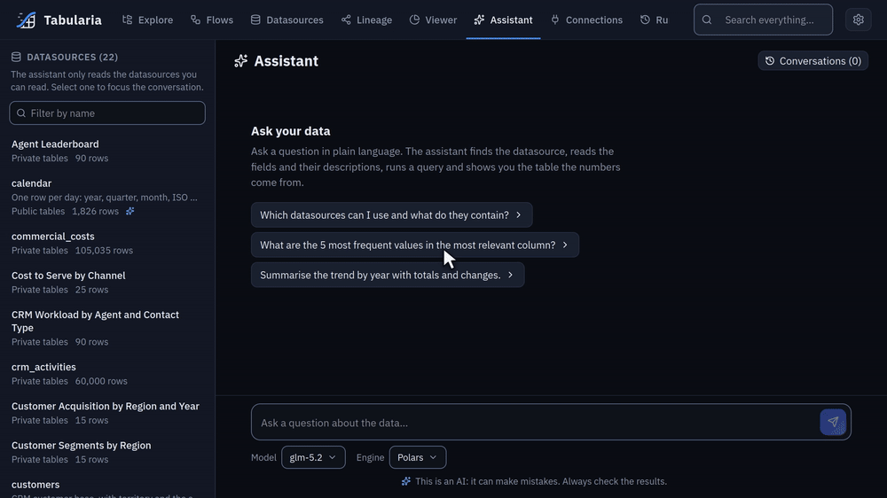
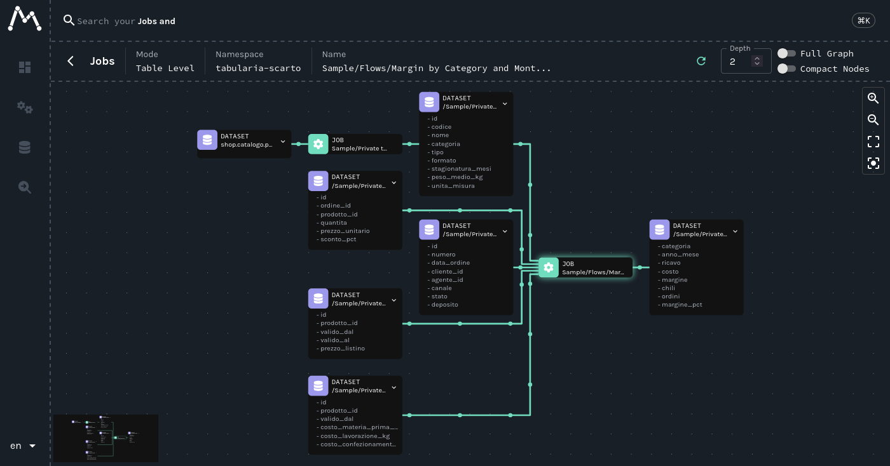

<!--  GitHub Pages: no Liquid in this page -->
<p align="center">
  
</p>

# Tabularia

[](https://github.com/JumpAsAService/Tabularia/actions/workflows/ci.yml)

**Self-hosted, open-source visual data-preparation platform.** A visual flow editor
on pluggable engines: build a pipeline once, preview it on the whole dataset, and
decide *later* where the compute runs.

**The same flow scales from a laptop to a warehouse without being rewritten.** Start
with nothing installed but Docker: transformations stream through memory in-process,
no cluster, no external service, no per-query bill. When the data outgrows one
machine, point the flow at **DuckDB** (same process, spilling to disk), a **managed
ClickHouse**, or **Google BigQuery** (serverless, nothing to operate) — the flow
definition does not change by a single node. The parquet stays in your bucket and the
warehouse reads it **in place**: nothing is copied, nothing streams back through the
workers. Storage follows the same curve, from MinIO on the same host to S3, Scaleway or
Google Cloud Storage; deployment from one `docker compose up` to Helm on Kubernetes.

Database sources and destinations, loops, charts, scheduling, cross-flow lineage, an
AI assistant over your own catalog and an audit trail come in the box. On Kubernetes,
your team also **writes Python and R in governed environments** and **orchestrates its
own containers**, as steps of the same flows.

<p align="center">
  
</p>

<p align="center"><em>A source, a filter, a group by and a sort — the preview refreshes at every step.
Here the 30,000 orders of the sample data on Polars; the same flow runs unchanged on DuckDB,
chDB, ClickHouse or BigQuery.</em></p>

> *Tabularia takes its name from the Tabularium, the records office of ancient Rome —
> the place where the state's tables were kept in order.*

Current release: **1.2.2 «Appio»** — see [CHANGELOG.md](CHANGELOG.md).

---

# Part I · Business

## The problem

Visual data-prep tools either cost thousands per seat, or quietly work on **samples**
of your data and hope for the best. And once a pipeline exists, moving it to bigger
iron usually means rebuilding it: the tool that was comfortable on a laptop does not
speak to the warehouse the company already pays for.

Tabularia is an open-source alternative you host yourself: a visual, drag-and-drop
pipeline builder that runs on the **entire** dataset, connects straight to your
databases, keeps a full record of who did what — and lets the same flow run on five
engines, from an in-process library to a serverless warehouse.

## What you get

- **Build pipelines visually — no code.** Drag transformations onto a canvas, connect
  them, and preview the result at any step.
- **No sampling, ever — unless you ask for it.** Previews, profiles and charts run on
  the *whole* dataset through a streaming engine: what you see in the editor is what
  you ship. Where every read is billed, an optional development sample keeps the
  editor cheap, per node and switchable, and never touches production runs.
- **Compute where it makes sense.** The same flow runs on Polars, DuckDB, chDB, an
  external ClickHouse or BigQuery. Design in-process, then hand production to the
  warehouse: the parquet stays in your bucket, the warehouse reads it **in place**,
  nothing is copied and nothing streams through the workers. See
  [Run it on your engine — or on your warehouse](#run-it-on-your-engine--or-on-your-warehouse).
- **Explore without building a flow.** The **Viewer** is a read-only BI surface over any
  datasource: filters, calculated fields, pivots and charts, computed on the whole
  dataset by the engine you choose. Any configuration can be **saved as a view** into a
  folder, next to flows and datasources. A view stores the configuration and never the
  rows, so reopening it reads today's data — it is a lens, not a copy.

  <p align="center">
    
  </p>

- **Connect to your databases.** Read directly from Postgres, MySQL, MariaDB,
  ClickHouse, Trino, Oracle, Microsoft SQL Server and SharePoint (Excel and CSV); write results
  back to a database table (Oracle and SQL Server are sources only, for now) or publish
  them as a reusable datasource. SQL Server's driver is Microsoft's, under Microsoft's
  licence, so it is not in the published images: you add it to yours
  ([SQL Server](docs/sqlserver.md)). Files (CSV/Excel/JSON/parquet) work too, uploaded,
  on an **SFTP server** or in an **S3 bucket**: a folder and a glob become one table,
  refreshed on schedule, and a flow can drop its result there as a file (on SFTP the
  server's host key is checked at every connection) ([SFTP](docs/sftp.md),
  [S3](docs/s3-datasource.md)).
  And any **HTTP API** (REST/JSON): page-number, offset, cursor and next-link pagination, OAuth2 client credentials too — the
  credentials never leave the API's host ([HTTP APIs](docs/api-datasource.md)). Inputs
  and outputs share **one placeholder language**: dates that move by themselves
  (`sales_{yesterday:yyyyMMdd}.csv`, `{last_refresh}`, `{run_id}`) in their own time
  zone, list variables and **ranges** (`day = today-7 .. today step 1d`: one file or one
  call per day, a missing day skipped and listed), refreshed as a snapshot or appended
  by key ([placeholders](docs/placeholders.md)).
- **Ask your data.** An optional AI assistant answers questions in plain language over
  the datasources you are allowed to read: it finds the table, reads the curated field
  descriptions, writes and runs the query on your engine, and shows the result table the
  numbers come from. Conversations are saved and can be reopened, so a question already
  answered is never paid for twice, and **every turn shows what it cost**. Any
  OpenAI-compatible endpoint works; an administrator decides which models may be used,
  and every query lands in the audit log.
- **Nothing happens to your data that you cannot preview.** Every node shows its row
  and column count as the preview arrives — no extra query, it is what the preview
  already returned — and edges can be removed with a click or the keyboard. Repeated
  previews reuse a per-step cache that is written *after* the answer is on screen, so a
  second click is fast without the first one waiting for it.
- **Data contracts: bad data does not get published.** A datasource can carry a
  contract — columns, types and rules on the values — checked every time new data
  arrives, *before* it is published. Each rule is either a **warning** (published,
  and reported) or an **error** (blocked: the datasource keeps serving the last good
  data and the run says which rule broke). The state shows as an icon wherever the
  datasource appears, down to the source nodes of the flows that read it; a change of
  state can send an email; the contract exports to the open
  [ODCS](https://bitol-io.github.io/open-data-contract-standard/) format.
- **Schedule and forget.** Put flows on a schedule (timezone-aware, DST-safe) and let
  them refresh on their own; a load heatmap shows busy time-bands and collisions
  before they bite.
- **Write R and Python in a governed environment.** Administrators define the
  environments — language version, pinned packages, the groups that may use them,
  variables and secrets — and Tabularia builds the image. Every script runs as a
  Kubernetes Job in its own namespace, with CPU and memory limits, network policies and
  a timeout; scripts live in folders with their versions, Python is checked by Ruff as
  you type, and every run keeps its log. An optional assistant writes and fixes the code
  beside it without ever seeing a row of data ([Python and R in flows](docs/scripting.md)).
- **Orchestrate your containers.** Run the images your team already ships — from Harbor,
  GitHub, GitLab, Docker Hub or your cloud's registry, limited to the repositories an
  administrator allows each group — with the command, arguments, variables, CPU and
  memory you set. A container gets its input as parquet and hands back its output, or
  just does its job elsewhere; retries, timeouts, logs and the outcome come with it
  ([The Container node](docs/container-node.md), [Container registries](docs/container-registries.md)).
- **Chain the work.** A **flow group** runs flows, datasource refreshes, saved scripts,
  container images and **Pushmail** emails (datasources sent as Excel files) in steps,
  drawn as a grid: the cells of a step run in parallel, the steps one after the other,
  and a failed step stops the chain. Build it by drag and drop, run it by hand or on a
  schedule, and watch every cell's state as it runs ([Pushmail](docs/pushmail.md)).
- **Full history & governance.** Every run is recorded with downloadable results; an
  **audit log** captures logins, flow runs, data exports and permission changes —
  "who entered, who ran what, which data was downloaded" — with a 24-hour access chart,
  and can be forwarded to **Splunk** as it happens, nothing skipped when Splunk is down.
- **See how everything connects.** A dedicated **Lineage** view maps datasources and
  flows across the whole workspace: provenance, impact/blast-radius, staleness and
  broken references at a glance. Optionally the same lineage is **told to an external
  catalog in the [OpenLineage](https://openlineage.io) standard** (Marquez, DataHub,
  Astro…): every run becomes a job with the tables, queries, files and datasources
  it read and wrote, and a flow's dependencies can be exported without running it.
- **Leave with your work.** Any flow exports as a **dbt project**: one model per output,
  the shared steps as `ref()`-ed models, `sources.yml`, `schema.yml` with descriptions and
  the data contract as dbt tests, seeds for the files it reads. Run it on your ClickHouse,
  which reads the source databases live, with dbt-duckdb, or natively in the source
  database — as a complete project or as a folder for the data team's own project.
  End-to-end oracles run it with a real dbt and compare it with what Tabularia publishes.
- **Multi-user from day one.** Password or SSO sign-in with any OIDC provider (Keycloak, Entra ID, Auth0, Okta…; verified against Keycloak)
  with sessions you can see and close, users & groups, nested projects with inherited
  view / edit / manage / connect permissions. Everyone works in the same place, safely.
- **Connects to the rest of your stack.** API tokens and **service accounts** let
  schedulers and CI run flows and read results; **webhooks** call your systems when a
  run finishes. Engine limits are tuned from the administration panel, without restarts.
- **Yours to run.** Self-hosted, AGPL-3.0 open source, no per-seat fees, no data
  leaving your infrastructure. Point it at managed S3 / Postgres / Redis if you prefer.
- **Speaks your language, looks the part.** UI in **English, Italian, French, German,
  Spanish**, with **Dark, Light, Imperium, Dracula and Monokai** themes, selectable per user.

## Run it on your engine — or on your warehouse

Every flow is stored as a declarative list of operations, decoupled from execution.
That is what makes the engine a deployment choice instead of a design constraint:

| Engine | Where the compute runs | What you need | How it is billed | Choose it when |
|---|---|---|---|---|
| **Polars** *(default)* | In the worker process | Nothing | Your servers | Day-to-day work, anything that fits the worker's memory |
| **DuckDB** | In the worker process, spilling to disk | Nothing | Your servers | Very large joins and aggregations on one machine |
| **chDB** | In the worker process (embedded ClickHouse) | The chDB build of the image | Your servers | Prototyping the ClickHouse dialect locally |
| **ClickHouse (external)** | On a managed or self-hosted ClickHouse server | A ClickHouse reachable from the workers | The server you rent | Big tables, sub-second aggregations, a warehouse you already run |
| **Google BigQuery** | On BigQuery, serverless | A GCP project and a bucket on Google Cloud Storage | Per byte read, no idle cost | Data already on GCP, elastic scale, zero servers to operate |

A flow carries **two engines**: the development one, used by the editor and manual
runs, and an optional production one, used by the scheduler and "Run in production".
Design on Polars with a development sample, schedule on ClickHouse or BigQuery: the
flow does not change, and every run records the engine it actually ran on. An
administrator can restrict which engines the installation allows.

The engines agree on one data standard — nulls, casts, joins, aggregates, sort order,
pivots — locked by an oracle test suite that runs the same hand-computed expectations
on all five. The remaining differences are documented, not discovered in production:
[docs/engines/engine-differences.md](docs/engines/engine-differences.md).

### How far it scales, and what it costs to get there

The flow is a declarative list of operations; the engine is a runtime decision. That
one property is what lets an installation grow without a migration:

| Stage | Compute | External services | Typical scale |
|---|---|---|---|
| **Laptop / one server** | Polars, streaming in the worker's memory | none | up to what the worker's RAM allows |
| **One bigger machine** | DuckDB, spilling to local disk | none | joins and aggregates past RAM |
| **Your warehouse** | Managed or self-hosted ClickHouse | a ClickHouse the workers can reach | tens of millions of rows, sub-second aggregates |
| **Serverless** | BigQuery | a GCP project and a GCS bucket | elastic, no idle cost |

Nothing above is a rewrite: it is a dropdown on the flow, and a flow can use one engine
in the editor and another in production. Two mechanisms keep the growth honest:

- **A development sample, off in production.** Where every read is billed, an optional
  sample keeps the editor cheap. It is per source node, switchable, marked in the
  definition, and **scheduled runs never sample** — you cannot ship a sampled result by
  accident.
- **A step cache with a ceiling.** Repeated previews of the same chain reuse the
  previous step instead of recomputing it. The copy is made *after* the preview has
  answered, in a separate task, and steps above `CACHE__MAX_STEP_ROWS` are not cached at
  all: a big intermediate result never makes you wait for a copy you did not ask for.

### Managed ClickHouse

Set `CLICKHOUSE_EXTERNAL__HOST` and the engine appears in the picker. With the `s3`
transport the server reads and writes the parquet **directly on the object storage**
through its `s3()` table function: nothing passes through the workers, and an
aggregation over 25 million rows answers in 0.6 s instead of 18 s, because the parquet
is written with large row groups the server can skip. With the `push` transport
the worker stages the source in a table and streams the result back, which works with
any server that cannot see the bucket. Validated on Scaleway's managed ClickHouse;
ClickHouse Cloud speaks the same protocol and reads S3-compatible buckets the same way
(multi-replica services are not handled yet: query cancellation and the performance
page read one replica).

Optionally, datasets above a size threshold are copied once into a MergeTree on the
server so the Viewer's full scans read local columns instead of the bucket.

### Google BigQuery

Point the object storage at Google Cloud Storage, give the engine a project and a
service account, and every flow can run on BigQuery. Each source parquet becomes a
**temporary external table** of the query (`gs://bucket/key`), so no dataset is
loaded and no copy is made; the chain of operations is one GoogleSQL query; results
come back through the Storage Read API and are written as parquet like everywhere
else. Columns are checked with free dry runs; every job is capped by
`BIGQUERY__MAXIMUM_BYTES_BILLED` so a runaway query is refused before it runs.

The editor gets a **native step-cache**: intermediate steps are materialised as
expiring tables in a `tabularia_cache` dataset by a background task, so the first click
on a node never waits and the next ones read a small native table. Measured on a
25 M × 50 table with a 100 k development sample: 0.6–1.1 s per click with the cache,
1.1–2.9 s without.

Know the cost model before pointing the Viewer at a wide table: BigQuery bills the
**logical** bytes of the columns a query touches, whatever the file compression. On
that same 25 M × 50 table, aggregations read 100 MB–1 GB per query (a fraction of a
cent); sorting whole rows reads all 50 columns, about 19 GB, eleven cents per click.
The per-query cap and the development sample are the two guards; the free tier
covers 1 TB a month.

## Who it's for

Data & analytics teams that want a self-hosted, governed, no-sampling data-prep tool
without enterprise licensing — and anyone who needs an auditable, multi-user pipeline
builder that can start on one machine and grow onto the warehouse they already have.

---

# Part II · Technical

## Architecture

[](https://jumpasaservice.github.io/Tabularia/architecture/runtime-architecture.html)

**[Open the interactive diagram](https://jumpasaservice.github.io/Tabularia/architecture/runtime-architecture.html)**
(pan/zoom, light/dark theme, search, guided views, PNG/SVG export). It is generated
with [Archify](https://github.com/tt-a1i/archify) from
[`docs/architecture/runtime.architecture.json`](docs/architecture/runtime.architecture.json);
every node cites the source files that implement it, verified against the commit
pinned in the spec.

| Runtime component | Role |
|---|---|
| Web UI | Nuxt 3 app, calls the gateway only (JWT) |
| Gateway | FastAPI control plane: auth, RBAC, audit; proxies to the engine after the permission check. Stateless between requests, so it runs in as many copies as you like (`APP__ROLE=api`) |
| Orchestrator | the same image in another role (`APP__ROLE=orchestrator`): fires the schedules and runs the flows. Each run is a row in Postgres that any orchestrator claims with a conditional update, so copies never fire a schedule twice. `APP__ROLE=all` (the default) does both jobs in one process |
| PostgreSQL | control-plane metadata (users, groups, projects, versioned flows, connections, runs, schedules, audit); its schema evolves through Alembic revisions ([database migrations](docs/database-migrations.md)) |
| Engine API | FastAPI on the private network: turns every preview and run into a Celery task |
| Valkey | Celery broker, step-cache index, preview slots |
| Run worker / preview worker | Celery workers on two queues (`celery`: runs, DB ingest, export · `preview`: interactive previews); in-process engines (Polars, DuckDB, chDB) and the clients of the external ones |
| Celery beat | cache eviction and storage statistics |
| Object storage | one bucket, all parquet: `datasets/` snapshots, `cache/` steps, `out/` results. MinIO locally; any S3 (Scaleway, AWS…) or Google Cloud Storage through its S3 API in the cloud |
| External engines *(optional)* | a managed ClickHouse reading and writing the parquet through `s3()`; Google BigQuery reading it as temporary external tables over GCS |
| External databases | sources streamed in Arrow batches into parquet snapshots (Postgres through ADBC, Oracle through python-oracledb in Thin mode, SQL Server through Microsoft's mssql-python, which [you add to your image](docs/sqlserver.md); no other vendor client), whole row groups whatever the driver's batch; Output nodes can write tables back |
| VictoriaMetrics + Grafana | scrape the engine `/metrics`, celery-exporter, cAdvisor and node-exporter |

The **gateway** (control plane) is the only public ingress: it owns the metadata
Postgres and enforces auth + RBAC on every call before proxying to the internal
**engine** (data plane), which stays stateless (Valkey + object storage only). Nothing
that outlives a request lives in a gateway process — the run queue, the login throttle
and "who has this flow open" are tables — which is what lets the API tier scale out and
the **orchestrator** tier scale separately: one process at ~100 requests/s, three copies
served 500 concurrent users at a 0.12 s p95 on one laptop.

That metadata Postgres has a diagram of its own:
**[Open the metadata database schema](https://jumpasaservice.github.io/Tabularia/architecture/metadata-schema.html)**
— the 28 tables and 35 foreign keys of release 1.1.0, read back from a live database
rather than transcribed from the models, and generated with Archify from
[`docs/architecture/metadata-schema.architecture.json`](docs/architecture/metadata-schema.architecture.json).
Six tables added since are not drawn yet: `user_sessions`, `api_tokens`, `webhooks`,
`webhook_deliveries`, `engine_settings` and `siem_destinations` (schema revisions
0002–0005, now 34 tables and 40 foreign keys).

## Declarative IR & pluggable engines

Flows are stored as a **declarative IR** — a JSON list of typed operations — fully
decoupled from execution. Adding or swapping an engine touches neither the routes, the
workers, nor saved flows. Five engines are registered:

| Engine | id | Notes |
|---|---|---|
| **Polars** | `polars` | In-process, lazy, streaming. **Default**; full operation coverage. |
| **DuckDB** | `duckdb` | Out-of-core SQL (spills to disk) for very large joins/aggregations. Full operation coverage. |
| **chDB (ClickHouse)** | `chdb` | Out-of-core SQL with the ClickHouse dialect, embedded. Full coverage except `foreach`. |
| **ClickHouse (external)** | `clickhouse` | *Optional.* Same dialect and ops as chDB, executed on a **remote ClickHouse server**. Enabled by `CLICKHOUSE_EXTERNAL__HOST`. Transport `s3` (the server reads/writes parquet directly on the object storage) or `push` (staging table + streamed result). |
| **BigQuery** | `bigquery` | *Optional.* GoogleSQL over **temporary external tables** on GCS; results through the Storage Read API. Enabled by `BIGQUERY__PROJECT` plus a service-account key. Full coverage except `foreach` and `median` inside `pivot`. |

Each engine is a registry of per-operation implementations. DuckDB and chDB are
guarded imports — absent packages simply mark the engine unavailable without breaking
Polars; the external engines are listed but unavailable until configured. chDB is
**fork-unsafe**, so it is imported *lazily inside the Celery child* (never in the
prefork parent) to avoid inherited native-thread deadlocks. Users pick a **preferred
engine** in settings (default for the Viewer and new flows); each flow persists the
engine it was built with, so opening a non-preferred flow is regression-safe. Each
flow also carries an optional **production engine**: the editor (previews, manual
runs) uses the development engine, while scheduled runs and "Run in production" use
the production engine. Every run records the engine it actually ran on.

An administrator can narrow that choice for the whole installation. **Admin → Engines**
decides which engines a flow may be built on. Disabling an engine stops it from being
*chosen* — at creation, when changing a flow's engine, and as a production engine — but
deliberately does **not** stop the flows already using it: a switch in an admin panel
should never halt a scheduled DAG the moment it is pressed. The panel reports how many
flows still run on each engine — that list is the migration backlog. At least one
engine always stays allowed, and the picker keeps *not allowed here* apart from *not
configured*.

### External engines in detail

**ClickHouse (external)** — `CLICKHOUSE_EXTERNAL__HOST`, `__PORT` (8443 with TLS on
managed services), `__USERNAME`, `__PASSWORD`, `__DATABASE`, `__SECURE`, `__TRANSPORT`
(`s3` | `push`), `__S3_ENDPOINT` (the storage endpoint *as the server sees it*) and,
recommended, `__S3_NAMED_COLLECTION`: a named collection holding the bucket credentials
on the server, so keys never travel inside a query nor land in `query_log`. The engine
raises `max_threads` on scan-heavy queries to hide object-storage latency, never on
`LIMIT` queries; `__MATERIALIZE_MIN_ROWS` turns on the MergeTree copy for the Viewer.
Interactive previews carry a `log_comment` tag: when a newer preview supersedes one
still running, the server is told to `KILL` it. Preview timings and the server's own
`query_log` are shown on the admin **Performance** page.

**BigQuery** — `BIGQUERY__PROJECT`, `BIGQUERY__CREDENTIALS_FILE` (path of the
service-account JSON key inside the container) or `BIGQUERY__CREDENTIALS_B64` (the
same key, base64 on one line), `BIGQUERY__LOCATION` (empty = the bucket's region),
`BIGQUERY__MAXIMUM_BYTES_BILLED` (default 20 GiB) and `BIGQUERY__CACHE_DATASET`
(default `tabularia_cache`, empty disables the step-cache). The service account needs
*BigQuery Job User* on the project, *BigQuery Data Editor* for the cache dataset, and
read access on the bucket; the object storage must be Google Cloud Storage
(`STORAGE__ENDPOINT=https://storage.googleapis.com` with HMAC keys). Column names
BigQuery cannot represent (`Ragione Sociale`, `Importo (€)`) are mapped to safe names
inside the query and restored in the results; `compute` expressions are transpiled from
the common dialect with sqlglot (`%` → `MOD`, `strftime` → `FORMAT_DATE`). Jobs are
labelled with the preview tag so a superseded preview is cancelled on the service.
Verified against a real project: the cross-engine oracle suite passes on BigQuery
(`BIGQUERY_LIVE=1 pytest -k bigquery`).

## Operations

~18 transforms plus source / output / control nodes, all engine-agnostic in the IR:

`select · drop · rename · cast · compute · sql · filter · sort · limit · unique ·
fill_null · drop_nulls · group_by · pivot · unpivot · join · union · foreach`

<p align="center">
  
</p>

<p align="center"><em>Click any node: its parameters on the right, its output below —
no run, no waiting for the whole pipeline.</em></p>

- **`foreach`** is a loop container: it iterates its body over a driver table with
  `{{placeholder}}` substitution, appending results with bounded memory.
- **Upstream filters** per source node: AND-ed `{column, operator, value}` conditions set in
  the editor on the input datasource and saved with the flow. They become plain `filter`
  operations injected right after the source is read, before anything else (development
  sample included), in *every* mode — editor previews, scheduled runs, "Run in production"
  and the dbt export — so a flow can read only the slice it needs from a large table.
- **Cross-engine data standard.** The same flow must give the same data on every engine,
  so the engines follow one explicit semantics, SQL-like, locked by an oracle test suite
  (`backend/tests/test_data_correctness.py`, hand-computed expectations run on Polars,
  DuckDB, chDB, external ClickHouse and BigQuery): comparisons with NULL are false
  (`ne`/`not_in` drop NULLs); aggregates ignore NULLs, `count`/`n_unique` never count NULL,
  `sum`/`mean`/`min`/`max` of an all-NULL group are NULL, `std`/`var` are sample (n-1),
  `median` interpolates; sort puts NULLs **last** in both directions; failed casts give
  NULL (never an error), text is trimmed before parsing, text→int accepts integer literals
  only, number→int truncates; joins never match NULL keys, `on` keys are one coalesced
  column, `left_on`/`right_on` keep both key columns, a non-key homonym from the right
  gets `_right`; `compute` overwrites an existing column in place; integer sums are
  int64; datetimes are **naive UTC instants** everywhere. The differences that remain
  between engines are listed in [engine-differences](docs/engines/engine-differences.md).
- **Development sampling** per source node: "first N rows" or "random p%" set in the
  editor and saved with the flow. It only affects previews and editor runs: the gateway
  resolver injects it solely in development, never for scheduled runs or "Run in
  production", and strips any such marked operation from production launches as defence
  in depth. With `PREVIEW__DEFAULT_SAMPLE_ROWS` set, every source node without a sample
  of its own gets an **automatic** "first N rows" sample, shown as a badge on the node
  and switchable per node ("off (all rows)") — the right default where every read is
  billed. Sample only the big table: joining two sampled sources loses most matches.
- **Field descriptions** on datasources: a hand-curated `{column: text}` map, kept
  separately from the inferred schema so it survives refreshes.
- **`pivot` / `unpivot`** follow one cross-engine standard: pivot columns are named by the
  value as text (`null` for NULL, `2024_web` for multi-column keys, existing combinations
  only, text-ordered), missing or all-NULL groups are NULL (`count`/`n_unique` → 0), and
  unpivot keeps only the index columns with the value cast to the common supertype.
- **`sql`** runs engine-native SQL against the node input (`FROM input`), with a
  guardrail floor that blocks filesystem / URL / executable access.
- **Nodes**: `source` (any datasource: an uploaded file, a database table or query, an
  SFTP or S3 folder, a SharePoint path, an HTTP API call), `output` (write to a DB table,
  publish a datasource — optionally with a copy on an external S3 bucket, see
  [Publishing to an external bucket](#publishing-to-an-external-bucket) —, drop a file on
  an SFTP server or an S3 bucket, or send it by email; append/replace + post-SQL for
  tables; names built with [placeholders](#dynamic-inputs-and-outputs)),
  `script` and `container` (code and images run as Kubernetes Jobs). Refreshing
  datasources and running other flows in order is the job of a **flow group** (steps of
  flows, refreshes, scripts, images and Pushmail emails); the `refresh` and `runflow`
  nodes of flows saved before still run, but are no longer offered.

Every node's output is **content-addressed and cached**: editing the last step of a
10-step flow recomputes one step, not ten. The copy is written *after* the preview
answers, by a separate task, and only for steps up to `CACHE__MAX_STEP_ROWS` (1M by
default): a step as large as the source is recomputed from the original parquet
instead of being copied. In-process engines and ClickHouse keep the steps as parquet
under `cache/`; BigQuery keeps them as expiring native tables. Cache entries evict by
TTL.

## Storage layout

All parquet, on any S3-compatible object storage (MinIO by default) or on Google Cloud
Storage through its S3 API — the two things GCS does differently (no batch delete,
no chunked request checksums) are handled by the storage layer:

```
raw/       ingested files, as uploaded
datasets/  normalized parquet datasources
cache/     content-addressed step outputs
out/       run results, downloadable as CSV/Excel
```

Parquet files are written with large row groups (`INGEST__PARQUET_ROW_GROUP_ROWS`,
default 1 M) and, when a datasource declares sort keys, ordered on them: that is what
lets an external engine skip most of a file on a filtered query instead of reading it.

## Publishing to an external bucket

An Output node that publishes a datasource can also drop a copy of the same parquet
on a bucket Tabularia doesn't own — the one another team already reads from. It is
the integration path for the common case where nobody wants a data-prep tool writing
into their database, and it needs no orchestrator: the consumer polls a path.

By default the copy lands at **the same key, always parquet, overwritten on every run**,
so whoever reads it agrees on one path once and never has to discover a new filename.
The key may also carry [placeholders](#dynamic-inputs-and-outputs) — one object per
day with `exports/sales/{today:yyyy/MM/dd}.parquet`, resolved in the node's time zone.
Scheduled runs, «Run now» and runs started from the editor all write it.
The overwrite is a single object and becomes visible only when the upload completes:
a reader gets either the previous file or the new one in full, never a mixture.

It is **best effort by design**. The datasource is the result; the copy is a delivery
downstream of it. A copy that fails — or cannot be made, like a key whose placeholder is
wrong — leaves the run successful and the datasource published, and the error is
recorded on the run and returned by the API.

> **No screen shows that error yet.** Until that is wired up, treat a successful run
> as saying nothing either way about the copy.

> **Use a different bucket from the one Tabularia itself runs on.** A copy written
> into that bucket is not checked against the objects already there: aim it at a key
> another datasource is using and you overwrite that datasource's snapshot, outside the
> permission model.

## Dynamic inputs and outputs

Every name Tabularia builds — the folder and files a datasource reads, the call an API
datasource makes, the file, key or email an Output writes — speaks **one placeholder
language**: dates that move by themselves, formatted the way the other side wants them,
in a time zone of your choice. Nothing is evaluated as code; a wrong placeholder is
refused when you save, and every form previews the resolved value as you type
(«today: `sales_17102026.csv`»). The full reference is in
[docs/placeholders.md](docs/placeholders.md).

| Write | Get (on 18 October 2026) |
|---|---|
| `{today}` · `{yesterday}` · `{today-7}` · `{today-1m}` | `2026-10-18` · `2026-10-17` · `2026-10-11` · `2026-09-18` |
| `{start_of_month}` · `{start_of_week}` · `{now-2h}` | `2026-10-01` · `2026-10-12` · two hours ago, a date-time |
| `{yesterday:ddMMyyyy}` · `{today:yyyy/MM/dd}` · `{now:yyyy-MM-dd'T'HH:mm}` | `17102026` · `2026/10/18` · `2026-10-18T09:30` |
| `{today:%Y%m%d}` · `{now:epoch}` · `{now:epoch_ms}` | strftime, and seconds or milliseconds since 1970 |
| `{last_refresh}` | inputs: when the last successful refresh started (to fetch only what is new) |
| `{run_id}` · `{flow}` | outputs: the run's number and the flow's name |

**Inputs.** A daily file on SFTP: folder `/in/{today:yyyy}/{today:MM}`, files
`sales_{yesterday:ddMMyyyy}.csv`. A **list variable** makes one read or call per value —
`symbol = AAPL, MSFT, ENI.MI` with the path `/quotes/{symbol}` — and every row says which
value it came from (`_param_symbol`). A **range variable** does the same over time:

```text
day = today-7 .. today step 1d          # the 7 days before today (today excluded)
files: exports/{day:yyyy/MM/dd}/*.parquet
```

reads one folder per day, stacks them with `_file` and `_param_day`, skips and lists a
day with no file, and fails only when the whole range has none. On an API the same range
makes one call per window, with `{day}` and `{day_end}` for APIs that take a from/to and
cap how many days one call may cover (`step 7d` over a year = 53 calls). Combined with
**append by key** — rows whose key already exists are replaced, new keys added — it is
the classic nightly incremental import: «every night re-read the last three days».

**Outputs.** An SFTP folder `/out/{today:yyyy}/{today:MM}` and file
`report_{today:yyyyMMdd}_{run_id}` write `report_20261018_381.csv`; an S3 key
`exports/{flow}/{now:yyyy-MM-dd'T'HHmm}.parquet` in `Europe/Rome`; an email with subject
`Daily sales {yesterday:dd/MM/yyyy}` and attachment `sales_{yesterday:yyyyMMdd}`. A
resolved name can never leave its folder (`..`, a `/` coming from a value, control
characters and over-long names are refused), and outputs written before this language
existed keep their exact names: `{date}`, `{datetime}`, `{run_id}` and `{flow}` mean what
they always meant, and literal braces stored earlier were escaped by a migration.

## Auth, RBAC & audit

Administrators are granted in two ways: a personal flag, or membership of a group
marked as an **administrators group** — every member is an administrator for as long as
they belong to it, which also means the right can be granted from an identity provider
through SSO group mapping. Both paths are audited, and no administrator can remove
their own last route to administration: demoting or deactivating yourself, demoting or
deleting your only admin group, or leaving it, is refused rather than silently
performed.

- **Sessions** that can be closed: every sign-in (password or SSO) is a row the
  gateway checks on each request, in the same query as the user. The browser keeps it
  in an `HttpOnly` cookie no script can read; sign-out really ends it; people see and
  close their own sessions, administrators anyone's from the Audit page; a password
  change or a disabled account closes them; an optional idle timeout
  (`AUTH__SESSION_IDLE_MINUTES`) signs an unattended page out after a warning.
- **An API for integrations** ([docs/api.md](docs/api.md)): personal API tokens and
  **service accounts** for schedulers and CI, read-only or read-write, always
  expiring, revocable, recorded in the audit log; **webhooks** that call another
  system when a flow or a datasource refresh finishes, signed with HMAC and retried.
- **Settings from the panel** ([docs/engine-settings.md](docs/engine-settings.md)):
  administrators change about a hundred settings of the gateway, the Kubernetes features
  and the engine (limits, waits, retention, the assistant's budget, the caps of the data
  sources) from Administration → Settings, in a box per component. Most apply within
  seconds on every process; the ones read only at start are marked, and the panel
  restarts their pods one at a time on Kubernetes. Addresses, credentials and the
  switches tied to the cluster stay in the environment; every change is checked and
  audited.
- **Audit log to Splunk** ([docs/siem-splunk.md](docs/siem-splunk.md)): every audit entry
  forwarded to the Splunk HTTP Event Collector within seconds, nothing skipped when
  Splunk is down, configured and tested from Administration → SIEM.
- **RBAC**: users & groups, nested projects, inherited **view / edit / manage /
  connect** permissions; access resolves to a set of `readable_project_ids` applied on
  every query. Object-level permissions extend to connections and datasources on the
  data plane.
- **Audit log**: append-only, with text snapshots that survive rename/delete. Captures
  logins, CRUD, flow runs, data exports, and permission changes; admin tab with a
  24-hour access-activity chart. Secrets (DB passwords) are encrypted at rest (Fernet).
- **SSO / OIDC** *(optional)*: sign in against Keycloak, Microsoft Entra ID (MSAL),
  Auth0 or Okta with the authorization-code flow (PKCE, `state`, `nonce`, id_token
  validated against the IdP JWKS). Users are provisioned on first login and the IdP's
  `groups` claim is reconciled onto Tabularia groups **by name**. Off until
  `OIDC__ISSUER` is set; local login always stays available as break-glass. See
  [`docs/design/sso-group-mapping.md`](docs/design/sso-group-mapping.md) and the
  runnable Keycloak example in [`docs/examples/keycloak/`](docs/examples/keycloak/).

### Free-form SQL, contained

A flow can carry a node holding hand-written SQL, and the assistant writes one for
every question. That node is bound to a single rule: **it may read its own input and
nothing else.** The query is parsed, and anything in a `FROM` or `JOIN` position that
is not `self` / `input` (or a `WITH` defined in the same query) is refused — table
functions, another database's tables, `information_schema`, dictionary and settings
lookups included. A query that cannot be parsed is refused rather than run. On DuckDB
the node executes in a locked in-memory sandbox with external access disabled; Polars
only ever sees the registered frame.

This matters because the engine holds credentials that can read the whole bucket: if a
query could name another table, the permission on a datasource would be decorative.

## AI assistant

<p align="center">
  
</p>

<p align="center"><em>It names the datasource it used, shows the table the numbers come from,
and tells you what the answer cost.</em></p>

Optional, in the gateway, built with [pydantic-ai](https://ai.pydantic.dev) against any
OpenAI-compatible endpoint (`AI__BASE_URL`, `AI__SECRET_KEY`; verified on Scaleway
Generative APIs). The agent has three tools and nothing else: `list_datasources`,
`describe_datasource` (columns, types and the hand-written **field descriptions** — the
semantic context that makes the query right — plus a few sample rows) and
`query_datasource` (one read-only `SELECT … FROM self`, executed by the engine through
the same `sql` node and guardrails as the editor, rows capped by
`AI__MAX_RESULT_ROWS`). Every tool re-checks the caller's permissions: a datasource
outside the user's VIEW scope looks exactly like one that does not exist. Each query is
an audit event (`ai.query`, with the SQL, the model and the row count).

**Conversations are saved** in the gateway's database, private to their author and
deleted with the account. They can be searched by title, reopened with their steps and
result tables, and continued — a question already answered costs nothing to read again.
The assistant names each conversation itself from the first question. Because the
history lives on the server, the browser sends only a conversation id: it cannot forge
a history, and a turn is bounded by `AI__MAX_COST_PER_TURN_USD` and
`AI__MAX_INPUT_TOKENS_PER_TURN`, not merely by a number of model round-trips.

**What a call cost is on screen**, under each answer and for the conversation as a
whole. The figure comes from the price data shipped with pydantic-ai — there is no
price list of ours to go stale — and it is an estimate from the model's list price,
not your provider's invoice; a dash means that model could not be priced, which is not
the same as free.

While the assistant works, the page names the phase it is actually in — scanning the
catalog, reading the fields of a datasource, querying it, writing the answer — read
from the same stream events the steps are read from.

Models are an administrator's decision (Admin → AI models): the provider's catalog is
listed, nothing is enabled by default, and embedding or audio models cannot be enabled
for chat.

**People always know they are talking to an AI** (EU AI Act, article 50). Before the
first question a dialog says so, and it cannot be skipped. In both assistants every
answer is labelled *AI assistant* with the model that wrote it, every question as the
user's, also for screen readers. A notice that stays under the input reads "This is an
AI: it can make mistakes. Always check the results". A downloaded conversation opens
with the same notice and labels who wrote what.

On the external ClickHouse engine the assistant's queries can run as a **dedicated
read-only account** (`CLICKHOUSE_EXTERNAL__AI_USERNAME`): a second barrier behind the
SQL node's allow-list, with no access to `system`, to any table, or to `url()` and
`file()`. See [docs/engines/clickhouse-ai-user.md](docs/engines/clickhouse-ai-user.md).

### In the flow editor

The editor's right panel has a second tab, **Assistant**, that builds the flow on the
canvas with you: ask for "the orders of last year, total per country" and it puts the
datasource on the canvas, adds a filter and a group-by, and checks every step on a
preview of the data — a step that fails or returns the wrong columns is fixed before it
goes on. It places the same operations you would, with the same parameters the node
panel shows; it reads only the datasources you may read, and previews pass the checks
the editor's do. What it built comes back as a whole and is applied as **one Undo
step**; it never saves, runs or schedules the flow. If you change the canvas while it
works, its version is not applied over yours without asking. The conversation is kept
with the flow and reopens with it; spending caps and the audit log count it like the
data assistant's.

### In the script editor

Beside the code of a Script node or a saved script, **Assistant** writes and fixes
Python and R for the script's environment, and «Explain and fix the last error» starts
from a failed run. It proposes whole files, applied only when you say so, as one change
you can undo. **No data reaches the model**: the code, the environment and its
packages, the names of the variables and of the inputs' columns, and only the error of
a failed run's log, never what the script printed. See
[docs/scripting.md](docs/scripting.md#the-assistant).

## Scheduling & timezone

Cron-style schedules are evaluated in a **deployment-wide timezone** (`APP__TIMEZONE`,
DST-aware) and stored/returned in UTC; the frontend displays browser-local time. A
schedule-load heatmap surfaces busy bands and collisions against a configurable
worker capacity. Schedules fire from the **orchestrator** role: a due slot is taken with
a compare-and-swap on the time the process saw, so with several orchestrators exactly
one fires it; a flow whose last run failed on schedule sends an email, once, to the
addresses set next to the schedule.

A **flow group** is queued and claimed like a flow's run. Its cells start together,
each flow under its own run row, so the flow's schedule cannot start it twice while
the group runs it. A flow already running is never duplicated: its run counts for the
cell when it runs in production and started after the previous step, otherwise the
cell runs the flow once it ends. A saved script's cell takes the script's live slot the
same way; a container cell runs its image as a Container node with no edges; a
Pushmail cell sends one email with an `.xlsx` per datasource, its recipients within the
SMTP connection's allowed domains, checked again when it runs. Cells
count in `ORCHESTRATOR__MAX_CONCURRENT` like flow runs; within that, how many really
run at once is up to the workers and the queue.

## Export to dbt

A flow is not locked in the tool: from the Flows page, *Export* turns it into a dbt
project (administrators only — an admin group is the way to give it to the data team). One model per output node (`table`, or `incremental` in append for database
tables written in append), the steps shared by several outputs as `ephemeral` models
referenced with `ref()`, `sources.yml` with the tables, their descriptions and columns,
`schema.yml` with every model's columns and descriptions and the **data contract as dbt
tests** (`not_null` as a generic test on the column; a one-column `unique` — two NULLs are
a duplicate, as in Tabularia — `accepted_values`, range, pattern, row count and expressions
as singular tests, each with the contract's severity), a seed for every file the flow
reads, a SQL-query datasource as an ephemeral model, and, from an upstream flow whose
output the flow reads, only the branch that publishes it. Three targets: **ClickHouse**
(dbt-clickhouse on your ClickHouse, which reads Postgres, MySQL and MariaDB live through
its PostgreSQL and MySQL table engines), **dbt-duckdb**, which attaches the source
databases and runs the very SQL Tabularia runs, and the **native warehouse**
(dbt-postgres or dbt-clickhouse, with the SQL translated by sqlglot; MySQL and MariaDB
sources are read by the other two targets). A dialog shapes it for the data team: a complete
project or a folder to copy into theirs, names and prefix, layers, their source names,
schema, materializations, tests and emails. End-to-end oracles export every Sample flow,
run it with a real dbt and compare it with the datasource Tabularia publishes
([e2e/dbt_export](e2e/dbt_export/README.md)). The details, the mapping and the limits are in
[docs/dbt-export.md](docs/dbt-export.md).

## OpenLineage (optional)

<p align="center"></p>

Set `OPENLINEAGE__URL` (and `OPENLINEAGE__API_KEY` if the collector wants one) and
every run that closes is reported with the official OpenLineage client: a flow run is
a job named after its folder path, its output nodes are child jobs with a
`ParentRunFacet`, a datasource refresh is a job of its own. Inputs are the datasources
read — named as in Tabularia under their folder path (`tabularia://<namespace>` +
`/Folder/name`), with schema and snapshot version, the parquet they serve as a symlink
and the Tabularia id in a `tabularia` facet
([schema](docs/openlineage/TabulariaDatasetFacet.json)) — database tables
(`postgres://host:5432` · `db.schema.table`, the standard naming), the tables a SQL
query reads (extracted with sqlglot, the query itself in the `sql` facet) and
SharePoint files; outputs are the datasources published, the tables written, the
S3/GCS objects and mirror copies. Emails are not datasets. Only metadata leaves: names,
schemas, query texts, paths, counts and times — never rows, users or credentials.
Events leave after the commit that closes the run, through a bounded queue and a
background thread: a collector that is down or slow never fails or delays a run.
Measured: closing a run costs 5–15 ms once, and under a storm of runs the gateway's
throughput is the same with lineage on or off, whether the collector is fast or
answers in 2 seconds.
`OPENLINEAGE__FILE` writes the same events as JSON Lines instead of, or
besides, the HTTP collector; the library's own `OPENLINEAGE_URL` / `OPENLINEAGE_CONFIG`
work too, for composite and custom transports.

`GET /flows/{id}/openlineage` returns the flow's dependencies as a static `JobEvent`
built from its definition — to download (also from the Flows page, under *Export*), or
to `POST` to the collector so that a catalog knows the flows before they ever run.
The full mapping, the dataset naming and the collector set-ups are in
[docs/openlineage.md](docs/openlineage.md).

## Monitoring

Ships in the box: **VictoriaMetrics + Grafana** dashboards (task durations, cache hit
rate, storage growth, per-container memory, preview latency by engine), plus cAdvisor,
node-exporter and a celery-exporter. Grafana is embedded in an admin-only Monitoring
tab, and a **Performance** page shows run durations, preview histograms per engine and
the external ClickHouse's slowest queries without any extra table.

## Services (docker-compose)

| Service | Role |
|---|---|
| `frontend` | Nuxt 3 app (SSR) — http://localhost:3000 |
| `gateway` | FastAPI control plane (auth, RBAC, audit) in role `all`: it also fires schedules and runs flows. Split it into `api` and `orchestrator` copies when you scale (see [docs/deploy/kubernetes.md](docs/deploy/kubernetes.md)) — :8000 |
| `backend` | FastAPI engine (preview) |
| `worker` / `preview-worker` | Celery workers (runs, DB ingest / preview) |
| `beat` | Celery beat: the only clock of the periodic tasks; keep it at one copy |
| `keys-init` | gives the `keys` volume (the encryption key) to the services, then exits |
| `postgres` | control-plane metadata |
| `redis` | Valkey — broker, cache index, counters |
| `minio` | S3 object storage — console :9001, S3 API :9002 |
| `victoriametrics` / `grafana` | metrics + dashboards — :3001 |
| `cadvisor` / `node-exporter` / `celery-exporter` | metric exporters |
| `sampledb-postgres` / `sampledb-clickhouse` / `sampledb-init` | the sample ERP and CRM (:5434, :8124) and the container that builds the `Sample` folder, then exits |

## Quickstart

> Production on Kubernetes: see [`docs/deploy/kubernetes.md`](docs/deploy/kubernetes.md)
> for the components, the hardened backend image, ingress and storage sizing, and the
> Helm chart in [`infrastructure/helm/tabularia`](infrastructure/helm/tabularia).
> Upgrading: [`docs/deploy/release-checklist.md`](docs/deploy/release-checklist.md).

Requires Docker and Docker Compose. Step by step, with the sample data and a first scheduled
flow: [getting started with Docker Compose](docs/getting-started-docker-compose.md).

```bash
git clone https://github.com/JumpAsAService/Tabularia.git
cd Tabularia/infrastructure
docker compose up -d
```

Nothing to configure: open http://localhost:3000 and create the administrator (the page
asks for it only while the installation has no account). The sample data, a company
with an ERP and a CRM and eleven ready-made flows, appears a couple of minutes later.
The first `docker compose up -d` builds the images from the code: 2–3 minutes on a fast
machine, 5–15 on a laptop. Settings are optional: `cp .env.example .env` and edit.
Script and Container nodes, saved scripts, container registries and the automatic
database backups need Kubernetes: on this stack they are shown greyed out ([Python and R in flows](docs/scripting.md),
[The Container node](docs/container-node.md)).

| Service   | URL                    | Credentials                        |
|-----------|------------------------|------------------------------------|
| App       | http://localhost:3000  | the administrator you create at the first visit |
| Gateway   | http://localhost:8000  | through the app's sign-in, or an API token |
| Grafana   | http://localhost:3001  | `admin` / `admin`                  |
| MinIO     | http://localhost:9001  | `minioadmin` / `minioadmin`        |

Upload a CSV/XLSX/JSON/parquet file **or** connect a database, drag transformations
from the sidebar, connect nodes, preview at any point, then run — or download any
node's data as CSV/Excel.

**Adding an external engine** is configuration only. For a managed ClickHouse:

```bash
CLICKHOUSE_EXTERNAL__HOST=xxxx.datawarehouse.it-mil.scw.eu
CLICKHOUSE_EXTERNAL__PORT=8443
CLICKHOUSE_EXTERNAL__SECURE=true
CLICKHOUSE_EXTERNAL__USERNAME=...
CLICKHOUSE_EXTERNAL__PASSWORD=...
CLICKHOUSE_EXTERNAL__S3_ENDPOINT=https://s3.it-mil.scw.cloud   # the bucket as the server sees it
```

For BigQuery, with the bucket on Google Cloud Storage:

```bash
STORAGE__ENDPOINT=https://storage.googleapis.com               # HMAC keys in STORAGE__ACCESS_KEY / SECRET_KEY
STORAGE__REGION=auto
BIGQUERY__PROJECT=my-gcp-project
BIGQUERY__CREDENTIALS_B64=...                                  # base64 -w0 service-account.json, one line
PREVIEW__DEFAULT_SAMPLE_ROWS=100000                             # keep the editor cheap
```

Recreate the workers (`docker compose up -d`) and the engine shows up in the picker;
[`docs/configuration.md`](docs/configuration.md) lists every variable, with its default.

**Secrets:** `SECURITY__FERNET_KEY` encrypts the connection passwords, the same value in
gateway, engine and workers; they refuse to start with an invalid one, or with none
unless a `SECURITY__KEYS_DIR` is shared, where it is created at the first start (the
Compose stack of `infrastructure/` does that, in its `keys` volume: back it up with the
data). On Kubernetes the chart sets the key. With
`APP__ENV_NAME=production` the gateway additionally refuses the dev-default secrets
(`JWT__SECRET`, admin and DB passwords) until they are overridden. Storage, broker,
database, timezone and engines are all env-driven — pointing at managed services is a
config change, not a code change.

**Database schema:** the metadata schema is versioned with Alembic revisions in
[`gateway/app/db/migrations/versions/`](gateway/app/db/migrations/versions/). The
development compose migrates at startup (`DB__AUTO_MIGRATE=true`). Everywhere else the
migration is a step of its own, `python -m app.db.migra`, run before the new version
starts (the Helm chart does it in an init container): it applies the revisions in one
transaction and checks the result against the models, and a gateway refuses to start on
a database behind its code. Revisions go forward only and keep the previous version
working during a rolling update; an installation from before Alembic is adopted by the
first run. How to add a revision: [`docs/database-migrations.md`](docs/database-migrations.md).
Upgrading an installation on Kubernetes or minikube (backup, rollout, rollback, restore):
[`docs/deploy/upgrading.md`](docs/deploy/upgrading.md).

## Sample data

A realistic **cured-meats company** dataset, on by default in the Compose stack — an ERP on Postgres and a CRM
on ClickHouse, generated with Faker/numpy — plus an init container that builds a
ready-made **`Sample`** folder in Tabularia on top of it. The data ships built-in
seasonality (monthly volume, product & channel seasonal mix, per-warehouse
fulfilment anomalies) so pivots tell a story. Details in
[`infrastructure/sampledb/README.md`](infrastructure/sampledb/README.md).

It is on in the Compose stack of `infrastructure/`, at the `small` scale (`SAMPLES_SCALE`
in `.env`: `small` | `medium` | `robusta`). To leave it out:

```bash
docker compose up -d --scale sampledb-init=0 --scale sampledb-postgres=0 --scale sampledb-clickhouse=0
```

The `sampledb-init` container waits for the gateway and the two sample databases,
fills them if they are empty (seconds at `small`, longer at `robusta`), then logs in
as the administrator and creates, idempotently by name:

| Where | What |
|---|---|
| `Sample` | the two connections (ERP, CRM) and four saved views (reports) |
| `Sample / Flows` | eleven flows — margin by category, cost to serve, RFM segments, CRM workload, leaderboards, private ⋈ public joins — three of them scheduled |
| `Sample / Private tables` | the nine company tables, and the tables the flows produce |
| `Sample / Public tables` | reference tables anyone could publish: a calendar with Italian holidays, the twenty regions |

Some tables carry column descriptions and some deliberately do not, so the
difference an assistant-ready datasource makes is visible. The flows are run once
so their output tables exist and the reports have something to show
(`SAMPLES_RUN_FLOWS=false` skips that). The folder is created with **no permissions
on it**: who gets to see it is the administrator's call, like any other folder.

Restarting the stack does not duplicate anything: the container finds what it
made and stops.

## Internationalization & themes

UI copy lives in per-language i18n catalogs (`en`, `it`, `fr`, `de`, `es`), selected
per user and persisted via cookie for SSR safety. Themes (`dark`, `light`, `imperium`,
`dracula`, `monokai`) are CSS-variable palettes on `:root[data-theme]`, persisted in localStorage
with an anti-flash head script. Code and comments are English-only; end-user strings
are translated.

## License

Copyright © 2025–2026 Leonardo Trivelli.

Licensed under the **GNU Affero General Public License v3.0** — see [LICENSE](LICENSE).
For commercial licensing options, contact the author.

Tabularia is provided **"as is", without warranty of any kind**; the authors are not liable
for any damage, including loss of data (AGPL-3.0, sections 15–16). Keep backups — and take one
before every upgrade: database migrations only go forward.

"BigQuery" and "Google Cloud" are trademarks of Google LLC; "ClickHouse" is a
trademark of ClickHouse, Inc. Other product and company names mentioned here are
trademarks of their respective owners, named only to say what Tabularia works with;
Tabularia is not affiliated with, endorsed by or sponsored by any of them.

### Third-party services

The default docker-compose deployment includes **MinIO** (AGPL-3.0) and **Grafana**
(AGPL-3.0) as separate, unmodified services accessed over standard APIs (S3, HTTP).
They are deployment choices, swappable via environment variables. All libraries used
by Tabularia itself are under permissive licenses (MIT/BSD/Apache-2.0/ISC).
<!--  -->
