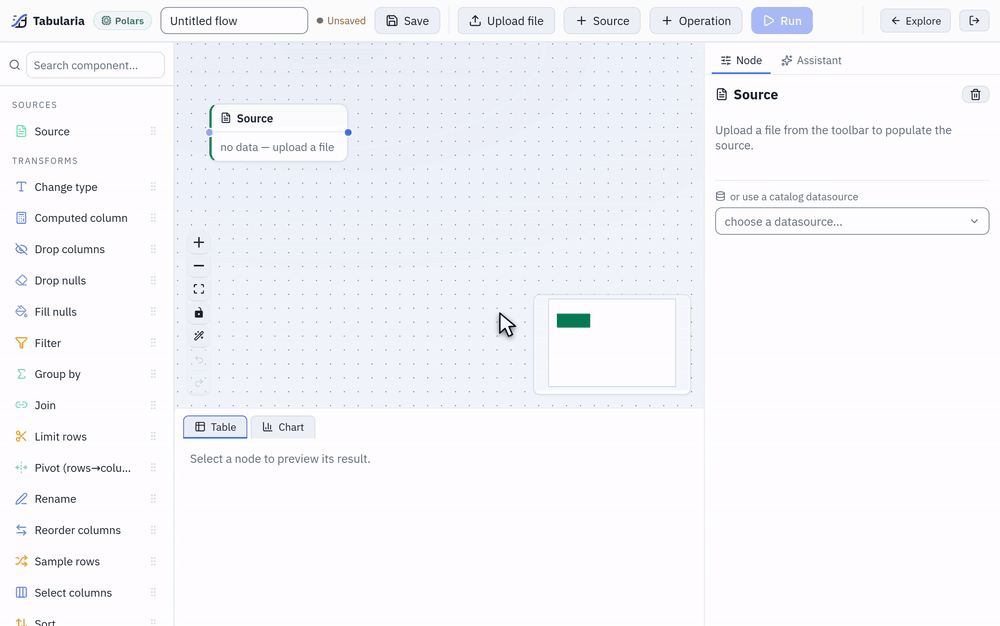
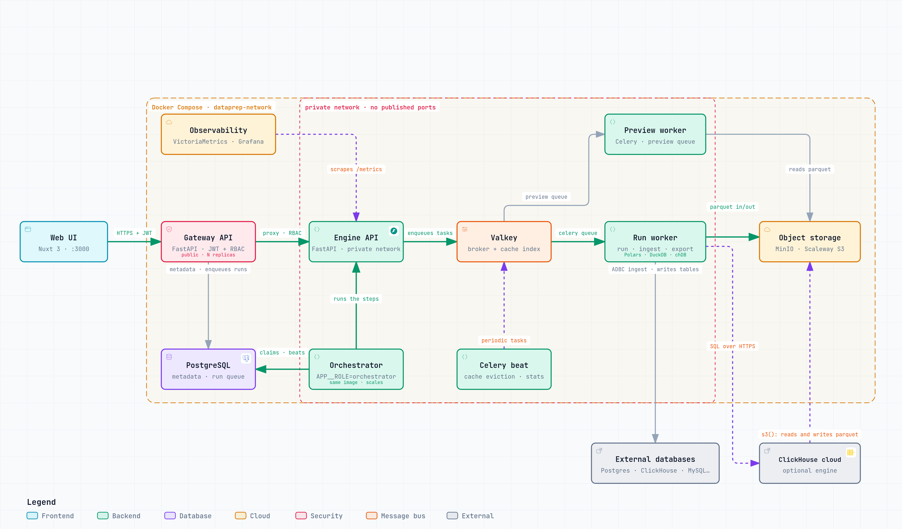

<!--  GitHub Pages: no Liquid in this page -->
<p align="center">
  
</p>

# Tabularia

**Messy in. Trusted out.**

[](https://github.com/JumpAsAService/Tabularia/actions/workflows/ci.yml)

**Self-hosted, open-source visual data-preparation platform.** Connect a source, draw a
flow of steps on a canvas, see the data of every step on the whole table, publish the
result as a datasource or write it to a database, a bucket, an SFTP server or an email,
and put it on a schedule.

**The same flow scales from a laptop to a warehouse without being rewritten.** Start
with nothing installed but Docker: transformations run in the worker process, on DuckDB
or Polars, with no cluster and no per-query bill. When the data outgrows one machine,
point the flow at a **managed ClickHouse** or **Google BigQuery**: the flow definition
does not change by a single node. The parquet stays in your bucket and the warehouse reads
it **in place**. Storage follows the same curve, from MinIO on the same host to S3 or
Google Cloud Storage; deployment from one `docker compose up` to Helm on Kubernetes.

It is for data and analytics teams that want a governed, multi-user data-prep tool that
works on the whole dataset, with no per-seat licence and no data leaving their
infrastructure.

<p align="center">
  
</p>

<p align="center"><em>A source, a filter, a group by and a sort — the preview refreshes at every step.
Here the 30,000 orders of the sample data on Polars; the same flow runs unchanged on DuckDB,
chDB, ClickHouse or BigQuery.</em></p>

> *Tabularia takes its name from the Tabularium, the records office of ancient Rome —
> the place where the state's tables were kept in order.*

Current release: **1.4.3 «Romulus»**, the long-term support line ([LTS](docs/lts.md): fixes only from here on, image tag `lts`) — see [CHANGELOG.md](CHANGELOG.md).

---

## The problem

Visual data-prep tools either cost thousands per seat, or quietly work on **samples** of
your data and hope for the best. And once a pipeline exists, moving it to bigger iron
usually means rebuilding it: the tool that was comfortable on a laptop does not speak to
the warehouse the company already pays for.

Tabularia is an open-source alternative you host yourself: a visual pipeline builder that
runs on the **entire** dataset, connects straight to your databases, keeps a full record of
who did what — and runs the same flow on five engines, from an in-process library to a
serverless warehouse.

## What you get

- **Pipelines built visually, no code.** Drag transformations onto a canvas and see every
  step's rows as you go, on the whole table, with its real row count and a profile of
  every column.
- **Compute where it makes sense.** Design on DuckDB or Polars, hand production to an
  external ClickHouse or BigQuery: the parquet stays in your bucket and the warehouse reads
  it in place.
- **Your data where it already lives.** Seven databases, S3, SFTP, HTTP APIs, SharePoint
  and Google Sheets in; datasources, database tables, files and email out, checked by data
  contracts before anything is published.
- **From numbers to people.** Pixel-perfect reports, dashboards with password-protected
  share links, and datasources served as read-only HTTP APIs to a CRM.
- **Governed by design.** Folders and permissions, single sign-on, an audit log that can
  stream to a SIEM, Python and R in environments the administrators control (internet
  access included), and an AI assistant that can be kept away from the data's values.
- **No lock-in.** AGPL, self-hosted, parquet files, an open REST API, MCP, dbt export and
  OpenLineage: what you build can leave with you.

## Who it's for

Data and analytics teams that want a self-hosted, governed, no-sampling data-prep tool
without enterprise licensing — and anyone who needs an auditable, multi-user pipeline
builder that can start on one machine and grow onto the warehouse they already have.

---

## Contents

Every feature below has one line, a short example taken from the code or tried on a running
installation, and the page with the complete one.

| Area | What is in it |
|---|---|
| [Connect your data](#connect-your-data) | Files, seven databases, S3, SFTP, HTTP APIs, SharePoint, Google Sheets; dates that move by themselves |
| [Build flows](#build-flows) | The canvas, 19 transformations and a loop, SQL steps, samples, versions, an assistant |
| [Preview and analysis](#preview-and-analysis) | Every step on the whole table, row counts, column profiles, charts, the Viewer, lineage |
| [Engines](#engines) | DuckDB, Polars, chDB, ClickHouse, BigQuery; one for design, one for production |
| [Publish and write](#publish-and-write) | Datasources, database tables, S3, SFTP, email; data contracts |
| [Schedule and automate](#schedule-and-automate) | Cron schedules, flow groups, Pushmail, API tokens, webhooks |
| [Reports and dashboards](#reports-and-dashboards) | Pixel-perfect reports, dashboards, share links |
| [Data APIs](#data-apis) | Datasources served as read-only HTTP APIs |
| [Scripting and notebooks](#scripting-and-notebooks) | Python, R, SQL scripts, marimo notebooks, your own containers |
| [Governance and security](#governance-and-security) | Folders and permissions, SSO, audit log, Splunk, contained SQL, AI without data |
| [Deploy and operate](#deploy-and-operate) | Docker Compose, Helm, scaling, backups, upgrades, monitoring |
| [Integrations](#integrations) | REST API, MCP, AI providers, dbt, OpenLineage |

Then: [Quickstart](#quickstart) · [How it works](#how-it-works) · [Sample data](#sample-data) · [License](#license)

---

## Connect your data

- **Uploaded files.** CSV, Excel (every sheet), JSON, NDJSON and parquet become a
  datasource; separator, encoding, decimal comma and dates are read from the file itself.
  [Uploaded files](docs/sources/files.md)
  ```text
  numero;data_ordine;canale;importo
  ORD-004101;2026-03-02;Ristorazione;1.234,50     →  importo is a number: 1234.5
  ```
- **Database tables and queries.** PostgreSQL, MySQL, MariaDB, ClickHouse, Trino, Oracle
  and SQL Server: a whole table or a SQL query, streamed into a parquet snapshot.
  [Database tables and queries](docs/sources/databases.md), [connections](docs/connections/databases.md)
  ```bash
  curl -X POST https://tabularia.example.com/api/projects/12/datasources/database \
    -H "Authorization: Bearer $TABULARIA_TOKEN" -H "Content-Type: application/json" \
    -d '{"name": "Open orders", "connection_id": 5, "source_type": "sql",
         "source_ref": "SELECT id, numero, data_ordine, canale FROM vendite.ordini WHERE stato <> '\''annullato'\''",
         "sort_keys": ["data_ordine"]}'
  ```
- **SQL Server, with Microsoft's driver.** The driver's licence keeps it out of the
  published images: two lines on top of the backend image add it.
  [Microsoft SQL Server](docs/sqlserver.md)
  ```dockerfile
  FROM jumpasaservice/tabularia-backend:1.4.3
  USER root
  RUN pip --python /opt/venv/bin/python install --no-cache-dir "mssql-python==1.15.0"
  USER 10001:10001
  ```
- **Folders on S3.** A folder and a glob in a bucket become one table, stacked with the
  file each row came from. With `day = today-7 .. today step 1d`: folder
  `exports/{day:yyyy/MM/dd}`, files `*.parquet`.
  [S3 folders](docs/s3-datasource.md), [S3 connections](docs/connections/s3.md)
- **Folders on SFTP.** The same on an SFTP server, with the server's host key shown and
  accepted before any password is sent. Folder `upload/depots`, files `sales_*.csv`.
  [SFTP](docs/sftp.md)
- **HTTP APIs.** Any REST/JSON API, with page, offset, cursor or next-link pagination and
  OAuth2 client credentials, sent only to the API's own host. `GET /{today-30}..?base=EUR&symbols=USD,CHF`
  on `https://api.frankfurter.dev/v1`, records path `rates`, appended by `_key`.
  [HTTP APIs as datasources](docs/api-datasource.md)
- **Excel on SharePoint.** Excel and CSV files in a SharePoint library, read with an app
  registered in Entra ID. Path `Magazzino/Inventari/{month:yyyy}/inventario_*_{month:yyyy-MM}.xlsx`.
  [Excel on SharePoint](docs/sources/sharepoint.md)
- **Google Sheets.** A tab or a range of a spreadsheet shared with a service account,
  typed column by column (codes keep their leading zeros). Share `Targets 2026` with
  `tabularia-reader@acme-data.iam.gserviceaccount.com`, choose the tab `By agent`.
  [Google Sheets](docs/sources/google-sheets.md)
- **The results of flows and scripts.** What a flow, a Python script or a SQL script
  publishes is a datasource like any other, read by the next flow, the Viewer and the
  assistant. [Flow and SQL script results](docs/sources/flow-outputs.md)
- **Dates that move by themselves.** One placeholder language for every name Tabularia
  builds, in the time zone you choose, previewed as you type.
  [Placeholders](docs/placeholders.md)
  ```text
  sales_{yesterday:yyyyMMdd}.csv        →  sales_20261017.csv
  exports/{today:yyyy/MM/dd}/           →  exports/2026/10/18/
  {last_refresh}                        →  when the last successful refresh started
  ```
- **Lists and ranges.** One read or one call per value, every row tagged with its value:
  `symbol = AAPL, MSFT, ENI.MI`, or `day = today-7 .. today step 1d` (a missing day is
  skipped and listed). [Variables](docs/placeholders.md#variables)
- **Snapshot or append by key.** Each refresh replaces the data, or adds the new rows and
  replaces those whose key exists: `day = today-3 .. today step 1d`, append, keys
  `_param_day, id`, re-reads the last three days every night.
  [Refreshing](docs/placeholders.md#refreshing-snapshot-or-append-by-key)
- **Refreshes by hand, on a schedule or from a script.** [Sources](docs/sources/README.md)
  ```bash
  curl -X PUT -H "Authorization: Bearer $TABULARIA_TOKEN" -H "Content-Type: application/json" \
    -d '{"cron": "0 6 * * 1-5"}' https://tabularia.example.com/api/datasources/47/schedule
  curl -X POST -H "Authorization: Bearer $TABULARIA_TOKEN" https://tabularia.example.com/api/datasources/47/refresh
  # 202 {"id": 154, "kind": "ingest", "status": "PENDING", …}
  ```
- **Field descriptions and sort keys.** What each column means, kept apart from the
  inferred schema so it survives refreshes and read by the assistant; sort keys order the
  parquet so external engines skip what a filter excludes. The map replaces the previous one.
  [Descriptions](docs/sources/README.md#descriptions), [sort keys](docs/sources/README.md#sort-keys)
  ```bash
  curl -X PATCH -H "Authorization: Bearer $TABULARIA_TOKEN" -H "Content-Type: application/json" \
    -d '{"column_descriptions": {"codice": "SKU code.", "tipo": "Kind of product: secca, fresca, da forno, lievitato."}}' \
    https://tabularia.example.com/api/datasources/47
  ```

## Build flows

- **A canvas, no code.** Drag sources, transformations and outputs from the palette and
  connect them; Undo and Redo, **Arrange the flow**, a minimap, notes. A right-click (or
  Shift+F10) opens a ring of transformations around the pointer, already connected to
  the selected node. [Flows](docs/capabilities/flows.md#the-editor)
- **19 transformations and a loop.** Select, reorder, drop, rename, change type,
  computed column, execute SQL, filter, sort, limit, unique, sample, fill nulls, drop
  nulls, group by, join (inner, left, right, full, semi, anti, cross), union, pivot,
  unpivot, and the **Foreach** loop. [The node catalogue](docs/capabilities/flows.md#the-node-catalogue)
- **A declarative definition.** A flow is a JSON list of typed operations, decoupled from
  the engine that runs it. [Concepts](docs/concepts.md), [How it works](docs/how-it-works.md#the-declarative-definition)
  ```json
  [{"type": "group_by", "params": {"by": ["codice", "nome", "categoria"],
     "aggregations": [{"column": "ricavo_netto", "func": "sum", "alias": "ricavo"}]}},
   {"type": "sort", "params": {"by": "ricavo", "descending": true}},
   {"type": "limit", "params": {"n": 20}}]
  ```
- **Computed columns.** SQL expressions in the engine's dialect, `CASE` and window
  functions included, each able to use the ones before it:
  `ricavo_netto = quantita * prezzo_unitario * (1 - sconto_pct / 100)`.
  [Columns](docs/capabilities/flows.md#columns)
- **A SQL step that reads only its input.** A whole `SELECT` over the step's input, named
  `self`; any other table, table function or file is refused before it runs.
  `SELECT canale, sum(ricavo) AS ricavo FROM self GROUP BY canale`.
  [Free SQL, contained](docs/governance/README.md#the-map)
- **Foreach.** The steps inside the loop run once per row of a driver table, with
  `{{column}}` placeholders in their settings, and the results are appended; at most
  1,000 iterations per loop. [Control](docs/capabilities/flows.md#control)
- **Upstream filters and a development sample.** A source node reads only the slice it
  needs, in development and in production; a sample (first N rows or random %) keeps the
  editor fast and never reaches a scheduled run. On every source node at once:
  `PREVIEW__DEFAULT_SAMPLE_ROWS=100000` (Helm `app.previewDefaultSampleRows`).
  [Sources and outputs](docs/capabilities/flows.md#sources-and-outputs)
- **Versions, copies and who has it open.** Every save is a version you can restore, a
  flow can be duplicated and renamed, and the editor says when someone else has the same
  flow open. `GET /flows/28/versions`.
  [Versions, copies and names](docs/capabilities/flows.md#versions-copies-and-names)
- **An assistant that builds with you.** Ask «the orders of last year, total per
  country»: it puts the datasource on the canvas, adds the steps, checks each one on a
  preview and hands the result back as one Undo step; it never saves, runs or schedules.
  [AI in Tabularia](docs/integrations/ai.md)

## Preview and analysis

- **Every step, on the whole table.** Click a node and its first 100 rows appear, computed
  on every row of its input. [Preview and analysis](docs/capabilities/preview-and-analysis.md)
  ```bash
  curl -X POST https://tabularia.example.com/api/tasks/preview \
    -H "Authorization: Bearer $TABULARIA_TOKEN" -H "Content-Type: application/json" \
    -d '{"bucket": "tabularia", "input_key": "datasets/56/….parquet", "engine": "duckdb", "limit": 5,
         "operations": [{"type": "group_by", "params": {"by": ["categoria"],
           "aggregations": [{"column": "margine", "func": "sum", "alias": "margine"}]}}]}'
  # {"columns": [{"name": "categoria", "dtype": "String"}, …], "rows": [{"categoria": "Biscotti", …}], …}
  ```
- **A step cache.** Each step's result is kept by content, written after the preview has
  answered, so changing the last of ten steps recomputes one. `CACHE__MAX_STEP_ROWS=1000000`
  keeps huge steps out of it. [The step cache](docs/capabilities/preview-and-analysis.md#the-step-cache)
- **The real row count.** «First 100 of 42,007,616 rows»: read from the
  parquet footer when it can be, counted up to 10 million otherwise, in the editor, the
  Viewer and on each node. [Previewing each step](docs/capabilities/preview-and-analysis.md#previewing-each-step-of-a-flow)
  ```bash
  curl -X POST …/api/tasks/count -d '{"bucket": "tabularia", "input_key": "…", "operations": […]}'
  # {"rows": 5, "over": false, "at_most": 10000000, "how": "metadata"}
  ```
- **A column profile to act on.** A null bar under every column; a click
  opens its distinct values, range, lengths, a histogram or the five most frequent values,
  each with **Filter to this value**, **Exclude** or **Fill nulls…**, which add the step.
  [The column profile](docs/capabilities/preview-and-analysis.md#the-column-profile)
  ```bash
  curl -X POST …/api/tasks/profile -d '{"bucket": "tabularia", "input_key": "…", "column": "categoria"}'
  # {"column": "categoria", "values": [{"value": "Biscotti", "count": 37}, …], "how": "computed"}
  ```
- **A data grid for the keyboard.** Arrows, Home/End, Page Up/Down,
  Ctrl+C copies a cell's exact value, Esc cancels a slow preview, which stops its query on
  the server. [Moving with the keyboard](docs/capabilities/preview-and-analysis.md#moving-with-the-keyboard)
- **Charts on all rows.** Thirteen kinds, from bars and lines to waterfall, funnel, heatmap, KPI,
  gauge and bullet, aggregated by the engine on every row: Gauge, average of `margine_pct`,
  min 0, max 50, target 30. [More chart kinds](docs/capabilities/preview-and-analysis.md#more-chart-kinds)
- **The Viewer.** Filters, computed fields, a pivot and charts on any datasource, without
  building a flow: computed field `ricavo_al_kg = round(ricavo / chili, 2)`, pivot rows
  `categoria`, columns `anno_mese`, sum of `margine`. [The Viewer](docs/capabilities/preview-and-analysis.md#the-viewer)
- **Saved views.** A Viewer configuration saved in a folder, never its rows: reopened
  tomorrow, it reads tomorrow's data. «Margin by category — month by month».
  [Saved views](docs/capabilities/preview-and-analysis.md#saved-views)
- **Downloads.** Any node or view as CSV (up to `EXPORT__MAX_ROWS`, 5 million) or Excel,
  written by a worker. [Recipes](docs/api.md#recipes)
  ```bash
  curl -X POST https://tabularia.example.com/api/tasks/export -o top20.csv \
    -H "Authorization: Bearer $TABULARIA_TOKEN" -H "Content-Type: application/json" \
    -d '{"bucket": "tabularia", "input_key": "datasets/61/….parquet", "operations": [], "format": "csv"}'
  ```
- **Ask your data.** Questions in plain language over the datasources you may read,
  answered with the query and the table behind the numbers, and what the answer cost.
  «Which depot cancels the most orders, and is it getting worse?» [Ask your data](docs/capabilities/ask-your-data.md)
  ```sql
  SELECT deposito, EXTRACT(YEAR FROM data_ordine) AS anno,
         round(100.0 * sum(CASE WHEN stato = 'annullato' THEN 1 ELSE 0 END) / count(*), 1) AS annullati_pct
  FROM self GROUP BY deposito, anno ORDER BY deposito, anno
  ```
- **Lineage.** How connections, datasources, flows, scripts, notebooks, flow groups, data
  APIs and destinations depend on each other, what a change would reach, and what is
  stale. [Lineage](docs/capabilities/lineage.md)
  ```bash
  curl -H "Authorization: Bearer $TABULARIA_TOKEN" \
    "https://tabularia.example.com/api/lineage?type=datasource&id=46&direction=downstream&depth=2"
  # {"nodes": [{"id": "flow:23", "type": "flow", "label": "Margin by Category and Month", …}, …], "edges": […]}
  ```

## Engines

- **Five engines, one flow.** The flow does not change; the engine is a setting of it.
  [Engines](docs/capabilities/engines.md)

  | Engine | Where it runs | Choose it when |
  |---|---|---|
  | **DuckDB** *(default since 1.4.0)* | In the worker, spilling to disk | Large joins and aggregations on one machine |
  | **Polars** | In the worker, streaming | Anything that fits the worker's memory |
  | **chDB** | In the worker, embedded ClickHouse (image built `WITH_CHDB=true`) | Prototyping the ClickHouse dialect |
  | **ClickHouse** | Your managed or self-hosted server | Big tables, sub-second aggregations |
  | **BigQuery** | Google's serverless warehouse | Data already on GCP, no servers to run |

- **One engine to design, another for production.** The editor and manual runs use the
  flow's engine; schedules and «Run in production» use its production engine, and every
  run records the one it ran on. [Choosing the engine of a flow](docs/capabilities/engines.md#choosing-the-engine-of-a-flow)
  ```bash
  curl -X PUT -H "Authorization: Bearer $TABULARIA_TOKEN" -H "Content-Type: application/json" \
    -d '{"cron": "30 5 * * *", "production_engine": "clickhouse"}' \
    https://tabularia.example.com/api/flows/28/schedule
  ```
- **A managed ClickHouse, reading your bucket in place.** With the `s3` transport the
  server reads and writes the parquet itself: an aggregation over 25 million rows answers in
  0.6 s instead of 18 s. [How it works](docs/how-it-works.md#external-engines-in-detail)
  ```bash
  CLICKHOUSE_EXTERNAL__HOST=xxxx.datawarehouse.it-mil.scw.eu
  CLICKHOUSE_EXTERNAL__PORT=8443
  CLICKHOUSE_EXTERNAL__SECURE=true
  CLICKHOUSE_EXTERNAL__S3_ENDPOINT=https://s3.it-mil.scw.cloud   # the bucket as the server sees it
  ```
- **BigQuery, with a ceiling on the bill.** Each parquet becomes a temporary external table
  on GCS, nothing is loaded, and a query over the cap is refused before it runs.
  [Engines](docs/capabilities/engines.md), [configuration](docs/configuration.md)
  ```bash
  STORAGE__ENDPOINT=https://storage.googleapis.com
  BIGQUERY__PROJECT=my-gcp-project
  BIGQUERY__CREDENTIALS_B64=...                 # base64 -w0 service-account.json
  BIGQUERY__MAXIMUM_BYTES_BILLED=21474836480    # 20 GiB, the default
  ```
- **The engines an installation allows.** **Administration → Engines** decides which
  engines a flow may be built on, without stopping the flows already on another.
  [The engines the administrator allows](docs/capabilities/engines.md#the-engines-the-administrator-allows)
- **One data standard.** The same flow gives the same data on every engine: comparisons
  with NULL are false (`ne` drops NULLs), sorts put NULLs last, a failed cast gives NULL,
  joins never match NULL keys; an oracle suite checks it on all five, and what still differs
  is written down. [Engine differences](docs/engines/engine-differences.md)

## Publish and write

- **A datasource.** The Output «Tabularia Datasource» publishes the result in a folder,
  for the Viewer, the assistant, reports and other flows; it can overwrite one of the same
  name at every run. [Writing data out](docs/connections/destinations.md#a-datasource)
- **A database table.** Append or replace into a table of any of the seven databases,
  with an optional post-insert SQL, in one transaction where the database allows it:
  `reporting.margine_mensile`, **Replace**, post-SQL `ANALYZE reporting.margine_mensile`.
  [A database table](docs/connections/destinations.md#a-database-table)
- **A file on S3.** Parquet, CSV or Excel at a key built with placeholders, or split into
  partitions: `exports/{flow}/{now:yyyy-MM-dd'T'HHmm}.parquet`.
  [S3 connections](docs/connections/s3.md#writing)
- **A copy for another team's bucket.** A published datasource can also land, as parquet,
  on a bucket Tabularia does not own, at the same key every run or one per day:
  `exports/sales/{today:yyyy/MM/dd}.parquet`.
  [A copy on another bucket](docs/how-it-works.md#a-copy-on-a-bucket-that-is-not-tabularias)
- **A file on an SFTP server.** Folder `/out/{today:yyyy}/{today:MM}`, file
  `report_{today:yyyyMMdd}_{run_id}` → `report_20261018_381.csv`.
  [SFTP](docs/sftp.md#output-to-an-sftp-server)
- **An email with the result attached.** Through an SMTP connection that sends only to the
  domains it allows: subject `Daily sales {yesterday:dd/MM/yyyy}`, attachment
  `sales_{yesterday:yyyyMMdd}`. [SMTP connections](docs/connections/smtp.md)
- **Data contracts: bad data is not published.** Columns, types and rules checked every
  time new data arrives; a broken *error* rule keeps the last good data, a *warning*
  publishes and reports; exported as ODCS. [Data contracts](docs/governance/data-contracts.md)
  ```bash
  curl -X PUT https://tabularia.example.com/api/datasources/45/contract \
    -H "Authorization: Bearer $TABULARIA_TOKEN" -H "Content-Type: application/json" \
    -d '{"enabled": true, "document": {"rules": [
          {"kind": "unique", "columns": ["id"], "severity": "error"},
          {"kind": "accepted_values", "column": "canale",
           "values": ["Supermercati", "Ristorazione", "Ingrosso", "Negozi", "Online"], "severity": "error"},
          {"kind": "freshness", "max_age_hours": 26, "severity": "warning"}]}}'
  ```

## Schedule and automate

- **Schedules.** Flows, refreshes, scripts, SQL scripts and flow groups on a cron, in the
  installation's time zone (`APP__TIMEZONE`, DST-safe), with an email once when a scheduled
  flow fails, and a heatmap of the load (`GET /schedule/load`).
  [Scheduling](docs/capabilities/scheduling.md)
  ```bash
  curl -X PUT -H "Authorization: Bearer $TABULARIA_TOKEN" -H "Content-Type: application/json" \
    -d '{"cron": "30 5 * * *", "notify_emails": "data-team@example.com", "notify_connection_id": 3}' \
    https://tabularia.example.com/api/flows/28/schedule
  ```
- **Flow groups.** Refreshes, flows, scripts, images, SQL scripts and emails in steps: the
  cells of a step in parallel, the steps in order, and a failed step stops the chain.
  `POST /flow-groups/{id}/run-now`, or a schedule. [Flow groups](docs/capabilities/flow-groups.md)
- **Pushmail.** A flow group's cell that emails datasources as Excel files, reports as PDF
  or Excel and dashboards as PDF or image: subject `Sales {today:yyyy-MM-dd}`, attachment
  `top_products_{today:yyyyMMdd}`. [Pushmail](docs/pushmail.md)
- **API tokens and service accounts.** Read-only or read-and-write tokens, always
  expiring, for a person or for an integration with its own permissions; every action is
  audited under the token's name. [Tabularia API](docs/api.md#signing-in-api-tokens)
  ```bash
  curl -X POST -H "Authorization: Bearer $TABULARIA_TOKEN" \
    "https://tabularia.example.com/api/flows/28/run-now?mode=production"
  # 202 {"status": "started", "flow_id": 28, "run_id": 152}
  curl -H "Authorization: Bearer $TABULARIA_TOKEN" https://tabularia.example.com/api/runs/152
  # {"id": 152, "status": "SUCCESS", "flow_id": 28, …}
  ```
- **Webhooks.** Tabularia calls your system when a flow run or a refresh ends, signed with
  HMAC-SHA256 and retried for hours. [Webhooks](docs/api.md#webhooks)
  ```bash
  curl -X POST https://tabularia.example.com/api/webhooks \
    -H "Authorization: Bearer $TABULARIA_TOKEN" -H "Content-Type: application/json" \
    -d '{"name": "CI notifier", "url": "https://ci.example.com/hooks/tabularia",
         "events": ["flow.run.succeeded", "flow.run.failed"], "project_id": 11}'
  # 201 {"id": 1, …, "secret": "whsec_…"}   the secret is shown once
  ```
- **External orchestrators.** A scheduler such as Airflow starts a flow with a service
  account's token and waits for a webhook or polls the run: no plugin to install.
  [Example: an external scheduler runs a flow](docs/integrations/README.md#example-an-external-scheduler-runs-a-flow)

## Reports and dashboards

- **Pixel-perfect reports.** Paginated reports designed in the browser, bands in
  millimetres, grouped tables with subtotals, 14 kinds of chart, parameters; read on
  screen, downloaded as PDF or Excel, sent by email. [Reports](docs/capabilities/reports.md)
  ```bash
  curl -fG -H "Authorization: Bearer $TABULARIA_TOKEN" -o margin_review.pdf \
    --data-urlencode format=pdf --data-urlencode category=Biscotti \
    https://tabularia.example.com/api/reports/5/render
  ```
- **Report functions.** A spreadsheet-like expression language over the report's data:
  `SUMIF([categoria] = "Biscotti", [ricavo])`, `FORMAT(SUM([ricavo]), "€ #,##0")`,
  `PREVIOUS`, `LOOKUP`, `RUNNING`. [Report functions](docs/capabilities/report-functions.md)
- **Dashboards.** Live tiles on an adaptive grid (KPIs, charts, tables, matrices), with
  parameters, a click on one tile that filters the others, a shared refresh, PDF and image.
  [Dashboards](docs/capabilities/dashboards.md), [from scripts](docs/api.md#dashboards)
  ```bash
  curl -s -H "Authorization: Bearer $TABULARIA_TOKEN" -H "Content-Type: application/json" \
    -d '{"params": {"area": "Nord-Ovest"}, "tiles": ["revenue"]}' \
    https://tabularia.example.com/api/dashboards/3/data
  # {"tiles": {"revenue": {"type": "kpi", "label": "Revenue", "text": "€ 2,818,063", …}}, …}
  ```
- **Share links.** A report or a dashboard given to someone outside Tabularia with a link
  and a password of its own, live and with your rights, or embedded in another site; on a
  host of their own if the rest stays internal. [Share links](docs/capabilities/share-links.md)
  ```yaml
  share:
    publicHost: share.example.com   # Helm: only /share/… is served on this host
  ```
- **AI comments.** An element of a report or a dashboard where a model writes a few lines
  on the numbers it shows, also in the PDF and the email; off in metadata-only mode.
  [AI comments](docs/capabilities/reports.md#ai-comments)

## Data APIs

- **Datasources as read-only HTTP APIs** (Kubernetes). Chosen columns and filters, keys
  shown once, expiry, rate limits and allowed addresses, an OpenAPI description, served by
  pods of their own. [Data APIs](docs/data-apis.md)
  ```bash
  curl -H "Authorization: Bearer $KEY" \
    "https://data.example.com/data/crm-customers/customers?region__in=North,South&_columns=customer_id,name&_sort=-score&_limit=100"
  # {"data": [{"customer_id": 4242, "name": "Rossi", …}], "next": null, "version": "…"}
  ```

## Scripting and notebooks

- **Python and R in governed environments** (Kubernetes). Administrators define the
  language version, pinned packages, variables, secrets and the groups that may use them;
  Tabularia builds the image. [Python and R in flows](docs/scripting.md)
  ```yaml
  scripts:
    enabled: true
    registry:
      repository: registry.example.com/tabularia
      pushSecret: registry-push
      pullSecret: registry-pull
  ```
- **The Script node.** A step of a flow that runs your code as a Kubernetes Job, with CPU
  and memory limits, network policies and a timeout; its input and output come from the
  edges. [The Script node](docs/scripting.md#the-script-node)
  ```python
  import os
  import polars as pl

  df = pl.scan_parquet(os.environ["TABULARIA_INPUT"])
  df.filter(pl.col("margine_pct") < 30).sink_parquet(os.environ["TABULARIA_OUTPUT"])
  ```
- **Saved scripts.** Scripts in folders with their versions, inputs and an output
  datasource, run by hand, on a schedule or in a flow group; Ruff checks Python as you type.
  [Saved scripts](docs/scripting.md#saved-scripts)
- **A script assistant that sees no data.** It writes and fixes Python and R for the
  script's environment, «Explain and fix the last error» included, from the code, the
  packages, the column names and the error only. [The assistant](docs/scripting.md#the-assistant)
- **SQL scripts.** SQL kept in a folder with its versions, run on the catalogue (the
  datasources by name) or on a database connection, exported, or written into a datasource.
  [SQL scripts](docs/sql-scripts.md)
  ```bash
  curl -X POST https://tabularia.example.com/api/sql-scripts/run \
    -H "Authorization: Bearer $TABULARIA_TOKEN" -H "Content-Type: application/json" \
    -d '{"sql": "SELECT canale, count(*) AS ordini FROM \"orders\" GROUP BY canale ORDER BY ordini DESC", "engine": "duckdb"}'
  # {"columns": […], "rows": [{"canale": "Ristorazione", "ordini": 2430886}, …], "datasources": [{"id": 45, "name": "orders"}]}
  ```
- **marimo notebooks as apps** (Kubernetes). Notebooks written in marimo, kept in a folder
  and opened as web apps that read the datasources with their author's rights.
  [marimo notebooks](docs/capabilities/notebooks.md)
  ```python
  import tabularia

  df = tabularia.read("Sample/Private tables/Margin by Category and Month")   # a polars DataFrame
  pdf = tabularia.report("Sales/Monthly sales", region="North")               # a report, as PDF bytes
  ```
- **Your own containers** (Kubernetes). An image from a registry the administrator
  grants, as a step of a flow or a flow group, with its command, arguments, variables,
  CPU and memory; it gets its input as parquet and hands back its output.
  [The Container node](docs/container-node.md), [Container registries](docs/container-registries.md)
  ```python
  source, target = os.environ.get("TABULARIA_INPUT"), os.environ.get("TABULARIA_OUTPUT")
  ```

## Governance and security

- **Folders and permissions.** Everything lives in a folder; groups and people get VIEW,
  RUN, EDIT, MANAGE or CONNECT on it, inherited below. [Permissions](docs/governance/permissions.md)
  ```bash
  curl -X POST https://tabularia.example.com/api/projects/7/permissions \
    -H "Authorization: Bearer $TABULARIA_TOKEN" -H "Content-Type: application/json" \
    -d '{"group_id": 4, "capability": "view"}'
  ```
- **Personal folders.** Everyone has a folder of their own to try things in, where they
  can edit but not hand out access. [Personal folders](docs/governance/permissions.md#personal-folders)
- **Administrators and observers.** Administrators by a personal flag or by an
  administrators' group (also from SSO); observers read the administration panels with
  emails masked (`a***@example.com`) and no IP addresses.
  [Administrators](docs/governance/permissions.md#administrators), [observers](docs/governance/permissions.md#observers)
- **Sessions you can close.** One revocable session per browser or script, in an
  `HttpOnly` cookie; people close their own, administrators anyone's, and an idle page
  signs out: `AUTH__SESSION_IDLE_MINUTES=30`.
  [Sign-in, sessions and API tokens](docs/configuration.md#sign-in-sessions-and-api-tokens)
- **Single sign-on.** Any OpenID Connect provider (Keycloak, Microsoft Entra ID…), its
  groups or roles mapped onto Tabularia's groups; local sign-in stays as break-glass.
  [Single sign-on with Keycloak](docs/sso-keycloak.md), [group mapping](docs/design/sso-group-mapping.md)
  ```yaml
  oidc:
    enabled: true
    issuer: "https://sso.example.com/realms/acme"
    clientId: tabularia
    groupsClaim: "groups"
    superuserGroup: "tabularia-admins"
  ```
- **Audit log.** Sign-ins, changes, runs, exports and permission changes, append-only, with
  who, what, when and from where; texts that survive renames and deletes.
  [Audit log](docs/governance/audit-log.md)
  ```bash
  curl -s -H "Authorization: Bearer $TABULARIA_TOKEN" \
    "https://tabularia.example.com/api/audit?action=export.download&since=2026-10-01T00:00:00&limit=200" \
    | jq '.items[] | {ts, actor_label, target_label, detail}'
  ```
- **Audit log to Splunk.** Every entry forwarded to the HTTP Event Collector within
  seconds, in order, none skipped when Splunk is down.
  `sourcetype="tabularia:audit" action=auth.login_failed | stats count by user, src`.
  [Audit log to Splunk](docs/siem-splunk.md)
- **Credentials encrypted at rest.** Connection secrets are encrypted with the
  installation's key and never returned by the API.
  `SECURITY__FERNET_KEY=$(openssl rand -base64 32 | tr '+/' '-_')`.
  [Configuration](docs/configuration.md#before-production)
- **AI that sees no data.** Two switches keep every value of every row away from the
  models, inside Tabularia and over MCP: `AI__METADATA_ONLY=true`, `MCP__METADATA_ONLY=true`.
  [Metadata-only mode](docs/integrations/ai.md#metadata-only-mode)
- **A read-only ClickHouse user for the assistant.** A second barrier behind the SQL
  allowlist: `CLICKHOUSE_EXTERNAL__AI_USERNAME=ai`, a user created with `readonly = 2` and
  no access to `system`. [A ClickHouse user for the AI](docs/engines/clickhouse-ai-user.md)
- **Retention and a privacy notice.** Client addresses emptied after
  `AUDIT__IP_RETENTION_DAYS` (90), run logs after `ORCHESTRATOR__LOG_RETENTION_DAYS` (30);
  a notice written in **Administration → Privacy** at the top of every page.
  [Retention](docs/governance/audit-log.md#retention), [privacy notice](docs/governance/audit-log.md#privacy-notice)
- **Users' code, isolated.** Python, R and images run in namespaces of their own, with no
  cluster token, under a network policy that keeps them away from Tabularia's pods, the
  private ranges and the cloud metadata addresses.
  [Network policies](docs/scripting.md#network-policies)

## Deploy and operate

- **Docker Compose, for a trial.** Three commands, nothing to configure, the sample data
  included: see [Quickstart](#quickstart). [Getting started with Docker Compose](docs/getting-started-docker-compose.md)
- **Helm on Kubernetes.** One chart, hardened images (non-root, read-only root
  filesystem), network policies, migrations in an init container.
  [Deploying on Kubernetes](docs/deploy/kubernetes.md)
  ```bash
  helm install tabularia infrastructure/helm/tabularia \
    --namespace tabularia --create-namespace --values my-values.yaml
  ```
- **Try it on one computer.** minikube for a first look, kind for a company-like cluster
  with several nodes, Calico and a private registry.
  [minikube](docs/deploy/minikube.md), [kind](docs/deploy/kind.md)
- **Scale the pieces apart.** The Go gateway answers requests (`APP__ROLE=api`) in as many
  replicas as you like; the orchestrators fire schedules and run flows
  (`APP__ROLE=orchestrator`) and share the work through the database; workers scale on
  their queues. Helm: `gateway.replicas: 3`. [Components](docs/deploy/kubernetes.md#components)
- **Long-term support.** 1.4 «Romulus» gets fixes only; the `lts` image tag follows the
  newest 1.4.x. [Long-term support](docs/lts.md)
- **Database migrations.** Alembic revisions, forward only, applied as a step of their
  own before the new version starts: `python -m app.db.migra`.
  [Database migrations](docs/database-migrations.md)
- **Automatic backups** (Kubernetes). `pg_dump` on a schedule into the object storage, the
  oldest removed beyond the number to keep; changed from **Administration → Backups**.
  [Upgrading, backups and restore](docs/deploy/upgrading.md)
  ```yaml
  backup:
    enabled: true
    schedule: "0 3 * * *"
    keep: 14
    bucket: tabularia-backups
  ```
- **Settings from the panel.** About a hundred settings of the gateway, the engine and the
  Kubernetes features changed in **Administration → Settings**, most live, the others
  rolled out pod by pod; every change audited. [Settings from the panel](docs/engine-settings.md)
- **Worker autoscaling bounds from the panel** (Kubernetes). **Administration → Workers**
  changes the minimum and maximum of the workers' autoscalers: Helm `adminScaling.enabled: true`.
  [Configuration](docs/configuration.md#worker-autoscaling-from-the-panel-kubernetes)
- **Monitoring.** Prometheus metrics, health checks, a Grafana dashboard, and the
  Performance, Queue and Cluster pages in the interface. [Monitoring](docs/integrations/monitoring.md)
  ```promql
  histogram_quantile(0.95,
    max by (le, engine) (rate(dataprep_preview_duration_ms_bucket{outcome="ok"}[5m])))
  ```
- **Five languages, five themes.** English, Italian, French, German and Spanish; Dark,
  Light, Imperium, Dracula and Monokai, chosen per person.
  [Languages and themes](docs/how-it-works.md#languages-and-themes)
- **Sample data at any scale.** A pasta and bakery company's ERP and CRM with eleven ready-made
  flows, two reports and a dashboard: `SAMPLES_SCALE=small | medium | robust | massive` (a
  billion CRM activities). [Sample data](#sample-data)

## Integrations

- **REST API.** Everything the interface does, described by the OpenAPI page the gateway
  serves at `/api/docs`, with a set of stable endpoints for integrations.
  [Tabularia API](docs/api.md)
- **MCP server.** Agents outside Tabularia read the catalogue, query datasources and build
  flows through plans a person confirms, signed in with an API token.
  [MCP](docs/integrations/mcp.md)
  ```bash
  curl -s https://tabularia.example.com/api/mcp \
    -H "Authorization: Bearer $TABULARIA_TOKEN" -H "Content-Type: application/json" \
    -H "Accept: application/json, text/event-stream" \
    -d '{"jsonrpc": "2.0", "id": 1, "method": "tools/list"}' | jq '.result.tools | length'
  # 40
  ```
- **AI providers.** Anthropic, and any OpenAI-compatible endpoint, added in
  **Administration → AI models**; the administrator enables the models and caps the cost
  per answer, per person and per day. [AI in Tabularia](docs/integrations/ai.md)
  ```bash
  AI__BASE_URL=https://api.scaleway.ai/v1
  AI__SECRET_KEY=<your API key>
  AI__MAX_COST_PER_DAY_USD=2
  ```
- **Export to dbt.** A flow as a dbt project: one model per output, `sources.yml`,
  `schema.yml`, the data contract as tests, seeds; for ClickHouse, dbt-duckdb or the source
  database. [Export to dbt](docs/dbt-export.md)
  ```bash
  curl -OJ -H "Authorization: Bearer $TABULARIA_TOKEN" https://tabularia.example.com/api/flows/28/export/dbt
  # Top_20_Products_by_Revenue_dbt_duckdb.zip
  ```
- **OpenLineage.** Every run reported to your catalog (Marquez, DataHub, OpenMetadata…)
  with what it read and wrote; only metadata leaves, never rows.
  `OPENLINEAGE__URL=http://marquez.lineage.svc:5000`, and `GET /flows/{id}/openlineage` for a
  flow's dependencies before it ever runs. [OpenLineage](docs/openlineage.md)

---

## Quickstart

> Production on Kubernetes: see [`docs/deploy/kubernetes.md`](docs/deploy/kubernetes.md)
> for the components, the hardened backend image, ingress and storage sizing, and the
> Helm chart in [`infrastructure/helm/tabularia`](infrastructure/helm/tabularia).
> Upgrading: [`docs/deploy/release-checklist.md`](docs/deploy/release-checklist.md).

Requires Docker and Docker Compose. Step by step, with the sample data and a first scheduled
flow: [getting started with Docker Compose](docs/getting-started-docker-compose.md).

```bash
git clone https://github.com/JumpAsAService/Tabularia.git
cd Tabularia/infrastructure
docker compose up -d
```

Nothing to configure: open http://localhost:3000 and create the administrator (the page
asks for it only while the installation has no account). The sample data, a company
with an ERP and a CRM and eleven ready-made flows, appears a couple of minutes later.
The first `docker compose up -d` builds the images from the code: 2–3 minutes on a fast
machine, 5–15 on a laptop. Settings are optional: `cp .env.example .env` and edit.
Script and Container nodes, saved scripts, container registries and the automatic
database backups need Kubernetes: on this stack they are shown greyed out ([Python and R in flows](docs/scripting.md),
[The Container node](docs/container-node.md)).

| Service   | URL                    | Credentials                        |
|-----------|------------------------|------------------------------------|
| App       | http://localhost:3000  | the administrator you create at the first visit |
| Gateway   | http://localhost:8000  | through the app's sign-in, or an API token |
| Grafana   | http://localhost:3001  | `admin` / `admin`                  |
| MinIO     | http://localhost:9001  | `minioadmin` / `minioadmin`        |

Upload a CSV/XLSX/JSON/parquet file **or** connect a database, drag transformations
from the sidebar, connect nodes, preview at any point, then run — or download any
node's data as CSV/Excel.

**Adding an external engine** is configuration only: set the variables of
[Engines](#engines) in `.env`, recreate the workers (`docker compose up -d`) and the engine
shows up in the picker; [`docs/configuration.md`](docs/configuration.md) lists every
variable, with its default.

**Secrets:** `SECURITY__FERNET_KEY` encrypts the connection passwords, the same value in
gateway, engine and workers; they refuse to start with an invalid one, or with none
unless a `SECURITY__KEYS_DIR` is shared, where it is created at the first start (the
Compose stack of `infrastructure/` does that, in its `keys` volume: back it up with the
data). On Kubernetes the chart sets the key. With
`APP__ENV_NAME=production` the gateway additionally refuses the dev-default secrets
(`JWT__SECRET`, admin and DB passwords) until they are overridden. Storage, broker,
database, timezone and engines are all env-driven — pointing at managed services is a
config change, not a code change.

**Database schema:** the metadata schema is versioned with Alembic revisions in
[`gateway/app/db/migrations/versions/`](gateway/app/db/migrations/versions/). The
development compose migrates at startup (`DB__AUTO_MIGRATE=true`). Everywhere else the
migration is a step of its own, `python -m app.db.migra`, run before the new version
starts (the Helm chart does it in an init container): it applies the revisions in one
transaction and checks the result against the models, and a gateway refuses to start on
a database behind its code. Revisions go forward only and keep the previous version
working during a rolling update; an installation from before Alembic is adopted by the
first run. How to add a revision: [`docs/database-migrations.md`](docs/database-migrations.md).
Upgrading an installation on Kubernetes or minikube (backup, rollout, rollback, restore):
[`docs/deploy/upgrading.md`](docs/deploy/upgrading.md).

## How it works

[](https://tabularia.org/architecture/runtime-architecture.html)

A Nuxt interface talks to a **gateway** in Go, the only public entry point (sign-in,
permissions, audit log, the metadata in PostgreSQL), which hands every preview and run to an
internal **engine** and its Celery workers; the data lives as parquet in one bucket, and the
external engines read it there. **[Open the interactive diagram](https://tabularia.org/architecture/runtime-architecture.html)**;
the components, the declarative definition, the step cache, the storage layout and the
services of the Compose stack are in [How Tabularia works](docs/how-it-works.md).

## Sample data

A realistic **pasta and bakery company**, on by default in the Compose stack: an ERP on
PostgreSQL and a CRM on ClickHouse, generated with built-in seasonality so pivots tell a
story, and a ready-made **`Sample`** folder on top of it — the two connections, the company's
tables, public reference tables (a calendar with Italian holidays, the twenty regions),
eleven flows (three of them scheduled), two pixel-perfect reports, a dashboard and four
saved views. Some tables
carry column descriptions and some deliberately do not, so the difference an
assistant-ready datasource makes is visible. The folder is created with **no permissions on
it**: who sees it is the administrator's call. Scale with `SAMPLES_SCALE` in `.env`
(`small` | `medium` | `robust` | `massive`); details in
[`infrastructure/sampledb/README.md`](infrastructure/sampledb/README.md). To leave it out:

```bash
docker compose up -d --scale sampledb-init=0 --scale sampledb-postgres=0 --scale sampledb-clickhouse=0
```

## License

Copyright © 2025–2026 Leonardo Trivelli.

Licensed under the **GNU Affero General Public License v3.0** — see [LICENSE](LICENSE).
For commercial licensing options, contact the author. The notices of the third-party software
are in the app, under **Open source licences** in the settings menu. If you offer a changed
version to others over a network, the AGPL asks you to offer them its source: point
`NUXT_PUBLIC_SOURCE_URL` (Helm: `frontend.publicSourceUrl`) at it, and **Source code** in the
menu leads there.

Tabularia is provided **"as is", without warranty of any kind**; the authors are not liable
for any damage, including loss of data (AGPL-3.0, sections 15–16). Keep backups — and take one
before every upgrade: database migrations only go forward.

"BigQuery" and "Google Cloud" are trademarks of Google LLC; "ClickHouse" is a
trademark of ClickHouse, Inc. Other product and company names mentioned here are
trademarks of their respective owners, named only to say what Tabularia works with;
Tabularia is not affiliated with, endorsed by or sponsored by any of them.

### Third-party services

The default docker-compose deployment includes **MinIO** (AGPL-3.0) and **Grafana**
(AGPL-3.0) as separate, unmodified services accessed over standard APIs (S3, HTTP).
They are deployment choices, swappable via environment variables. All libraries used
by Tabularia itself are under permissive licenses (MIT/BSD/Apache-2.0/ISC).
<!--  -->
