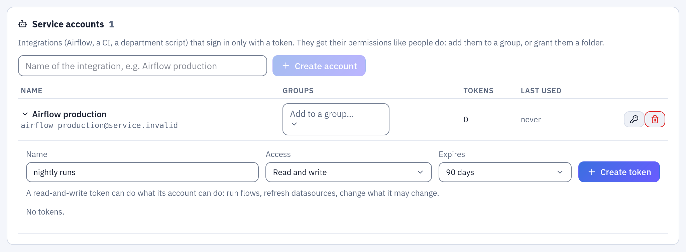
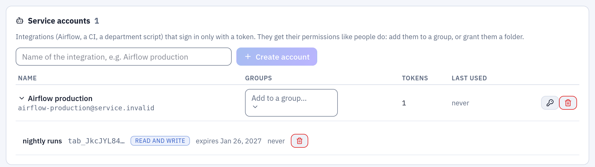

# Tabularia API

For whoever connects another system to Tabularia: a scheduler such as Airflow, a
CI job, a department script. Everything the interface does goes through this
API; the complete, always-current reference is the OpenAPI page the gateway
serves itself, at `https://<your host>/api/docs` (`http://localhost:8000/docs` in
development). This guide covers the part an integration needs and promises to
keep stable. The other integrations are listed in [Integrations](integrations/README.md).

## Signing in: API tokens

A script authenticates with a token in the `Authorization` header:

```bash
curl -H "Authorization: Bearer tab_…" https://tabularia.example.com/api/auth/me
```

Tokens start with `tab_`. They come in two kinds:

- **Personal tokens**, which anyone creates in **Settings → API tokens** for their
  own scripts. They act with that person's permissions. An administrator can turn
  them off for the whole installation (`AUTH__PERSONAL_TOKENS=false`): from then
  on, personal tokens already given out stop working too, while service account
  tokens keep working. Observer accounts (such as a shared demo guest) have no
  personal tokens: an account made an observer loses the ones it had, and a
  personal token never works for an account that is only an observer, however it
  became one (for example by losing its administrator role).
- **Service account tokens**, created by an administrator in **Administration →
  Service accounts**. A service account is an integration rather than a person: it has
  no password and cannot sign in through SSO. It gets permissions like anyone else,
  from the groups it belongs to and from the folders it is granted. Use one per
  integration, so that revoking one integration's access does not affect the others.

Every token has:

- **An access level.** *Read only* refuses every request that changes something
  (any method other than GET/HEAD/OPTIONS) with `403`; the two POSTs that only
  read, `POST /tasks/export` (with `POST /tasks/exports`) and `POST /tasks/preview`,
  are allowed. *Read and
  write* can do whatever its account can do. A token never adds permissions: it
  is at most as powerful as its account.
- **An expiry** of at most `AUTH__API_TOKEN_MAX_DAYS` days, one year by default.
- **A secret that is shown once**, at creation. Tabularia keeps only its SHA-256
  fingerprint and its first characters, so you can recognise it in a list.

Tokens are revoked from the same screens: the owner revokes their own, an
administrator revokes any token from **Administration → Service accounts → All API
tokens**. A revoked or expired token gets `401` on the next request, and so does
any token of a deleted account. Deactivating an account or setting a new password
for it revokes its tokens along with its sessions; reactivating the account does
not bring them back. Every action records in the audit log the name of the token
that did it, never the token itself. Tokens travel only in the header; one placed
in a cookie is ignored.

A token cannot create other tokens, create users, set passwords, reactivate an
account, or make an account an administrator or an observer (by its flag, a group's
flag or joining such a group). So revoking a leaked token is enough to close the
door: it cannot have left behind another way in. What it did with its permissions
stays done, as with any account: after revoking a leaked administrator token, look
in the audit log for the actions carrying its name (a webhook it created, a
schedule it changed).

## Example: a token for a scheduler

An external scheduler (Airflow, a CI job) runs the sample flow «Top 20 Products by
Revenue» every night. As an administrator:

1. **Administration → Service accounts**, name `Airflow production`, **Create account**.
   The account gets an address of its own (`airflow-production@service.invalid`) and
   no password.
2. Give it what the job needs, as to a person: **RUN** on `Sample / Flows`, where the
   flow is, and **EDIT** on `Sample / Private tables`, where its Output writes (in each
   folder's **Folder settings**, or through a group). Without EDIT there the run starts
   and then fails with «Missing 'edit' permission on folder …».
3. Open the account, name the token `nightly runs`, **Access** *Read and write*,
   **Expires** 90 days, **Create token**. Copy the secret now: it is shown once.



*A token is created on the account it acts as; its access and its expiry are chosen here.*



*After **Create token** the list keeps only the first characters of the token, to recognise it, and when it was last used.*

Then, from the scheduler (the flow's id is in its editor address, `/editor?flow=6`):

```bash
curl -X POST -H "Authorization: Bearer tab_…" \
  https://tabularia.example.com/api/flows/6/run-now
# 202 {"status": "started", "flow_id": 6, "run_id": 1318}

curl -H "Authorization: Bearer tab_…" https://tabularia.example.com/api/runs/1318
# {"id": 1318, "status": "SUCCESS", "flow_id": 6, "launched_by": 206, …}
```

The run appears in **Runs** started by `Airflow production`, and the audit log names the
token. To cut the job off, revoke the token: the next call gets `401`.

## Stable endpoints

The paths below are a contract: within a major version they keep their meaning
and their fields. New fields can appear, so ignore the ones you do not know.
Anything else in `/docs` may change between minor versions. Breaking changes are
announced in `CHANGELOG.md` one minor release in advance.

| What | Request | Notes |
|---|---|---|
| Who am I | `GET /auth/me` | the account behind the token |
| Folders | `GET /projects` | those you can see |
| Flows | `GET /flows`, `GET /flows/{id}` | |
| Run a flow | `POST /flows/{id}/run-now` | `202` with `{"run_id": …}`; `409` if it is already running. `?mode=production` uses the flow's production engine, as a schedule would |
| A run | `GET /runs/{id}` | `status`: `PENDING`, `STARTED`, `SUCCESS`, `FAILURE`; `error` when it failed |
| Runs | `GET /runs?q=…&status=…&limit=…&offset=…` | a page: `{"items": […], "total": n}` |
| Datasources | `GET /datasources` | each with `bucket` and `key`, which the export needs; `GET /datasources/{id}/runs` for its refreshes |
| Refresh a datasource | `POST /datasources/{id}/refresh` | `202` with the run; database datasources only |
| Export | `POST /tasks/export` | CSV (streamed) or Excel; see below |
| Download a report | `GET /reports/{id}/render?format=pdf&<parameter>=<value>` | the file, waited for; see [Download a report](#download-a-report) |
| Reports | `GET /reports`, `GET /reports/{id}/parameters` | those you can see; a report's parameters with their defaults and choices |
| Lineage | `GET /lineage` | the graph of flows, datasources, connections, scripts, SQL scripts, notebooks and flow groups; `?type=flow\|datasource\|connection\|script\|sql\|notebook\|group&id=…` centres it |

All paths are relative to the gateway: `https://<host>/api` behind the reference
ingress or compose file, `http://localhost:8000` in development.

### Recipes

Run a flow and wait for the result:

```python
import time, requests

API = "https://tabularia.example.com/api"
H = {"Authorization": "Bearer tab_…"}

run_id = requests.post(f"{API}/flows/42/run-now", headers=H).json()["run_id"]
while True:
    run = requests.get(f"{API}/runs/{run_id}", headers=H).json()
    if run["status"] in ("SUCCESS", "FAILURE"):
        break
    time.sleep(5)
if run["status"] == "FAILURE":
    raise SystemExit(run["error"])
```

Polling is fine for a script. For anything long-lived, have Tabularia call you
instead (webhooks, below).

Refresh a database datasource:

```bash
curl -X POST -H "Authorization: Bearer tab_…" https://tabularia.example.com/api/datasources/7/refresh
# 202 {"id": 1234, "status": "PENDING", …}: then GET /runs/1234 as above
```

Download a datasource as CSV:

```python
ds = next(d for d in requests.get(f"{API}/datasources", headers=H).json() if d["id"] == 7)
body = {"bucket": ds["bucket"], "input_key": ds["key"], "operations": [], "format": "csv", "filename": f"{ds['name']}.csv"}
with requests.post(f"{API}/tasks/export", headers=H, json=body, stream=True) as r:
    r.raise_for_status()
    with open(body["filename"], "wb") as f:
        for chunk in r.iter_content(1 << 20):
            f.write(chunk)
```

CSV exports stop at `EXPORT__MAX_ROWS` (5,000,000 rows by default) and Excel
exports at 1,048,575 rows; the response says so instead of cutting silently.

A worker writes the file, and `POST /tasks/export` keeps the request open until it
has. For a long export, start it and come back for it instead, as the web app does:
`POST /tasks/exports` with the same body answers `{"task_id": …}`;
`GET /tasks/exports/{task_id}` says `running`, `ready` or `failed` (with `detail`);
once ready, `GET /tasks/exports/{task_id}/file` sends the file, once: it is deleted
as soon as it has been sent, and one never taken is deleted after an hour. Only the
account that started an export can see it.

### Errors

| Code | Meaning |
|---|---|
| `401` | no token, unknown token, expired or revoked token, deactivated account |
| `403` | the account lacks the permission, or the token is read only |
| `404` | not found, or not visible to this account |
| `409` | conflict: the flow is already running, the datasource is already refreshing |
| `422` | the request is malformed: the body says which field |

Error bodies are JSON with a `detail` field. Its language follows the
`Accept-Language` header where a translation exists.

## Download a report

A pixel-perfect report (a page designed in **Reports**, kept in a folder) can be
downloaded from any script, with its parameters, as the web app renders it:

```
GET /reports/{id}/render?format=pdf&region=North&since=2026-09-01
```

- **`format`**: `pdf` (the default), `xlsx` (the report's tables, groups and subtotals as
  rows) or `html` (the summary an email carries, as an `.mhtml` file: the HTML with its
  charts as images).
- **The parameters** go in the query string by name. A parameter that takes several values
  repeats its name: `?region=North&region=South`. One left out takes the report's default.
  A value is text, as typed in the report's form: a number with a dot for decimals
  (`1234.5`), a date as `yyyy-mm-dd`, `true` or `false`. A date may also be a
  [placeholder](placeholders.md), resolved in the report's time zone when it is rendered:
  `since={start_of_month-1m}` is the first day of last month.
- **The token**: *read only* is enough. The report reads with the rights of the token's
  account: it needs **VIEW** on the report's folder, and every dataset the report reads
  must be one that account may read (the datasources, the views, the SQL scripts, and
  **CONNECT** on a database connection).
- **The answer** is the file, with its name in `Content-Disposition` (`Monthly sales.pdf`).
  The request stays open while a worker renders it, up to `REPORTS__API_WAIT_SECONDS`
  (120 seconds by default); past that the render is stopped. Every download is in the
  audit log (`report.render`, from `api`).

The report's id is in its address (`/report?id=12`), and **Copy API link** in the
report's toolbar gives the address with the values on screen. `GET /reports` lists the
reports the account sees; `GET /reports/{id}/parameters` lists a report's parameters, with
their types, their defaults as they read today and their choices.

### Example: last month's PDF, every month

A script run on the first of each month downloads the PDF of the month before for one
region. As an administrator, create a service account (see
[Example: a token for a scheduler](#example-a-token-for-a-scheduler)) with **VIEW** on the
report's folder and on the data it reads, and give it a token with access *Read only*.
The report here has the parameters `region` (text) and `since` and `until` (dates):

```python
import datetime as dt
import os

import requests

API = "https://tabularia.example.com/api"
TOKEN = os.environ["TABULARIA_TOKEN"]  # never in the script itself
REPORT_ID = 12

first_of_this_month = dt.date.today().replace(day=1)
last_day = first_of_this_month - dt.timedelta(days=1)
first_day = last_day.replace(day=1)

response = requests.get(
    f"{API}/reports/{REPORT_ID}/render",
    params={"format": "pdf", "region": "North", "since": first_day.isoformat(), "until": last_day.isoformat()},
    headers={"Authorization": f"Bearer {TOKEN}"},
    timeout=180,  # longer than REPORTS__API_WAIT_SECONDS
)
if response.status_code == 400:
    detail = response.json()["detail"]
    raise SystemExit(f"{detail['parameter']}: {detail['message']}")
response.raise_for_status()
with open(f"sales_north_{first_day:%Y-%m}.pdf", "wb") as f:
    f.write(response.content)
```

The same with curl, two regions in Excel; `-G` with `--data-urlencode` puts the values in
the query string, encoded:

```bash
curl -fG -H "Authorization: Bearer $TABULARIA_TOKEN" -o sales.xlsx \
  --data-urlencode format=xlsx --data-urlencode region=North --data-urlencode region=South \
  --data-urlencode "since={start_of_month-1m}" \
  https://tabularia.example.com/api/reports/12/render
```

### When it fails

| Code | Meaning |
|---|---|
| `400` | a value does not fit a parameter: `{"detail": {"message": "Parameter «since»: '2026-02-30' is not a date: write it as yyyy-mm-dd", "parameter": "since"}}`. The same for a required parameter without a value, a value outside its choices, a name the report does not have |
| `404` | no report with that id, or one in a folder the account cannot see |
| `422` | the report cannot be rendered: a dataset the account may not read, said with its name as one that does not exist (`The dataset «orders»: there is no datasource «Salaries» you can read`), a dataset over the row limit (`REPORTS__MAX_ROWS`, 10,000 by default: aggregate in SQL, or filter), too many pages |
| `502` | the engine could not render it (the chart service down, for a report with charts) |
| `504` | not ready within `REPORTS__API_WAIT_SECONDS`: the render was stopped |

To send a report by email instead, on a schedule and right after the data is refreshed,
put it in the [Pushmail cell of a flow group](pushmail.md#reports). In a marimo notebook,
[`tabularia.report()`](capabilities/notebooks.md#reports) does the same as this API.

## Webhooks

Instead of polling, an administrator can have Tabularia call an address when
something finishes (**Administration → Webhooks**).

### Events

| Event | When |
|---|---|
| `flow.run.succeeded` / `flow.run.failed` | a flow execution finished: from a schedule, from **Run** in the interface, from `run-now`, or inside a flow group (the group itself sends no event). A run closed because its process died, because the gateway shut down, or because it waited in the queue too long is a `flow.run.failed` too |
| `datasource.refresh.succeeded` / `datasource.refresh.failed` | the refresh of a database datasource finished |
| `ping` | the **Send a test call** button |

A webhook can be limited to one folder and its subfolders.

### The call

A `POST` with a JSON body:

```json
{
  "id": "5f0c1c8e-8a2e-4b8f-9a55-2a8f4b1d2c3e",
  "event": "flow.run.failed",
  "created_at": "2026-10-12T08:30:12.401Z",
  "data": {
    "run": {
      "id": 2212, "kind": "orchestration", "status": "FAILURE", "trigger": "schedule",
      "started_at": "2026-10-12T08:29:50.112Z", "finished_at": "2026-10-12T08:30:11.700Z",
      "duration_seconds": 21.6, "rows_written": null, "error": "ClickHouse: no response from …"
    },
    "flow": {"id": 14, "name": "Margin by Category and Month"},
    "folder": {"id": 3, "name": "Reports"}
  }
}
```

For datasource events, `data` carries `datasource` in place of `flow`. Headers:

| Header | |
|---|---|
| `X-Tabularia-Event` | the event |
| `X-Tabularia-Delivery` | the delivery id, the same as `id` in the body |
| `X-Tabularia-Signature` | `t=<unix seconds>,v1=<hex HMAC-SHA256>` |

### Verifying the signature

Each webhook has a secret (`whsec_…`), shown when it is created or regenerated.
`v1` is the HMAC-SHA256 of `"<t>.<raw body>"` keyed with that secret. Check it
against the **raw** body, before parsing it, and reject old timestamps:

```python
import hashlib, hmac, time

def verify(secret: str, raw_body: bytes, header: str, tolerance: int = 300) -> bool:
    parts = dict(p.split("=", 1) for p in header.split(","))
    t, v1 = parts.get("t", ""), parts.get("v1", "")
    expected = hmac.new(secret.encode(), f"{t}.".encode() + raw_body, hashlib.sha256).hexdigest()
    return hmac.compare_digest(expected, v1) and abs(time.time() - int(t)) <= tolerance
```

Regenerating the secret takes effect at once, including for calls already queued.

### Delivery

- **Any 2xx answer counts as delivered.** Anything else, or no answer within
  `WEBHOOKS__TIMEOUT_SECONDS` (10), is retried after 30 s, 2 min, 10 min, 1 h and
  6 h; after the sixth attempt the delivery is marked failed. Redirects are not
  followed, and only the first few kilobytes of the answer are read.
- **At least once.** A call can, rarely, arrive twice: deduplicate on
  `X-Tabularia-Delivery`. A delivery sent again by hand from the history gets a new id.
- **Order is not guaranteed** across events: use `created_at` and the run's
  `finished_at`.
- **One slow receiver does not hold up the others.** Each Tabularia process keeps
  up to 16 calls in flight, at most 2 of them to the same webhook, and starts the
  next as soon as one finishes. A webhook whose receiver is down retries on its own
  schedule while the others go out as usual.
- **HTTPS.** The certificate is checked against the name in the URL. Tabularia
  trusts the usual public certificate authorities; for a receiver with a
  certificate from your company's own authority, give the gateway its bundle with
  `SSL_CERT_FILE` (or `SSL_CERT_DIR`).
- **Allowed addresses.** Only `http`/`https`. Never loopback, link-local
  (including the cloud metadata address 169.254.169.254), multicast or reserved
  addresses, nor the other clouds' metadata addresses (100.100.100.200,
  168.63.129.16, fd00:ec2::254). The name is resolved on every call, checked, and
  the connection goes to the address that was checked, so a name cannot resolve to
  something else in between. Private networks are allowed, since an integration on
  the same network is the normal case. A forbidden address fails at once and is not
  retried; a name that does not resolve is retried like any other failure. An
  address that cannot be read (`http://0177.0.0.1/`, an empty label, a port above
  65535) is refused when the webhook is saved.
- **The history** of every call (status, attempts, HTTP code, error, the body
  sent) is kept for `WEBHOOKS__RETENTION_DAYS` (30) and shown under each webhook,
  where a call can be sent again.
