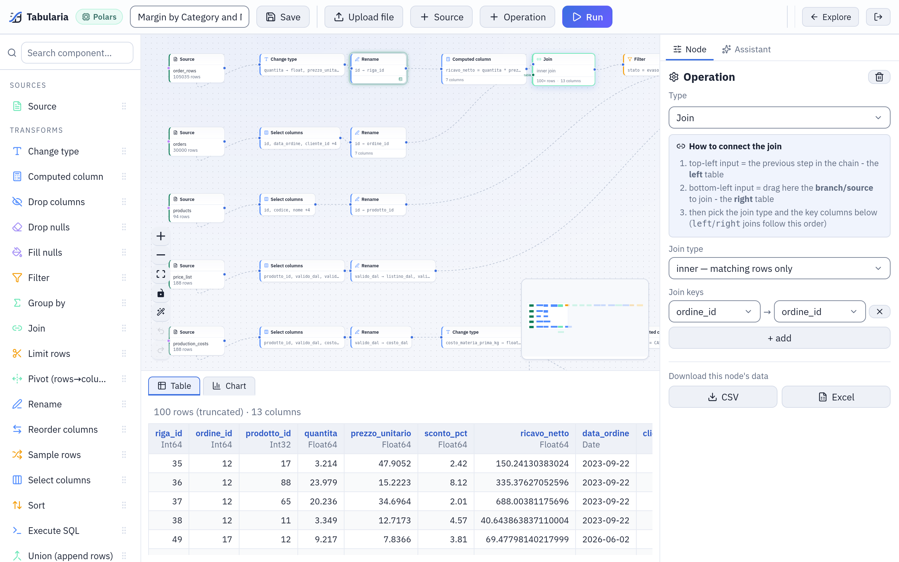

# Capabilities

What Tabularia does, one capability per page: preparing data on a canvas, analysing it,
asking it questions, printing it as reports, running Python, R, SQL and container images
on it, chaining and scheduling the work, and choosing where it is computed. Each page
says where the feature is in the interface, how it works, who may use it and what it
does not do, with an example on the sample data of the Docker Compose stack.

*The flow editor, where most of the work starts: the sample flow «Margin by Category and Month» with the selected step's rows below.*

## The map

### Prepare and analyse

| Capability | What it gives you | Page |
|---|---|---|
| Low-code flows | A pipeline drawn on a canvas: sources, 19 transformations and a loop, outputs, each step previewed on the whole table | [Flows](flows.md) |
| Preview and analysis | The data of every step as a table or a chart, the Viewer with filters, computed fields and pivots, saved views, CSV and Excel downloads | [Preview and analysis](preview-and-analysis.md) |
| Ask your data | Questions in plain language over the datasources you may read, answered with the query and the table behind the numbers | [Ask your data](ask-your-data.md) |
| Pixel-perfect reports | Paginated reports designed in the browser: bands in millimetres, tables grouped with subtotals over many pages, 14 kinds of chart and KPI cards, parameters; read on screen, downloaded as PDF or Excel, sent by email | [Reports](reports.md), [functions](report-functions.md) |

### Code and containers

| Capability | What it gives you | Page |
|---|---|---|
| Python and R | Code in environments an administrator defines, run as Kubernetes Jobs, as a step of a flow or as a saved script | [Python and R](../scripting.md) |
| SQL scripts | SQL kept in a folder with its versions, run on the catalogue or on a database connection, exported or written into a datasource | [SQL scripts](../sql-scripts.md) |
| marimo notebooks | Notebooks written in marimo's editor, kept in a folder and opened as web apps that read the datasources with their author's rights | [marimo notebooks as apps](notebooks.md) |
| Docker images in flows | Your own images, from the registries an administrator grants, run as a step of a flow with its input and output | [The Container node](../container-node.md) |

### Orchestrate

| Capability | What it gives you | Page |
|---|---|---|
| Flow groups | Flows, refreshes, scripts, images and emails in steps: the cells of a step in parallel, the steps in order | [Flow groups](flow-groups.md) |
| Scheduling | Flows, datasource refreshes, scripts and flow groups on a cron, in the installation's time zone, with an email when a scheduled flow fails | [Scheduling](scheduling.md) |
| Dynamic dates | File names, folders, API calls and outputs with dates that move by themselves (`{yesterday:yyyyMMdd}`) and ranges of days | [Placeholders](../placeholders.md) |
| Pushmail | Datasources sent by email as Excel files, and reports as PDF or Excel with their summary in the message, as a step of a flow group | [Pushmail](../pushmail.md) |

### Where it runs, and where it goes

| Capability | What it gives you | Page |
|---|---|---|
| Engines | The same flow on Polars, DuckDB, chDB, an external ClickHouse or BigQuery, one engine for design and another for production | [Engines](engines.md) |
| Export to dbt | A flow as a dbt project: models, sources, tests from the data contract, ready for your repository | [Export to dbt](../dbt-export.md) |

## Common ground

A few things hold for every capability above.

- **Everything lives in folders.** Flows, datasources, saved views, scripts, SQL
  scripts, notebooks, reports, flow groups and connections are objects in a folder, and the folder's
  permissions decide who sees, runs, edits or connects: VIEW, RUN, EDIT, MANAGE and
  CONNECT ([Permissions](../governance/permissions.md)).
- **Datasources are the shared currency.** Flows read datasources and publish new ones;
  the Viewer, the assistant, SQL scripts and flow groups read the same catalogue. Where
  data comes from is in [Sources](../sources/README.md), where it can go in
  [Destinations](../connections/destinations.md).
- **The whole table, unless you ask otherwise.** Previews, charts and runs read every
  row. A development sample, per source node, is the explicit exception, and it never
  reaches a scheduled run.
- **Everything is recorded.** Runs keep their history, objects keep their versions, and
  saves, runs, exports and permission changes go to the audit log.
- **Kubernetes for code.** Python, R, notebooks and container images run as Kubernetes
  Jobs: on a Docker Compose installation those features are shown greyed out with the
  reason.
- **AI is optional.** The assistants need a model configured by an administrator
  ([AI in Tabularia](../integrations/ai.md)); without one, nothing else changes.
