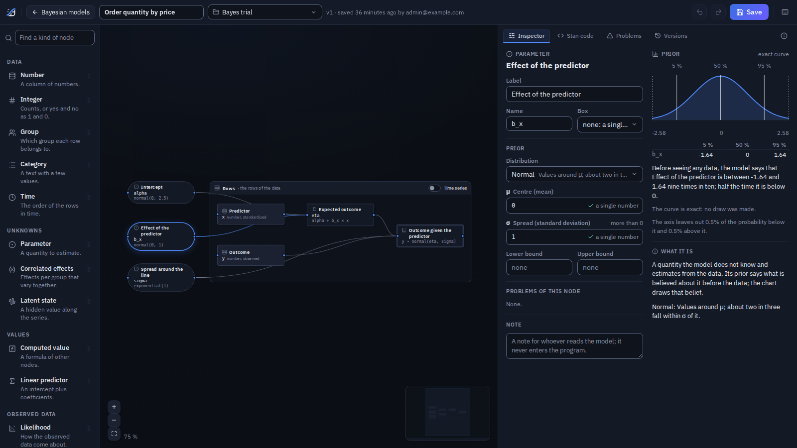
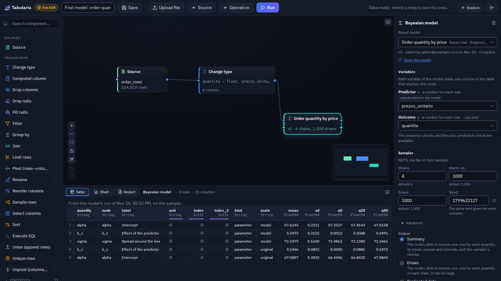
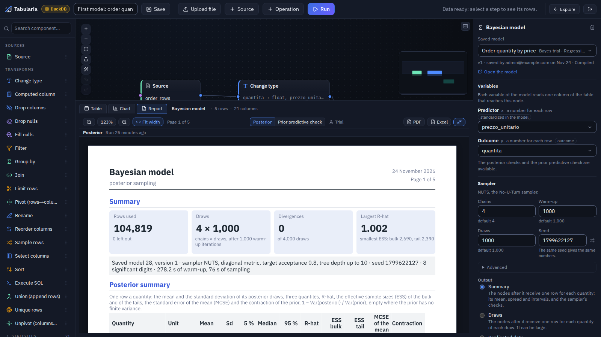
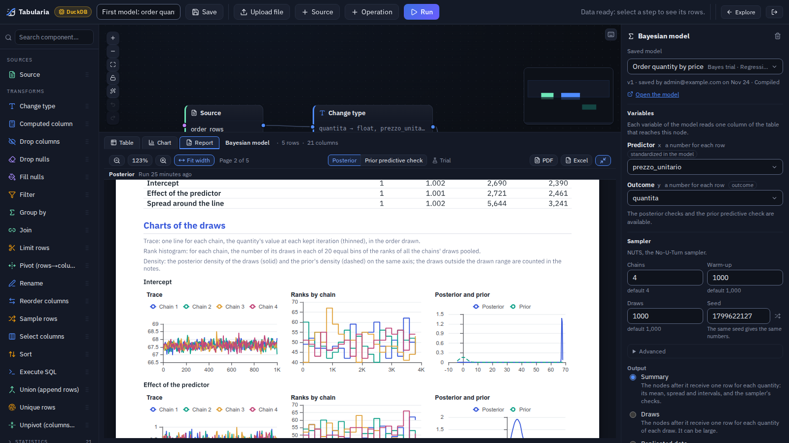

<!--  GitHub Pages: no Liquid in this page -->
# Bayesian models

A Bayesian model says how your data could have come about: the quantities you do not know, what you think of each of them
before looking, and how they produce the rows you observe. In Tabularia you **draw that model as a graph** in a space of its
own, **Bayesian models**: data, parameters with their priors, a likelihood, boxes for the groups of a hierarchical model.
Tabularia writes the Stan program from the drawing and shows it, read only. A node of a flow, **Bayesian model**, binds the
model's data variables to the columns of its input, samples the model with Stan and returns the draws of the posterior of
every unknown, with a report that gives the sampler's measures and facts and draws the predictive checks as charts.

It runs on Kubernetes only, as a Job in a group an administrator enabled (Stan's compiler and sampler are not in the Docker
Compose stack), and the Job has **no internet access** at run time. The space is not offered where the group is not usable.
How an administrator turns the group on, sizes a run and empties the cache of compiled models is at the end of this page,
in [For administrators](#for-administrators).

## At a glance

| | |
|---|---|
| Where | **Bayesian models**, in the **Scripting** menu of the top bar (`g` then `y` on the keyboard), to draw and save a model; the node **Bayesian model**, in the **Models** section of the flow editor's palette, to run it |
| Who may use it | Whoever may use the group (everyone who can edit flows, or the user groups the administrator chose; administrators always can) and has VIEW on the model's folder to see a model, EDIT to change it, RUN to run it; the right to run is checked at every run, with the authority of the person who ran the flow or of the schedule's author |
| What it needs | An administrator who enabled the group **Bayesian models** (Administration → Statistical models), Kubernetes, and a table in the flow with a column for every data variable of the model |
| What it makes | The summary of every quantity (mean, standard deviation, quantiles, R-hat, effective sample sizes, the standard error of the mean, the contraction of the prior), or the draws, or replicated data, as the node's output; a report on screen, in PDF and in Excel; optionally a record in MLflow |
| What it never does | Rate a result: every diagnostic is a measure or a fact, and the predictive checks are charts with no p-value, no probability and no share. It does not predict new rows, compare models, take hand-written Stan code, or give the draws to MLflow ([What is not in this release](#what-is-not-in-this-release)) |

## Your first model

This example draws a linear regression from a template, saves it, runs it in a flow and reads its report. It uses the sample
data of the Docker Compose stack, loaded in a Kubernetes installation as the [Statistical
models](models.md#the-models) page says: `order_rows`, with the columns `quantita` (the outcome) and `prezzo_unitario` (the
predictor). In the Docker Compose stack they are stored as text; in a Kubernetes installation they may already be numbers.

1. Open **Scripting → Bayesian models** and press **New model**. Choose the folder it goes in (you need EDIT on it).
2. In **Where do you start?** choose **Linear regression**. The template asks for the outcome's typical value and its typical
   spread: you write them from what you know, they are never read from the data, and left empty they are 0 and 1. The model
   opens on the canvas.
3. Click the node **Effect of the predictor**: the inspector shows its prior, `normal(0, 2.5)`, with its chart beside the
   numbers. Change a number and the chart changes while you type ([Priors](#priors)).
4. Give the model a name and press **Save** (Ctrl+S, or ⌘+S on a Mac). It becomes version 1, its Stan program is stored with
   it, and Tabularia compiles it in the background (about 10 to 30 seconds).

   

5. In a flow, add `order_rows` as a source. If the source's preview shows `quantita` and `prezzo_unitario` as text (as in
   the Docker Compose stack), add a **Change type** of the two to *decimal* (a number variable takes only a numeric column); if
   it shows them as numbers, as on a Kubernetes installation that loaded them so, skip it. Then drop **Bayesian model** from the **Models** section of the palette after it, and
   in its panel choose your saved model. Under **Variables**, bind **Outcome** to `quantita` and **Predictor** to
   `prezzo_unitario`. A Run in the panel reads the flow's development sample; a flow run reads every row of the input, up to the
   group's limit, so keep a large table down with a filter first ([Limits](#limits-and-what-it-refuses)).

   

6. Press **Run**. If the model is still compiling, the step says so and waits. When it ends, open the **Report** tab: the first
   page gives the rows used and left out, the draws and the sampler's facts, then the summary of each quantity. The
   predictor was standardized, so its coefficient is per standard deviation of the predictor and the table also gives it on the
   column's own scale ([Reading the report](#reading-the-report)).
   With no development sample set on the source, the panel's Run reads every row: on the 104,819 rows of `order_rows` it took
   5 minutes 30 seconds on the three-node test cluster. To read fewer rows, open the source and set a **Development sample**
   (**first N rows** or **random %**), which the panel's Run uses and a flow run does not, or add **Upstream filters**, which
   every run applies.

   

7. Before or after, press **Run the prior predictive check** in the node's panel: it draws data sets from the priors alone and the
   report shows them as charts beside your data ([Trying the model](#trying-the-model)).

## Drawing a model

**Bayesian models** opens the list of the models you may see: name, folder, family, version, how many flows use it, the state
of its compile, the last save. **New model** opens the editor on an empty canvas with the templates' gallery; a name in the
list opens a saved model on its current version.

The editor has the palette at the left, the canvas in the middle and a side panel at the right with the tabs **Inspector**,
**Stan code**, **Problems**, **Assistant** (only where the installation has an AI model you may use), **Versions** and, with the
information icon, a **Glossary** of the model's words in two sentences each.

### The kinds of node

| Group of the palette | Kind | What it is |
|---|---|---|
| Data | **Number**, **Integer**, **Group**, **Category**, **Time** | A column of the table the flow node binds: numbers; counts or 0 and 1; which group each row belongs to; a text with a few values; the order of the rows in time. On the canvas, a filled rectangle |
| Unknowns | **Parameter** | A quantity to estimate, with its prior. On the canvas, a pill |
| Unknowns | **Correlated effects** | Several effects per group, such as a level and a slope, that vary together; their correlation has its own prior |
| Unknowns | **Latent state** | A hidden value that moves along a series |
| Values | **Computed value** | A formula of other nodes |
| Values | **Linear predictor** | An intercept plus a coefficient times each predictor |
| Observed data | **Likelihood** | How the observed data come about from the other nodes: the node that ties the model to the rows |
| Boxes | **Group box** | Repeats what it holds once for each group |

The **Rows** box is part of every model and stays: one unit per row of the data the flow node binds. The data, the values
computed for each row and the likelihood sit in it. Drag a kind onto the canvas, or press **N** to move to the palette, on
its first kind, where Enter adds the kind you are on in the selected box. A link is drawn from the fields: a node uses another by writing its name in a slot (or choosing it in the
node's menu, **Link to another node…**); the canvas draws the links, it does not store them.

### Names, labels and notes

A node has a **name**, used in expressions and in the Stan program, a **label**, free text for people, and a **note** that never
enters the program. A name has lower-case letters, digits and `_`, starts with a letter, is at most 40 bytes, does not end in `__`
and is not a name Stan or its compiler keeps for itself. A node without a usable name is still valid: the program writes a
generated identifier for it, and the **Names in the code** table of the Stan code tab says which ([The Stan
program](#the-stan-program)). A label never enters the code.

### The inspector, the findings and the keyboard

The inspector of a node has its fields, a short explanation of what the kind is, and for a parameter its prior with the chart
beside the numbers. Every field that takes a number takes an expression ([Expressions](#the-free-models-expressions)), checked
as you type in your browser; the gateway reads the whole graph at the save and, while the **Stan code** tab is open, 600 ms after
the last change that leaves no error. The **Problems** tab lists
what the check finds, each with a button that shows the node: an **error** keeps the model from being saved, a **warning**
blocks nothing and says what the model will do.

Everything is reachable from the keyboard:

| Action | PC | Mac |
|---|---|---|
| Into the nodes, then select one | Tab, Enter | Tab, Enter |
| The nearest node in a direction | Alt + arrow | Alt + arrow |
| Move the selected node or box | Shift + arrow | Shift + arrow |
| To the palette, to add a node | N | N |
| The selected node's commands | M, or Shift + F10 | M |
| Remove the selected node, box or link | Delete, Backspace | Backspace |
| Duplicate the selected node | Ctrl + D | ⌘ + D |
| Undo, redo | Ctrl + Z, Ctrl + Y or Ctrl + Shift + Z | ⌘ + Z, ⌘ + Shift + Z |
| Save a new version | Ctrl + S | ⌘ + S |
| Zoom in, zoom out, fit the model | +, −, 0 | +, −, 0 |
| The tabs of the side panel | `,` and `.` | `,` and `.` |
| From a field back to its node | Esc | Esc |
| The list of keys | ? | ? |

Undo and redo take back and bring back the editor's steps, one for each change, whatever made it (a field, a move, a template,
what the assistant proposed and you applied).

## Priors

A **prior** says what you believe about a quantity before the data. The inspector of a parameter shows the prior's distribution
and its arguments, each an expression, and **beside them the chart of the prior**, drawn in your browser while you type: no
request is made and no data is read. When every argument is a constant the chart is the exact curve of the density. When an
argument is itself a parameter with a prior (a hierarchy), the chart is the histogram of 4,000 draws made in the model's order:
first the quantities the prior depends on, then the quantity from them. A text under the chart says it in numbers: «Before
seeing any data, the model says that the quantity is between a low and a high value nine times in ten; half the time it is below
the median». **Draw again** changes the seed of the draws. A prior with bounds is cut to them. Where an argument has an error the
chart keeps the last valid form, dimmed, with the name of the argument to fix.

A prior never depends on data: the model's space holds no data. A group's units are drawn as one unit, since before the data they
are exchangeable. A node that depends on data (the linear predictor, the likelihood) has no chart; the prior predictive check,
run from the flow node, is where they are seen.

### Standardized predictors

A **number** data node that is a predictor is **standardized** by default: the flow node takes its mean off and divides it by its
standard deviation before sampling, and the model's coefficient for it is the change of the linear predictor **per standard
deviation of the predictor**. The outcome, integers, groups and categories are not standardized. The report gives the mean and
the standard deviation each predictor was standardized with, and, for the coefficients of a **linear predictor** node, the
coefficient on both scales ([Reading the report](#reading-the-report)). A formula you write in a free expression stays on the
standardized scale.

### What a default says, and where it comes from

The templates' priors are on the scale of the standardized predictors and are never changed by the data. The panel of each node
says what the node is and quotes its default with its source, in the words of the table below; the defaults are the numbers of
two public documents, or Tabularia's own choice where those give none.

| Prior | Default | Source |
|---|---|---|
| The intercept of a numeric outcome | `normal(m, 2.5·s)`, `m` and `s` the typical value and spread you wrote when you opened the template | the documentation of the rstanarm package, «Prior Distributions for rstanarm Models» |
| A coefficient of a standardized predictor | `normal(0, 2.5·s)` (`s` is 1 for the logit and log links) | the same page |
| The intercept with a logit or log link | `normal(0, 2.5)` | the same page |
| The spread around the line | `exponential(1/s)` | the same page |
| The spread between the groups | `normal(0, s)` cut at 0 | the Stan wiki, «Prior Choice Recommendations» |
| The extra variation of a negative binomial count | `inv_gamma(0.4, 0.3)` | the same wiki page |
| The correlation of correlated effects | LKJ with η = 2 | the same wiki page |
| The weights of the past values of an AR model | `normal(0, 0.5)` each (stationarity is not imposed) | Tabularia's choice |
| A random walk's drift | `normal(0, s)` | Tabularia's choice |
| A local level's first value | `normal(m, 2.5·s)` | as the intercept |

The two pages are <https://mc-stan.org/rstanarm/articles/priors.html> and
<https://github.com/stan-dev/stan/wiki/Prior-Choice-Recommendations>. After opening a template the numbers are yours to change in
the inspector.

### The ten templates

| Template | Family | What it is for |
|---|---|---|
| Linear regression (`glm_linear`) | regression | A numeric outcome that moves along a straight line with a predictor |
| Logistic regression (`glm_logistic`) | regression | A yes or no outcome whose probability depends on a predictor |
| Poisson regression (`glm_poisson`) | regression | A count whose average depends on a predictor |
| Negative binomial regression (`glm_negbin`) | regression | A count that varies more than its average says, depending on a predictor |
| Varying intercepts by group (`hier_intercepts`) | hierarchical | A numeric outcome with a level of its own for each group |
| Varying intercepts and slopes by group (`hier_slopes`) | hierarchical | A level and the effect of a predictor that change from group to group, together |
| Nested groups (`hier_nested`) | hierarchical | A level for each group inside a larger group, such as schools in districts |
| Series from its own past values (`ts_ar`) | series | A series explained by its past values; you choose the order p |
| Random walk with drift (`ts_random_walk`) | series | A series that moves step by step from its last value, with a steady tendency |
| Hidden level that drifts (`ts_local_level`) | series | A series around a hidden level that changes over time, measured with noise |

A template, once opened, is a graph like any other. The **Empty model** is the free model: a canvas with no node. The model's
family in the list is derived from the saved graph: group boxes make it hierarchical, rows that are a series make it a series, a
linear predictor with a generalized-linear likelihood makes it a regression, anything else is free-form.

### The distributions

A prior or a likelihood takes its distribution from the catalogue below. A distribution marked as internal is used by the
programs Tabularia writes (the non-centred form, the correlated effects) and is not one you choose.

| Distribution | Arguments | Values it takes | Where it goes |
|---|---|---|---|
| `normal` | `mu`, `sigma` | any number | a prior, or the likelihood of a numeric outcome |
| `student_t` | `nu`, `mu`, `sigma` | any number | a prior |
| `cauchy` | `mu`, `sigma` | any number | a prior |
| `exponential` | `beta` (the rate) | positive numbers | a prior |
| `gamma` | `alpha` (shape), `beta` (rate) | positive numbers | a prior |
| `inv_gamma` | `alpha` (shape), `beta` (scale) | positive numbers | a prior |
| `lognormal` | `mu`, `sigma` | positive numbers | a prior |
| `beta` | `alpha`, `beta` | between 0 and 1 | a prior |
| `uniform` | `alpha`, `beta` (two constants, `alpha` below `beta`) | between `alpha` and `beta` | a prior |
| `lkj_corr_cholesky` | `eta` (a constant) | the Cholesky factors of correlation matrices | the prior of the correlation of a correlated-effects node |
| `multi_normal_cholesky` | `mu`, `L` | a vector | internal: the centred form of correlated effects |
| `std_normal` | none | any number | internal: the non-centred form |
| `bernoulli_logit` | `alpha` (the log-odds) | 0 or 1 | the likelihood of a yes or no outcome |
| `binomial_logit` | `N` (data), `alpha` (the log-odds) | 0 to `N` | the likelihood of a count out of `N` |
| `poisson_log` | `alpha` (the log of the rate) | counts: 0, 1, 2… | the likelihood of a count |
| `neg_binomial_2_log` | `eta` (the log of the mean), `phi` (the precision) | counts: 0, 1, 2… | the likelihood of a count that varies more than a Poisson one; it cannot be truncated |

A parameter may have **bounds** (a lower, an upper, or both); the prior is cut to them and values outside have no probability. A
parameter with bounds on a non-centred group box stays centred, and its node says so.

## Hierarchical models

When rows fall in groups (pupils in schools, orders in stores), a **Group box** repeats what it holds once for each group. A box
inside another box is a nested group (schools inside districts). The units of a box are the distinct values of the column bound
to its **Group** data node, in text order, and the flow node says how many there are at the run. A group may have its own
quantities (a parameter inside the box has one value per unit), and an expression reaches the unit's value of a row with the
group's name in brackets: `mu_school[school]`.

Each box has a switch between two ways of writing the same model:

- **Non-centred** (the default): the sampler moves on the standardized scale of the groups, and the program gives back each
  group's value as it is. It is the form people usually choose when the groups have few rows each.
- **Centred**: the sampler moves on the values of the groups themselves, as their prior writes them.

The two forms describe the same model. The report's facts (the divergences' count, the tree depths, the sampler's measures) tell
what a run did, and what people usually try when a run shows divergent transitions is the other form; the report never says which
form is right. **Correlated effects** puts several effects on the box (a level and a slope, up to 10 components) and an LKJ prior
on their correlation.

## Series

A **Time** data node, bound to a date or a number, gives the rows an order: the Rows box becomes a **time series**, with an
option to have **one series for each value** of a group column. The flow node sorts the rows by the group and the time, and the
run is refused when a unit has two rows at the same time. Two things use the order:

- `lag(x, k)` in an expression is the value of `x` k rows earlier in the series, k from 1 to 60. The first k rows of each series
  have none; in the AR template they stay out of the likelihood, and the template says so.
- A **Latent state** is a hidden value that starts from its prior and moves by a normal step at each row (a random walk), the
  data being measured around it. Its first value and the scale of its steps have priors.

The three series templates use them. A prior chart for a state shows its first value and its scale; the later values spread
further with the series' length, which the model's space does not know.

## The free model's expressions

Every field that takes a value takes an **expression**: a number, the name of a node, or a formula.

| Form | Example |
|---|---|
| A number | `2.5`, `1e-3` |
| A node's name | `sigma` |
| Arithmetic | `+`, `-`, `*`, `/`, `^` and brackets: `alpha + b_x * x` |
| A function | `exp`, `log`, `log1p`, `expm1`, `sqrt`, `square`, `inv_logit`, `logit`, `log1p_exp`, `log_inv_logit` |
| The unit of a group for each row | `mu_school[school]` |
| A past value in a series | `lag(y, 2)` |

`^` is the power, `-a ^ 2` is minus the square of `a`, and `*` and `/` act on a value per row and a value per unit alike: the
editor chooses the elementwise form. The names in an expression are the nodes' names. A quantity that belongs to a box is written with the group's name when it is
used on the rows, and the error says how («`mu_school` is per school: write `mu_school[school]`»).

What it refuses, each with a message that says what to write instead: a character that is not ASCII (a look-alike such as a
typographic minus is named, with the character meant), strings, comments, `;`, `=`, `~`, comparisons, blocks, `**`, `%`,
functions of your own, an upper-case name, a number such as `1.` or `.5` or `2i`. The limits are in
[Limits](#limits-and-what-it-refuses). An expression is read by one parser, the gateway's: the editor's copy only gives feedback
while you type. The Stan text of an expression is written from its parsed form, never from your text.

## The Stan program

The **Stan code** tab shows the program Tabularia writes from the graph, **read only** (there is no way to edit it: [What is not
in this release](#what-is-not-in-this-release)). It comes from the gateway, which asks for it when the tab opens and 600 ms
after a change, and shows the program's sha256 with buttons to copy the program and the hash. Under it, **Names in the code**
lists each name of the graph, its label and what it is, and the identifier the program writes; choose a row to see its node on
the canvas and the lines that use it (Up and Down walk the rows, Esc leaves the code).

While the graph has an error there is no program for the changes: the tab shows the last saved version's program, with a notice,
as the flows that pin that version run it. **A saved version's program is stored with it and never written again**: a flow runs
the program the version saved, even after Tabularia is updated.

## Saving, versions and sharing

**Save** writes a new version. A graph with an **error** is not saved (the findings are listed and nothing is written); warnings
never stop a save. A save that changes nothing writes no version. Each version keeps the graph, its Stan program, the program's
sha256 and the names table, and versions are never removed. When you save, the version's program is compiled in the background
and the list says where it stands:

| State | Meaning |
|---|---|
| Compiled the first time it runs | No compiled copy exists yet: the first run compiles it |
| Waiting to compile | Another compile is running; the number that may run at once is an administrator's setting |
| Compiling | Usually 10 to 30 seconds |
| Compiled | Kept in the cache for the group's current image |
| Compile failed | The program did not compile; the detail says why (when the compiler refused the program Tabularia wrote, it is a fault of Tabularia, not of the model, and the administrator's log says where) |
| Too long to compile | It passed the limit of the compile; it is not tried again with that limit |

A compile that does not finish never stops a save, and a run compiles first when it finds none. The **Versions** tab lists the
versions: **Open** shows one read only (a banner says so), **Restore** copies an older version, graph and program as they were
stored, into a new version. If someone saved a newer version while you were editing, the save is refused with **Reload**, which
puts their version on the canvas; your graph stays in the history and Undo brings it back.

In the list, a model's **More actions** rename it, move it to another folder (EDIT on both), duplicate it or delete it. **Delete**
is refused while a flow pins the model, and names the flows. A model is an object of its folder: it appears in Explore, in the
search and in the recent objects of whoever may see it, and a folder that holds models cannot be deleted before they are moved or
deleted. Each action is in the audit log.

## In a flow

In the flow editor, **Bayesian model** is in the **Models** section of the palette (shown when the group is usable by you). Its
panel has these parts, top to bottom:

1. **Saved model.** A searchable list of the models you may see; choosing one **pins its current version**. The node runs the
   pinned version: a newer save changes no scheduled run. When a newer version exists and **changes the model** (a version that only moves the drawing says nothing), the panel offers **Use version N**; moving
   the pin keeps the columns already bound to variables still there when the column still fits, and lists the variables that
   have none.
2. **Variables.** One row for each data variable of the pinned version, with a column picker filtered by the type of the variable:
   numbers for a number or an integer; text or integers for a group or a category; dates, timestamps, integers or numbers for
   the time. A text column bound to a **group** becomes the units 1 to J, in text order. A text column bound to a **category**
   becomes treatment contrasts, the first level in text order being the reference and every other level having its own
   coefficient. Rows with a missing value in a bound column are left out, with their count in the report. A predictor
   standardized in the model says so.
3. **Sampler.** **Chains** (1 to 8, default 4), **Warm-up** (0 to 10,000, default 1,000), **Draws** a chain (1 to 10,000, default
   1,000) and the **Seed**, drawn once when the node is created and shown: the same seed gives the same numbers, and **Draw another
   seed** changes it. The sampler is NUTS, the No-U-Turn sampler, and there is no other. Under **Advanced**: the target
   acceptance `adapt_delta` (between 0 and 1, default 0.8), the largest tree depth `max_treedepth` (1 to 15, default 10) and the
   **initial values** (CmdStan's own, a random radius, or a value for each single-number parameter). Every field shows its default
   and a **Reset to default**.
4. **Output** ([below](#the-output)).
5. **MLflow** ([below](#mlflow)).
6. **Limits.** The time limit (default 1,800 s, at most the group's longest run) with retries, and the group's limits for a run,
   read only: rows, quantities, units, memory, processors and temporary disk. An administrator sets them.
7. **Run**, and **Prior predictive check**.

A node run in a flow checks, before anything starts, every variable is bound, the sampler is within its ranges, the model is
visible to the person running it and runnable (RUN on its folder), and the group is usable. A refusal names what lacks, and no
Job is made. On the canvas the node shows the model's name, its version, a dot when a newer version changes the model, and **not
up to date** when its settings or the steps before it changed since its last output (the settings counted are the model, the
version, the bindings, the sampler and the output; the MLflow block is not).

### The output

| Output | What the nodes after it receive |
|---|---|
| **Summary** (the default) | One row for each quantity: `quantity`, `node`, `label`, `unit`, `index`, `index_2`, `kind`, `scale`, `mean`, `sd`, five quantiles (`q5`, `q25`, `q50`, `q75`, `q95`), `mcse_mean`, `mcse_sd`, `rhat`, `ess_bulk`, `ess_tail` and `contraction` (the contraction of the prior). A coefficient of a linear predictor has a second row on the column's own scale |
| **Draws** | One row for each quantity of each draw (`chain`, `draw`, `quantity`, `node`, `unit`, `index`, `index_2`, `value`). It can be large; it is written in blocks and never held whole in memory |
| **Replicated data** | Data drawn from the fitted model, thinned to a few draws for each chain (1 to the draws, default 50): `chain`, `draw`, `row`, `outcome`, `value` |
| **Results table** | The ten columns every model node writes, as the report reads them |

The report is always drawn from the ten columns, whichever output you choose; the draws are 8 digits of precision, CmdStan's
default.

## Trying the model

**Run** in the node's panel is a trial on the flow's development sample: the same step as in the flow, on that sample, and the
**Report** tab shows its result. If the compile has not finished, the step says «compiling the model first (usually 10–30 s)» and
waits for it; the wait counts in the node's time limit. A node with a model that has no compiled copy yet queues its compile as
soon as it is planned.

**Prior predictive check** is a trial of its own, offered when the pinned version can run it. It draws data sets from the priors
alone, before the data are seen: four chains of 250 draws from the node's seed, no warm-up and no sampler's diagnostics. It is
never the node's output; its report is in the Report tab, beside the latest sampling run, with a switch **Posterior** / **Prior
predictive check**. A version saved before the predictive checks existed has none («saving it again adds them»), and a model with a
truncated gamma or inverse-gamma prior has the posterior checks only, because Stan cannot draw such a prior ancestrally.

## Reading the report

The report is drawn from the ten columns the run wrote and nothing else, on screen, in PDF and in Excel, in five languages. In
this report **every diagnostic is a measure or a fact, with a sentence that says what it measures**: there is no mark, no colour
that judges and no word that rates the run.

1. **Summary.** Four cards: the rows used and left out, the draws (chains × draws, after the warm-up), the divergences (of the
   draws) and the largest R-hat with the smallest effective sample sizes. A facts line gives the saved model and its version, the
   sampler and its settings, the seed, the precision of the draws and the seconds of warm-up and sampling.
2. **Posterior summary.** One row for each quantity: mean, standard deviation, three quantiles, R-hat, the effective sample sizes
   of the bulk and of the tails, the standard error of the mean and the contraction of the prior (1 − Var(posterior) /
   Var(prior)), empty where the prior has no finite variance. The table holds the scalars and the correlations; Excel holds every
   quantity of the report's scope.
3. **Groups.** For each group box, the median of each unit's draws with its 5 % to 95 % interval, units in the order of their
   medians (a sample of the units when the box has more than 1,000, said under the chart).
4. **Data.** Each bound variable, its column, its type, whether it was standardized with its mean and standard deviation, the
   units or levels, the reference level of a category and the rows left out.
5. **Diagnostics.** The sampler's measures for each chain: divergences, draws at the largest tree depth and the deepest tree,
   E-BFMI, the step size, the mean acceptance statistic, the mean number of leapfrog steps, the seconds of warm-up and sampling;
   and for each node its largest R-hat and smallest effective sample sizes. Under them, a paragraph for each measure says what it
   measures.
6. **Charts of the draws**, for at most 12 quantities: the trace (a line for each chain), the rank histograms of each chain,
   the density of the posterior with the prior's overlaid, and the pairs of draws of at most four quantities with the divergent
   draws in their own colour. Each caption says how to read the chart, not what it shows beyond the picture.

   
7. **Predictive checks** ([below](#the-predictive-checks)).
8. **How this report was computed**, and the notes.

### The original scale of a coefficient

When a predictor was standardized, a coefficient of a linear predictor is also given **on the column's own scale**: the
coefficient divided by the predictor's standard deviation, and the intercept minus the sum of each coefficient times the
predictor's mean over its standard deviation, draw by draw, so the table «On the column's scale» gives the mean, the standard
deviation and the quantiles of those draws. The table «Data» gives the mean and standard deviation used. A formula in a free
expression has the standardized scale only.

### The predictive checks

A predictive check draws replicated data sets from the model and **draws them next to your data**. For each checked outcome the
report has the density of the values (your data in black, 20 drawn data sets in grey), a histogram of each statistic of the drawn
data sets with the same statistic of your data marked by a dashed line (what the statistics are depends on the outcome: for a
number, the mean, standard deviation, minimum, maximum and the 10th, 50th and 90th percentiles; for a count, the mean, standard
deviation, maximum, the 50th and 90th percentiles and the number of zeros; for an outcome of yes or no, the mean), and the same for the mean of each of the units with the most rows. The outer points of a grey line
count the drawn values below and above the range of your data. **No p-value, no probability and no share is given**, and
the report says so: a predictive check is read by looking at the charts, and the numbers that would stand beside them would
turn a picture into a verdict. The posterior checks come from replicated data drawn from the posterior; the prior checks from the
priors alone, and are labelled so.

### The literature's reference values

The report's section **How this report was computed** quotes what the literature says about R-hat, effective sample size,
divergences, tree depth, E-BFMI and the contraction, each quotation in English, as the source writes it, with its author, year
and page (the Stan Reference Manual by section). Those quotations are the only place the report, and this page, give a
reference value, and **no number of a run is compared with them**. For example the report quotes Vehtari, Gelman, Simpson,
Carpenter and Bürkner (2021, arXiv:1903.08008v5, p. 4), who write: “we propose modifications to [R-hat] based on
rank-normalizing and folding the posterior draws, only using the sample if [R-hat] < 1.01.” and (p. 5): “we recommend requiring
that the rank-normalized ESS is greater than 400, a number we chose based on practical experience and simulations”; Betancourt
(2017, arXiv:1701.02434v2, p. 44), who writes of E-BFMI: “Empirically, values of this energy Bayesian fraction of missing
information below 0.3 have proven problematic, although more theoretical work is needed to formalize any exact threshold.”; and
Gabry, Simpson, Vehtari, Betancourt and Gelman (2019, arXiv:1709.01449v5, p. 8): “Posterior predictive checking is mostly
qualitative.” These are their words and their values, quoted. The report's section holds the others, with the formulas of each
measure, the program's and the binary's hashes, CmdStan's version and the seed.

## MLflow

A Bayesian model node can record its run in [MLflow](../connections/mlflow.md) with the same block as the other model nodes: the
connection, the experiment, **Register the model as** and **Continue without MLflow**. What it records are the **parameters** (the
saved model and version, the sampler's settings, the output, and for each bound variable its column and, when standardized, its
mean and standard deviation), the **summary of the quantities** as metrics (mean, standard deviation, three quantiles, R-hat, the
effective sample sizes and the standard error of the mean, for up to 100 scalar quantities; the others are in the summary file),
the **sampler's facts** and the extremes of each node, and these files: `tabularia/summary.csv`, `tabularia/report.pdf`,
`model/MLmodel`, `model/model.json` and `model/program.stan`. **The draws are never recorded**, and neither is `results.parquet`,
whatever the node's output. A trial and the prior predictive check record nothing. The experiment is checked, and the
connection's CONNECT right with it, before the program is compiled: a refusal is said under **Run** and nothing is compiled.

**Register the model as** adds a version with the model's program and its summary. No metric is a threshold or a verdict.

## Predict

**Predict** does not apply a Bayesian model: a step that names a registered Bayesian version is refused with «holds a Bayesian
model, which Predict does not apply: a Bayesian model's draws are read in its report and its summary». A **Model** node that
names the Bayesian model is refused too, with the way out: add **Bayesian model** from the palette. Predictions on new rows are
not in this release.

## The assistant

Where the installation has an AI model you may use ([AI in Tabularia](../integrations/ai.md)), the editor has an **Assistant** tab.
It **explains** the model on the canvas (what a node is, what a prior says in numbers, what a finding means) and **proposes
changes** that you apply or discard. It never decides, adds or deletes a node, binds data, changes the sampler, saves or runs.
A proposal is a list of changes to existing nodes: a prior's distribution and arguments, an expression, a bound, the form of a
box. Each is placed by the node's id and the slot's name, and its **Apply** is offered only after the gateway has read the graph
the change would make (`POST /bayes-models/check`): a new error withholds it, and the findings are shown and can be sent back to
the assistant. A change is applied as one step of the editor that Undo takes back, and it is never applied over something that
changed since the assistant read it. In a version looked at (read only) nothing is applied.

**What goes to the model**, with each request:

- your message and the conversation;
- the graph as the editor holds it, up to 256 KiB: for each box its id, kind, label, form, group data node and parent, series
  settings and note; for each node its id, kind, name, label, box, note and, by kind, the type of a data variable and whether it
  is standardized, a prior or an initial value with its distribution and arguments, bounds, a likelihood's distribution and
  arguments, a linear predictor's intercept and terms, a computed value's expression. A text is cut to 80 characters (a name to
  60, a note to 200; an expression to its 1,000 bytes), at most 120 nodes are shown and the others are said to be left out, and
  every text of the graph reaches the model **as data between markers, never as instructions**;
- the findings of the editor's check;
- the selected node, and the numbers of its prior chart (three quantiles);
- when you choose **Read a run**, from the runs of the nodes in flows you may open that pin this model: the run's version
  (said when it is not the one in the editor), the sampler's facts (chains, draws, divergences, draws at the largest tree depth
  and the deepest tree, E-BFMI, step size, mean acceptance, mean leapfrog steps, seconds of warm-up and sampling) and, for each
  node, its largest R-hat and its smallest effective sample sizes.

**What never goes**: a row of your data (the editor holds none), a column of an input, the levels of a group, the mean and
standard deviation a predictor was standardized with, the posterior summary of a run, the draws, the replicated data, the report.
The assistant has no tool that reads data or runs anything.

**What it says**: a number of a run is a measure or a fact, said with what it measures. It uses no word that rates the run, the
model or a number, and it does not set a number of the run against a reference value of its own; if you ask for a judgement, it
says what the numbers measure, that the report quotes what the literature says, and that the judgement is yours. It states a prior
by its arithmetic. It offers a remedy of its own only for a fact of the run (divergences, the tree depth reached, E-BFMI as the
number measured) and names it as what people usually try, with what it costs; for R-hat and the effective sample sizes it says what they
measure and where they are largest.

**Metadata-only mode.** With `AI__METADATA_ONLY` on, this assistant works as without it, because nothing it receives is a row of
data, and the tab says so in its notice. What changes is the conversation: the turns made before the mode came on are not sent
again, and the assistant says it can no longer see them. The run you choose to read still goes as above: its facts are counts and
extremes of the sampler's measures, not a value of your rows, and the mode does not switch them off. See [metadata-only
mode](../integrations/ai.md#metadata-only-mode).

## Limits, and what it refuses

The model's limits are constants of the catalogue, not settings:

| Limit | Value |
|---|---|
| A node's name | 40 bytes |
| A label | 200 characters |
| A note | 2,000 characters |
| An expression | 1,000 bytes, nested up to 32 levels, up to 256 nodes (4,096 in all the expressions of a model) |
| A number in an expression | 32 characters, at most 1e15 in magnitude |
| `lag(x, k)` | k from 1 to 60 |
| Nodes in a graph | 200 |
| Boxes, and their depth | 8 boxes, nested up to 4 |
| Components of correlated effects | 10 |
| The graph's size | 262,144 bytes |

A run's limits are the group's (a node shows them read only), with these defaults: **1,000,000 rows**, **20,000 quantities** and **20,000
units** of a group or a category, **2 GiB** of memory, 4 processors, **2 GiB** of temporary disk and **3,600 s** for the longest run.
The report lists up to 2,000 quantities in its summary table; a node's summary output has them all. A run that would pass a limit
is **refused before it ends, with the sentence that names the way out, and leaves no partial result**. For example:

- «`school` has more than 20000 values: is it the right column?»
- «the model has 31400 quantities; this installation allows 20000»
- «about 41 minutes for 4 chains of 2000 iterations; the node's timeout is 30 minutes: fewer draws, or a longer timeout»
- «the draws would write about 6.1 GB; this Job's disk holds 2.1 GB: fewer draws or chains»
- «`hours` has the same value on every row: it cannot be standardized»
- «`district_income` changes within the unit «Liceo Galilei» of School: it must have one value for each» (a column on a group box
  that varies within a unit)
- «no row has every bound column: 1204 rows have a missing value»
- «the sampler found no starting point where the model's density is finite: check the bounds and the priors, or give initial values
  under Advanced»
- «the replicated data are not available for this model: it has correlated effects, and Stan reads the draws back with a check on their
  correlations that the 8 digits the sampler writes cannot meet; run it with the summary, the draws or the results table» (a model with
  correlated effects, such as the one with random slopes, runs with the posterior checks and the replicated data off: the node says so, and
  the prior predictive check stays available)

(The numbers are examples, written as the runner writes them, with no thousands separator.) **Divergent transitions are not a refusal**: the run goes on to the end and their count
is a fact on the first page.

## What is not in this release

Predictions of new rows, leave-one-out cross-validation and the comparison of models, hand-written or hand-edited Stan code,
functions of your own, variational and other methods than NUTS, differential equations, Gaussian processes and mixtures, and a
Predict step for a Bayesian model. Copy and paste of nodes is not offered either; Duplicate makes a copy of one.

## For administrators

### Turning the group on

**Administration → Statistical models** lists the group **Bayesian models** with its one node, **Bayesian model**. **Enable** builds
its image as for the other groups ([Turning a group on](models.md#turning-a-group-on-administrators)): the scripts' machinery
(`scripts.enabled` with its registry) and the **scripts bucket** are needed first. The build installs CmdStan 2.40.0 from its
release tarball, pinned by URL and sha256 for x86-64 and arm64, the Python packages `numpy` and `pyarrow` pinned by hash, and
Debian's `g++` and `make`, which compile each model. It needs, **at build time only**, the hosts and the build's time and
memory that [the Bayesian group of the Kubernetes page](../deploy/kubernetes.md#statistical-models) lists; the image weighs about
1.8 GB. **The group runs on x86-64**: arm64 is pinned but not yet built and self-tested on an arm64 node. When the image is
built, its **self-test** runs eight checks of the image (the versions and checksums, a compile and a run under the Job's conditions,
the known answer of a normal model, the same draws for the same seed on x86-64, and the catalogue's distributions against
Stan's), and the group is **Ready** when they pass. **Who may use it** is set as for every group: everyone who can edit flows,
or the user groups you tick; administrators always can. An observer reads the card and acts on nothing; an API token never
changes the settings.

### Resources

| Job | Default | Notes |
|---|---|---|
| A **sampling** Job | 4 processors, 2 GiB of memory, 2 GiB of temporary disk, at most 3,600 s, at most 1,000,000 input rows | Set under **Resources, access and versions**; the temporary disk, in the group's card; apply from the next run |
| A **compile** Job | 1 processor, 3 GiB of memory, 300 s, 512 MiB of temporary disk, 2 compiles at once | The card **Bayesian models: compiles and cache**; apply to the next compile, no build |

The compile card refuses a memory below 2 GiB or a limit below 60 seconds, with the measured peaks quoted (a compile peaks at 1.3
to 1.9 GiB and takes 11 to 45 s). A sampling run is refused when its projection of time or disk goes over the limit, with the
sentence of [Limits](#limits-and-what-it-refuses), and a run in the cluster that goes over its memory is stopped by the cluster and
the step says so. The Job has no internet access and reaches the scripts bucket through the egress proxy only.

### The compile cache

A compiled model is kept, once for each saved program and each image, in the engine's storage; runs place it in their Job. The
card shows the cache's **limit** (2 GiB by default), the space used, the number of binaries, the date of the oldest use and the
binaries of an older image. When a new binary would pass the limit, the least recently used go first, those of an older image
before any. A binary is valid only with the image that compiled it, so a rebuild of the group makes the first run of each model
compile again. **Empty the cache** removes every binary not being placed (and says how many it kept because they were in use) and
asks for confirmation: the next run of each model compiles first. The card also lists the last 20 compiles, with the model and
version when you may see them, the state, the seconds and, for a compile that was too long, the limits it ran under.

### Audit

Every action is in the [audit log](../governance/audit-log.md): `models.group_enable`, `models.group_disable`,
`models.group_rebuild`, `models.group_settings` and `models.group_access` for the group; `models.bayes_compile_settings` and
`models.bayes_cache_empty` for the card; and `bayes_model.create`, `bayes_model.update`, `bayes_model.restore`,
`bayes_model.compile` and `bayes_model.delete` for the models themselves.

### An air-gapped cluster, a proxy, arm64

The hosts, the mirror variable `MODELS__SOURCES_BASE_URL` for a cluster that may not reach GitHub's release downloads, and the
state of arm64 are in [the Kubernetes page](../deploy/kubernetes.md#statistical-models); they are not repeated here.

### Licences

The licences of CmdStan, Stan, Stan Math, stanc3 and what they bundle, and of the packages of the group's image, are listed in
[Licences](../licences.md), with where each full text is.

## Related

- [Statistical models](models.md): every model of the flow editor, the output, the Report tab and MLflow
- [Statistics: the whole picture](statistics-overview.md)
- [MLflow](../connections/mlflow.md)
- [AI in Tabularia](../integrations/ai.md)
- [Licences](../licences.md)
<!--  -->
