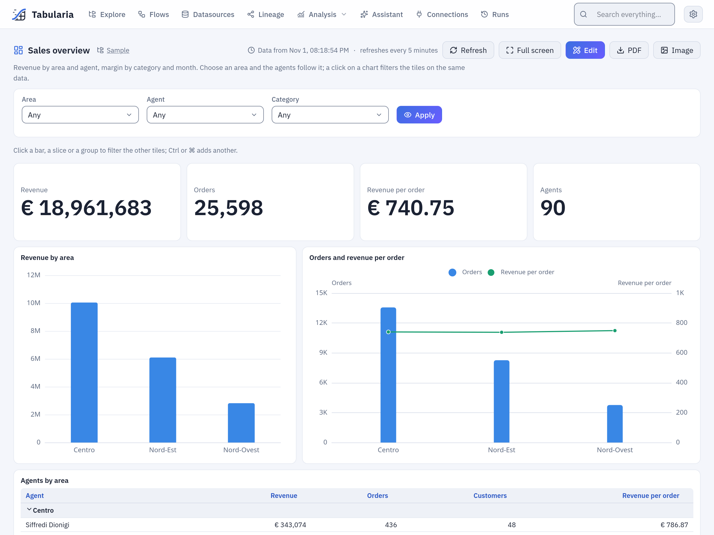
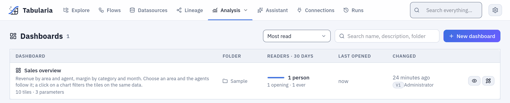
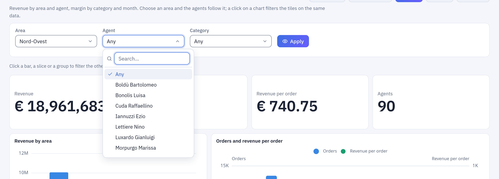
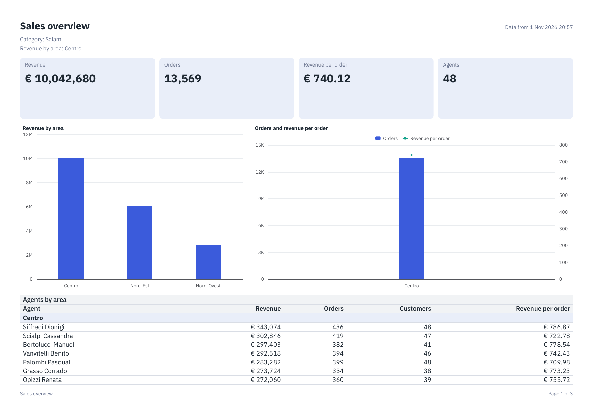

# Dashboards

A dashboard is a screen of live tiles on a grid: key figures, charts, tables, matrices,
texts and images. It is an object of a folder, with its versions, like a flow or a report.
A reader opens it to see the state of something at a glance, chooses its parameters at the
top, clicks a bar to filter the other tiles, or leaves it on a wall screen refreshing by
itself. It downloads as a **PDF** or an **image**; a flow group **sends it by email**; a
script takes its file through the **API**.

Use a [report](reports.md) when the answer has to arrive as a document with a fixed page,
the same layout every month. Use a dashboard when the screen is the answer: it adapts to
the window and answers clicks. The two share what they can: a dashboard's datasets and
parameters are written as a report's, read with the same rights, in the same
[expression language](report-functions.md). Every installation has dashboards, Docker
Compose included.

*Sales overview, the dashboard of the [sample data](../getting-started-docker-compose.md#a-the-sample-data-already-there): open it in the `Sample` folder, and everything on this page can be tried on it.*

## At a glance

| | |
|---|---|
| Where | Explore → **New** → **Dashboard**, in a folder, or **New dashboard** in **Analysis → Dashboards**, which lists the dashboards you may open, the most read first |
| What it reads | up to 10 **datasets**, as a report's: SQL on the catalog or on a database connection, a datasource, a saved view, a saved SQL script |
| What it shows | up to 40 **tiles** on a grid of 12 columns: KPI, 14 kinds of chart, table, matrix, text, image, [AI comment](#ai-comments) |
| Parameters | up to 20, as a report's: text, number, date or yes/no, one value or several, fixed choices or choices from a dataset |
| A click | on a bar, a slice or a group filters the other tiles on the same dataset |
| Refresh | by hand, and if you want by itself, at least every minute; the numbers are kept and shared, so that many readers run one query |
| Going out | a link that holds the filters, a **PDF**, an **image**, an email from a flow group's [Pushmail](../pushmail.md#dashboards) cell, the [API](../api.md#dashboards) |
| Rights | VIEW on the folder to open it, EDIT to design it; each dataset is read with the rights of whoever reads the dashboard, tile by tile |

## Reading a dashboard

**Analysis → Dashboards** lists the dashboards you may open, the most read first: the
people who opened one in the last 30 days, counted once a day. The search looks in the
names, the descriptions and the folders. A click on a row opens the dashboard; so does a
click in Explore, or a link someone sent you, after signing in.

### Parameters

The bar at the top holds the dashboard's parameters. Choose values and press **Apply**: the
tiles read the data again with them, and the address holds them. A list can follow another:
in Sales overview, choose an **Area** and the **Agent** list holds only the agents of that
area, before you press **Apply**.

*With Nord-Ovest chosen the Agent list holds 13 names of the 90. An agent chosen before goes back to **Any** when the area changes.*

### A click filters the other tiles

A click on a bar, a slice, a point, a cell of a heatmap, a group's name in a table or a
header of a matrix filters the **other tiles on the same dataset**. A strip under the
parameters says what is active, with a cross on each filter and **Clear all**.

*A click on Centro, then **Clear all**. The tile clicked keeps its bars and marks the one chosen.*

- **Ctrl** (or **Cmd**) with the click adds a value, or takes it away. A plain click on the
  only value chosen clears it.
- In one tile, values add up: Centro or Nord-Est. Between tiles, and between the rows and
  the columns of a matrix, each narrows the others.
- A click stays on its dataset. In Sales overview a click on an area leaves the margin at
  the bottom as it is, because the margin reads another dataset, with its own **Category**
  parameter and its own click on the donut. To filter several datasets with one choice, use
  a parameter that each of them reads.
- A KPI, a text and an image do not filter. Neither do «Other», a waterfall's total, a
  gauge or a detail row of a table. The designer can turn a tile's filtering off (**A click
  filters the other tiles**).
- An aggregate that names its dataset, `SUM([ricavo], "agents")`, still reads all of it, so
  that a share of the total stays one; so does a calculated field.
- A parameter changed afterwards keeps the clicks whose values still exist, and drops the
  others.
- On a table that can filter, a group's name filters and the arrow beside it closes the
  group.

Clicks are in the address too (`?area=Nord-Est&click.by_area=Nord-Est`), so **Back** undoes
one, and a link gives the same state to someone else with the rights. A link naming a tile
that is gone, or one that no longer filters, opens without that click.

From the keyboard, a group's name, a matrix's header, the cross on a filter and **Clear all**
are buttons (**Ctrl** with **Enter** adds). A chart's drawing cannot be reached: when it
takes the focus a list of its categories shows, and choosing there adds a value. **The parts
of a split chart, the cells of a heatmap and the points of a scatter cannot be chosen from
the keyboard**, only their category where they have one.

### Refresh and the cache

Beside the title, **Data from** says when the oldest numbers on the screen were read from
their source.

- **Everyone shares the numbers.** The first person to open a dashboard reads the source;
  whoever opens it in the next five minutes (`DASHBOARDS__CACHE_SECONDS`, or the dashboard's
  own interval when that is longer) gets the same numbers without a new query. On a
  database that charges by the query, this is what keeps the bill down. A click works from
  the rows already read and does not go back to the source. Your rights are checked at every
  request all the same: sharing never shows you what you may not read.
- **Refresh** reads the source again, for everyone, at most once every 10 seconds per
  dashboard. Pressed sooner, it shows what there is, without an error.
- **By itself.** A dashboard can refresh every so many seconds, from 60 to 86,400: **Refresh →
  By itself** in the designer, and the viewer says so («refreshes every 5 minutes»). It runs
  only while the tab is in sight. When a refresh fails it keeps the last numbers, with the
  time they are from, and says so; it tries again at the next interval.
- A datasource refreshed or a flow run is new data: its new snapshot is read at the next
  request, with no wait for the five minutes.

**Full screen** leaves only the title, the strip of clicks, the tiles and the time of the
last update, for a wall screen. **Esc** comes back.

### Any window

The grid adapts to the width of the window. From 1,100 pixels it is as designed, on 12
columns; from 700 to 1,099 it has 6, and the tiles take what is free; below 700 pixels one
column, top to bottom and left to right. A tile hidden by its condition takes no place.

### PDF and image

**PDF** and **Image** download what is on the screen: the same parameters, the same clicks,
the same sort and closed groups, and **the same numbers**, because they come from the same
reading. It is a document of the numbers, not a picture of the screen: it has a report's
look, on white, whatever the theme you use.

*On top, what it is showing: the name, the parameters that have a value, the clicks, when the rows are from. At the foot, the page's number.*

- A row of tiles stays together; a table takes its row alone and the whole width, goes on
  over the pages, and repeats its title and head on each. The columns that do not fit go on
  in another table with the first column again.
- The page is A4 across with margins of 10 mm, unless the designer sets another in **Page of
  the PDF and the image**.
- The **image** is the same document on one long page, PNG at 192 ppi. It is one page in
  memory: past `REPORTS__RENDER_MEMORY_MB` (at the default, a table of 1,000 rows fits and
  one of 2,000 does not) **it stops, says so, and points you to the PDF**, which holds more.
- A tile that cannot say its numbers says why in its place. Of a dataset you may not read it
  says only that you cannot.

## Example: Sales overview

The sample data ends with this dashboard in the `Sample` folder, made by `sampledb-init`
([the sample data](../getting-started-docker-compose.md#a-the-sample-data-already-there)). It
reads two tables the sample flows write, in `Sample / Private tables`:

| Dataset | Datasource | Read by |
|---|---|---|
| `agents` | «Agent Leaderboard», one row per agent: `area`, `agente`, `ricavo`, `ordini`, `clienti`, `ricavo_per_ordine` | Revenue, Orders, Revenue per order, Agents, the two charts by area, the table |
| `months` | «Margin by Category and Month», one row per category and month: `categoria`, `anno_mese`, `ricavo`, `margine`… | Margin, Revenue by category, Revenue and margin by month |

It has three parameters: **Area** and **Agent** filter `agents`, **Category** filters
`months`. With the sample data at the default scale:

| With | Revenue | Orders | Agents | Margin |
|---|---|---|---|---|
| nothing chosen | € 19,693,658 | 25,560 | 90 | 29.7% |
| **Area** `Nord-Ovest` | € 2,823,696 | 3,688 | 13 | 29.7% |
| a click on the bar `Centro` | € 10,464,499 | 13,594 | 48 | 29.7% |
| **Category** `Biscotti` | € 19,693,658 | 25,560 | 90 | 28.8% |

### Build one yourself

A smaller version, with the mouse, in a folder where you have EDIT, here `My dashboards`; the
reader needs VIEW on it and on `Sample / Private tables`.

1. **The dashboard.** In Explore, in your folder, **New → Dashboard**. In the designer, write
   `My sales` over «New dashboard». The empty page says to start with the data.
2. **The data.** **Add a dataset** (or **Data → + Dataset**): name `agents`, **Datasource**,
   choose «Agent Leaderboard», **Add**. Its fields show under the dataset.
3. **The first parameter.** **+ Parameter**: name `area`, label `Area`, type **Text**,
   **Choices → From a dataset**, value `[area]`. **Filter this dataset by what is chosen** is
   already on. **Add**: its list shows above the grid.
4. **The second.** **+ Parameter** again: name `agent`, label `Agent`, **From a dataset**,
   value `[agente]`, **Add**. Because it comes after `area` and filters the same dataset, the
   agents follow the area. Nothing more is needed.
5. **A key figure.** **Insert → KPI**. It opens with a number on it, from the fields of the
   dataset. In the panel on the right, **Value** `SUM([ricavo])`, label `Revenue`, format
   `€ #,##0`.
6. **The chart that filters.** **Insert → Chart**, kind **Column**: along the axis `[area]`,
   the series' value `SUM([ricavo])`, title `Revenue by area`. **A click filters the other
   tiles** is already on.
7. **A table.** **Insert → Table**; it opens with columns from the fields. Give it the title
   `Agents`. Leave a column or two, or click fields in **Data** to add them.
8. **The places.** Drag the tiles where you want them, and their handles to size them.
9. **Done** saves and opens it as readers see it. Revenue says € 19,693,658. Click the bar
   `Centro`: € 10,464,499.

## The designer

The designer opens from Explore, from the tab, and from **Edit** in the viewer; with VIEW
only you are taken to the viewer. It needs a window at least 900 pixels wide. It has the
three parts of the [report designer](reports.md#the-designer): on the left **Insert** and
**Data**, the grid in the middle with the real numbers on it, on the right the properties of
what is selected.

*The tile selected shows its handles; the panel holds its place, its kind and its data. With nothing selected, it holds the dashboard: language, time zone, refresh, page of the documents.*

| Tile | What it is | Smallest |
|---|---|---|
| **KPI** | one value in large type, its change against another and a sparkline | 2 × 2 |
| **Chart** | bar, column, line, area, pie, donut, combo, waterfall, funnel, treemap, heatmap, scatter, gauge, bullet: [the kinds](reports.md#charts-and-kpis) | 4 × 4 |
| **Table** | the rows of a dataset, with groups and totals, 50 rows a page | 4 × 4 |
| **Matrix** | a table with one column per value of a field | 4 × 4 |
| **Text** | text as written, or an expression when it starts with `=` | 2 × 1 |
| **Image** | a PNG, JPEG or SVG of at most 512 KiB, kept inside the dashboard | 1 × 1 |
| **AI comment** | a short text the configured AI model writes on the numbers of the tiles you pick: [below](#ai-comments) | 4 × 3 |

Sizes are in cells: 12 columns that share the width, rows of 40 pixels, 10 pixels between
tiles. Drag a tile to move it, a handle to size it; it snaps to the grid, and a tile it
lands on goes down rather than being covered. Click a tile in **Insert** to add it where it
first fits, or drag it; click a field in **Data** to add it to the tile selected or make a
new one. A new tile opens with data on it, from the fields of its dataset. One half made
says what it needs; one with a mistake says so inside the tile and at its field, and the
others go on.

The keys: **Ctrl+S** saves, **Ctrl+Z** and **Ctrl+Shift+Z** undo and redo (a whole drag is one
step, with what it pushed), the arrows move the tile selected by one cell (5 with **Shift**),
**Ctrl+D** duplicates it, **Del** removes it. A click on the grid selects a tile and filters
nothing. **Shown when**, a condition, hides a tile from readers: on the grid it stays and
says so.

**Datasets, parameters and expressions** are a report's, with the same dialogs: see
[Datasets and parameters](reports.md#datasets-and-parameters),
[A parameter that filters the data](reports.md#a-parameter-that-filters-the-data),
[Expressions](reports.md#expressions) and [Report functions](report-functions.md), with
`SUM([x], "group")`, `PREVIOUS`, `LOOKUP`, `SUMIF` and `COUNTIF`. `PAGE()` and `PAGES()`, which
speak of a page, write nothing on a screen. Every save is a new version;
the server checks the whole definition each time, and a save it refuses names the tile and
the field. If someone else saved since you opened it, **Save** says so and asks before yours
becomes the newest.

## AI comments

An **AI comment** tile holds a short text written by the configured AI model on the numbers of
the tiles you pick, such as what moved and what stands out. The numbers never depend on it, and
never wait for it: a provider that is down, a budget that is spent or a mode that forbids it
costs the comment only, and the tile says so.

**To add one**, click **AI comment** in **Insert**, and in its panel write what you ask of it (at
most 1,000 characters; empty, it says what stands out) and tick what it reads, from 1 to 10 KPIs,
charts or tables. **Try it** shows what it writes on the tile: the designer asks the model only
then, never at a keystroke, and it needs EDIT on the folder.

| | |
|---|---|
| **What it reads** | the title and the numbers of the tiles it reads, as the screen writes them: a KPI's value and change, a chart's categories and series, a table's groups and totals, a matrix's page, what is chosen by a click, with your instruction, in the dashboard's language |
| **What it never reads** | a row. A table's detail rows and a scatter that is not aggregated stay out, though the screen shows them. A tile with only those is left out, and with nothing left no call is made: the panel says so. It has no tool to query with |
| **When it writes** | on opening, on **Apply** and on a refresh by hand, if those numbers have no comment; on a PDF or an image, always on the numbers of that document. A hundred people on one dashboard make one call |
| **After a click** | the old text goes, and **Comment this view** writes one for that view. **Back** brings the old one back, with no call |
| **A screen that refreshes by itself** | at most one call every `AI__COMMENT_MIN_SECONDS` (an hour): until then the old text stays and says the time of the numbers it speaks of |
| **Who pays** | whoever causes the call, under the daily ceilings: the author of a schedule for a [Pushmail cell](../pushmail.md#ai-comments). A read-only API token and an observer cause no call, and read what is kept |

Every comment says **Written by AI · the model · numbers of the moment they were read**, and that
it may be wrong, on screen and on paper; no setting takes that away. It is plain text, at most
1,500 characters, with no link.

When it cannot write, it says why in its place, and a PDF, an image or an email goes out with one
line there: that the comment is not available, that the day's spending limit has been reached, that this
installation sends no data to AI models (`AI__METADATA_ONLY`).

**Any element it reads that you may not read stops the comment**, with what a tile with no access
says and nothing about which one, on screen and in the PDF, with a comment kept for others and with
none: a text written from fewer numbers would mislead, one from more would leak. An element hidden by
its own condition shows nothing, so it is left out.

What its model reads goes where the administrator said: [AI in Tabularia](../integrations/ai.md).

## Sending it on a schedule

A dashboard is sent by a flow group: a [Pushmail cell](../pushmail.md#dashboards) attaches it
as PDF or PNG, up to 5 of them, with the values of its parameters. The group's schedule is
the dashboard's: the cell runs after the steps that refresh the data. **Nobody looks at it
before it leaves**, so it is stricter than the screen: a dataset the group's author may not
read, or a tile that cannot say its numbers, stops the cell with its name, and nothing is
sent. It reads its source and not what the screen keeps: what the steps before it refreshed
is what it says. An [AI comment](#ai-comments) never stops it: with the provider down the email
goes out, with one line in its place.

## With whose rights

A dashboard never lends its author's rights. What a tile reads is checked dataset by dataset,
at every request, with the rights of whoever it is read for, before anything shared is looked
at:

| Read | With the rights of |
|---|---|
| in the viewer, in the designer | whoever opens it |
| by a flow group | whoever runs the group: the author of its schedule, for a scheduled run, checked again at every send |
| through the API | the token's account |

**A tile whose dataset you may not read says so inside the tile, and the others work**: «You
do not have access to the data of this tile», with no number, no column and no name of the
dataset, whether or not someone with the rights has just read it. A click on such a tile counts
for nothing. Row-level security does not exist in Tabularia, here as in reports: rights are on
the dataset.

Whoever reads Sales overview needs VIEW on `Sample`, which reaches `Sample / Private tables` where
its data is. The `Sample` folder is created with no permissions: the administrator shares it.

| On the dashboard's folder | You can |
|---|---|
| VIEW | open it, choose its values, click, refresh, go full screen, download the PDF and the image, read its versions |
| EDIT | create it, design and save it, rename, move, duplicate and delete it, restore a version |

Administrators see every dashboard. Dashboards show in Explore, with their own icon, in the
search and in the tab. A view, a SQL script, a datasource or a connection that a dashboard
reads cannot be deleted while it reads it: the refusal (`409`) names it. A dashboard a flow
group sends cannot be deleted until it is taken out of the group's cells.

The [audit log](../governance/audit-log.md) has every change (`dashboard.create`, `.update`,
`.delete`, `.move`, `.rename`, `.duplicate`, `.restore`), every opening (`dashboard.open`) and
every document (`dashboard.render`, with its format, its parameters, its clicks and where it
came from: `interface`, `api` or `flow_group`). A click and an automatic refresh are not in it:
they would drown the log.

## Limits and good to know

| Limit | Value | Past it |
|---|---|---|
| Tiles, datasets, parameters | 40, 10, 20 | a save says which limit, and refuses |
| Rows of one dataset | `DASHBOARDS__MAX_ROWS`, by default `REPORTS__MAX_ROWS`, 3,000,000 | the tiles on it say so, and how to aggregate: **no number on part of the rows**, not even a plain table's |
| Values of one click | 100 | the API answers `422` |
| Categories, series of a chart | 2,000, 24 | said in the tile |
| Points of a scatter | 10,000 | said in the tile: aggregate |
| A column with `RUNNING` or `PREVIOUS` | a page more than 100,000 rows down cannot be reached | said in the tile: those functions read every row above in memory |
| Rows of a table on screen | 50 a page | the next page |
| Pages of a document, its time | `REPORTS__MAX_PAGES` (200), `REPORTS__RENDER_SECONDS` (120) | the document stops, and says so |
| The image, in memory | `REPORTS__RENDER_MEMORY_MB` (1024): about 1,000 rows of table | it stops, and points to the PDF |

- Aggregate in the dataset where you can. The rows of a request stay in the memory of the
  preview worker: see [`DASHBOARDS__MAX_ROWS`](../configuration.md#dashboards).
- Without Valkey or the bucket a dashboard works, without the cache.
- Administrators change what the cache keeps, live, in **Administration → Settings**
  ([the settings](../engine-settings.md)); `DASHBOARDS__MAX_ROWS` stays in the environment, as
  `REPORTS__MAX_ROWS` does.
- The screen draws its charts in your browser. The PDF and the image draw them with the chart
  service, as a report does: when it does not answer, a document with charts stops and says so.

## What is not in this version

- No custom tiles and no code of your own in a tile.
- No drill-down from a tile to another dashboard.
- **A click filters its own dataset only**: across datasets, use a parameter.
- No comments by people and no alerts on a number.
- No dashboard public without signing in: a link needs an account with the rights.
- **No CSV or Excel of a tile.** A dashboard goes out as a PDF or an image.
- The assistant and MCP do not create or change dashboards, and have no tools on them; the
  search finds a dashboard by name and gives its link.

## Related

- [Reports](reports.md) and [Report functions](report-functions.md): datasets, parameters,
  expressions
- [Pushmail](../pushmail.md#dashboards): sending a dashboard from a flow group
- [Share links](share-links.md): a dashboard given to someone outside Tabularia with a link and its own password, or embedded in another site
- [API: dashboards](../api.md#dashboards)
- [Permissions](../governance/permissions.md)
- [Configuration: dashboards](../configuration.md#dashboards),
  [Settings from the panel](../engine-settings.md)
