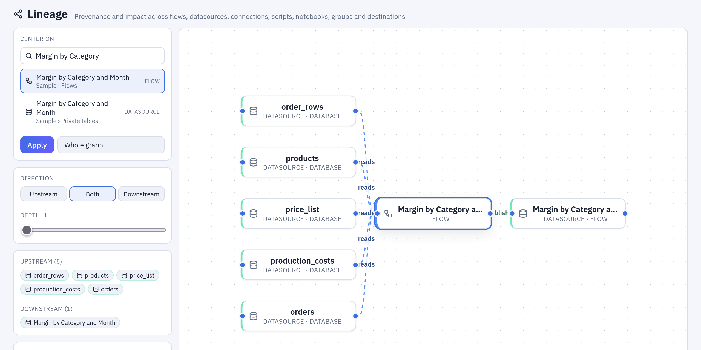

# Lineage

The **Lineage** page draws how the objects of the workspace depend on each other: which
connection a datasource is imported from, which flows, scripts, SQL scripts, notebooks and
data APIs read it, what each flow publishes or writes, which flow groups refresh, run or
send what. Use it before changing a table that other work reads, to find what a stale
number came from, or to see what a scheduled chain touches. It reads only the metadata
Tabularia keeps: nothing is run, nothing is read from the data.



***Lineage** centred on «Margin by Category and Month»: the five datasources it reads, and the one it publishes.*

## At a glance

| | |
|---|---|
| Where | **Lineage** in the navigation. Explore asks the same graph before a delete, to say what would break |
| What it draws | connections, datasources, flows, saved Python and R scripts, SQL scripts, notebooks, flow groups, data APIs, container images, and the destinations outside Tabularia: database tables, objects on S3, files on SFTP, the Pushmail emails of flow groups |
| The links | *ingest* (a connection fills a datasource), *reads*, *publishes* (the datasource of a flow, a script or a SQL script), *writes* (a table, an object, a file, an email), *refreshes* and *orchestrates* (what a flow group, or an old flow's Refresh and Run flow nodes, start) |
| Centred | on one object, **Upstream**, **Downstream** or **Both**, from 1 to 8 steps away (3 by default); or **Whole graph** |
| Health | each flow's last run; **Stale** on a flow that reads data refreshed after its last successful run, and **Stale inherited** on everything after it |
| Rights | you see what you may read; an object you may not read, or one removed, shows as an unresolved reference, without its name |
| API | `GET /lineage`, `?type=…&id=…&direction=…&depth=…` |

## How it works

### What the graph is made of

The graph is computed at every request from what the gateway already stores: the
definition of every flow (its source nodes and its Output nodes), the source of every
datasource, the inputs and outputs of saved scripts and SQL scripts, the grid of every
flow group, the datasources a notebook read in its sessions and the datasource behind
each data API. Nothing is declared by hand, so it cannot drift from what runs: change a
flow's Output and the next request draws the new destination.

A destination outside Tabularia is a node of its own: the table a flow writes, with its
connection; the key on S3; the file on an SFTP server. A flow group's cells link the group
to the flows, scripts, SQL scripts and images it runs and the datasources it refreshes; a
Pushmail cell is an email node, with how many recipients, attachments, reports and
dashboards it carries, linked to the datasources it attaches.

### Centring, direction and depth

Search for an object by name, pick it and press **Apply**: the graph keeps what is
reachable from it within the depth you chose, following the links forward
(**Downstream**: what would change if this one changed), backward (**Upstream**: where
its data comes from) or both. **Center here**, on any node, moves the centre there.
Selecting a node opens its panel, where **Downstream impact** counts what a change to it
would reach along the data, up to 8 steps whatever the view shows: how many flows,
datasources and destinations.

### Stale data

A flow is **stale** when a datasource it reads was refreshed after the flow's last
successful run: its output was computed on older data. The mark then follows the data,
to the datasources the flow publishes and to the flows that read those (**Stale
inherited**). The cure is to run the chain again, in order: a [flow
group](flow-groups.md) does exactly that, on a schedule.

### What you may see

The graph is built from the objects you may read. An object you may not read still
appears where one of yours depends on it, but as an unresolved reference: its kind,
never its name or its folder. The same mark covers an object that was removed while
something still pointed at it, such as a flow whose source datasource was deleted.

## Example: what reads `order_rows`

The sample data's `order_rows` (42 million order lines, imported from the ERP) is read
by most of the sample flows. Before changing its query:

1. Open **Lineage**, search `order_rows`, choose it, **Downstream**, depth 2, **Apply**.
2. The graph shows the eight sample flows that read it (among them «Margin by Category
   and Month», «Top 20 Products by Revenue» and «Cost to Serve by Channel») and, one step
   further, the eight datasources they publish. Select `order_rows`: its **Downstream
   impact** reads «8 flows», «8 datasources».
3. Flows marked **Stale** read `order_rows` after a refresh that came later than their
   last run: their datasources are inherited stale until they run again.

The same question from a script, with an [API token](../api.md):

```bash
curl -s -H "Authorization: Bearer $TABULARIA_TOKEN" \
  "https://tabularia.example.com/api/lineage?type=datasource&id=46&direction=downstream&depth=2" \
  | jq '{center, flows: [.nodes[] | select(.type == "flow") | .label]}'
```

```json
{
  "center": "ds:46",
  "flows": ["Cost to Serve by Channel", "Top 20 Products by Revenue", "Margin by Category and Month", "…"]
}
```

The answer is `{"nodes": […], "edges": […], "center": …}`. A node has an `id` such as
`ds:46` or `flow:23`, a `type` (`connection`, `datasource`, `flow`, `script`,
`sql_script`, `notebook`, `flow_group`, `data_api`, `container`, `db_sink`, `s3_sink`,
`sftp_sink`, `email_sink`), its `label`, `restricted` for an unresolved reference, and a
`meta` with what the page shows (rows, the last run's status, `stale` and its reason). An
edge has `source`, `target` and `kind` (`ingest`, `read`, `publish`, `write`,
`refresh`, `orchestrate`). `type` in the query is one of `flow`, `datasource`,
`connection`, `script`, `sql`, `notebook`, `group` or `dataapi`; without `type` and `id`
the whole graph comes back.

## Permissions

| To | You need |
|---|---|
| Open the page | Any account |
| See an object, with its name | **VIEW** on its folder, connections included |
| Call `GET /lineage` | An API token of any access level: it reads only |

## Limits and good to know

- The graph shows what the definitions say, not what a past run did: a flow's last run
  may have written to an Output removed since. The runs' own record is on **Runs**, and
  in your catalog with [OpenLineage](../openlineage.md), which reports every run as it
  ends.
- A SQL step reads the node before it. A SQL script on the catalogue is linked to the
  datasources its SQL names; one on a database connection, to the connection, not to the
  tables it names.
- A script or an image is linked to the datasources it is given and the ones it publishes;
  what its code reads or writes elsewhere (an API, another bucket) is not drawn.
- On a very large workspace, centre the graph on one object: the whole graph is
  computed for every request and drawn at once.

## Related

- [OpenLineage](../openlineage.md): the same dependencies, reported to an external
  catalog at every run
- [Flows](flows.md), [Flow groups](flow-groups.md), [Sources](../sources/README.md)
- [Tabularia API](../api.md): `GET /lineage` is one of the stable endpoints
