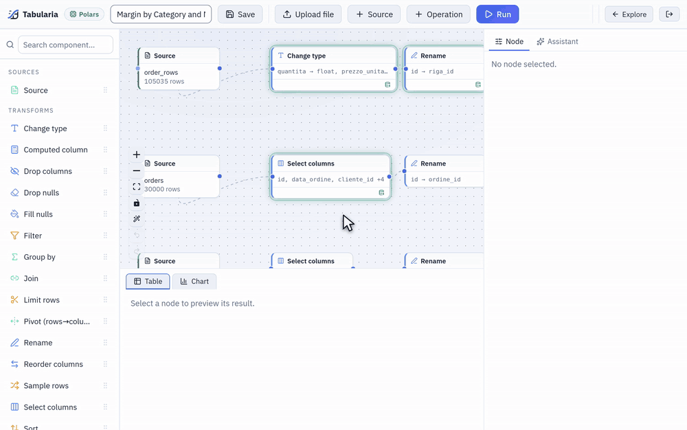
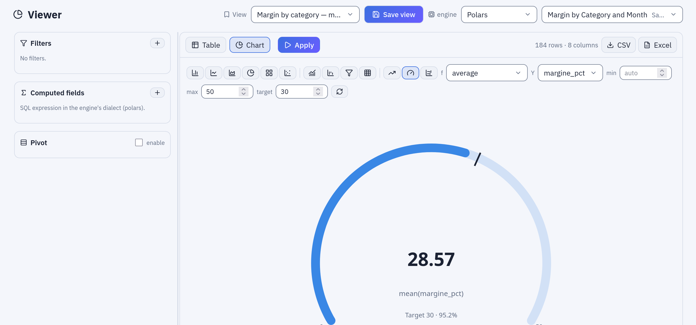
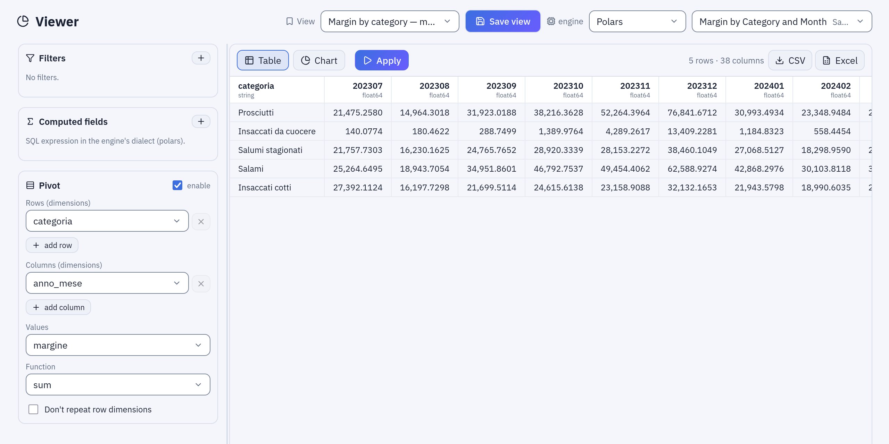
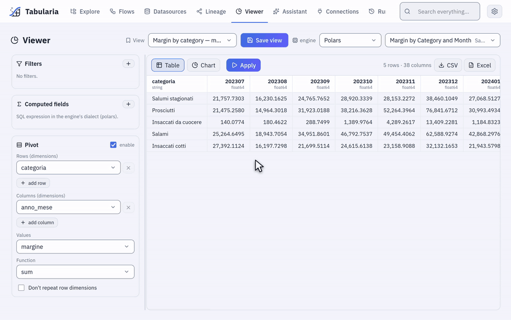

# Preview and analysis

Tabularia shows the data at every step: click a node of a flow and its result appears
under the canvas, as a table or as a chart. The **Viewer** does the same on any
datasource without building a flow: filters, computed fields, a pivot and charts,
computed by the engine on the whole table, and saved as a named view that anyone with
access to the folder can reopen. Nothing in either place changes the data.

## At a glance

| | Flow editor | Viewer |
|---|---|---|
| Where | The data view under the canvas: **Table** and **Chart** tabs | **Analysis → Viewer** in the navigation, a datasource or a saved view opened from **Explore**, or **Explore → New → View** |
| Reads | The chain up to the selected node | One datasource |
| Rows shown | First 100 of the selected node | First 500 of the table you build on **Rows**, **Columns** and **Measures** |
| Computed on | The whole input, or the source's development sample | The whole datasource |
| Charts | Bars, Lines, Area, Pie, Treemap, Scatter, Bars and line, Waterfall, Funnel, Heatmap, KPI, Gauge, Bullet, aggregated on all rows | The same |
| Download | **Download this node's data**: CSV or Excel | **CSV** and **Excel** of the current view: the table as built |
| Kept | With the flow | As a **saved view** in a folder |
| Step cache | Yes | No: every **Apply** reads the datasource |

## Previewing each step of a flow

Clicking a node runs the chain that leads to it and shows its first 100 rows, with the
column types, in the **Table** tab. The summary beside the tabs names the node and says how
many rows there are: «First 100 rows» at once, then the real total when it has been read
or counted («First 100 of 42,007,616 rows», «First 100 of more than 10,000,000 rows» past
the counting cap); the node keeps the same count so you can read the shape of a flow at a
glance. Nulls are shown as `∅`. A node that is not configured yet asks to be set, instead
of showing an error.

> The real row count, the column profile and the keyboard of the grid described on this
> page arrived with 1.4.2.

*Each click shows that step's first 100 rows: the order lines, the computed revenue, the join with the orders, the margin by category and month.*

The rows are computed on the **whole input**: a Group by groups every row, a Join joins
every row, and you see the first 100 of the result. The one exception is a source with a
**Development sample** (first N rows or a random percentage), which previews and editor
runs read instead of the full table. An administrator can give every source an
automatic sample with `PREVIEW__DEFAULT_SAMPLE_ROWS` (0 by default: no sample); the
source node then shows «automatic (first N rows)» and anyone can switch it to «off (all
rows)». Scheduled runs and **Run in production** always read everything.

### The column profile

After the rows and their count, the editor (and the Viewer, for its applied view) profiles
the result's columns. Under a column's name and type a thin bar, in the colour of the
null-handling operations (Fill nulls, Drop nulls), fills in proportion to its nulls, and
«33% ∅» follows the type when there is room; a column without nulls has no bar at all. A
grey line only holds the bar's place while the profile is asked. In the editor the profile
comes by itself only from what the parquet file's statistics say (no query: a source, or a
cached step followed only by select, reorder, drop, rename or sort), so only the columns
those statistics describe get a bar until a column is opened.

Click a column's name, or press **Enter** on it, to open its profile. Its first line says
which rows its figures are of: «All 764 rows», or «First 100,000 of 42,007,616 rows» on a
larger step. Then:

| | |
|---|---|
| Distinct values | counted exactly: «1,204» over every row, «1,204 in the sample» over the first rows |
| Min and max | a number's or a date's, in the column's own format; «all rows» beside them when they come from the file's statistics |
| Length | a text's shortest and longest, in characters (never an alphabetical range) |
| Values | a category's five most frequent values, each with its share of the rows and a bar; a number's spread over 20 equal intervals between its min and max, as a small histogram |
| ∅ | the nulls, among the values, only when there are some |

A column whose values are (almost) all different, 99% or more of the rows seen, is said to be
«Unique in the sample, likely a key»: no frequent values are asked, they would all be held by
one row.

**From a value to a step.** In the editor each frequent value has **Filter to this value**
and **Exclude**, which add a Filter step after the node on screen (equals, or is not equal
to, the value), selected and previewed; the ∅ line has **Fill nulls…**, which adds a Fill
nulls step with the column already chosen. The step goes where every added step goes:
between the node and the one it feeds, at the end of the chain otherwise, as a new branch
when the node already forks. **Undo** takes it away. In the Viewer the same buttons add a
filter to the view's **Filters** and apply it (not on a cross table).

*The profile of `regione` in the Viewer: the rows its figures are of, the distinct values, the lengths, and the most frequent values, each one click from a filter.*

With a profile open, **←** and **→** move it to the column beside, and **Esc** gives the focus
back to that column's name. A click anywhere outside closes it.

A profile is made as cheaply as the step allows, and never at the expense of the rows or the
workers. The nulls of every column and the range of its numbers and dates are read from the
parquet statistics when they apply, exact for every row, and win over the sample. The rest is
one query over the step's **first 100,000 rows**: the engine stops reading there (a sample
spread over the table would make it compute the whole chain first). A column's values or
histogram are one more query, for that column only, once the profile has come. A profile is
remembered as long as the step cache keeps its copies, is stopped at the next click and gives
up after 20 seconds; it never runs beside the preview or the count it follows, and one that
would take more than its share of the worker's memory stops itself, alone, and says so. When it does
not come, the panel says why («it took more than 20 seconds and was stopped») and offers
**Try again**; a count that failed says why in its tooltip and offers **Count again**.

The same numbers on every engine: the distinct values are counted exactly over the rows
read, everywhere. On the ClickHouse engines a list is never null, so a list column shows no
nulls there ([engine differences](../engines/engine-differences.md)).

### Moving with the keyboard

The table is one stop of the **Tab** key. The arrow keys move from cell to cell and up into
the column names; **Home** and **End** go to the row's first and last cell, **Ctrl+Home**
and **Ctrl+End** to the table's first cell and its last, **Ctrl+↑** and **Ctrl+↓** (⌘ on a
Mac, which has no Home nor End: there Fn with an arrow writes them) to the column's first
and last row, **Page Up** and **Page Down**
by a screenful, past the rows drawn too; the active cell keeps its ring whichever key moved
it. **Ctrl+C** (**Cmd+C** on a Mac) copies the cell's exact value (the tooltip's, not the
rounded one), or a column's name; cells selected with the mouse copy as tab-separated values a
spreadsheet pastes. **Esc** stops a preview being computed. The keyboard icon in the bar above
the table lists these keys.

The summary beside the tabs stays on one line and is never cut in the middle of a word: as
the panel narrows, **Use a sample** goes into a **…** menu, the cache's mark keeps its icon,
and «12 columns removed» becomes «−12»; the node's name keeps at least 14 characters (all of
it in its tooltip). **Use a sample** is offered when the step's source holds more than a
million rows, not because a preview was slow.

The **Chart** tab draws the selected node. The chart is an aggregation the engine
computes on all the node's rows, not on the 100 shown: choose the kind (**Bars**,
**Lines**, **Area**, **Pie**, **Treemap**, **Scatter**), the column for the X axis, an
optional column that splits it into series, and a function: count, sum, average,
minimum, maximum, median or distinct count. Bars keep the top N categories (20 by
default), a treemap the top N too; a pie shows the five largest and, for a count or a
sum, gathers every other category of the data under «Other». A pie, a treemap and a
funnel draw only what is above zero: they say how many categories they leave out, and
with nothing above zero they say so instead of drawing. At most five series are drawn,
and the chart says how many it left out. A scatter plots one point per group, with an aggregation on each axis.

### More chart kinds

After the first six, the row of chart kinds has two more groups. The first composes:
**Bars and line** (a second measure drawn as a line over the bars), **Waterfall** (how
each category adds to or takes from the total, which comes last), **Funnel** (stages from
the largest down) and **Heatmap** (X by a second column, **by**, the colour by the
value). The second shows one number: **KPI** (the aggregate of the whole table in large
type; with **trend**, a column such as a month, its sparkline and the change of the last
period against the one before), **Gauge** (the number on an arc, with **min**, **max**
and a **target**) and **Bullet** (a bar per category against a second measure, its
target). They are computed on all rows like the others, look as they do in the
[pixel-perfect reports](reports.md#charts-and-kpis), and the assistant draws them in its
answers too.

*The Viewer with **Gauge**: the average margin percentage of the sample data against a target of 30; the row of kinds above, the first six, those that compose, those of one number.*

**Download this node's data**, in the node's panel, writes the node's whole result as
CSV or Excel: a worker writes the file and the browser saves it.

## The step cache

Every step's result is stored under a key made from its source and its operations.
Previewing node 9 after node 8 reuses node 8's result instead of starting from the
source again, and changing the last step of a long flow recomputes one step, not all of
them.

- **The copy never delays the answer.** The preview answers first; the step's result is
  written afterwards by a separate, low-priority task.
- **The editor shows what is cached.** A node whose result is in the cache has a ring and
  a small icon, «Result in cache: the nodes after this one start from here».
- **Large steps are not copied.** A step over `CACHE__MAX_STEP_ROWS` rows (1 million by
  default) is recomputed at every preview: a copy as large as the source saves nothing.
  The node carries a small refresh mark on its border, the preview's summary says «over
  the cache cap» (a button explaining it), and the node's panel suggests a development
  sample or an earlier filter.
- **Entries expire.** A step unused for `CACHE__TTL_SECONDS` (one day by default) is
  deleted. On BigQuery the cache is a set of expiring tables in a dataset of its own
  (`BIGQUERY__CACHE_DATASET`).
- **A release reads only what it computed.** The key carries the release, as do the
  remembered row counts, the column profiles and the dashboards' numbers: after an upgrade
  the first preview of each step is computed again, once, and what the release before left
  expires as any unused entry does.

The Viewer does not use the step cache: its filters change at every click, and a cache
of them would only fill the storage.

## Cancelled previews

Moving through the nodes of a flow starts a preview at every click. Only the last one
matters, so each panel (the table, the chart, the list of a column's values) keeps one
preview at a time: a new one cancels the previous, whether it is still queued or already
running. On the external ClickHouse engine the query is stopped on the server too, and on
BigQuery the job is cancelled. A preview that takes longer than `PREVIEW_TIMEOUT_SECONDS`
(120 by default) is stopped and reported.

## The Viewer

The Viewer is a read-only analysis page over one datasource. Choose the datasource and
the engine at the top (your **Preferred engine**, from **Settings**, is the default).

**The table starts empty, and you build it on three areas.** On the left is the list of
the datasource's **Fields** (name, type, and the description when the datasource has one),
with a filter box above it. The result panel has **Columns** across the top, **Rows** down
the left and **Measures** in the middle, each saying what to drop on it. Until a field is
placed nothing is read: the names and types come from the datasource's metadata, and the
page says how many rows and fields there are. Drag a field onto an area and it stays there
as a chip:

| On the areas | The table is | The engine does |
|---|---|---|
| Fields in **Rows** only | the rows as they are, with those columns | reads only those columns (three of eighty cost three) |
| **Rows** and **Measures** | one row per group, each measure aggregated | one group by |
| **Measures** only | one row of totals | one aggregation |
| A field in **Columns**, with a measure (and any Rows) | a cross table: one column per value of the field | one pivot |

- A field dropped on **Measures** is summed when it is a number and counted otherwise; the
  function is chosen on its chip: sum, average, min, max, count, distinct count.
- A **cross table shows one measure**, the first; the others stay on the area, dashed,
  and count again as soon as **Columns** is empty. A field in **Columns** with more than
  500 distinct values is refused, with the number it would have made. **Columns** without a
  measure asks for one, and reads nothing.
- Chips are dragged to reorder them and from one area to another, and removed with their
  **×**. With **Rows** alone, a field can also be dropped between two names of the table's
  header, a name dragged along it, or out of the table to remove it.
- A double click on a field puts it in **Rows**; **Add all** puts every field there (the
  whole table, as it is); **Clear** empties the three areas. The **…** on a field lists
  where it can go, for a touch screen or a pointer that does not drag.
- **Drag a field onto Filters** to start a filter on it, ready for its value, and **onto
  the chart** (hold it over the **Chart** tab to open it) to put it on the **Axis or
  category** or as the **Value**.
- The engine always aggregates: no rows travel to the browser to be added up. With Rows
  alone, moving and removing a column ask nothing and adding one asks its rows once; the
  row count is asked once per set of filters; an aggregated table is one request per change.

Everything has a way from the keyboard, listed under **?**. In the list of fields ↑ ↓ move,
**r** (or **Enter**) puts the field in Rows, **c** in Columns, **m** in Measures, **f**
filters on it, **p** puts it on the chart, **Del** (**Ctrl/⌘+Backspace**) takes it off the
table. On a chip the arrows move along the area, **Shift** with an arrow moves the chip,
**r**, **c**, **m** send it to another area and **Del** removes it. In a table of rows as
they are, **Shift+← →** move the column and **Del** on its name removes it.

Then build the rest of the view in the side panel and press **Apply**:

- **Filters**: =, ≠, >, ≥, <, ≤, between, contains, starts with, in (a,b,…), not in,
  is null, is not null. Dates and times get a calendar.
- **Computed fields**: a name and a SQL expression in the engine's dialect, for example
  `ricavo / chili`. They join the list of fields and go on the three areas and on the
  chart like any column (the filters are applied before them).
- **Don't repeat row dimensions**, under **Rows** when a table is aggregated on two or more
  of them, prints a row field's value once per group, as in a report.
- **Table** and **Chart** tabs: the table shows the first 500 rows of the result; the
  chart works as in the editor, on the filtered and computed data, and asks nothing
  until you choose its columns (or drop a field on it).
- **CSV** and **Excel** download the whole current view (filters and computed fields
  applied) as the table is built: the Rows' columns in their order, the grouped or the
  cross table; with the three areas empty, every field. The chosen engine computes it; the file is written by a worker with
  Polars.

*The saved view «Margin by category — month by month»: **Rows** `categoria`, **Columns** `anno_mese`, **Measures** sum of `margine`.*

## Saved views

**Save view** stores the current configuration, with a name, in a folder: the engine,
the three areas (Rows, Columns, Measures with their functions), the filters, the computed
fields, the open tab and the chart's settings. A view holds **no rows**: opening it
tomorrow reads tomorrow's data. A view saved before the three areas opens as it did: its
pivot becomes Rows, Columns and the measure, and a view without a pivot has every field in
Rows, the whole table. A filter still without its value is not saved. A report or a
dashboard that reads a view gets its filters, computed fields and cross table (with more
measures and no Columns, the first one); a view of rows as they are gives them every field.

A view can also start in **Explore**: **New → View** in a folder (or the button of an empty
folder) opens the Viewer, asks for the datasource, and proposes that folder when you
**Save view**. Nothing is created until then.
Saved views appear in
**Explore** next to flows and datasources, and in the **View** picker of the Viewer.
Saving again under the same name in the same folder updates the view; the name cannot
be reused there for a view of another datasource.

## Example: the margin of the sample data

The sample flow «Margin by Category and Month» publishes a datasource of the same name
in **Sample / Private tables**, with one row per product category and month:
`categoria`, `anno_mese` (`202510` for October 2025), `ricavo`, `costo`, `margine`,
`chili`, `ordini`, `margine_pct`.

1. Open **Analysis → Viewer**, choose `Margin by Category and Month` and press **Add all**
   (the table starts empty; every field goes to **Rows**).
2. **Filters**: `margine_pct` < `30`, then **Apply**. The table lists the months in
   which a category earned less than 30% of its revenue.
3. **Computed fields**: `ricavo_al_kg` = `round(ricavo / chili, 2)`, revenue per kilo.
4. Remove the filter, press **Clear**, and drag `categoria` onto **Rows**, `anno_mese`
   onto **Columns** and `margine` onto **Measures** (sum). One row per category, one
   column per month.
5. Switch to **Chart**, choose **Lines**, X `anno_mese`, series `categoria`, function
   sum of `margine`: the seasons of the sample data (Christmas, summer) show up in
   each category's line.
6. **Save view**, name `Margin by category — month by month`, in a folder of yours.
   Whoever can see that folder opens the same matrix, on the current data.

The **Sample** folder already holds four views built this way, among them «Margin
watch — categories under 30%» (step 2) and «Margin by category — month by month»
(step 4).

*The same view: the rows without the pivot, the matrix with it, then **Chart** with the sum of `margine` by category, computed on every row.*

## Permissions

| To | You need |
|---|---|
| Preview a node, or open a datasource in the Viewer | Read access to every datasource involved: **VIEW** on its folder |
| Open a saved view | **VIEW** on the view's folder, and on the datasource's to see its data |
| Save, rename, move or delete a view | **EDIT** on its folder (both folders, to move it); saving also checks **VIEW** on the datasource |
| Download a node's data or export a view | Read access to every datasource involved |

A view grants access to nothing: whoever opens it without access to the datasource gets
a message, not the data. Every download and export is in the audit log
(`export.download`), with the format, the file name and the sources read.

## Limits and good to know

- The editor shows 100 rows per node and the Viewer 500; charts and exports read every
  row.
- A CSV export holds at most `EXPORT__MAX_ROWS` rows (5 million by default) and an Excel
  file the format's limit of about one million. Larger results belong in a datasource,
  through a flow's Output node.
- One person has at most `EXPORT__MAX_RUNNING_PER_PERSON` exports and documents (CSV,
  Excel, reports, dashboards) being prepared at once, 3 by default: past it Tabularia asks
  to wait for one to finish. Code — the REST API with a token, a notebook's
  `tabularia.report()` — waits for its turn instead ([API](../api.md)).
- A pivot makes at most 500 new columns.
- A preview's numbers come from the engine you previewed with. When a flow's production
  engine is another one, see [Engine differences](../engines/engine-differences.md).
- Joining two sampled sources loses most matches: sample only the big table.

## Related

- [Flows](flows.md): the editor and its nodes
- [Engines](engines.md): which engine computes a preview
- [Ask your data](ask-your-data.md): questions in plain language over the same datasources
- [SQL scripts](../sql-scripts.md): free SQL over the catalogue, with CSV and Excel export
- [Configuration](../configuration.md#step-cache-and-metrics): the cache settings
