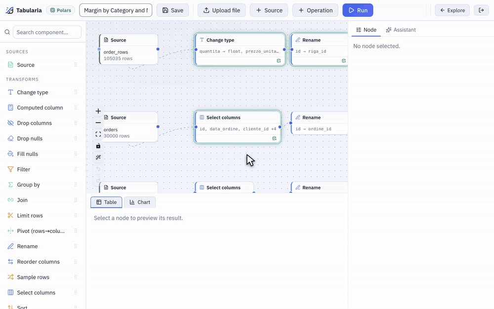
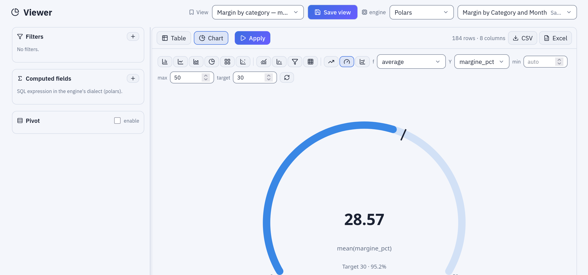
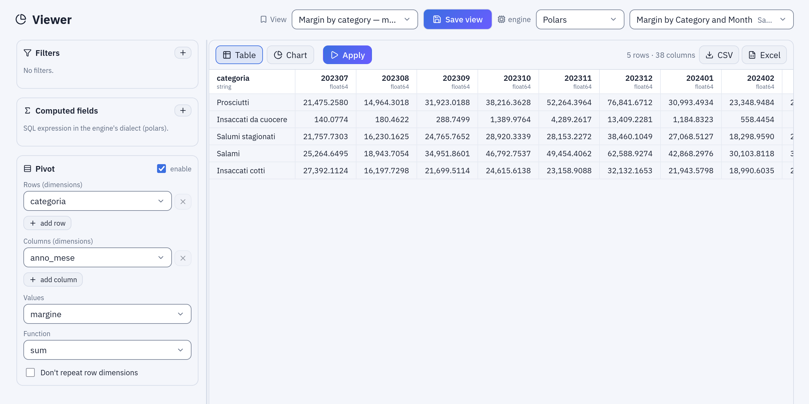
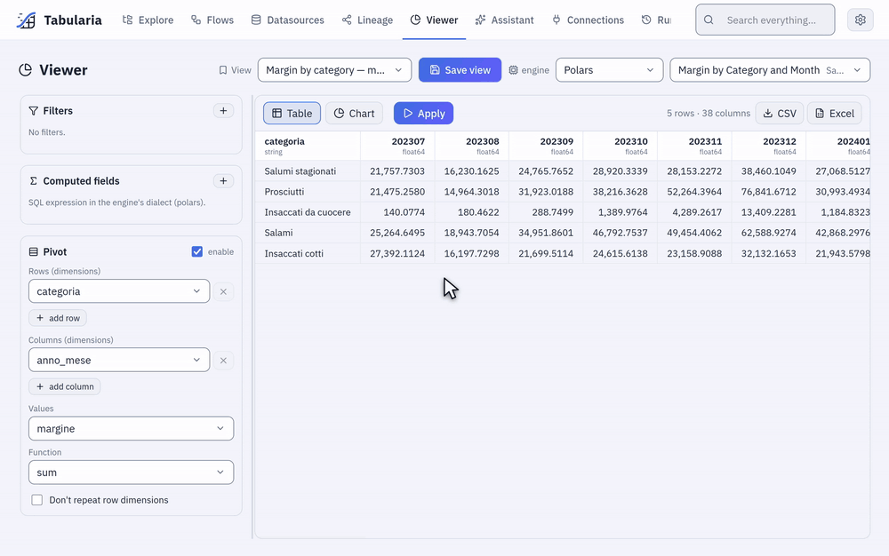

# Preview and analysis

Tabularia shows the data at every step: click a node of a flow and its result appears
under the canvas, as a table or as a chart. The **Viewer** does the same on any
datasource without building a flow: filters, computed fields, a pivot and charts,
computed by the engine on the whole table, and saved as a named view that anyone with
access to the folder can reopen. Nothing in either place changes the data.

## At a glance

| | Flow editor | Viewer |
|---|---|---|
| Where | The data view under the canvas: **Table** and **Chart** tabs | **Viewer** in the navigation, or a saved view opened from **Explore** |
| Reads | The chain up to the selected node | One datasource |
| Rows shown | First 100 of the selected node | First 500 of the result |
| Computed on | The whole input, or the source's development sample | The whole datasource |
| Charts | Bars, Lines, Area, Pie, Treemap, Scatter, Bars and line, Waterfall, Funnel, Heatmap, KPI, Gauge, Bullet, aggregated on all rows | The same |
| Download | **Download this node's data**: CSV or Excel | **Export CSV** and **Export Excel** of the current view |
| Kept | With the flow | As a **saved view** in a folder |
| Step cache | Yes | No: every **Apply** reads the datasource |

## Previewing each step of a flow

Clicking a node runs the chain that leads to it and shows its first 100 rows, with the
column types, in the **Table** tab. The count above the table says how many rows came
back and whether there are more («100 rows (truncated)»); the node keeps the same count
(«100+ rows · 12 columns») so you can read the shape of a flow at a glance. Values are
shown raw, nulls as `∅`. A node that is not configured yet asks to be set, instead of
showing an error.

*Each click shows that step's first 100 rows: the order lines, the computed revenue, the join with the orders, the margin by category and month.*

The rows are computed on the **whole input**: a Group by groups every row, a Join joins
every row, and you see the first 100 of the result. The one exception is a source with a
**Development sample** (first N rows or a random percentage), which previews and editor
runs read instead of the full table. An administrator can give every source an
automatic sample with `PREVIEW__DEFAULT_SAMPLE_ROWS` (0 by default: no sample); the
source node then shows «automatic (first N rows)» and anyone can switch it to «off (all
rows)». Scheduled runs and **Run in production** always read everything.

The **Chart** tab draws the selected node. The chart is an aggregation the engine
computes on all the node's rows, not on the 100 shown: choose the kind (**Bars**,
**Lines**, **Area**, **Pie**, **Treemap**, **Scatter**), the column for the X axis, an
optional column that splits it into series, and a function: count, sum, average,
minimum, maximum, median or distinct count. Bars keep the top N categories (20 by
default), a treemap the top N too; a pie shows the five largest and, for a count or a
sum, gathers every other category of the data under «Other». A pie, a treemap and a
funnel draw only what is above zero: they say how many categories they leave out, and
with nothing above zero they say so instead of drawing. At most five series are drawn,
and the chart says how many it left out. A scatter plots one point per group, with an aggregation on each axis.

### More chart kinds

After the first six, the row of chart kinds has two more groups. The first composes:
**Bars and line** (a second measure drawn as a line over the bars), **Waterfall** (how
each category adds to or takes from the total, which comes last), **Funnel** (stages from
the largest down) and **Heatmap** (X by a second column, **by**, the colour by the
value). The second shows one number: **KPI** (the aggregate of the whole table in large
type; with **trend**, a column such as a month, its sparkline and the change of the last
period against the one before), **Gauge** (the number on an arc, with **min**, **max**
and a **target**) and **Bullet** (a bar per category against a second measure, its
target). They are computed on all rows like the others, look as they do in the
[pixel-perfect reports](reports.md#charts-and-kpis), and the assistant draws them in its
answers too.

*The Viewer with **Gauge**: the average margin percentage of the sample data against a target of 30; the row of kinds above, the first six, those that compose, those of one number.*

**Download this node's data**, in the node's panel, writes the node's whole result as
CSV or Excel: a worker writes the file and the browser saves it.

## The step cache

Every step's result is stored under a key made from its source and its operations.
Previewing node 9 after node 8 reuses node 8's result instead of starting from the
source again, and changing the last step of a long flow recomputes one step, not all of
them.

- **The copy never delays the answer.** The preview answers first; the step's result is
  written afterwards by a separate, low-priority task.
- **The editor shows what is cached.** A node whose result is in the cache has a ring and
  a small icon, «Result in cache: the nodes after this one start from here».
- **Large steps are not copied.** A step over `CACHE__MAX_STEP_ROWS` rows (1 million by
  default) is recomputed at every preview: a copy as large as the source saves nothing.
  The node shows a refresh icon and the editor warns once, suggesting a development
  sample or an earlier filter.
- **Entries expire.** A step unused for `CACHE__TTL_SECONDS` (one day by default) is
  deleted. On BigQuery the cache is a set of expiring tables in a dataset of its own
  (`BIGQUERY__CACHE_DATASET`).

The Viewer does not use the step cache: its filters change at every click, and a cache
of them would only fill the storage.

## Cancelled previews

Moving through the nodes of a flow starts a preview at every click. Only the last one
matters, so each panel (the table, the chart, the list of a column's values) keeps one
preview at a time: a new one cancels the previous, whether it is still queued or already
running. On the external ClickHouse engine the query is stopped on the server too, and on
BigQuery the job is cancelled. A preview that takes longer than `PREVIEW_TIMEOUT_SECONDS`
(120 by default) is stopped and reported.

## The Viewer

The Viewer is a read-only analysis page over one datasource. Choose the datasource and
the engine at the top (your **Preferred engine**, from **Settings**, is the default),
then build the view in the side panel and press **Apply**:

- **Filters**: =, ≠, >, ≥, <, ≤, between, contains, starts with, in (a,b,…), not in,
  is null, is not null. Dates and times get a calendar.
- **Computed fields**: a name and a SQL expression in the engine's dialect, for example
  `ricavo / chili`. They can be filtered, pivoted and charted like any column.
- **Pivot**: **Rows (dimensions)**, **Columns (dimensions)**, **Values** and a
  **Function** (sum, average, min, max, count). **Don't repeat row dimensions** prints a
  dimension's value once per group, as in a report.
- **Table** and **Chart** tabs: the table shows the first 500 rows of the result; the
  chart works as in the editor, on the filtered and computed data.
- **Export CSV** and **Export Excel** download the whole current view (filters, computed
  fields and pivot applied). The chosen engine computes it; the file is written by a
  worker with Polars.

*The saved view «Margin by category — month by month»: **Pivot** with **Rows** `categoria`, **Columns** `anno_mese`, **Values** `margine`, **Function** sum.*

## Saved views

**Save view** stores the current configuration, with a name, in a folder: the engine,
the filters, the computed fields, the pivot, the open tab and the chart's settings. A
view holds **no rows**: opening it tomorrow reads tomorrow's data. Saved views appear in
**Explore** next to flows and datasources, and in the **View** picker of the Viewer.
Saving again under the same name in the same folder updates the view; the name cannot
be reused there for a view of another datasource.

## Example: the margin of the sample data

The sample flow «Margin by Category and Month» publishes a datasource of the same name
in **Sample / Private tables**, with one row per product category and month:
`categoria`, `anno_mese` (`202510` for October 2025), `ricavo`, `costo`, `margine`,
`chili`, `ordini`, `margine_pct`.

1. Open **Viewer** and choose `Margin by Category and Month`.
2. **Filters**: `margine_pct` < `30`, then **Apply**. The table lists the months in
   which a category earned less than 30% of its revenue.
3. **Computed fields**: `ricavo_al_kg` = `round(ricavo / chili, 2)`, revenue per kilo.
4. Remove the filter and turn the **Pivot** on: **Rows** `categoria`, **Columns**
   `anno_mese`, **Values** `margine`, **Function** sum. One row per category, one column
   per month.
5. Switch to **Chart**, choose **Lines**, X `anno_mese`, series `categoria`, function
   sum of `margine`: the seasons of the sample data (Christmas, summer) show up in
   each category's line.
6. **Save view**, name `Margin by category — month by month`, in a folder of yours.
   Whoever can see that folder opens the same matrix, on the current data.

The **Sample** folder already holds four views built this way, among them «Margin
watch — categories under 30%» (step 2) and «Margin by category — month by month»
(step 4).

*The same view: the rows without the pivot, the matrix with it, then **Chart** with the sum of `margine` by category, computed on every row.*

## Permissions

| To | You need |
|---|---|
| Preview a node, or open a datasource in the Viewer | Read access to every datasource involved: **VIEW** on its folder |
| Open a saved view | **VIEW** on the view's folder, and on the datasource's to see its data |
| Save, rename, move or delete a view | **EDIT** on its folder (both folders, to move it); saving also checks **VIEW** on the datasource |
| Download a node's data or export a view | Read access to every datasource involved |

A view grants access to nothing: whoever opens it without access to the datasource gets
a message, not the data. Every download and export is in the audit log
(`export.download`), with the format, the file name and the sources read.

## Limits and good to know

- The editor shows 100 rows per node and the Viewer 500; charts and exports read every
  row.
- A CSV export holds at most `EXPORT__MAX_ROWS` rows (5 million by default) and an Excel
  file the format's limit of about one million. Larger results belong in a datasource,
  through a flow's Output node.
- A pivot makes at most 500 new columns.
- A preview's numbers come from the engine you previewed with. When a flow's production
  engine is another one, see [Engine differences](../engines/engine-differences.md).
- Joining two sampled sources loses most matches: sample only the big table.

## Related

- [Flows](flows.md): the editor and its nodes
- [Engines](engines.md): which engine computes a preview
- [Ask your data](ask-your-data.md): questions in plain language over the same datasources
- [SQL scripts](../sql-scripts.md): free SQL over the catalogue, with CSV and Excel export
- [Configuration](../configuration.md#step-cache-and-metrics): the cache settings
