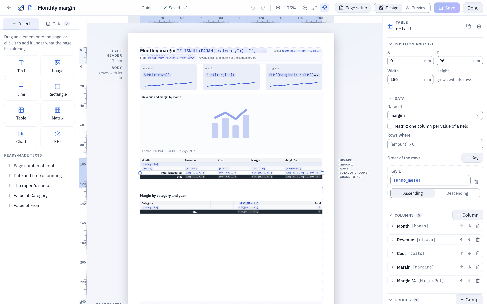
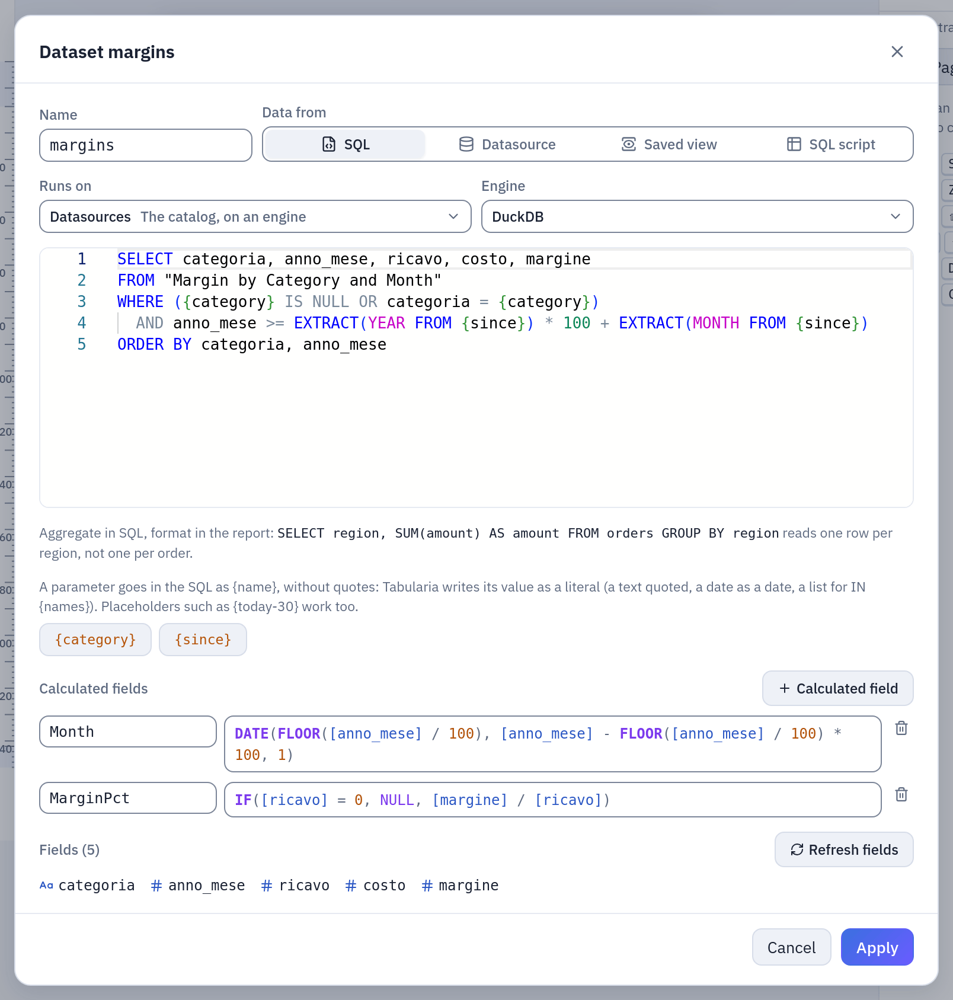
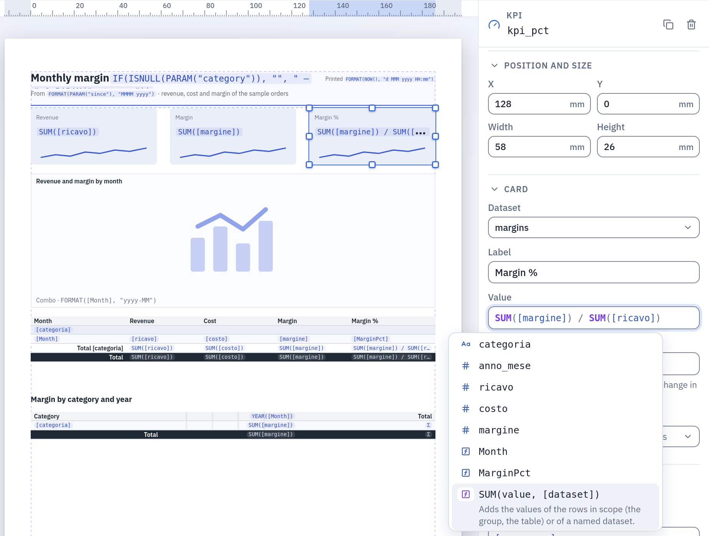
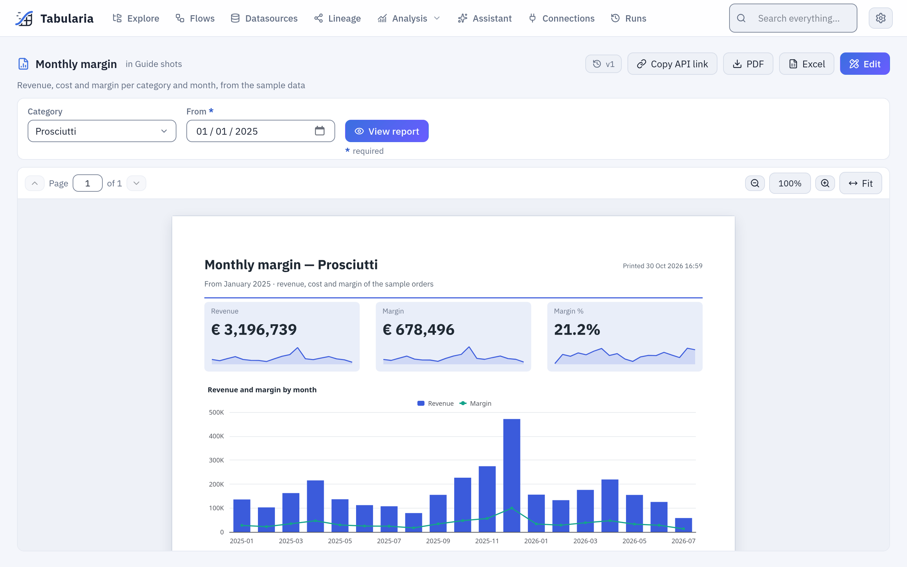

# Pixel-perfect reports

A report is a page of fixed size, designed in the browser to the tenth of a millimetre:
a header and a footer on every page, tables that group and subtotal over as many pages
as the data needs, charts, gauges and KPI cards, texts written with expressions. It is
an object of a folder, with its versions, like a flow or a SQL script. Readers open it
on screen with its parameters and download it as **PDF** or **Excel**; a flow group
**sends it by email** right after the data it shows is refreshed; a script downloads it
through the **API**.

Use the [Viewer](preview-and-analysis.md#the-viewer) to explore a datasource: filters,
pivots and charts that change as you ask. Use a report when the answer has to arrive as
a document: the same layout every month, page numbers and totals in their place, for
people who never open Tabularia and read it as a PDF or in their inbox. Every
installation has reports, Docker Compose included.



*The designer with the report of the [example below](#example-a-monthly-margin-report): the table is selected, its rows labelled on the right of the page (header, group, rows, the group's total, the grand total), its properties in the panel.*

## At a glance

| | |
|---|---|
| Where | Explore → **New** → **Report**, in a folder; it opens in the designer. Readers open it in the viewer from Explore or from **Analysis → Reports**, the most read first |
| What it reads | up to 20 **datasets**: SQL on the catalog or on a database connection, a datasource, a saved view, a saved SQL script |
| What it shows | texts and expressions, images, lines, rectangles, tables and matrices with groups and totals, 14 kinds of chart, KPI cards |
| Parameters | text, number, date or yes/no, one value or several, fixed choices or choices from a dataset; in the SQL as `{name}` |
| Formats | **PDF** (the page as designed), **Excel** (the tables with their groups and subtotals), the **summary in an email** |
| Sending | from a flow group's [Pushmail](../pushmail.md#reports) cell, after the steps that refresh the data; a report has no schedule of its own |
| From code | `GET /reports/{id}/render` with an API token ([API](../api.md#download-a-report)), `tabularia.report()` in a [marimo notebook](notebooks.md#reports) |
| Rights | VIEW on the folder to open and download it, EDIT to design it; the data is read with the rights of whoever reads the report |
| Limits | 3,000,000 rows per dataset and 200 pages per render by default ([`REPORTS__*`](../configuration.md#reports-1)) |

## The designer

**New → Report** in a folder creates «New report» and opens it in the designer. The bar
at the top holds the report's name (write over it to rename), its folder, whether it is
saved and its version, undo and redo, the zoom, **Snap to the millimetre grid**,
**Page setup**, **Design** and **Preview**, **Save** and **Done** (save and open the
report as readers see it). The page sits in the middle with its rulers in millimetres;
on the left, **Insert** holds the elements and **Data** the datasets and the parameters;
on the right, the properties of what is selected: an item, a band (a click on its name
beside the page) or, with nothing selected, the report.

### The page and its bands

**Page setup** sets the paper (A4, A3, A5, Letter, Legal or a size of your own in
millimetres), the orientation and the four margins; the **language** of the report
(English, Italian, German, Spanish, French: the separators of the numbers, the names of
months and days, and the words the report writes by itself, «Page 1 of 3», «Total»); its
**time zone** (`{today}` and `NOW()` are read in it); and the theme: the font (the PDF
embeds IBM Plex Sans), its size, the text colour and the accent that colours the charts
and the sparklines.

A page has three bands:

| Band | What it holds |
|---|---|
| **Page header**, **Page footer** | a fixed height, printed on every page; **Also on the first page** and **Also on the last page** turned off leave them out there. Texts, images, lines and rectangles only: what is the same on every page (a title, a logo, the parameters chosen, `"Page " & PAGE() & " of " & PAGES()`). A field of a dataset is refused here; an aggregate of a named dataset, `SUM([amount], "orders")`, is not |
| **Body** | flows over the pages. Items whose heights overlap make a row and are placed side by side; a **table** takes its row alone, grows with its data and pushes down what is under it (an item dropped beside a table goes under it) |

Every position and size is in millimetres, to a tenth. Items snap to the millimetre grid
while you drag them; the edges and centres of the other items always guide. Held near an
edge of the page's area, a dragged item scrolls it. Where items overlap, the one drawn
last is on top: in the header and the footer the one added last, in the body the one
lower on the page (then the one more to the right), in the designer as in the PDF: a
rectangle meant as a background starts at or above the texts it frames.

### Elements

Drag an element from **Insert** onto the page, or click it to add it under what the page
holds already:

| Element | What it is |
|---|---|
| **Text** | text as written, or an **expression** when it starts with `=`: `="Sales in " & PARAM("region")`. Size, weight, italic, colours, alignment, padding, border, a format, and **Grows with a long text** |
| **Image** | a PNG, JPEG or SVG of at most 512 KiB, kept inside the report (never a link): **Whole**, **Fill** or **Stretch**. An SVG that links outside itself or runs scripts is refused when the report is saved |
| **Line**, **Rectangle** | a rule, a frame or a coloured band |
| **Table** | the rows of a dataset, with columns, groups, subtotals and totals: [tables and matrices](#tables-and-matrices) |
| **Matrix** | a table with one column per value of a field |
| **Chart** | 14 kinds, chosen when it is placed: [charts and KPIs](#charts-and-kpis) |
| **KPI** | one value in large type, its change against another and a sparkline |

**Ready-made texts** are texts written for you: **Page number of total**, **Date and time
of printing**, **The report's name**, and **Value of …** for each parameter.

In **Data**, a field dragged onto a table becomes a new column, and anywhere else in the
body a text that shows it; a click on a field adds it as a column to the selected table.
A table reads one dataset: a field of another is refused.

The keys: **Ctrl+S** saves, **Ctrl+Z** and **Ctrl+Shift+Z** undo and redo; on the page,
the arrows move the selected item by 1 mm (5 mm with **Shift**), **Ctrl+D** duplicates
it, **Ctrl+C** and **Ctrl+V** copy and paste, **Del** removes it. A copy can be pasted
into another report, open in another tab too; if it read a dataset that report does not
have, it reads its only dataset, or waits for one to be chosen, and says so. **Tab**
goes through the bands' names and the items; **Enter** on a band's name selects it.

### Saving and the preview

**Save** keeps the report as a new version. The server checks the whole definition at
every save: a field that does not exist, a function with the wrong arguments, a text
added to a number. A save it refuses lists the problems in the bar; the first item is
selected and the message sits under its field, with the character where the mistake
is. The expression fields check what they can while you type: an expression you are still
writing (`SUM([ric`) is not a mistake, and is said only if you leave the field that way; one
that is finished and wrong is said at once. After a pause the server checks the report as
a save would (the types, where a field may be used, the formats) and says what it finds
under the same fields. If someone else saved
the report since you opened it, **Save** says so and asks before your version becomes
the newest: theirs stays among the versions.

**Preview** renders the report as it is on screen, saved or not, with the values of its
parameters you choose in the same form the viewer has (the lists read from a dataset
included): the same renderer as the PDF, so what you see is what will print. A report with mistakes is not rendered: the preview lists them, and a click on one
takes you to its field in **Design**.


*A table under the chart: four fields dragged into it, a group by `[categoria]` written in its properties. A new column has no total: **Sum**, chosen in the **Total** of each amount, brings the group's total row. **Preview** asks for the parameters as the viewer does, here **Category** `Salami`.*

## Datasets and parameters

A **dataset** is a set of rows the report reads; the items of the report each read one.
In **Data**, **+ Dataset**:

| Data from | What it reads |
|---|---|
| **SQL** | a query on the **catalog** (the datasources you may read, by name, on the engine you choose, as in a [SQL script](../sql-scripts.md)) or on a **database connection** (in the database's own dialect, with **CONNECT** on the connection's folder). Only a query runs, as in a SQL script; as there, the barrier is [a read-only database user](../sql-scripts.md#on-a-database-connection) on the connection |
| **Datasource** | a datasource as it is, with optional **filters** (a column, `=` `<>` `<` `<=` `>` `>=` `in` `contains`, a value or a parameter) applied before the rows are read |
| **Saved view** | a [saved view](preview-and-analysis.md#saved-views) with its filters, computed fields and pivot, plus filters of its own |
| **SQL script** | a saved [SQL script](../sql-scripts.md), its current version, on its catalog or connection: whoever changes the script changes the report. Its parameters are the report's |

A parameter goes in the SQL as `{name}`, **without quotes**: Tabularia writes its value
as a literal of the dialect, never as text pasted into the query. A text is quoted and
escaped, a number checked as a number, a date written `DATE 'yyyy-mm-dd'`, a list
`(a, b, c)` for `IN {regions}` (an empty list stops the render and says so). A parameter
written inside quotes, `'{region}'`, is refused: «write `{region}` without quotes:
Tabularia quotes it». Tabularia's own [placeholders](../placeholders.md) work too,
`{today-30}`, `{start_of_month}`, read in the report's time zone.

**Fields** are the columns the designer last read from the data (**Refresh fields**):
they feed the completion and the checks; the render uses what the data has.
**Refresh fields** also counts the dataset's rows with the parameters' defaults and shows
the number under the dataset: past 500,000 rows an orange warning gives the time a render
will take, past `REPORTS__MAX_ROWS` a red one says the report will not render. Aggregate
in the SQL and format in the report: `SELECT region, SUM(amount) AS amount FROM orders
GROUP BY region` gives the report one row per region, not one per order.
**Calculated fields** are expressions computed for every row, used as any other field.



*The dataset of the example: the SQL with its two parameters in braces (the chips under the editor insert them), the calculated fields `Month` and `MarginPct`.*

A **parameter** is a value the reader chooses. In **Data**, **+ Parameter**:

| Field | |
|---|---|
| **Name** | letters, digits and `_`; not a name of Tabularia's placeholders (`today`, `now`…). In the SQL `{name}`, in an expression `PARAM("name")` |
| **Label in the form** | what the reader sees |
| **Type** | **Text**, **Number**, **Date** or **Yes or no**; **Several values** makes it a list |
| **Required** | the report does not render without a value |
| **Default** | used when the reader gives none: a value, or for a date a placeholder resolved at every render, `{today-30}`, `{start_of_month-1m}` |
| **Choices** | **Any value**, a **Fixed list** (one per line), or **From a dataset** (an expression for the value and one for the label shown; that dataset cannot use the parameter it fills) |

Values arrive as text (the viewer's form, a flow group's cell, the query string of the
API) and are converted and checked against the type and the choices before anything
runs: a value that does not fit stops the render with the parameter's name.

## Expressions

Expressions are a small language of Tabularia's own, close to spreadsheet formulas. The
server parses and evaluates them, never runs them as code. They go wherever a value is
computed: a text that starts with `=`, a column's value and total, a group's key and
label, a rule's condition, a chart's axis and series, a KPI, a table's **Rows where**
and its sort keys, an item's **Shown when**, a calculated field.

| Write | For |
|---|---|
| `[ricavo]` | a field; `]]` for a `]` in its name |
| `"text"`, `12.5`, `TRUE`, `FALSE`, `NULL` | values; `""` for a quote inside a text |
| `{today-7}` | a date [placeholder](../placeholders.md), in the report's time zone |
| `+` `-` `*` `/` | arithmetic; a date plus a number moves it by days, a date minus a date is days |
| `&` | joins texts: `"Total " & [region]` |
| `=` `<>` `<` `>` `<=` `>=` | comparisons, one at a time: join two with `AND` |
| `AND` `OR` `NOT` | conditions |
| `SUM(...)` | functions, in capitals or not |

`!=`, `==`, `&&`, `||`, `^`, `%` and texts in single quotes are not part of the
language: the check says what to write instead. NULL goes through arithmetic and
comparisons (`NULL + 1` is NULL), aggregates skip it, a division by zero is NULL, `&`
writes it as nothing, and a condition that is NULL is false.

**Where an aggregate counts.** An aggregate works on the rows of the place it sits in:
in a group's total row, the group's rows; in the grand total, the table's; in a text, a
KPI or a chart of the body, the rows of its dataset. A dataset named as the last
argument, `SUM([amount], "orders")`, reads that whole dataset instead, which is the only
way to show data in the page header and footer. A field written outside a row (in a
group's total row) is the value of the group's first row.



*The completion (**Ctrl+Space**, or `[` for the fields): the dataset's fields with their types, the calculated ones, then the functions with their arguments; the highlighted one says what it does.*

### Functions

Every function with its cases and an example on the sample data, with the result it
prints, is in [Report functions](report-functions.md), with recipes for a real report:
the margin percentage, the growth on the month before, the share of a category, running
totals, thresholds, dates in titles.

| Function | Arguments | Gives |
|---|---|---|
| `SUM`, `AVG` | `value, [dataset]` | the sum, the average of the values, NULLs left out |
| `MIN`, `MAX` | `value, [dataset]` | the smallest, the largest value |
| `COUNT` | `[value], [dataset]` | how many rows; with a value, how many are not NULL |
| `COUNTDISTINCT` | `value, [dataset]` | how many different values |
| `FIRST`, `LAST` | `value, [dataset]` | the value of the first, the last row |
| `PERCENT` | `aggregate` | the aggregate as a share of the same one level up: a row of its group, a group of the whole. `PERCENT(SUM([amount]))` |
| `RUNNING` | `aggregate` | the running total within the group, row after row: `RUNNING(SUM([amount]))` |
| `ROWNUMBER` | | the number of the row within its group, from 1 |
| `IF` | `condition, value if true, [value if false]` | one value or the other; without the third, NULL |
| `IFS` | `condition1, value1, condition2, value2, …, [else]` | the value of the first true condition, else the last argument |
| `ISNULL` | `value` | true when the value is missing |
| `COALESCE` | `value1, value2, …` | the first value that is not missing |
| `ROUND` | `number, [decimals]` | rounded half away from zero, to 0 decimals by default |
| `ABS`, `FLOOR`, `CEILING` | `number` | without its sign, rounded down, rounded up |
| `POWER` | `number, exponent` | a number raised to the exponent |
| `UPPER`, `LOWER`, `TRIM`, `LEN` | `text` | in capitals, in lower case, without spaces at its ends, its length |
| `LEFT`, `RIGHT` | `text, count` | the first, the last characters |
| `MID` | `text, start, count` | part of a text, from a position (1 is the first character) |
| `REPLACE` | `text, old, new` | every occurrence of `old` replaced |
| `CONTAINS`, `STARTSWITH` | `text, part` | true when the text contains, starts with, the part |
| `TEXT` | `value` | the value as text, as the report would write it |
| `CONCAT` | `value1, value2, …` | the values joined as one text |
| `DATE` | `year, month, day` | a date; an impossible one (30 February) is NULL |
| `YEAR`, `MONTH`, `DAY` | `date` | the year, the month (1 to 12), the day of the month |
| `WEEKDAY` | `date` | the day of the week, 1 (Monday) to 7 (Sunday) |
| `DATEADD` | `unit, count, date` | the date moved by `"d"` days, `"w"` weeks, `"m"` months or `"y"` years; 31 January plus a month is the last day of February |
| `DATEDIFF` | `unit, start, end` | whole days, weeks, months or years from start to end |
| `TODAY`, `NOW` | | today's date, the date and time of the render, in the report's time zone |
| `FORMAT` | `value, pattern` | a number or a date as text: `FORMAT([day], "d MMM yyyy")` (the patterns are below) |
| `PAGE`, `PAGES` | | the page's number and how many pages there are; only in a text, joined with `&` |
| `PARAM` | `"name"` | the value of a parameter, the name in quotes |
| `REPORT` | | the report's name |

Arguments in brackets are optional. An aggregate takes one value at a time: write
`SUM([a]) / SUM([b])`, not an aggregate inside another.

### Formats

The **Format** of a text, a column, a chart or a KPI, and the second argument of
`FORMAT()`, is a pattern. `,` and `.` mark where the separators go; the characters
written are those of the report's language.

| Pattern | Value | English | Italian |
|---|---|---|---|
| `0` | 202401 | 202401 | 202401 |
| `#,##0` | 10478825.4 | 10,478,825 | 10.478.825 |
| `#,##0.00` | 1234.5 | 1,234.50 | 1.234,50 |
| `0.0%` | 0.2453 | 24.5% | 24,5% |
| `€ #,##0` | 2569181 | € 2,569,181 | € 2.569.181 |
| `#,##0 pcs` | 1200 | 1,200 pcs | 1.200 pcs |
| `#,##0;(#,##0)` | -1500 | (1,500) | (1.500) |
| `#,##0;-#,##0;-` | 0 | - | - |
| `d MMM yyyy` | 2026-03-05 | 5 Mar 2026 | 5 mar 2026 |
| `MMMM yyyy` | 2026-03-05 | March 2026 | marzo 2026 |
| `dd/MM/yyyy` | 2026-03-05 | 05/03/2026 | 05/03/2026 |
| `EEEE d MMMM` | 2026-03-05 | Thursday 5 March | giovedì 5 marzo |
| `HH:mm` | 14:30 | 14:30 | 14:30 |

- **Numbers**: `0` a digit always written, `#` one written only when needed, `%`
  multiplies by 100; text before or after the digits as it is, in double quotes when it
  holds `0`, `#` or `%`. Up to three sections separated by `;`:
  positive, negative, zero. Rounding is half away from zero. French groups with a
  space (1 234,50); Spanish starts grouping at five digits (1234, but 12.345).
- **Dates**: `yyyy` `yy` the year, `MMMM` `MMM` `MM` `M` the month (name, short name,
  two digits, one or two), `dd` `d` the day, `EEEE` `EEE` the day of the week, `HH` `H`
  the hour, `mm` `m` the minutes, `ss` `s` the seconds. `M` is the month and `m` the
  minute. Text goes in single quotes, `''` for an apostrophe.
- **Without a format** a whole number is written as it is (a year or a month code is
  never «2,026»), other numbers with separators and up to two decimals, a date in the
  language's own way (`d MMM yyyy` in English, `dd/MM/yyyy` in Italian, Spanish and
  French, `dd.MM.yyyy` in German), a yes/no as Yes or No.
- **In Excel** a cell keeps the raw number or date, with the same pattern as its number
  format, so it can still be summed; a pattern that does not say how to write negatives
  writes them in red.

## Tables and matrices

A table lists the rows of its dataset and grows over as many pages as they need, its
header repeated at the top of every page. Its properties:

| Section | |
|---|---|
| **Data** | the dataset; **Rows where**, a condition that keeps some rows; **Order of the rows**, keys with their direction |
| **Columns** | for each: **Header**, **Value** (an expression), **Width** (millimetres, or automatic), alignment, **Format**, **Total** (**None** until you choose one: **Sum**, **Average**, **Minimum**, **Maximum** or **Count** of the column's value, or an **Expression…**, an aggregate of your own such as `SUM([margine]) / SUM([ricavo])`; printed in the groups' total rows and in the grand total), the style of its cells and its **Conditional formatting** |
| **Groups** | up to six levels, each with **Group by** (an expression), **Label**, **Order**, **Page break** (none, between groups, after each group), **Header row**, **Total row** and **Keep the last rows with their total** |
| **Layout** | **Show the rows** (off: the groups' totals only), **Grand total at the end**, **Header on every page**, **Alternate row shading** |
| **Sheet name in Excel** | the table's sheet when the report is downloaded as Excel |
| **On screen** | **Sort by a column with a click on its header**, **Close and open the groups**: what the reader may do in the viewer |

No column gets a total by itself: a field dragged onto a table, a column added and a new
table have none, because a price or a discount does not add up and only you know which
values do. The table's first total, when no row is there to print it, turns on **Grand
total at the end**; turn it off if you want the groups' totals alone. A table where no column
has a total prints no total rows at all, not even empty ones, and the designer draws none
(a group with its **Header row** off keeps its **Total row**: it is all that names the group).

A group's total row reads «Total» and the group's label, across the columns before the
first one that has a total; when the first column has a total too, the label takes a row
of its own above the values. A group whose value is missing is named «(blank)». A group
that goes on over the next page repeats its label there. **Keep the last rows with their
total** never leaves a total alone at the top of a page. A table with no rows says «No
data», with no total of nothing.

Columns whose widths add up to more than the table are narrowed to fit it, and a value
wider than its column (a long number in a narrow column) would run into the next one:
the preview and the viewer say both, naming the table and the columns, so the design can
be fixed. So does an item that goes past the edge of the paper, and a KPI whose value is
wider than its card.

**Conditional formatting** gives a column's cells a style when a condition about their
row is true: `[MarginPct] < 0.3` in red and bold. A column may have several rules; when
more than one holds, the later ones win where they differ. Rules colour the rows'
cells, not the totals.

A **matrix** is a table with **One column per value of** an expression (at most 60
columns): `YEAR([Month])` gives a column per year. Its groups make the rows, **Value of
the cells** is an aggregate of the rows that meet there (`SUM([margine])`), **Total
column**, which a new matrix leaves off, adds the row totals, and **Grand total at the end**
adds the column totals.

The columns come in the order of the data: each value where it first comes in the rows the
table reads, after its **Rows where** and its **Order of the rows**, as a chart's categories
do with «In the data's order». With levels of columns, each one's values follow the same rule
inside the value above them. So the `ORDER BY` of the dataset's SQL decides: with `ORDER BY
anno_mese`, a column per `FORMAT([Month], "MMM")` reads Jan, Feb, Mar. A value that the first rows
do not have comes where it first shows up, so sort by what makes the columns, before the
rest. A query without `ORDER BY` has no order the database promises, and the columns may
change from one run to the next: order the dataset, or the table. A missing value is a
column too, «(blank)», in its place.


*Page 3 of the example: the group carried over from page 2 repeats its label, the rule paints the margins under 30% red, the group's total and the grand total follow; then the matrix, one column per year.*

## Charts and KPIs

A chart reads its dataset and aggregates it: **Along the axis** says what the bars,
points or slices are (`[region]`, `FORMAT([day], "yyyy-MM")`), and each **Series** is an
aggregate. The server draws the charts, the same in the PDF, on screen and (as images)
in the email.

| Kind | Draws |
|---|---|
| **Bar**, **Column** | horizontal bars, vertical columns; stacked if asked |
| **Line**, **Area** | one line per series along the axis |
| **Pie**, **Donut** | each category's share; values below zero are left out |
| **Combo** | bars and lines together, each series **Drawn as** bars or line, on the left or the right axis, with a **Format of its values** of its own (amounts in euros on the left, a percentage on the right); its axis writes its numbers the same way |
| **Waterfall** | how each category adds to or takes from a total: rises in green, falls in red, the total last |
| **Funnel** | stages from the largest to the smallest |
| **Treemap** | each category as a rectangle sized by its value; with **One series per value of**, nested |
| **Heatmap** | a grid of the axis by **One series per value of**, the colour by the value |
| **Scatter** | one point per category (X the category, Y the aggregate), or one per row with a value that is not an aggregate |
| **Gauge** | one value on an arc, with **Minimum**, **Maximum**, a **Target** and coloured **Bands** |
| **Bullet** | a bar per category against its **Target**, over its **Bands** |

The options: **One series per value of** (the first series repeated for each value of a
field, up to 24), **Stacked**, **Values on the chart**, **Legend**, **Order** and **Top**
(the N largest values of the first series, the rest gathered as «Other»), **Minimum**,
**Maximum**, **Target** (a number or an aggregate), **Bands** (their limits, `50, 80`)
and a **Format** for the values. With **Order** «In the data's order» the categories come
as they first appear in the dataset's rows, so the `ORDER BY` of its SQL decides: sort
the query by the axis (`ORDER BY anno_mese`) and the months follow one another in time,
whatever they print as (`"MMM yy"` too); the series of **One series per value of** and a
KPI's trend follow the same order. «By value, smallest first» and «By value, largest
first» sort the categories by the first series' value instead. With **Top**, the N
largest are kept and shown in the order chosen. A chart draws at most 2,000 categories:
set **Top**, or aggregate.

A **KPI** card shows one aggregate in large type, with its **Label** and **Format**;
**Compared with**, another aggregate, adds the change in percent with an arrow and a
colour; **Show the trend under the value** draws a sparkline of an aggregate **Along** a
field.

The new kinds (combo, waterfall, funnel, heatmap, gauge, bullet, the KPI card) are in
the Viewer's and the assistant's charts too: see
[Preview and analysis](preview-and-analysis.md#more-chart-kinds).

## The viewer

A click on a report in Explore opens it for reading. The bar at the top has one field
per parameter, as the report defines it: a list for those with choices («Any» for an
optional one), a date picker, Yes or No, several values for a list; `*` marks a required
one. The fields open with the defaults. An optional field emptied has no value, whatever
its default; a required one asks for a value. **View report** renders it.



*The example with **Category** `Prosciutti`: the title says which category, and the KPIs and the chart count only its rows. Above, **PDF**, **Excel**, **Copy API link**, the versions and **Edit**.*

The pages are those of the PDF, drawn by the same renderer, with **Page** to move
between them (**Page Up**, **Page Down**), the zoom (**+**, **−**, **0** to fit the
width) and **Fit**. Where the designer allowed it, a click on a column's header sorts the
table by it (again for descending), and a click on a group's label closes or opens it;
**Reset view** goes back to the report's own order with every group open. **PDF** and
**Excel** download the report **as shown**: with the values chosen, the sort and the
groups closed on screen. The API, the flow groups and the notebooks render it in its own
order.


*«Margin growth by month» from January 2026: a click on the header **vs month before**
sorts every group by it (the running revenue follows the new order), a click on the
group's label closes it to its total; **Reset view** puts the report back as designed.*

The other buttons: **Copy API link** (the address a script downloads the report from,
with the values on screen that are not the defaults, so a default such as
`{today-30}` keeps moving with the calendar, and the same as a Python or a curl
example), the **versions** (every save; who may
edit restores an older one, which becomes the newest), and **Edit**, which opens the
designer for who may edit. A report that cannot be rendered says why in words: a value
that does not fit, a dataset you may not read, too much data, too many pages, the time
limit.

## The Reports tab

**Analysis → Reports** in the top bar lists every report you may open, from every
folder, the most read first; **Analysis** also holds the
[Viewer](preview-and-analysis.md#the-viewer). Each row shows the report's name and
description, how many datasets and parameters it has, its folder with the folders above
it, its readers, when it was last opened, and when it was last changed, with its version
and its author. A click on a row opens it in the viewer; on the right, **Open**,
**Edit in the designer** (with EDIT on its folder) and **Copy API link**, the same as in
the viewer, with the report's defaults.


*The tab as an analyst with EDIT on `Sales reports` sees it: «Monthly margin», opened by
five people this month, comes first.*

**Readers · 30 days** is what the default order, **Most read**, follows: the people who
opened the report in the viewer in the last 30 days, with a short bar against the most
read report of the page. Under it, the openings in those days and the openings ever. A
person counts once a day per report: reloading the page, choosing other values or opening
it from three tabs is still one opening. The day is the installation's (`APP__TIMEZONE`).
At the same number of people the report opened more times comes first, then the one
opened more times ever, then the one changed last. **Name** and **Recently changed** order
the list the other ways.

Only the viewer counts: a download through the API, a flow group's email and a notebook
render the report without anyone reading it on screen, and the designer's preview is its
author at work. Who opened a report is kept for 30 days and then removed every hour; the
report keeps its total and the moment it was last opened. The list never says who read a
report, only how many.

The search box looks in the names, the descriptions and the folders: `finance` finds the
reports of a folder *Finance* and of every folder inside it. The list shows 50 reports a
page. The order, the search and the page are in the address, so a link or a reload gives
the same list.


*From the **Analysis** menu: the most read first, then by name; the search finds by
folder (`channels`) and by name or description (`margin`); a click on a row opens the
report.*

## PDF, Excel and the email

| Format | What it is |
|---|---|
| **PDF** | the page as designed: positions exact to a tenth of a millimetre, the font embedded, the header and footer on every page, «Page X of Y». The same data gives the same file |
| **Excel** | one sheet per table and matrix, named by **Sheet name in Excel**: the groups as outline levels (closed and opened with Excel's **+** and **−**), the subtotals and totals as `SUBTOTAL` formulas with their values, numbers that stay numbers in the report's formats (a whole number past 16 digits, an id, and a date before 1900 are written as text: a cell of Excel would change the first and cannot show the second), the header frozen and repeated on printed pages, a page break per group where the report has one; one more sheet lists the parameters' values. A text is never turned into a formula |
| **Email** | the summary in the body of a [Pushmail](../pushmail.md#reports) email, 640 pixels wide: the report's texts, its KPI cards, its charts as images and the totals of every table and matrix ([below](#the-summary-in-the-email)); the detail goes as the attached PDF or Excel |


*Page 1 of 3 of the example's PDF with every category, from January 2025.*

### The summary in the email

The summary follows the body of the report, in its order:

- its texts, its KPI cards and its charts;
- each **table** as its totals: the total row of each of its outermost groups and the
  grand total, with the columns that have a total; a **matrix** as its rows and its total
  column. Five columns of values at most fit the width of an email: a wider matrix shows
  its total column alone, a wider table its first five, and says how many more are in the
  attached report;
- a table with nothing to total (no group with a total row, no grand total) is left out,
  and so is the row of texts right above it that introduces it, its title; a table with no
  text above it is introduced by its **Sheet name in Excel**, when it has one.

Gmail cuts a message longer than about 100 KB: a long summary shows fewer groups per table
(«… and 40 more: the whole report is attached»), then leaves out the last tables («2 more
tables are in the attached report»). The same summary goes as plain text, a line per
total («Total Salami — Revenue 4,854,308 · Margin 1,299,924»), for a mail client that
shows no HTML.

## Sending it by email

A report is sent only by a flow group: a [Pushmail cell](../pushmail.md#reports) attaches
it (PDF or Excel, the values of its parameters, the file's name) and can put its summary
in the email's body. The cell runs after the steps before it, so the email leaves right
after the data it shows has been refreshed, and not at all when a refresh failed.


*The example sent by a flow group to a test mail server: the cell's message, then the report's summary; the whole report is the attached PDF.*

## From scripts: the API and notebooks

Any script downloads a report with an API token that may read, with the values of its
parameters in the query string:

```bash
curl -fG -H "Authorization: Bearer $TABULARIA_TOKEN" -o monthly_margin.pdf \
  --data-urlencode format=pdf --data-urlencode category=Salami --data-urlencode "since={start_of_year}" \
  https://tabularia.example.com/api/reports/12/render
```

The formats, the errors and a Python example are in the API's
[Download a report](../api.md#download-a-report); in a marimo notebook,
[`tabularia.report()`](notebooks.md#reports) does the same in one line.

## With whose rights

A report never lends its author's rights. What it reads is checked dataset by dataset
with the rights of whoever it is rendered for:

| Rendered | Reads with the rights of |
|---|---|
| in the viewer, in the designer's preview | whoever opens it |
| by a flow group | whoever runs the group: the author of its schedule, for a scheduled run, checked again at every send |
| through the API | the token's account |
| in a notebook | the notebook's session, as its reads |

A dataset the reader may not read stops the render with its name, as one that does not
exist (`The dataset «orders»: there is no datasource «Salaries» you can read`): two
people may open the same report and one of them gets an explanation instead of the
pages. SQL on a connection needs **CONNECT** on the connection's folder.

Because a scheduled group sends with its author's rights, someone else who changes what
a report **reads** switches off the schedules of the groups that send it: a dataset added,
or one whose SQL, connection, datasource, view or filters changed; a new default of a
parameter the group's cell does not set itself; a change to a SQL script or to the filters,
computed fields or pivot of a saved view that the report reads. The audit log says why,
and the author schedules the group again after looking. A change of layout, or one made
by the schedule's own author, keeps them. A report that a flow group sends cannot be
deleted until it is taken out of the group's cells.

The other way round, what a report reads by reference (a saved view, a SQL script, a
datasource chosen as such, a connection) cannot be deleted while the report's current
version reads it: the refusal names the reports you may see and counts the others. A
datasource named in a SQL goes by its name, and is not looked for: the report then says
it cannot find it.

## Example: a monthly margin report

With the sample data ([the «Sample» folder](../getting-started-docker-compose.md#a-the-sample-data-already-there)):
a report on the datasource «Margin by Category and Month» (in `Sample / Private tables`,
written by the sample flow of the same name), with the revenue, cost and margin of each
category month by month, a chart and three KPIs on top, and a choice of category and of
the first month.

1. **The report.** In Explore, in a folder of yours (here `Sales reports`), **New →
   Report**. In the designer, write `Monthly margin` over «New report». In **Page setup**
   keep A4 portrait with margins 15 · 12 · 15 · 12, set the language English, the time
   zone `Europe/Rome` and the font size 8.
2. **The categories.** **Data → + Dataset**: name `categories`, **SQL**, **Runs on**
   Datasources, engine DuckDB:

   ```sql
   SELECT DISTINCT categoria FROM "Margin by Category and Month" ORDER BY 1
   ```

3. **The parameters.** **+ Parameter**: name `since`, label `From`, type **Date**,
   **Required**, default `{start_of_year-1y}` (the first of January of last year, at
   every render). Then name `category`, label `Category`, type **Text**, not required,
   no default, **Choices → From a dataset**: `categories`, value and label
   `[categoria]`.
4. **The data.** **+ Dataset**: name `margins`, SQL on the catalog, DuckDB:

   ```sql
   SELECT categoria, anno_mese, ricavo, costo, margine
   FROM "Margin by Category and Month"
   WHERE ({category} IS NULL OR categoria = {category})
     AND anno_mese >= EXTRACT(YEAR FROM {since}) * 100 + EXTRACT(MONTH FROM {since})
   ORDER BY categoria, anno_mese
   ```

   With no category chosen `{category}` is `NULL` and every category stays; `{since}`
   becomes a date, and `anno_mese` holds months as `202501`. Add two **Calculated
   fields**: `Month`, `DATE(FLOOR([anno_mese] / 100), [anno_mese] - FLOOR([anno_mese] / 100) * 100, 1)`,
   the first day of the month as a date; and `MarginPct`, `IF([ricavo] = 0, NULL, [margine] / [ricavo])`.
   **Add**: the fields are read from the data.
5. **The page header.** Click **Page header** beside the page, then in **Insert** a
   **Text**, **Expression**:
   `="Monthly margin" & IF(ISNULL(PARAM("category")), "", " — " & PARAM("category"))`,
   size 14, bold. Under it a text
   `="From " & FORMAT(PARAM("since"), "MMMM yyyy") & " · revenue, cost and margin of the sample orders"`,
   size 8, grey; on the right the ready-made **Date and time of printing**; a **Line**
   across, 0.4 mm, in the accent colour. Header height 17 mm.
6. **The KPIs.** Click **Body**, then three **KPI** cards side by side, 58 mm wide, on
   `margins`: `Revenue`, `SUM([ricavo])`, format `€ #,##0`; `Margin`, `SUM([margine])`,
   `€ #,##0`; `Margin %`, `SUM([margine]) / SUM([ricavo])`, `0.0%`. Each with **Show the
   trend under the value** along `[anno_mese]`, the same value.
7. **The chart.** A **Chart**, kind **Combo**, the full width under the cards, title
   `Revenue and margin by month`: along the axis `FORMAT([Month], "yyyy-MM")`, series
   `Revenue`, `SUM([ricavo])`, drawn as bars, and `Margin`, `SUM([margine])`, as a line;
   format `#,##0`.
8. **The table.** A **Table** under the chart. In **Data**, drag `Month`, `ricavo`,
   `costo`, `margine` and `MarginPct` onto it. Open `ricavo`, `costo` and `margine` and
   choose **Sum** as their **Total**.
   Name the headers `Month`, `Revenue`, `Cost`, `Margin`, `Margin %`; give `Month` the
   format `MMMM yyyy` and the amounts `#,##0`; `Margin %` the total **Expression…**
   `SUM([margine]) / SUM([ricavo])`, the format `0.0%` and a **Rule**: when
   `[MarginPct] < 0.3`, red and bold. **Order of the rows**: `[anno_mese]`.
   **+ Group**: `[categoria]`. **Grand total at the end** is already on, from the first
   total you chose; tick **Alternate row shading** and both **On screen** options. The [GIF above](#saving-and-the-preview)
   shows the drag and the group.
9. **The matrix.** Under the table a text `Margin by category and year` (size 10, bold)
   and a **Matrix**: rows grouped by `[categoria]`, **One column per value of**
   `YEAR([Month])`, **Value of the cells** `SUM([margine])`, format `#,##0`; tick **Total
   column**. The years come in the order of the rows, which the query sorts by `anno_mese`
   within each category.
10. **The footer.** Click **Page footer**, add the ready-made **The report's name** on
    the left and **Page number of total** on the right.
11. **Preview** and look at it, then **Done**: the report is saved and opens in the
    viewer. It has three pages; with **Category** `Prosciutti`, one.
12. **PDF** downloads it. To send it every month, put it in a flow group after the
    refresh of its data: step 1 the flow «Margin by Category and Month», step 2 a
    [Pushmail cell](../pushmail.md#reports) with the report as PDF, the file name
    `monthly_margin_{today:yyyyMM}` and **Summary in the email body**; then
    **Schedule** the group, for example `0 7 1 * *`, at seven on the first of every
    month.

Who reads it needs VIEW on `Sales reports` and on `Sample / Private tables`, where the
datasource is; who sends it from a flow group needs, besides, what the
[group and the Pushmail cell](../pushmail.md#what-is-checked-and-when) need.

## Permissions

| On the report's folder | You can |
|---|---|
| VIEW | open it, choose its values, read it on screen, download it as PDF or Excel, copy its API link, read its versions |
| EDIT | create it, design and save it, rename, move, duplicate and delete it, restore a version |

Whoever has VIEW only is taken to the viewer when they open the designer's address.
Administrators see every report. Reports show in Explore, with their own icon, in the
search and in the [Reports tab](#the-reports-tab). Every save, rename, move, duplicate,
delete and restore is in the [audit log](../governance/audit-log.md) (`report.create`,
`report.update`…), and so is every render (`report.render`), with its format, the values of its parameters, the
outcome and where it came from: the interface, the API, a notebook or a flow group.

## Limits and good to know

- A dataset reads at most `REPORTS__MAX_ROWS` rows (3,000,000 by default): one more stops
  the render and names the dataset. The query is cut at the source, so a `SELECT *` on a
  big table costs no more than that many rows. A report is a document, not an export:
  aggregate in the SQL where you can. The report works out its groups, totals, charts and
  KPIs over the rows in columns, with DuckDB: a million rows grouped with their totals
  take a second or two and some 500 MB of the worker's memory, a thousand totals almost
  nothing. Shown row by row they would not fit the pages: a table with more rows to show
  than its pages can hold stops at once and says so. A render makes at most `REPORTS__MAX_PAGES` pages (200); its
  layout runs in a process of its own with `REPORTS__RENDER_MEMORY_MB` of memory
  (1024: some 200 pages of tables) and `REPORTS__RENDER_SECONDS` of time (120). See the
  [configuration](../configuration.md#reports-1).
- Charts are drawn by a chart service: the `chart-renderer` service on Docker Compose, a
  sidecar of the worker pods on Kubernetes. When it does not answer, a report with charts
  fails and says so; the others still render.
- At most 20 datasets and 50 parameters per report, six levels of groups per table, 60
  columns per table or matrix, 2,000 categories per chart, an expression of 4,000
  characters, an image of 512 KiB.
- The screen is drawn from the same pages as the PDF; sorting and closing groups render
  it again, which takes as long as a render.
- No subreports and no Word output. A report has no lineage of its own: it writes no
  dataset. Its schedule is that of the flow group that sends it.

## Related

- [Report functions](report-functions.md): every function with examples on the sample data
- [Pushmail](../pushmail.md#reports): sending a report from a flow group
- [Flow groups](flow-groups.md) and [Scheduling](scheduling.md)
- [API: download a report](../api.md#download-a-report),
  [marimo notebooks](notebooks.md#reports)
- [SQL scripts](../sql-scripts.md), [Preview and analysis](preview-and-analysis.md)
- [Date placeholders](../placeholders.md)
- [Configuration: reports](../configuration.md#reports-1)
