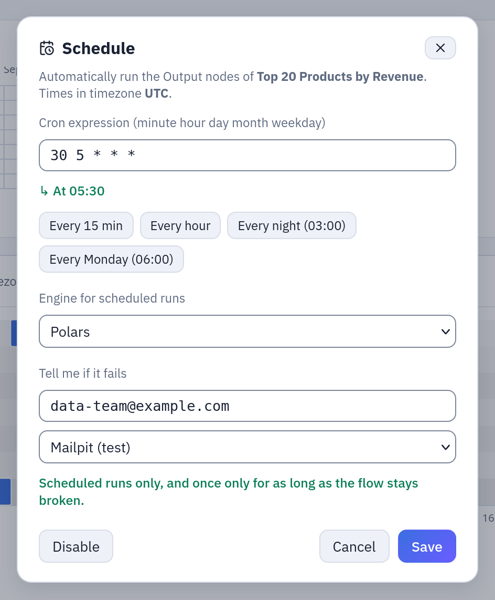
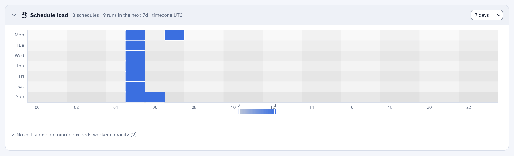

# Scheduling

A schedule runs a flow, a datasource import, a script or a flow group by itself, at the
times a cron expression gives, with the rights of the person who set it. It is how a
report stays current without anyone pressing a button, and how an administrator can
still tell, months later, who is answerable for each job that runs at night.

## At a glance

| | |
|---|---|
| What can be scheduled | flows, datasources read from a connection (database, S3, SFTP, API, SharePoint), saved Python or R scripts, SQL scripts that write a datasource, flow groups |
| How | a 5-field cron expression: `minute hour day-of-month month day-of-week` |
| Time zone | one for the whole installation: `APP__TIMEZONE`, or Administration → Settings → «Time zone of the schedules» |
| Rights | those of whoever set the schedule, checked again every time it fires |
| Precision | the scheduler looks every 60 seconds: a job starts within a minute of its time |
| Who runs it | the gateway processes with `APP__ROLE` `all` or `orchestrator` |
| Permission to set one | RUN on the object's folder (plus CONNECT on the connection, for an import) |

## Where to set one

| Object | Where | Button |
|---|---|---|
| Flow | **Flows** tab, the calendar icon on the flow's row | «Schedule run» |
| Datasource | **Datasources** tab, the datasource's row | «Schedule automatic refresh (cron)» |
| Saved script | the script's page | **Schedule** |
| SQL script | the script's page, once it writes a datasource ([SQL scripts](../sql-scripts.md#on-a-schedule)) | **Schedule** |
| Flow group | the group's page | **Schedule** |

Each opens the same dialog: the cron expression, its meaning in words as you type
(«At 06:30, Monday through Friday»), four presets («Every 15 min», «Every hour»,
«Every night (03:00)», «Every Monday (06:00)») and the time zone the times are read in.
**Disable** removes the schedule. For a flow the dialog also has:

- **Engine for scheduled runs**: the production engine; «same as development» by
  default. Flow groups run their flows on it too.
- **Tell me if it fails**: addresses and an SMTP connection. An email goes out when a
  scheduled run fails after one that succeeded, once for as long as the flow stays
  broken; runs started by hand never send it.

*The dialog of a flow, as in step 2 of the example below: cron `30 5 * * *`, the production engine, and **Tell me if it fails** with an address and an SMTP connection.*

A flow can be scheduled only when it has something to run (an Output, a refresh or a
run-flow node), a flow group when it has at least one cell, a saved script when it has
code, a SQL script when its author could write its datasource now.

The next run shows next to the object: «next run …» in the Flows tab, «· next …» in
the Datasources tab, **Next run** in a group's run bar. Times on screen are in your
browser's time zone.

## How it works

### Cron and time zone

The expression has five fields, read in the installation's time zone, daylight saving
included: `0 3 * * *` fires at 03:00 local wall time all year, not at 03:00 UTC.
Schedules are stored in UTC. Changing the time zone in Administration → Settings
recomputes the next run of every schedule.

| Expression | Runs |
|---|---|
| `*/15 * * * *` | every 15 minutes |
| `0 * * * *` | at the start of every hour |
| `0 3 * * *` | every night at 03:00 |
| `30 6 * * 1-5` | Monday to Friday at 06:30 |
| `0 7 * * 1` | every Monday at 07:00 |
| `0 6 1 * *` | on the first day of every month at 06:00 |
| `0 8-18/2 * * 1-5` | every two hours from 08:00 to 18:00, on weekdays |
| `0 0 1 1,4,7,10 *` | at midnight on the first day of each quarter |

When both day-of-month and day-of-week are set, the job runs on either (standard cron
behaviour): `0 6 1 * 1` runs on the 1st **and** on every Monday.

### Whose rights

A schedule remembers who set it. Every run it starts uses that person's rights, not
those of the person who last edited the object, and they are checked again each time:

| Object | Checked when it fires |
|---|---|
| Datasource | RUN on its folder, CONNECT on its connection |
| Flow | everything the run will need: RUN on the flow's folder and on every flow it runs, read access to every source and file, RUN and CONNECT for every refresh, CONNECT for the connections it writes to, EDIT where it publishes, the use of its scripting environments and registries |
| Flow group | RUN on its folder, then the same for every cell ([flow groups](flow-groups.md#with-whose-rights)) |
| Saved script | to see it and use its environment, RUN on its folder; when the run starts, read access to its inputs and EDIT where it publishes |
| SQL script | to see it, RUN on its folder; then what a write needs: the datasources it names, EDIT on the datasource's folder, CONNECT on its connection |

### What switches a schedule off

A schedule switches itself off, and the audit log records why, when:

- **the author is gone**: deactivated or deleted. The schedule turns off at its next slot;
- **the author lost the basic right**: RUN on the folder (and, for a datasource, CONNECT
  on its connection; for a script, the use of its environment);
- **someone else widened it**: an edit by another person that makes the object read or
  write more than the author chose (a new datasource, file, connection, publish folder,
  other code or another image for a flow; a new cell or a changed Container or Pushmail
  cell for a group; other SQL, another connection or another target folder for a SQL
  script). Changes that only remove things, and the author's own changes, keep it;
- **someone else moved it** to another folder;
- **a script it runs changed**: when a saved script or a SQL script is widened by
  someone else, the schedules of the flows and groups that run it, set by others, turn
  off too.

When the author keeps the basic right but lacks something deeper (for a flow, read
access to one source; for a group, CONNECT on one refresh's connection), the schedule
stays on, and each slot records a failed run that says what is missing: «Scheduled
run not started: the schedule runs with the rights of … who no longer has …». Restore
the right, or set the schedule again as someone who has it.

### From the slot to the run

- **Flows, flow groups, saved scripts** are queued in the database and picked up by an
  orchestrator process, which follows each step to its end. A run still queued after
  `ORCHESTRATOR__QUEUE_TIMEOUT_SECONDS` (900 by default) is closed as failed.
- **Datasource imports and SQL script writes** go straight to the engine's workers.
- **One at a time.** When the object is still running at its next slot, that slot is
  skipped; the log says so.
- **Missed slots.** If no orchestrator was running at the time of a slot, the job runs
  once when one is back, and the following slot is computed from then: missed slots
  are not run one after the other.

### Several gateways

The gateway can run as several processes: `APP__ROLE=api` only answers requests,
`orchestrator` only does the background work (schedules, flow runs, clean-up), `all`
does both. Every process with `all` or `orchestrator` runs the scheduler. They share
the work through the database: each due slot is taken by exactly one process, with a
conditional update, before the job is launched. If that process dies between taking
the slot and launching, the slot is lost (one run fewer), never run twice. The
machines' clocks must agree within `ORCHESTRATOR__DEAD_AFTER_SECONDS`.

### Seeing the load

The **Flows** tab shows the **Schedule load**: a day-by-hour heat map of the flows and
datasource imports scheduled over the next days, with the minutes where more jobs start
together than the workers can carry (`SCHEDULING__WORKER_CAPACITY`). Spread the crowded
ones by a few minutes: `5 3 * * *` instead of `0 3 * * *`.

## Example: a nightly chain with the sample data

The sample `Sample / Flows` folder already has three scheduled flows (`0 6 1 * *`,
`30 5 * * *`, `0 7 * * 1`). To keep their sources current:

1. **Datasources**, row `orders` → «Schedule automatic refresh (cron)» → `0 5 * * *`
   → **Save**. Do the same for `order_rows` at `0 5 * * *`.
2. **Flows**, row «Top 20 Products by Revenue»: it is already scheduled at
   `30 5 * * *`, half an hour after the imports. Open the dialog, set **Tell me if it
   fails** to `data-team@example.com` with your SMTP connection, **Save**.
3. Look at **Schedule load** in the Flows tab: 05:00 holds two imports, 05:30 one flow.

***Schedule load**: the next seven days hour by hour; the darker the cell, the more runs start in it. Below, whether any minute exceeds the workers' capacity.*

Two schedules half an hour apart work as long as the imports take less than half an
hour. When the order matters, put the jobs in a [flow group](flow-groups.md) with one
schedule: the flow then starts when both imports have succeeded, and does not start
when one has failed.

If the person who set these schedules leaves the company and their account is
deactivated, the imports and the flow stop at their next slot; the audit log shows
each schedule turned off with the reason. Someone with the rights sets them again.

## Permissions

| To | You need |
|---|---|
| set or remove a flow's, a group's or a script's schedule | RUN on its folder |
| set or remove a datasource's schedule | RUN on its folder and CONNECT on its connection |
| see that something is scheduled, and when it runs next | VIEW on its folder |
| change the time zone | administrator (Administration → Settings) |

Every schedule set, changed, removed or switched off is in the audit log
(`flow.schedule`, `datasource.schedule`, `flow_group.schedule`, `script.schedule`,
`sql_script.schedule`).

## Limits and good to know

- Five fields only, minute precision; the scheduler looks once a minute.
- One time zone for the whole installation; a schedule cannot have its own.
- Saved scripts run on Kubernetes only: on Docker Compose their schedules do not fire.
- Scheduled flow runs use the flow's production engine and read all the data: the
  development sample of the editor does not apply.
- A run that only fails some of its rights does not turn the schedule off: watch the
  failed runs, or set **Tell me if it fails** on the flow, or a webhook
  ([API and webhooks](../api.md#webhooks)).
- To start jobs from another scheduler instead, use the [API](../api.md) with a token.

## Related

- [Flow groups](flow-groups.md): several jobs in order on one schedule
- [Flows](flows.md)
- [SQL scripts](../sql-scripts.md#on-a-schedule), [Python and R](../scripting.md#running-and-scheduling)
- [Configuration: orchestration and scheduling](../configuration.md#orchestration-and-scheduling)
