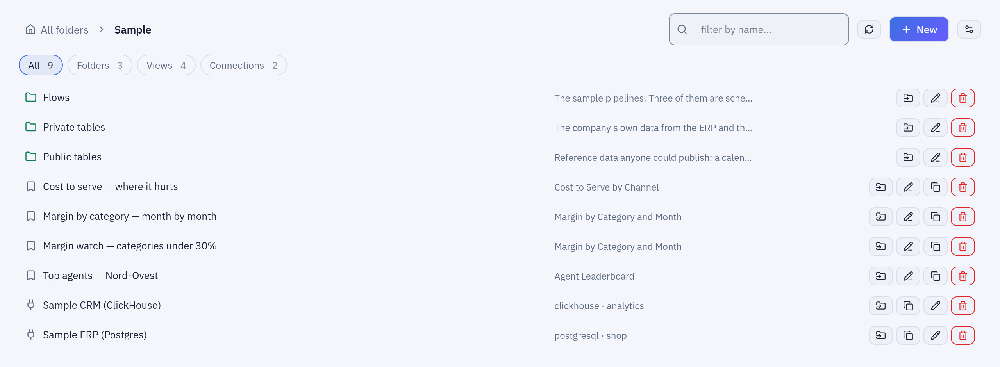

# Concepts

Tabularia is a workspace of folders that hold connections, datasources, flows, scripts
and flow groups, with permissions set on the folders. This page is the mental model in
one place, for anyone arriving: what each object is, how they work together, who may do
what, and which services run behind them. Every section points to the page that goes
into detail.

## At a glance

| Object | What it is | Lives in | More |
|---|---|---|---|
| Folder | A node of the workspace tree; carries the permissions | Explore | [Permissions](governance/permissions.md) |
| Connection | The address and credentials of a database, SFTP server, S3 bucket, HTTP API, SharePoint site or SMTP server | a folder | [Connections](connections/README.md) |
| Datasource | A named table of the catalog: a parquet snapshot in the object storage | a folder | [Sources](sources/README.md) |
| Flow | A pipeline drawn on a canvas: source nodes, operations, Output nodes | a folder | [Flows](capabilities/flows.md) |
| Saved view | A Viewer configuration (filters, pivots, charts) over a datasource; never the rows | a folder | [Preview and analysis](capabilities/preview-and-analysis.md) |
| Script | Python or R code with its versions, run on Kubernetes | a folder | [Python and R](scripting.md) |
| SQL script | SQL over the catalog or over a database connection | a folder | [SQL scripts](sql-scripts.md) |
| Report | A paginated, pixel-perfect document over datasets, with parameters: read on screen, downloaded as PDF or Excel, sent by email | a folder | [Reports](capabilities/reports.md) |
| Flow group | Flows, refreshes, scripts, SQL scripts, images and emails in steps | a folder | [Flow groups](capabilities/flow-groups.md) |
| Run | One execution, with its outcome, timings, engine and log | the **Runs** page | below |
| User, group, service account | Who signs in or calls the API, and how they are grouped | **Administration** | [Permissions](governance/permissions.md) |

## Folders and permissions

Everything lives in a folder, and folders nest. **Explore** shows the tree: a folder
lists its subfolders, flows, datasources, views, connections, scripts, SQL scripts,
notebooks, reports and flow groups.
Root folders are created by administrators; a subfolder by whoever has **MANAGE** on
its parent.



***Explore** in the `Sample` folder: the subfolders `Flows`, `Private tables` and `Public tables`, the saved views and the two connections, with a filter by kind at the top.*

Permissions are granted on a folder, to a user or to a group, and hold for every folder
below it. There are five:

| Permission | Allows |
|---|---|
| **VIEW** | seeing the folder and opening what it holds, its connections excepted |
| **RUN** | VIEW, and running its flows, refreshes and flow groups |
| **EDIT** | RUN, and creating, changing, moving and deleting what it holds |
| **MANAGE** | everything, including the folder's permissions and its subfolders |
| **CONNECT** | seeing, using and creating the folder's connections, and nothing else; MANAGE includes it |

Grants only add: there are no deny rules. Administrators can do everything. Access to
data follows the same rules: a flow, a script or the AI assistant reads only the
datasources its user may see.

## Connections and datasources

A **connection** holds where a system is and how to sign in to it. Its secrets are
encrypted at rest and never returned by the API. Creating, testing or reading through a
connection needs **CONNECT** on its folder.


*The **Connections** page lists every connection you can see, with its type, address and folder.*

A **datasource** is the unit of data everyone else works with: a name in a folder, a
schema, field descriptions and, when you want one, a data contract. Its rows are a
**parquet snapshot** in the object storage. A datasource is made by:

- **«Datasource from a database»** in Explore, which reads a table or a query through a
  connection (databases, an SFTP or S3 folder, an HTTP API, SharePoint) and keeps the
  result; a **refresh** reads the source again, by hand or on a schedule, and replaces
  the snapshot (or appends by key, for the sources that support it);
- an **Output node** of a flow that publishes its result as a datasource;
- a **SQL script** that writes its result into a datasource.

Files can also be uploaded straight into a flow from the editor's toolbar
(**«Upload file»**). Reading from a datasource never touches the source system: flows,
the Viewer and the assistant read the snapshot.

## Flows, engines and previews

A **flow** is a graph drawn in the editor: **source** nodes that read datasources,
**operations** (select, filter, join, group by, pivot, compute, SQL…) and **Output**
nodes that write the result: a datasource, a database table, a file on SFTP or S3, an
email. On Kubernetes, **Script** and **Container** nodes run your code and your images
as steps of the same flow.

Saved, a flow is a declarative description, not code for one engine. At preview or run
time the gateway turns each Output's branch into a list of typed operations, for
example:

```json
[
  {"type": "group_by", "params": {"by": ["codice", "nome", "categoria"],
    "aggregations": [{"column": "ricavo_netto", "func": "sum", "alias": "ricavo"}]}},
  {"type": "sort", "params": {"by": "ricavo", "descending": true}},
  {"type": "limit", "params": {"n": 20}}
]
```

and an **engine** executes it: Polars (the default), DuckDB or chDB inside the workers,
or an external ClickHouse or Google BigQuery. A flow has a development engine, used by
the editor, and an optional production engine, used by schedules and **«Run in
production»**. The engines follow one data standard; the differences that remain are
listed in [Engine differences](engines/engine-differences.md).

A **preview** is what you see when you click a node: the result of the flow up to that
step, computed on the whole dataset unless a development sample is set on the source
node (or the installation sets an automatic one). Previews run on workers of their own,
so they never wait behind a run; a newer preview of the same step replaces one still
running; the output of intermediate steps is cached up to a size cap, so changing the
last step usually does not recompute the first ones.

Every save that changes a flow keeps a version; an old version can be brought back.
More in [Flows](capabilities/flows.md) and [Preview and analysis](capabilities/preview-and-analysis.md).

## Runs and history

A **run** is one execution: of a flow, of a datasource refresh, of a SQL script, of a
script or of a flow group. It is queued, taken by a worker and closed as `SUCCESS` or
`FAILURE`, with the engine it ran on, its timings, the rows it wrote and, when it failed,
the error. The **Runs** page lists them, with who started each or whether a schedule
did; a run's result can be downloaded. The log a script or a
container printed is kept with the run for `ORCHESTRATOR__LOG_RETENTION_DAYS` days.

## Scripts, flow groups and schedules

- **Python and R scripts** run as Kubernetes Jobs in environments an administrator
  defines; they are saved in folders with their versions, and run on their own, in a
  flow (Script node) or in a flow group. Kubernetes only: [Python and R](scripting.md).
- **SQL scripts** run SQL on the catalog's datasources, with the engine you choose, or
  on a database through a connection, and can write a datasource:
  [SQL scripts](sql-scripts.md).
- A **flow group** is a grid of steps: the cells of a step run in parallel (flows,
  datasource refreshes, scripts, SQL scripts, container images, [Pushmail](pushmail.md)
  emails), the steps one after the other, and a failed step stops the group:
  [Flow groups](capabilities/flow-groups.md).
- A **report** is a page designed in millimetres over datasets, with parameters, read on
  screen and downloaded as PDF or Excel; it has no schedule of its own: a flow group's
  Pushmail cell sends it after the data is refreshed: [Reports](capabilities/reports.md).
- A **schedule** is a cron expression on a flow, a datasource refresh, a script, a SQL
  script or a flow group, read in the installation's time zone (`APP__TIMEZONE`). A
  scheduled run acts with the permissions of the person who set the schedule:
  [Scheduling](capabilities/scheduling.md).

Inputs and outputs can carry [dynamic dates](placeholders.md) such as
`sales_{yesterday:yyyyMMdd}.csv`, resolved at every run.

## Users, groups and service accounts

- **Users** sign in with an email and a password, or through single sign-on with an
  OIDC provider ([Single sign-on with Keycloak](sso-keycloak.md)).
- **Groups** collect users; permissions granted to a group hold for its members. With
  SSO, groups can follow the identity provider's groups or roles.
- **Administrators** see and change everything, as a personal flag or as members of an
  administrators group. **Observers** read the administration pages without changing
  anything.
- **Service accounts** are integrations, not people: they have no password, receive
  permissions like a user and call the API with tokens ([API](api.md)).

Every sign-in, change, run, export and permission change is written to the **audit
log**.

## Architecture in brief

```
                 Browser
          pages │       │ API calls (HTTPS)
                ▼       ▼
 Frontend (Nuxt)        Gateway (FastAPI) ──────── PostgreSQL
                        sign-in, permissions,      users, folders, flows,
                        audit, schedules, runs     runs, schedules, audit
                             │ internal token
                             ▼
                        Engine API (FastAPI) ───── Valkey
                             │                     queues, step-cache index,
                             ▼                     preview slots, counters
                        Celery workers
                        «celery»: runs, imports, exports
                        «preview»: previews
                             │
         ┌───────────────────┼──────────────────────┐
         ▼                   ▼                      ▼
   Object storage      External engines       Your databases, SFTP,
   raw/ datasets/      ClickHouse, BigQuery   S3, HTTP APIs, SMTP
   cache/ out/         (optional)
```

| Component | Role |
|---|---|
| Frontend | The web interface. The browser calls the gateway directly. |
| Gateway | The only entry point: sign-in, permissions, audit log, the metadata. Its **orchestrator** role fires the schedules and runs flows and flow groups; it can run as a separate process (`APP__ROLE`). |
| PostgreSQL | The metadata: users, groups, folders, flows and their versions, connections, runs, schedules, the audit log. |
| Engine API | Internal, reachable only by the gateway: turns every preview and run into a task for the workers. |
| Valkey | The Celery broker, the index of the step cache, the preview slots, the counters behind the metrics. Any Redis-compatible server works. |
| Workers | Celery processes on two queues, running the in-process engines and the clients of the external ones. **Beat** schedules the periodic housekeeping. |
| Object storage | One S3-compatible bucket (MinIO, AWS S3, Google Cloud Storage…): `raw/` uploads, `datasets/` snapshots, `cache/` steps, `out/` results. |
| Kubernetes Jobs | On Kubernetes, scripts and container images run as Jobs in namespaces of their own, with limits and network policies. |

The interactive diagrams: [runtime architecture](architecture/runtime-architecture.html)
and [metadata database schema](architecture/metadata-schema.html).

## Example: from a database table to a daily report

The `Sample` folder of the development stack, step by step:

1. **A connection.** `Sample` holds the connection «Sample ERP (Postgres)» to the
   order system.
2. **Datasources.** In `Sample / Private tables`, the datasources `order_rows` and
   `products` are snapshots of the tables `vendite.righe_ordine` and
   `catalogo.prodotti`, read through that connection.
3. **A flow.** In `Sample / Flows`, «Top 20 Products by Revenue» reads `order_rows`,
   computes the net revenue of each line, joins `products`, groups by product, sorts by
   revenue and keeps 20 rows. Clicking any node previews its result.
4. **An output.** Its Output node publishes the datasource «Top 20 Products by Revenue»
   in `Sample / Private tables`, which the Viewer, the assistant and other flows can read.
5. **A schedule.** The flow runs at `30 5 * * *`, every day at 05:30, on its production
   engine; each run appears on the **Runs** page.
6. **Permissions.** A sales team given **VIEW** on `Sample / Private tables` reads the
   report; nobody in it needs **CONNECT** on the ERP connection, because the report reads
   the snapshot, not the database.

## Good to know

- Python and R scripts, Script and Container nodes need Kubernetes; on Docker Compose
  they are greyed out with the reason. SQL scripts work everywhere.
- A datasource is a snapshot: it is as fresh as its last refresh or publish.
- An administrator decides which engines may be chosen; the external ones exist only
  once configured.
- Docker Compose is for trying Tabularia; production runs on Kubernetes with the Helm
  chart ([Kubernetes and Helm](deploy/kubernetes.md)).

## Related

- [Getting started with Docker Compose](getting-started-docker-compose.md)
- [Capabilities](capabilities/README.md)
- [Sources](sources/README.md)
- [Connections](connections/README.md)
- [Integrations](integrations/README.md)
- [Permissions](governance/permissions.md)
- [Configuration reference](configuration.md)
