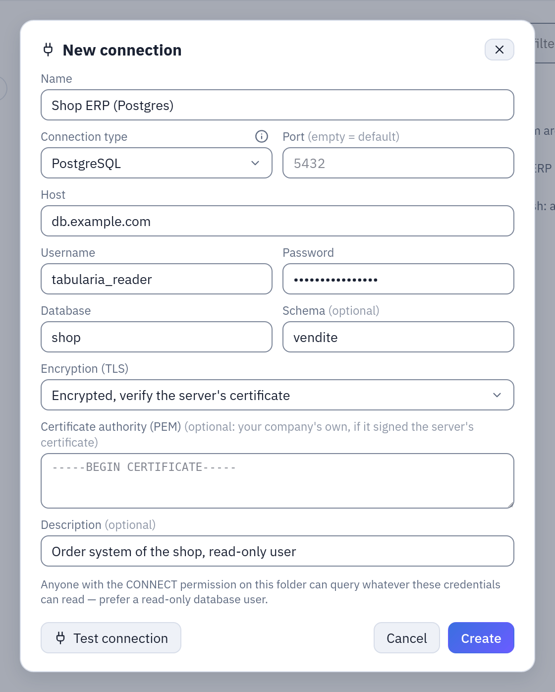
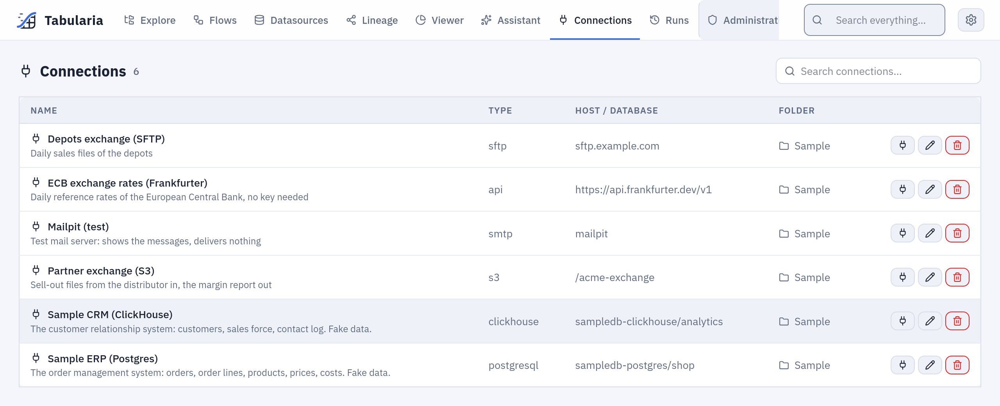

# Connections

A **connection** holds the address and the credentials of a system outside Tabularia —
a database, a bucket, a mail server, an SFTP server, a SharePoint site, an HTTP API — so
that datasources, flows, SQL scripts and flow groups can read from it or write to it
without anyone typing a password twice. It lives in a folder, it is used by whoever has
the **CONNECT** permission there, and its secret is encrypted and never shown again.
This page maps every type and the rules they share; each type has its own page.

## Every type at a glance

| Type (as in the form) | Reads into Tabularia | Writes or sends out | Default port | Authentication | Page |
|---|---|---|---|---|---|
| PostgreSQL | a datasource from a table or a SQL query; SQL scripts | Output node «Database table» | 5432 | user and password | [Databases](databases.md#postgresql) |
| MySQL, MariaDB | as PostgreSQL | as PostgreSQL | 3306 | user and password | [Databases](databases.md#mysql-and-mariadb) |
| ClickHouse | as PostgreSQL | as PostgreSQL | 8123 (HTTP); 8443 for HTTPS | user and password | [Databases](databases.md#clickhouse) |
| Trino | as PostgreSQL | as PostgreSQL | 8080 | user; with a password, HTTPS and basic authentication | [Databases](databases.md#trino) |
| Oracle | as PostgreSQL | as PostgreSQL | 1521 | user and password | [Databases](databases.md#oracle) |
| Microsoft SQL Server | as PostgreSQL, once the driver is added | as PostgreSQL, once the driver is added | 1433 | user and password | [Databases](databases.md#sql-server) |
| S3 / object storage | a datasource «S3 folder» | Output node «File on S3 / object storage»; the copy of a datasource Output to S3 | the endpoint URL's | access key ID and secret access key | [S3](s3.md) |
| SMTP / email | — | Output node «Email with attachment»; Pushmail cells of flow groups; failure notices of scheduled flows; data contract notifications | 587 | user and password, optional | [SMTP](smtp.md) |
| SFTP (files) | a datasource «SFTP folder» | Output node «SFTP server (file)» | 22 | password or private key, and the server's host key | [SFTP](../sftp.md) |
| SharePoint | a datasource from Excel files of a document library | — | HTTPS (Microsoft Graph) | an app registered in Entra ID: client ID and secret | [SharePoint](../sources/sharepoint.md) |
| HTTP API (REST/JSON) | a datasource «API call» | — | the base URL's | none, API key, bearer token, basic, OAuth2 client credentials | [HTTP APIs](../api-datasource.md) |

All the destinations of an Output node, with an example each, are on
[Writing data out](destinations.md). The sources, connection-based or not (uploaded files,
datasources published by flows), are on [Sources](../sources/README.md).

**Container registries are not connections.** The registries the Container node pulls
images from are defined by an administrator in **Administration → Container
registries**, granted to groups and users rather than living in a folder, tested from the
gateway, and their images are downloaded by the cluster's nodes. See
[Container registries](../container-registries.md).

## How it works

### Where a connection lives

A connection is created from a folder in Explore: **New → New connection**, shown only
where you have CONNECT. The form asks for a **Name** (unique in the folder), the
**Connection type**, the fields of that type and an optional **Description**. The **(i)**
beside the type, «Example of the fields», shows every field of the type filled with
made-up values and a tip; nothing is copied into the form.



***New → New connection**: the name, the type, the type's fields. A secret is shown as dots and never comes back from the server.*

The **Connections** page of the main menu lists every connection you may use, from every
folder, with a search over name, host and database; from there a connection is tested,
edited or deleted. A connection is moved to another folder like any object of Explore,
and duplicated there as «name (1)»: the copy keeps the stored secret.



*The **Connections** page: every connection you may use, from every folder, with a search.*

### The CONNECT permission

CONNECT is a permission of its own, beside VIEW < RUN < EDIT < MANAGE: EDIT does not
include it, MANAGE does. Like every permission it is given on a folder and holds for the
folders below it; administrators have it everywhere. With CONNECT on a connection's folder
you can:

- see the connection in Explore and on the Connections page (without it, it is invisible);
- create, test, edit, move, duplicate and delete the connections of that folder;
- choose it where a connection is chosen: a datasource from a database, an Output node,
  a SQL script, a Pushmail cell, the failure notice of a schedule, the notifications of a
  data contract;
- run what uses it: refreshing its datasources, a flow whose Output writes through it, a
  SQL script on it.

What CONNECT does **not** do: it never shows the secret. And what does **not** need it:
reading a datasource imported through a connection is a matter of VIEW on the
datasource's folder, like any datasource.

The rights are checked again when something runs on its own. A scheduled refresh whose
author lost CONNECT is switched off, saying why; a scheduled flow or flow group is
checked the same way when it fires, and does not start without it. Use is use: **whoever can use a
connection reads (or writes) everything its credentials allow**. Give the connection a
database user, a bucket key or a mail account with the least rights the job needs, and
give CONNECT to the people who may move data through it.

See [Permissions](../governance/permissions.md) for the whole model.

### Secrets

The password, secret key, client secret, API token or SFTP private key (with its
passphrase) is encrypted with Fernet under `SECURITY__FERNET_KEY` the moment it is saved.
The API never returns it: a connection says only `has_password` (and `has_private_key`
for SFTP). It reaches the engine still encrypted, and the worker decrypts it only to
open the connection. When you edit a connection, an empty password field keeps the
stored secret. Moving an SFTP connection to another host, port or user, or an HTTP API
connection to another host, needs the secret typed again: a stored secret never follows a
connection to another server.

Keep `SECURITY__FERNET_KEY` with your backups and never change it once connections are
saved: without it they cannot be decrypted. See [Configuration](../configuration.md).

### «Test connection»

The form's **Test connection** tries the connection before it is saved, with the secret
typed in the form, and stores nothing. On the Connections page it tests a saved
connection. What it does:

| Type | The test |
|---|---|
| Databases | opens a connection and runs `SELECT 1` (Oracle: `SELECT 1 FROM DUAL`) |
| S3 | lists one object of the default bucket, or the buckets when there is no default |
| SMTP | connects, encrypts as chosen and signs in; it sends nothing |
| SFTP | reads the server's host key and, once the key is accepted, signs in ([SFTP](../sftp.md#the-host-key-trust-on-first-use)) |
| SharePoint | gets a token from Entra ID, then finds the site and its document library |
| HTTP API | a `GET` of the base URL, or of the test path when one is set, with the credentials ([HTTP APIs](../api-datasource.md)) |

A failure shows the server's own message (refused, wrong password, unknown database,
certificate not trusted).

### Deleting and moving

A connection cannot be deleted while a datasource reads from it, nor while a flow sends
its failure notices through it: the refusal says which. Nothing else is checked: a flow
whose Output node writes through it, a SQL script on it, a Pushmail cell or a data
contract's notifications stop working at their next run, which is refused because the
connection is missing.

Moving a connection to another folder needs CONNECT on both. Its datasources and the
flows that use it keep referring to it; what changes is who can use it. A schedule whose
author has no CONNECT on the new folder stops at its next firing, as above.

### Network

Tabularia's engine opens every connection, never the browser and never the gateway: the
engine API for tests and table lists, the workers for imports, outputs, emails and SQL
scripts. These pods must reach the host and port of every connection.

- **Docker Compose**: the services share the `dataprep-network` network. A host name is
  resolved from inside the containers, so `localhost` is the container itself: use the
  database's name on that network, or an address the containers can reach.
- **Kubernetes with the chart's network policy**: with `networkPolicy.egressCIDRs` or
  `networkPolicy.egressNamespaces` set, the engine, the workers and beat may reach only
  what is listed there (plus DNS, their own namespace and the namespaces of the broker,
  the storage and ClickHouse when those are cluster Services). Every database, bucket,
  mail server, SFTP server and API your connections use must then be in one of the two
  lists; the cloud metadata address is always carved out. With both lists empty there is
  no egress policy and the workers reach anything.

```yaml
# values.yaml
networkPolicy:
  enabled: true
  egressCIDRs:
    - 10.20.0.0/16        # the company's databases and SFTP server
    - 203.0.113.25/32     # the mail relay
  egressNamespaces:
    - databases           # a PostgreSQL running in this cluster
```

Container registries are the exception: their **Test** runs from the gateway, and their
images are downloaded by the cluster's nodes. See
[Deploying on Kubernetes](../deploy/kubernetes.md#networking).

### Audit

Creating, changing and deleting a connection is in **Audit** (`connection.create`,
`connection.update`, `connection.delete`), with who did it and, at creation, the type and
the host; accepting an SFTP host key is `connection.host_key_accept`, with the fingerprint.
Secrets never appear there, nor in error messages or the run history.

## Example: the sample connections

The sample data of the Docker Compose stack (the `samples` profile) creates two
connections in the folder **Sample**, both reachable on the stack's network:

| Name | Type | Host | Port | Username | Database | Schema |
|---|---|---|---|---|---|---|
| Sample ERP (Postgres) | PostgreSQL | `sampledb-postgres` | 5432 | `shop` | `shop` | `vendite` |
| Sample CRM (ClickHouse) | ClickHouse | `sampledb-clickhouse` | 8123 | `analytics` | `analytics` | |

Eleven datasources of **Sample / Private tables** and **Sample / Public tables** are
imported through them (`vendite.ordini` as *orders*, `clienti` as *customers*, …). To let
a colleague build flows on those datasources, VIEW on **Sample** is enough; to let them
refresh the datasources or query the ERP from a SQL script, give them CONNECT on
**Sample** as well.

## Permissions

| To | You need |
|---|---|
| see, create, test, edit, duplicate or delete a connection | CONNECT on its folder |
| move it | CONNECT on both folders |
| create or refresh a datasource through it | CONNECT on the connection's folder, and EDIT (to create) or RUN (to refresh) on the datasource's folder |
| run a flow whose Output writes through it | RUN on the flow, CONNECT on the connection |
| read a datasource imported through it | VIEW on the datasource's folder |
| manage container registries | an administrator |

## Limits and good to know

- Any host is allowed: Tabularia does not filter the addresses a connection may reach.
  CONNECT, the credentials' own rights and, on Kubernetes, the network policy are the
  barriers.
- A connection's name is unique within its folder, not across folders: pickers show
  the folder of each connection.
- The secret is never shown again. To change it, type a new one; to remove it, clear it
  and save.

## Related

- [Databases](databases.md), [S3](s3.md), [SMTP](smtp.md), [SFTP](../sftp.md),
  [SharePoint](../sources/sharepoint.md), [HTTP APIs](../api-datasource.md),
  [SQL Server driver](../sqlserver.md)
- [Writing data out](destinations.md)
- [Sources](../sources/README.md), [Database sources](../sources/databases.md)
- [SQL scripts](../sql-scripts.md), [Flows](../capabilities/flows.md),
  [Flow groups](../capabilities/flow-groups.md)
- [Container registries](../container-registries.md)
