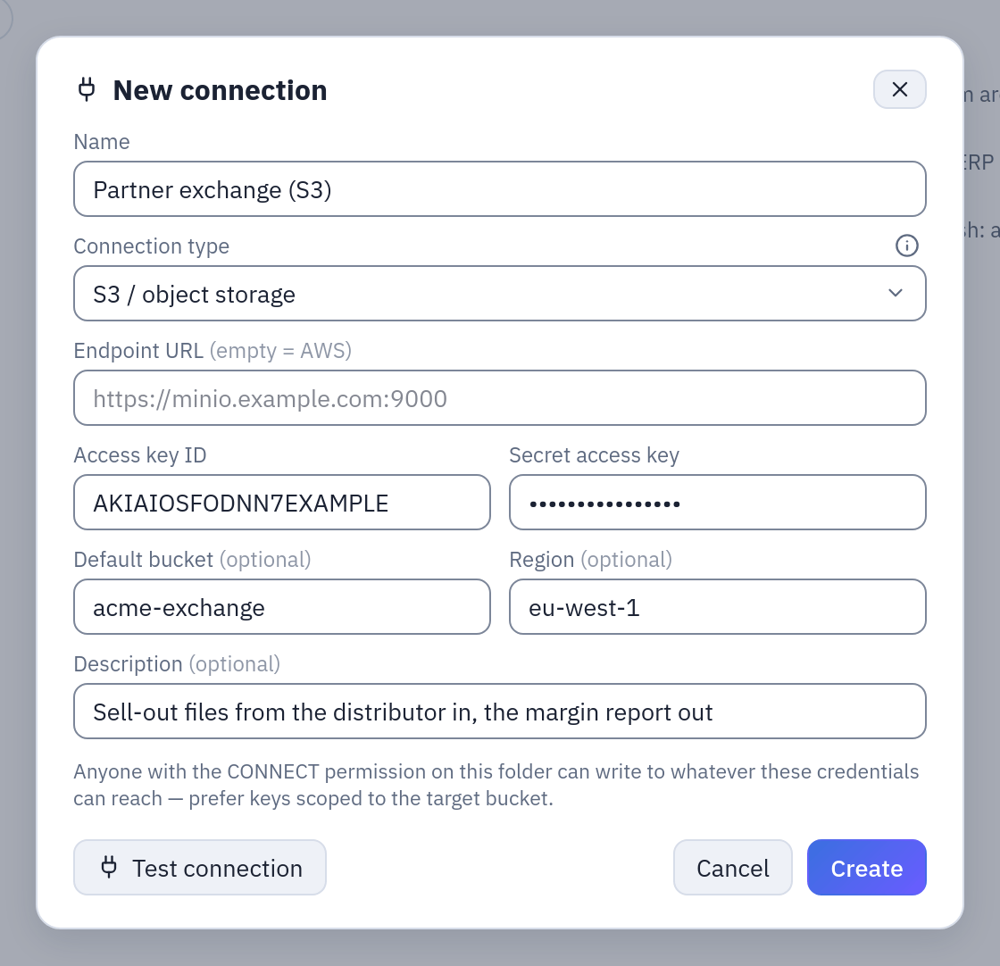

# S3 connections

An S3 connection reaches a bucket of any S3-compatible object storage — AWS S3, MinIO,
Cloudflare R2, Wasabi, Scaleway, Google Cloud Storage through its S3 API — to read the
files of a folder into a datasource and to write a flow's result there as a Parquet or
CSV file, or as a partitioned dataset. It is how Tabularia exchanges files with a data
lake, a partner's bucket or a downstream tool that reads object storage.

## At a glance

| | |
|---|---|
| Where | A folder in Explore, **New → New connection**, type **S3 / object storage** |
| Reads | A datasource **«S3 folder»**: the files of a folder that match a glob, stacked into one table ([S3 folder datasource](../s3-datasource.md)) |
| Writes | An Output node **«File on S3 / object storage»**: one file, or a hive-partitioned dataset; and the S3 copy of an Output that publishes a datasource ([Writing data out](destinations.md)) |
| Formats | Reading: CSV, TSV, Parquet, Excel, NDJSON. Writing: Parquet, CSV |
| Permissions | CONNECT on the connection's folder, to create, test and use it |

## How it works

### The fields

| Field | Meaning |
|---|---|
| Endpoint URL | Empty for AWS. Otherwise the service's S3 address: `https://s3.fr-par.scw.cloud` (Scaleway), `https://<account>.r2.cloudflarestorage.com` (R2), `https://storage.googleapis.com` (GCS with HMAC keys), `http://minio.internal:9000` (MinIO). |
| Access key ID | The key's identifier (`AKIA…` on AWS). |
| Secret access key | Encrypted at rest and never shown again; empty when editing keeps the stored one. |
| Default bucket | Optional. Used by every datasource and Output that leaves its own bucket empty. |
| Region | Optional: `eu-west-1`, `fr-par`. Set it on AWS; MinIO usually needs none. |

With an endpoint set, requests use **path-style** addresses (`endpoint/bucket/key`),
which MinIO requires and the other services accept. The secret travels encrypted to the
worker and is decrypted only to sign the requests.

**Test connection** lists one object of the default bucket, or, without a default bucket,
lists the buckets. A key restricted to one bucket therefore needs the default bucket set
for the test to pass.



*The connection of the example below: AWS (endpoint empty), the key's ID and secret, the default bucket and the region.*

### Reading

A datasource «S3 folder» (**New → Datasource from a database**, then the S3 connection)
takes a bucket, a folder (a key prefix), a glob over the file names and a format. At each
refresh every matching object is downloaded to the worker, read, and the rows stacked into
one table, each row carrying `_file` and `_file_modified_at`. The objects are left where
they are. Folder and glob may hold [placeholders](../placeholders.md), such as
`daily/{yesterday:yyyy/MM/dd}/`. The whole page: [S3 folder datasource](../s3-datasource.md).

The datasource is a **snapshot**: the files are read at the refresh and kept as Parquet in
Tabularia's storage; the bucket is not read again until the next refresh. (The in-place
reading of the DuckDB and chDB engines, `STORAGE__DIRECT_READ`, concerns Tabularia's own
storage, not the buckets of S3 connections.)

### Writing

An Output node with destination **File on S3 / object storage**:

| Field | Meaning |
|---|---|
| S3 connection | An S3 connection you have CONNECT on. |
| Bucket | Empty = the connection's default bucket. |
| Key / path | The object's key, or the prefix of a partitioned dataset. Placeholders allowed: `exports/{today:yyyy/MM}/sales_{date}.parquet`. |
| Format | **Parquet** or **CSV**. |
| Partition by | Optional columns: the output becomes a hive tree `key/column=value/…`. |
| Time zone | The zone of the dates in the key; empty = UTC. |

- **Without partitions** one object is written at the key, replacing an object with the
  same key. Parquet is copied as Tabularia computed it; CSV is converted on the worker,
  streaming. The key is used as written: no extension is added.
- **With partitions** the output is written as `key/column=value/…` files, the partition
  columns kept inside the files too, ready for the partition pruning of Trino, Athena,
  DuckDB or Spark. After uploading, the objects under the prefix that this run did not
  write are **deleted**, so a partition gone from the data does not linger and no row is
  counted twice. At most 1,000 partitions: more stops the run, asking whether those are
  the right columns. An empty result writes nothing and fails.
- Large files are uploaded in parts.

The **datasource Output** can also keep a copy on S3: **Also copy the file to external
S3**, with an S3 connection, a bucket and a **Path in the bucket**. The copy is always
Parquet, written after the datasource, and best effort: if it fails, the run still
succeeds and the error is recorded in the history.

## Example: a nightly exchange with a partner bucket

A distributor sends the day's sell-out as CSV files into `s3://acme-exchange/inbound/`,
and expects the margin report back under `outbound/`.

1. **The key.** On AWS, an IAM user `tabularia-exchange` with this policy:

   ```json
   {
     "Version": "2012-10-17",
     "Statement": [
       {
         "Sid": "ListTheBucket",
         "Effect": "Allow",
         "Action": "s3:ListBucket",
         "Resource": "arn:aws:s3:::acme-exchange"
       },
       {
         "Sid": "ReadInbound",
         "Effect": "Allow",
         "Action": "s3:GetObject",
         "Resource": "arn:aws:s3:::acme-exchange/inbound/*"
       },
       {
         "Sid": "WriteOutbound",
         "Effect": "Allow",
         "Action": ["s3:PutObject", "s3:DeleteObject", "s3:AbortMultipartUpload"],
         "Resource": "arn:aws:s3:::acme-exchange/outbound/*"
       }
     ]
   }
   ```

   `s3:ListBucket` serves the test, the datasource's file listing and the cleanup of a
   partitioned output. `s3:DeleteObject` is needed only for partitioned outputs; a
   single-file output never deletes.

2. **The connection.** In the folder **Partners**: type **S3 / object storage**, endpoint
   empty, the access key ID and secret, default bucket `acme-exchange`, region
   `eu-west-1`. **Test connection** lists one object of the bucket.

3. **Reading.** A datasource «S3 folder»: folder `inbound`, files `sellout_*.csv`, format
   from the extension, refresh on a schedule at 05:30. Every row says which file it came
   from in `_file`.

4. **Writing.** The flow joins the sell-out with the product catalogue and ends in an
   Output node: **File on S3 / object storage**, the same connection, bucket empty, key
   `outbound/margin`, format **Parquet**, partition by `anno_mese`. Every run rewrites
   `outbound/margin/anno_mese=2026-10/…` and removes the files of months no longer in
   the result.

On MinIO the same steps work with the endpoint `http://minio.internal:9000`, region
empty, and a MinIO policy with the same actions on the same resources.

## Permissions

| To | You need |
|---|---|
| create, test, edit or delete the connection | CONNECT on its folder |
| create an «S3 folder» datasource | CONNECT on the connection's folder and EDIT on the datasource's |
| refresh it | CONNECT on the connection's folder and RUN on the datasource's |
| run a flow with an S3 Output or an S3 copy | RUN on the flow and CONNECT on the connection's folder |

Whoever has CONNECT on the connection can read and write whatever its key can reach:
scope the key to the bucket and prefixes the job needs.

## Limits and good to know

- Reading is capped per refresh (`S3_SOURCE__MAX_FILE_BYTES`, `S3_SOURCE__MAX_FILES`,
  `S3_SOURCE__MAX_TOTAL_BYTES`, `S3_SOURCE__MAX_LISTED`), checked before anything is
  downloaded: see [S3 folder datasource](../s3-datasource.md#caps).
- An object key is at most 1,024 bytes; a key resolved from placeholders is checked.
  `..` and empty segments are refused.
- Writing a partitioned dataset deletes the objects under its prefix that the run did not
  write: give it a prefix of its own.
- The workers reach the endpoint: on Kubernetes with the network policy, its address must
  be allowed ([Network](README.md#network)).
- An S3 connection is not Tabularia's own storage (`STORAGE__…`): it is an external bucket
  that flows read from and write to.

## Related

- [Connections](README.md), [Writing data out](destinations.md#a-file-on-s3)
- [S3 folder datasource](../s3-datasource.md), [Placeholders](../placeholders.md)
- [Sources](../sources/README.md)
