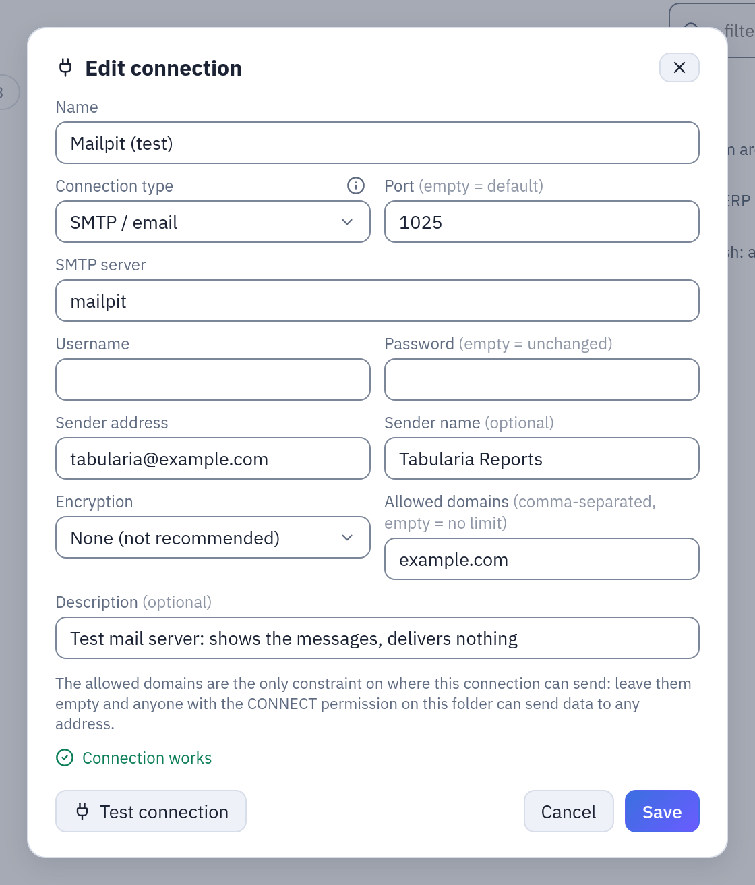

# SMTP connections

An SMTP connection is the mail server Tabularia sends email through: a flow's result as
an attachment, the datasources of a flow group as Excel files, the notice that a
scheduled flow failed, the notice that a data contract changed state. It names the
server, the account and the sender, and — the part that matters most — the **allowed
domains**, the only limit on whom the connection can write to.

## At a glance

| | |
|---|---|
| Where | A folder in Explore, **New → New connection**, type **SMTP / email** |
| Used by | Output node **«Email with attachment»**; **Pushmail** cells of flow groups; **«Tell me if it fails»** of a flow's schedule; the **Notifications** of a data contract |
| Encryption | **STARTTLS (587)**, **SSL/TLS (465)**, or **None (not recommended)** |
| Limit | 15 MB of attachments per email |
| Permissions | CONNECT on the connection's folder, to create it and to send through it |

## How it works

### The fields

| Field | Meaning |
|---|---|
| SMTP server, Port | `smtp.office365.com`, `587`. Empty port = 587. |
| Username, Password | The account that signs in. Both empty: no sign-in, for a relay that accepts the engine's address. |
| Sender address | The `From` address: `reports@example.com`. Nothing is sent without it. |
| Sender name | Optional display name: `Tabularia Reports`. |
| Encryption | **STARTTLS (587)**: a plain connection upgraded to TLS before signing in, the usual choice (Microsoft 365, Gmail with an app password). **SSL/TLS (465)**: TLS from the first byte. **None**: no encryption at all, the password included; only for a relay on a network you trust, or a test server. |
| Allowed domains | Comma-separated: `example.com, example.org`. Empty = no limit. |

With STARTTLS and SSL/TLS the server's certificate and name are verified. For a relay with
a self-signed certificate, `SMTP__VERIFY_TLS=false` on the engine and its workers turns the
check off for every SMTP connection of the installation: still encrypted, but to a server
nobody vouched for, which receives the password. See [Configuration](../configuration.md).

**Test connection** connects, encrypts as chosen and signs in, then closes: it sends
nothing. A certificate that cannot be verified is named in the error, with the variable
that would accept it.

### Allowed domains

Recipients are free text: whoever writes a flow types them in the Output node, the
Pushmail cell or the schedule. The allowed domains decide which of them are acceptable,
and nothing else does — Tabularia has no other list of permitted addresses.

- **Empty**: any address. Whoever can use the connection can send data anywhere.
- **Set**: every recipient, in To and in Cc, must have **exactly** one of the listed
  domains after its `@`, case aside. `example.com` allows `anna@example.com` and
  `ANNA@Example.com`; it does **not** allow `anna@it.example.com`: list subdomains one by
  one. A leading `@` is dropped (`@example.com` is `example.com`).
- **Malformed** (edited by hand into something that is not a list): no email leaves
  through the connection, until it is fixed.

Where the check happens, always in the gateway before anything is sent:

| Use | When the recipients are checked |
|---|---|
| Output node «Email with attachment» | at the start of every run, manual or scheduled: a recipient outside the domains refuses the run, naming it |
| Pushmail cell | when the group is saved and again when it runs |
| «Tell me if it fails» of a schedule | when the schedule is saved |
| Notifications of a data contract | when the contract is saved |

**«Send it to me»** on an email Output node is the one exception: it sends the real
attachment only to the address of the account that presses it, set by the server, so the
domains do not apply.

The domains bind everyone who sends through the connection. They do not bind whoever
manages it: CONNECT on the connection's folder is also the right to edit it, domains
included. Changes are in **Audit** (`connection.update`, with who made them). Give CONNECT
on the folder of an SMTP connection to the people you trust to choose its domains.

### Where it is used

- **Output node «Email with attachment»** in a flow: **SMTP connection**, **Recipients**,
  **Cc**, **Subject**, **Message body** (plain, or HTML when **The body is HTML** is
  ticked), **Attachment name**, **Format** (**Excel (.xlsx)** or **CSV**), and **Stop the
  flow if the send fails** (on by default). The attachment is made at every run, even with
  no rows. Subject and attachment name take [placeholders](../placeholders.md):
  `Sales {yesterday:dd/MM}`. See [Writing data out](destinations.md#an-email-with-an-attachment).
- **Pushmail cells** of a flow group: one email with one `.xlsx` per datasource, up to 20
  datasources. See [Pushmail](../pushmail.md).
- **«Tell me if it fails»** in a flow's schedule: addresses and an SMTP connection. Only
  scheduled runs, and only when the flow moves to failure: a flow that stays broken is
  reported once, not at every firing. A connection that sends a flow's failure notices cannot be
  deleted until the schedule is changed.
- **Notifications** of a data contract: addresses and an SMTP connection; one email when
  the contract's state changes (an update refused, a rule no longer respected, everything
  fine again), not one per check.

Every send goes from the engine's workers (the notices from the engine), never from the
gateway or the browser.

## Example: try it locally with Mailpit

[Mailpit](https://mailpit.axllent.org/) is a mail server for tests: it accepts every
message and shows it in a web page, delivering nothing. With it you can build and check an
email flow without sending real mail.

### Docker Compose

Start Mailpit on the development stack's network, so the workers reach it by name:

```bash
docker run -d --name mailpit --network dataprep-network -p 8025:8025 axllent/mailpit
```

Then, in a folder where you have CONNECT, **New → New connection**:

| Field | Value |
|---|---|
| Name | `Mailpit (test)` |
| Connection type | SMTP / email |
| SMTP server | `mailpit` |
| Port | `1025` |
| Username, Password | empty |
| Sender address | `tabularia@example.com` |
| Encryption | None (not recommended) |
| Allowed domains | `example.com` |

**Test connection** says *Connection works*.



*The Mailpit connection of this example after **Test connection**. On a real server keep STARTTLS or SSL/TLS.*

Open the sample flow **Top 20 Products by
Revenue**, add an Output node after the last step with destination **Email with
attachment**, the connection `Mailpit (test)`, recipients `sales@example.com`, subject
`Top 20 products {today:dd/MM/yyyy}`, attachment name `top20_{date}`, format Excel. Run the
flow: the email, with `top20_2026-10-27.xlsx` attached, is at http://localhost:8025.
Change a recipient to `someone@example.net` and run again: the run is refused before it
starts, because `example.net` is not an allowed domain.

Remove it with `docker rm -f mailpit`.

### Kubernetes

Run Mailpit in Tabularia's namespace (here `tabularia`): the chart's egress policy always
lets the workers reach pods of their own namespace.

```bash
kubectl -n tabularia create deployment mailpit --image=axllent/mailpit --port=1025
kubectl -n tabularia expose deployment mailpit --port=1025 --target-port=1025
kubectl -n tabularia port-forward deployment/mailpit 8025:8025
```

The connection is the same as above with SMTP server `mailpit` (the Service's name) and
port `1025`; the messages are at http://localhost:8025 while the port-forward runs.
Remove it with `kubectl -n tabularia delete deployment,service mailpit`.

## Permissions

| To | You need |
|---|---|
| create, test or edit the connection, its allowed domains included | CONNECT on its folder |
| run a flow with an email Output | RUN on the flow and CONNECT on the connection's folder |
| set up a Pushmail cell, or run its group | CONNECT on the connection's folder and VIEW on the datasources it attaches |
| set «Tell me if it fails» on a schedule, or the notifications of a contract | CONNECT on the connection's folder |

## Limits and good to know

- **15 MB per email.** An attachment (or the files of a Pushmail cell together) over 15 MB
  stops before sending, with a message suggesting a filter, a limit or CSV. Mail servers
  often refuse 10–25 MB, and base64 makes attachments a third larger.
- An Excel attachment holds at most 1,048,575 rows, the format's limit: more fails the
  send, suggesting CSV.
- A server that does not answer is given up after 30 seconds.
- With username and password empty, Tabularia does not sign in. A server that requires
  authentication then refuses the message.
- The allowed domains are checked when a notice's addresses are saved, not when the notice
  is sent: narrowing the domains later does not change notices saved before. Save the
  schedule or the contract again to check them.
- The workers reach the mail server: on Kubernetes with the network policy, its address
  must be allowed ([Network](README.md#network)).

## Related

- [Connections](README.md), [Writing data out](destinations.md)
- [Pushmail](../pushmail.md), [Flow groups](../capabilities/flow-groups.md)
- [Placeholders](../placeholders.md), [Configuration](../configuration.md)
