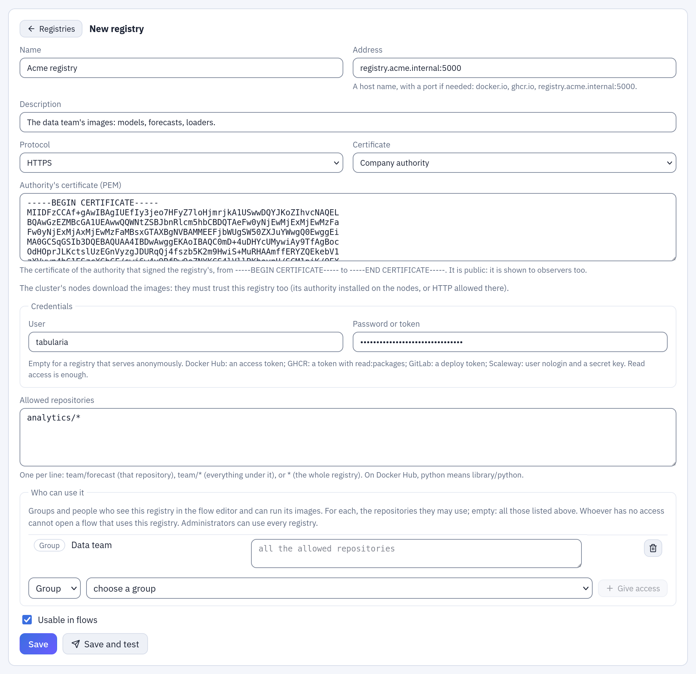
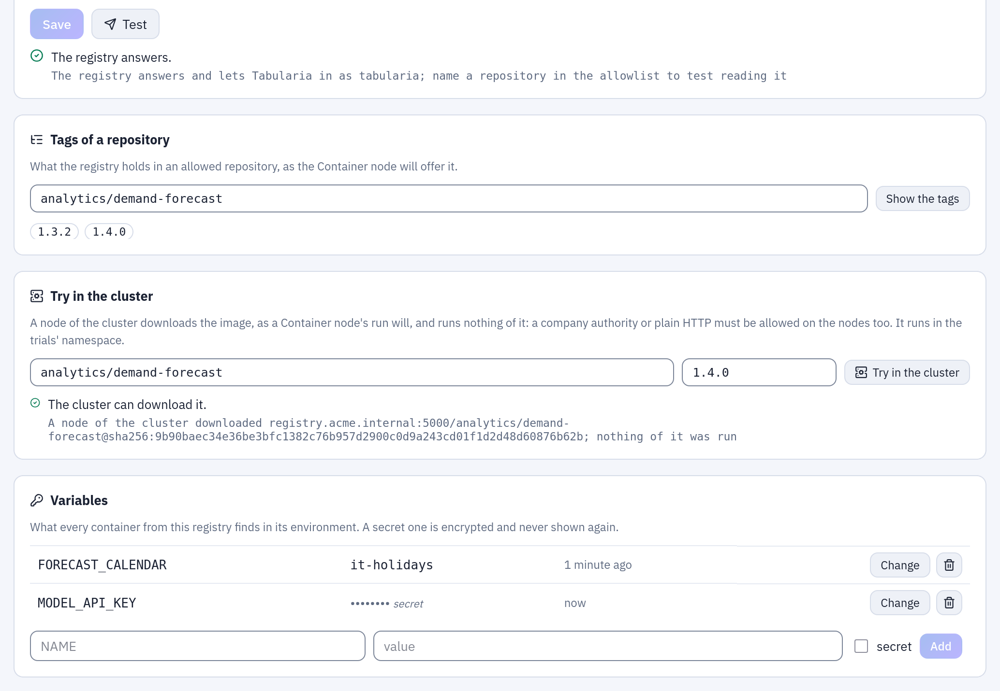

# Container registries

**Administration → Container registries** lists the image registries the
[Container node](container-node.md) may take images from. An administrator defines each one: its address, how Tabularia
trusts its certificate, the credentials, and the repositories whose images may run. The
people who write flows then pick an image of an allowed repository; they never type a
registry address or a password.

A registry is not one of the folder [connections](connections/README.md) to databases,
buckets and servers: it is granted to groups and users rather than placed in a folder, it
is tested from the gateway, and its images are downloaded by the cluster's nodes, not by
Tabularia's workers.

It is a Kubernetes feature, like [Python and R in flows](scripting.md): the containers
run as Kubernetes Jobs.

## Turning it on

In the chart's values:

```yaml
containers:
  enabled: true
```

or `CONTAINERS__ENABLED=true` for the gateway. Without it (on Docker Compose, for
instance) the section, the palette's **Container** and the Container nodes of a flow
brought from a cluster are greyed out, with the reason; nothing is saved here, and such
a flow is saved as it is.

The chart then creates two namespaces, both at the Pod Security `baseline` level (root
is allowed inside a container, as most existing images need; privileges and host access
are not):

| Value | Default | What runs there |
|---|---|---|
| `containers.namespace` | `<release namespace>-containers` | the Container nodes of the flows' runs |
| `containers.trialNamespace` | `<release namespace>-containers-dev` | the editor's trials and **Try in the cluster**, under a ResourceQuota (`containers.trialQuota`) |

The gateway's and the orchestrator's service accounts (`…-scaler`, `…-orchestrator`)
get a Role in each: Jobs, their Pods, logs and events, and Secrets (the pull Secrets
below). If your namespaces are created by someone else, `containers.createNamespaces:
false`: the chart still adds the Roles, the trials' ResourceQuota and the network policy
of the users' code.

## A registry

| Field | |
|---|---|
| **Name** | how flows and the audit call it |
| **Address** | a host name with its port if any: `docker.io`, `ghcr.io`, `registry.gitlab.com`, `rg.fr-par.scw.cloud`, `registry.acme.internal:5000` |
| **Protocol** | HTTPS, or HTTP for a registry inside your network |
| **Certificate** | how HTTPS is checked (below) |
| **User**, **Password or token** | read access is enough; empty for a registry that serves anonymously |
| **Allowed repositories** | which images may run (below) |
| **Usable in flows** | off keeps the registry, and its images can no longer be chosen |



*A new registry, the one of [the example below](#example-the-company-registry): a company authority with its certificate, a user and a password, the repositories under `analytics/`, and the group `Data team` allowed to use them.*

The password or token is encrypted with the installation's key and never shown again:
leave the field empty to keep it, or **Remove the password** to reach the registry
anonymously.

Credentials for the usual registries:

| Registry | User | Password or token |
|---|---|---|
| Docker Hub (`docker.io`) | your Docker ID | an access token, read-only |
| GitHub (`ghcr.io`) | your GitHub user | a token with `read:packages` |
| GitLab (`registry.gitlab.com`) | the deploy token's user | a deploy token with `read_registry` |
| Scaleway (`rg.<region>.scw.cloud`) | `nologin` | a secret key whose rights include the registry |
| Harbor | a robot account with *Pull* on the project (`robot$project+name`) | its secret |

### The certificate

- **Public authorities**: the registry's certificate is signed by an authority every
  system trusts. Docker Hub, GHCR, GitLab and the cloud registries are.
- **Company authority**: your company signs its own certificates. Paste the
  authority's certificate, in PEM (`-----BEGIN CERTIFICATE-----` …). It is public: the
  observers see it too.
- **Not checked**: Tabularia does not check who answers. Anyone between Tabularia and
  the registry could pose as it: for a test registry only. The choice is recorded in the
  audit, like every change of the registry.

**HTTP** has no certificate: images and credentials travel unencrypted, so keep it for a
registry inside your network.

**The nodes download the images, not Tabularia.** With a company authority or HTTP, the
cluster's nodes must trust the registry too, as for any image of the cluster: the
authority installed on the nodes (a node image, or a DaemonSet that writes it into
containerd's `certs.d`), or the registry allowed over HTTP there. The
[kind guide](deploy/kind.md#3-nodes-that-trust-the-authority) shows how a node is set up.

### Allowed repositories

One per line:

| Line | Allows |
|---|---|
| `team/forecast` | that repository only |
| `team/*` | every repository under `team/`, at any depth |
| `*` | the whole registry |

On Docker Hub an official image has no prefix: `python` is saved as `library/python`.
Images of a repository that is not listed cannot be chosen, nor read: **Tags of a
repository** answers only for allowed ones.

### Who can use it

Access to a registry is given here, by an administrator, to **groups** and to single
**users**, and to nothing else: a registry is not tied to folders. For each group or
user you may also list the repositories they may use, with the same patterns as above;
left empty, they may use all the repositories the registry allows. Administrators use
every registry.

Someone with access sees the registry in the flow editor, with only the repositories
granted to them, and can put its images in a Container node of a flow they may edit.
Someone without:
- does not see the registry, nor its repositories or tags;
- **cannot open a flow that uses it**, nor one whose image is outside what they were
  granted. The flow is still listed in Explore, in Flows and in the search, greyed out
  with a lock: it is not a link and has no actions, and hovering it says which registry or image is missing and
  that an administrator can grant it. Reached by its address, the editor says the same
  in place of the canvas. Its versions, a copy, a run,
  a schedule and adding it to a group of flows are refused the same way;
- cannot add a Container node of that registry to a flow.

A registry that is deleted blocks nobody any more: its Container nodes simply cannot run.

### Variables

What every container of the registry finds in its environment, as for the scripting
environments: a secret one is encrypted and never shown again. Names are in capitals,
digits and `_`; those starting with `TABULARIA_` or `AWS_` are set by Tabularia.

## Test

**Test** (it saves first) checks, from the gateway:
1. that the address answers as a registry;
2. that the certificate is the one expected;
3. that the credentials are accepted, the way the registry asks: a token from its
   authentication service (Docker Hub, GHCR, GitLab, Harbor, Scaleway) or a user and a
   password (a registry with `htpasswd`);
4. with an allowed repository named in full, that it can be read: it shows a few of its
   tags.

The result stays on the registry, and the list shows whether each one works. A failure
says which part to fix: *The registry's certificate is not signed by a public
authority: choose «Company authority»*; *The registry answers in plain HTTP: choose
HTTP*; *The registry refused the user and the password*; *team/forecast is not in the
registry, or not visible with these credentials*.

The gateway never connects to the cloud metadata addresses, whatever a registry's name
resolves to. Private addresses are fine: company registries usually are.

## In the cluster

**Test** speaks from the gateway; the images are downloaded by the cluster's nodes,
which may not trust the same certificates nor reach the same addresses.

**Try in the cluster** checks the nodes: give an allowed repository and a tag (or a
digest). Tabularia resolves the tag to its digest, then starts a Pod in the trials'
namespace with that image and a command that does not exist: the node downloads the
image and then fails to start it, so **nothing of the image runs**. The Pod is removed at
once. The answer is either *The cluster can download it*, with the digest, or what went
wrong, in the words of a run:
- *the nodes do not trust the registry's certificate*: the authority must be installed
  on the nodes ([kind guide](deploy/kind.md#3-nodes-that-trust-the-authority));
- *the nodes reach the registry in HTTPS but it answers in HTTP*: the registry must be
  allowed over HTTP on the nodes;
- *the registry refused the credentials*, *the image is no longer there*, or that no
  node downloaded it in time (`CONTAINERS__PULL_CHECK_SECONDS`, 300 s by default: a large
  image, or a busy cluster).

The check answers within 270 s, under the ingress' 300 s
(`nginx.ingress.kubernetes.io/proxy-read-timeout`). A node still downloading a large
image then is said to be, and its Pod is left to finish the download (for up to
`CONTAINERS__PULL_CHECK_SECONDS`): the next try finds the image on that node.

**Pull Secrets.** A registry with credentials has a Secret
`tabularia-registry-<id>` (type `kubernetes.io/dockerconfigjson`) in the containers'
namespaces, written by Tabularia right before a Pod needs it, from the credentials as
they are then: a changed or removed password never lingers there. A registry without
credentials has none, and a deleted registry's goes with it. Do not edit them by hand:
the next run writes them again.

## Example: the company registry

Your company runs a Harbor at `registry.acme.internal:5000`, with a certificate signed by
its own authority, and the data team pushes its images under `analytics/`.

1. In Harbor, create a robot account with *Pull* on the project `analytics`, and keep its
   name (`robot$analytics+tabularia`) and its secret.
2. **Administration → Container registries → New registry**:
   - **Name** «Acme registry», **Address** `registry.acme.internal:5000`, **Protocol**
     HTTPS;
   - **Certificate** **Company authority**, and in **Authority's certificate (PEM)** the
     certificate of the company's authority, from `-----BEGIN CERTIFICATE-----` to
     `-----END CERTIFICATE-----`;
   - **User** `robot$analytics+tabularia`, **Password or token** its secret;
   - **Allowed repositories** `analytics/*`.
3. Under **Who can use it**, choose **Group**, the data team's group, and **Give access**.
   Leave its repositories empty: it may use everything under `analytics/`.
4. **Save and test**. The answer is «The registry answers.», with a few tags when an
   allowed repository is named in full; a failure says which part to fix.
5. Under **Tags of a repository**, `analytics/demand-forecast` → **Show the tags** lists
   what the Container node will offer, `1.4.0` among them.
6. Under **Try in the cluster**, the same repository and **Tag or digest** `1.4.0` →
   **Try in the cluster**. «The cluster can download it.», with the digest, means the
   nodes trust the authority and accept the robot's credentials. If they do not trust it,
   install the authority on the nodes first ([kind guide](deploy/kind.md#3-nodes-that-trust-the-authority)).



*The same registry once saved: **Test** answers from the gateway, **Tags of a repository** lists what the Container node will offer, **Try in the cluster** says a node downloaded `analytics/demand-forecast:1.4.0` by its digest, and **Variables** holds one plain and one secret value for every container of the registry.*

From then on, the data team finds **Container** in the palette of the flow editor, with
the registry and its `analytics/` images: [a forecast step in a flow](container-node.md#example-a-forecast-step-in-a-flow).

## Audit

Every creation, change, test, deletion and variable is in **Audit**, with who did it.
The password, the token and the secret variables never are: only that they were set,
changed or removed.
