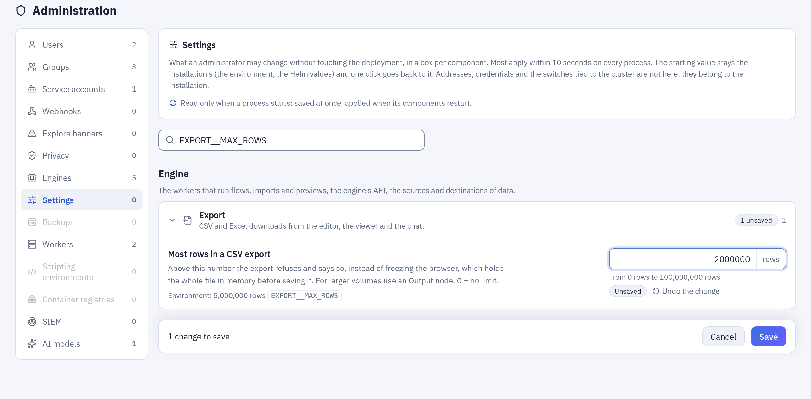

# Settings from the administration panel

For whoever installs and runs Tabularia. **Administration → Settings** changes, while
everything keeps running, the settings an administrator may own: limits, waits, retention,
the assistant's budget, the caps of the data sources. The environment (`.env`, the Helm
values) stays the starting value of every setting; the panel overrides it, and **Back to
the environment** returns to it.

The settings are in boxes, one per component (Gateway, Kubernetes, Engine), with a search
by name or variable. Each one shows a description in the reader's language, the value of
the environment and its variable, the allowed range, and who changed it and when.

*A change on its way: the setting found by its variable, the new value marked **Unsaved** next to the environment's, and **Save** in the bar at the bottom.*

## Three families

- **Live** (most of them): read by the code each time it is used. A change applies within
  ten seconds on every process: every gateway and orchestrator replica, the engine API,
  every worker process.
- **Read when a process starts** (marked with the restart icon ↻): saved at once, applied
  when the components that read them restart. The panel tells which components still run
  a previous value and restarts them (see [Restarts](#restarts)).
- **Never in the panel**: addresses, credentials, keys, identities, namespaces, buckets,
  the switches tied to resources the Helm chart creates (scripting, Container node,
  cluster view, scaling), the audit log's retention, and anything that, wrong, would stop
  Tabularia from starting or anyone from signing in. They are the configuration of the
  installation and stay in the environment. Some that look harmless are left out on
  purpose: `OIDC__SUPERUSER_GROUP` (it makes administrators), `OIDC__SCOPES`,
  `OIDC__VERIFY_TLS` and `SMTP__VERIFY_TLS` (the security of a connection), the scripting
  base images, builder image, PyPI and CRAN addresses (code that runs in the builds),
  `CLICKHOUSE_EXTERNAL__TRANSPORT` and `STORAGE__DIRECT_READ` (they depend on the network
  between services), `KUBERNETES__*_MAX_REPLICAS` (the ceiling the installer puts on the
  panel itself), `AUDIT__RETENTION_MINUTES` and `AUDIT__IP_RETENTION_DAYS` (an
  administrator must not be able to shorten the trail of what administrators do),
  `ENGINE__SETTINGS_PANEL` (it governs the panel).

Database backups (on, schedule, number kept) are in **Administration → Backups**, and the
processes per worker in **Administration → Workers**: not repeated here.

## What can be changed

The panel accepts narrower ranges than the environment, so that a typing mistake cannot
take the system down; a value outside them goes in the environment. The boxes of a feature
the installation does not have are not shown (single sign-on, Kubernetes, scripting, the
Container node) or greyed out (an engine that is not configured).

### Gateway and Kubernetes

**Sign-in and sessions**

| Setting | Variable | Panel range | Applies |
|---|---|---|---|
| Longest a session lasts | `JWT__ACCESS_TTL_MINUTES` | 15 min – 7 d | live |
| Session closed after inactivity | `AUTH__SESSION_IDLE_MINUTES` | 0 min – 1 d | live |
| Personal API tokens | `AUTH__PERSONAL_TOKENS` | on / off | live |
| Furthest expiry of an API token | `AUTH__API_TOKEN_MAX_DAYS` | 1 d – 3650 d | live |

**Single sign-on** (when single sign-on is configured)

| Setting | Variable | Panel range | Applies |
|---|---|---|---|
| Where the groups are in the token | `OIDC__GROUPS_CLAIM` | text | live |
| Groups taken from the identity provider | `OIDC__GROUP_ALLOWLIST` | text | live |
| Create missing groups | `OIDC__AUTO_CREATE_GROUPS` | on / off | live |
| The identity provider owns the membership | `OIDC__AUTHORITATIVE` | on / off | live |
| E-mail domains allowed in | `OIDC__ALLOWED_EMAIL_DOMAINS` | text | live |
| Only members of the groups taken | `OIDC__REQUIRE_ALLOWLISTED_GROUP` | on / off | live |
| Text of the sign-in button | `OIDC__BUTTON_LABEL` | text | live |
| How long the provider's configuration is kept | `OIDC__DISCOVERY_TTL_SECONDS` | 1 min – 1 d | live |
| Wait for the identity provider | `OIDC__TIMEOUT_SECONDS` | 1 s – 1 min | live |
| Time to sign in at the provider | `OIDC__LOGIN_TX_TTL_SECONDS` | 2 min – 1 h | live |

**Orchestration and schedules**

| Setting | Variable | Panel range | Applies |
|---|---|---|---|
| Time zone of the schedules | `APP__TIMEZONE` | IANA name | live |
| Run declared lost after | `ENGINE__RUN_STALE_TIMEOUT_SECONDS` | 15 min – 7 d | live |
| Longest wait for a Refresh node | `ORCHESTRATOR__REFRESH_WAIT_SECONDS` | 1 min – 1 d | live |
| How often a running flow checks its steps | `ORCHESTRATOR__POLL_INTERVAL_SECONDS` | 0.5 s – 1 min | live |
| How often the queue is read | `ORCHESTRATOR__QUEUE_POLL_SECONDS` | 0.2 s – 30 s | live |
| Executions at once per orchestrator | `ORCHESTRATOR__MAX_CONCURRENT` | 1 – 200 | live |
| Longest stay in the queue | `ORCHESTRATOR__QUEUE_TIMEOUT_SECONDS` | 1 min – 1 d | live |
| Heartbeat of the executions | `ORCHESTRATOR__HEARTBEAT_SECONDS` | 2 s – 2 min | live |
| Execution declared lost after silence | `ORCHESTRATOR__DEAD_AFTER_SECONDS` | 15 s – 1 h | live |
| Runs at once in the schedules' map | `SCHEDULING__WORKER_CAPACITY` | 1 – 256 | live |

**History kept**

| Setting | Variable | Panel range | Applies |
|---|---|---|---|
| Run logs kept for | `ORCHESTRATOR__LOG_RETENTION_DAYS` | 0 d – 3650 d | live |
| Data contract reports kept | `ORCHESTRATOR__CONTRACT_RESULTS_KEPT` | 0 – 100,000 | live |
| Versions kept | `ORCHESTRATOR__VERSIONS_KEPT` | 0 – 10,000 | live |
| Assistant conversations kept for | `ORCHESTRATOR__AI_CHAT_RETENTION_DAYS` | 0 d – 3650 d | live |
| Webhook deliveries kept for | `WEBHOOKS__RETENTION_DAYS` | 1 d – 3650 d | live |

**Webhooks and SIEM**

| Setting | Variable | Panel range | Applies |
|---|---|---|---|
| Wait for the receiver | `WEBHOOKS__TIMEOUT_SECONDS` | 1 s – 1 min | live |

**AI assistant**

| Setting | Variable | Panel range | Applies |
|---|---|---|---|
| Model proposed first | `AI__DEFAULT_MODEL` | text | live |
| Rows of an assistant's query | `AI__MAX_RESULT_ROWS` | 1 – 2,000 | live |
| Model rounds per message | `AI__MAX_REQUESTS` | 1 – 50 | live |
| Model rounds when an assistant builds | `AI__MAX_FLOW_REQUESTS` | 1 – 80 | live |
| Messages of history sent back | `AI__MAX_HISTORY_MESSAGES` | 0 – 400 | live |
| Most spent per answer | `AI__MAX_COST_PER_TURN_USD` | 0 USD – 100 USD | live |
| Most spent per user per day | `AI__MAX_COST_PER_DAY_USD` | 0 USD – 10000 USD | live |
| Most spent per day, everyone together | `AI__MAX_COST_PER_DAY_TOTAL_USD` | 0 USD – 100000 USD | live |
| Most tokens read per answer | `AI__MAX_INPUT_TOKENS_PER_TURN` | 1,000 – 2,000,000 | live |
| Conversations listed per user | `AI__MAX_CHATS_LISTED` | 1 – 500 | live |
| AI time of a dbt export | `AI__DBT_EXPORT_TIMEOUT_SECONDS` | 10 s – 1 h | live |

**Agents over MCP**

| Setting | Variable | Panel range | Applies |
|---|---|---|---|
| MCP server | `MCP__ENABLED` | on / off | live |
| Plans confirmed only in Tabularia | `MCP__CONFIRM_IN_TABULARIA_ONLY` | on / off | live |

**dbt export**

| Setting | Variable | Panel range | Applies |
|---|---|---|---|
| Wait for the engine to build a dbt export | `ENGINE__DBT_EXPORT_TIMEOUT_SECONDS` | 10 s – 1 h | live |

**Previews and uploads**

| Setting | Variable | Panel range | Applies |
|---|---|---|---|
| Automatic sample of the editor | `PREVIEW__DEFAULT_SAMPLE_ROWS` | 0 – 10,000,000 | live |
| Largest file uploaded | `UPLOAD__MAX_BYTES` | 1 MiB – 1 TiB (0, no limit, only from the environment) | live |

**Database backups**

| Setting | Variable | Panel range | Applies |
|---|---|---|---|
| Longest a backup may take | `BACKUP__TIMEOUT_SECONDS` | 1 min – 1 d | live |

**Monitoring**

| Setting | Variable | Panel range | Applies |
|---|---|---|---|
| Wait for the metrics | `MONITORING__TIMEOUT_SECONDS` | 0.5 s – 30 s | live |
| Metrics shared for | `MONITORING__CACHE_SECONDS` | 0 s – 5 min | live |

**OpenLineage**

| Setting | Variable | Panel range | Applies |
|---|---|---|---|
| Wait for the lineage collector | `OPENLINEAGE__TIMEOUT_SECONDS` | 1 s – 2 min | live |

**Gateway processes**

| Setting | Variable | Panel range | Applies |
|---|---|---|---|
| Requests served at once | `APP__GATEWAY_THREADS` | 4 – 200 | ↻ gateway, orchestrator |
| Database connections kept open | `DB__POOL_SIZE` | 1 – 200 | ↻ gateway, orchestrator |
| Extra connections at peaks | `DB__MAX_OVERFLOW` | 0 – 200 | ↻ gateway, orchestrator |

**Kubernetes API** (on Kubernetes)

| Setting | Variable | Panel range | Applies |
|---|---|---|---|
| Wait for the Kubernetes API | `KUBERNETES__TIMEOUT_SECONDS` | 1 s – 2 min | live |

**Python and R scripts** (when scripting is on)

| Setting | Variable | Panel range | Applies |
|---|---|---|---|
| How often a script's Job is checked | `SCRIPTS__POLL_SECONDS` | 1 s – 1 min | live |
| Finished script Jobs kept for | `SCRIPTS__JOB_TTL_SECONDS` | 1 min – 7 d | live |
| Script output kept | `SCRIPTS__LOG_MAX_BYTES` | 4 KiB – 16 MiB | live |
| Check Python while typing | `SCRIPTS__LINT` | on / off | live |

**Image builds** (when scripting is on)

| Setting | Variable | Panel range | Applies |
|---|---|---|---|
| Longest an image build may take | `SCRIPTS__BUILD_TIMEOUT_SECONDS` | 1 min – 6 h | live |
| CPU of an image build | `SCRIPTS__BUILD_CPU` | Kubernetes quantity | live |
| Memory of an image build | `SCRIPTS__BUILD_MEMORY` | Kubernetes quantity | live |
| Longest the check of an image may take | `SCRIPTS__CHECK_TIMEOUT_SECONDS` | 30 s – 1 h | live |

**Container nodes** (when the Container node is on)

| Setting | Variable | Panel range | Applies |
|---|---|---|---|
| Time to download an image | `CONTAINERS__PULL_CHECK_SECONDS` | 30 s – 1 h | live |
| How often a container's Job is checked | `CONTAINERS__POLL_SECONDS` | 1 s – 1 min | live |
| Finished container Jobs kept for | `CONTAINERS__JOB_TTL_SECONDS` | 1 min – 7 d | live |
| Most CPU a Container node may ask for | `CONTAINERS__MAX_CPU` | Kubernetes quantity | live |
| Most memory a Container node may ask for | `CONTAINERS__MAX_MEMORY` | Kubernetes quantity | live |
| Longest timeout of a Container node | `CONTAINERS__MAX_TIMEOUT_SECONDS` | 1 min – 30 d | live |
| Container output kept | `CONTAINERS__LOG_MAX_BYTES` | 4 KiB – 16 MiB | live |

### Engine

**Workers and runs**

| Setting | Variable | Panel range | Applies |
|---|---|---|---|
| Longest a task can run (hard limit) | `CELERY__TASK_TIME_LIMIT` | 1 min – stale timeout − 5 min | live |
| Shutdown notice (soft limit) | `CELERY__TASK_SOFT_TIME_LIMIT` | 30 s – 7 d | live |
| Tasks before a process is renewed | `CELERY__MAX_TASKS_PER_CHILD` | 1 – 100,000 | ↻ worker, preview-worker |
| Memory of a process before it is renewed | `CELERY__MAX_MEMORY_PER_CHILD_KB` | 100 MiB – 256 GiB | ↻ worker, preview-worker |
| Share of the container's memory | `CELERY__MAX_MEMORY_HEADROOM_FRAC` | 0.1 – 0.95 | ↻ worker, preview-worker |
| Memory per process without a limit | `CELERY__MAX_MEMORY_PER_CHILD_FALLBACK_KB` | 100 MiB – 256 GiB | ↻ worker, preview-worker |
| Least memory per process | `CELERY__MAX_MEMORY_PER_CHILD_FLOOR_KB` | 50 MiB – 256 GiB | ↻ worker, preview-worker |

**Step cache**

| Setting | Variable | Panel range | Applies |
|---|---|---|---|
| How long the step cache lasts | `CACHE__TTL_SECONDS` | 5 min – 30 d | live |
| Most rows in a cached step | `CACHE__MAX_STEP_ROWS` | 0 – 100,000,000 | live |
| How often expired steps are cleared | `CACHE__SWEEP_INTERVAL_SECONDS` | 1 min – 7 d | ↻ beat |
| How often storage is measured | `METRICS__STORAGE_STATS_INTERVAL_SECONDS` | 10 s – 1 h | ↻ beat |

**Embedded engines**

| Setting | Variable | Panel range | Applies |
|---|---|---|---|
| Memory of a chDB query | `CHDB_MAX_MEMORY_USAGE` | 128 MiB – 1 TiB | ↻ worker, preview-worker |
| Aggregations to disk above | `CHDB_MAX_BYTES_BEFORE_EXTERNAL_GROUP_BY` | 0 – 1 TiB | ↻ worker, preview-worker |
| Sorts to disk above | `CHDB_MAX_BYTES_BEFORE_EXTERNAL_SORT` | 0 – 1 TiB | ↻ worker, preview-worker |
| Memory of a chDB join | `CHDB_MAX_BYTES_IN_JOIN` | 0 – 1 TiB | ↻ worker, preview-worker |
| Most rows of a cross join | `ENGINE_MAX_CROSS_JOIN_ROWS` | 1,000 – 1e+10 | ↻ worker, preview-worker |

**Engine API**

| Setting | Variable | Panel range | Applies |
|---|---|---|---|
| Requests served at once | `APP__ENGINE_API_THREADS` | 40 – 2,000 | ↻ engine |
| Longest wait for a preview | `PREVIEW_TIMEOUT_SECONDS` | 10 s – 290 s | ↻ engine |

**Import**

| Setting | Variable | Panel range | Applies |
|---|---|---|---|
| Rows per row group | `INGEST__PARQUET_ROW_GROUP_ROWS` | 10,000 – 5,000,000 | live |
| Longest wait for an answer during an import | `INGEST__DB_READ_TIMEOUT_SECONDS` | 30 s – 1 d | live |

**Export**

| Setting | Variable | Panel range | Applies |
|---|---|---|---|
| Most rows in a CSV export | `EXPORT__MAX_ROWS` | 0 – 100,000,000 | live |

**SFTP**

| Setting | Variable | Panel range | Applies |
|---|---|---|---|
| Largest file | `SFTP__MAX_FILE_BYTES` | 1 MiB – 100 GiB | live |
| Most files per refresh | `SFTP__MAX_FILES` | 1 – 100,000 | live |
| Most bytes per refresh | `SFTP__MAX_TOTAL_BYTES` | 1 MiB – 1 TiB | live |
| Wait for the server | `SFTP__TIMEOUT_SECONDS` | 1 s – 10 min | live |

**S3 folders**

| Setting | Variable | Panel range | Applies |
|---|---|---|---|
| Largest object | `S3_SOURCE__MAX_FILE_BYTES` | 1 MiB – 100 GiB | live |
| Most files per refresh | `S3_SOURCE__MAX_FILES` | 1 – 100,000 | live |
| Most bytes per refresh | `S3_SOURCE__MAX_TOTAL_BYTES` | 1 MiB – 1 TiB | live |
| Most keys scanned | `S3_SOURCE__MAX_LISTED` | 100 – 10,000,000 | live |
| Longest download of an object | `S3_SOURCE__MAX_REQUEST_SECONDS` | 10 s – 1 d | live |

**HTTP APIs**

| Setting | Variable | Panel range | Applies |
|---|---|---|---|
| Wait for each request | `API__TIMEOUT_SECONDS` | 1 s – 10 min | live |
| Most pages per call | `API__MAX_PAGES` | 1 – 1,000,000 | live |
| Most calls per refresh | `API__MAX_CALLS` | 1 – 100,000 | live |
| Most rows per refresh | `API__MAX_ROWS` | 1 – 1,000,000,000 | live |
| Largest response | `API__MAX_RESPONSE_BYTES` | 1 KiB – 10 GiB | live |
| Most bytes per refresh | `API__MAX_TOTAL_BYTES` | 1 KiB – 1 TiB | live |
| Retries of a failed request | `API__MAX_RETRIES` | 0 – 20 | live |
| Longest Retry-After accepted | `API__MAX_RETRY_WAIT_SECONDS` | 0 s – 1 h | live |
| Most redirects | `API__MAX_REDIRECTS` | 0 – 30 | live |
| Longest a request may take | `API__MAX_REQUEST_SECONDS` | 1 s – 1 d | live |
| Least pause between requests | `API__MIN_INTERVAL_SECONDS` | 0 s – 1 h | live |

**Placeholders**

| Setting | Variable | Panel range | Applies |
|---|---|---|---|
| Most values of a variable | `PLACEHOLDERS__MAX_VALUES` | 1 – 100,000 | live |

**ClickHouse**

| Setting | Variable | Panel range | Applies |
|---|---|---|---|
| Threads for scans | `CLICKHOUSE_EXTERNAL__PARQUET_SCAN_MAX_THREADS` | 0 – 64 | live |
| Longest a query can run | `CLICKHOUSE_EXTERNAL__MAX_EXECUTION_TIME` | 0 s – 1 d | live |
| Copy for the viewer above (rows) | `CLICKHOUSE_EXTERNAL__MATERIALIZE_MIN_ROWS` | 0 – 1,000,000,000 | live |
| How long the viewer copies last | `CLICKHOUSE_EXTERNAL__MATERIALIZE_TTL_SECONDS` | 1 min – 7 d | live |
| Wait to connect to ClickHouse | `CLICKHOUSE_EXTERNAL__CONNECT_TIMEOUT` | 1 s – 5 min | live |

**BigQuery**

| Setting | Variable | Panel range | Applies |
|---|---|---|---|
| Most bytes billed per query | `BIGQUERY__MAXIMUM_BYTES_BILLED` | 0 – 100 TiB | live |

## Rules between settings

A change that breaks one of these is refused, and the error names the setting just
changed:

- the tasks' soft time limit stays below the hard one, and the import read timeout below
  the soft one;
- the engine's hard time limit stays at least five minutes below
  `ENGINE__RUN_STALE_TIMEOUT_SECONDS`, the age after which the gateway declares a run lost
  (both directions: lowering the threshold below the engine's limit plus five minutes is
  refused too, and checked against the engine, so it is refused while the engine does not
  answer);
- an orchestration's heartbeat fits at least three times in the silence after which it is
  declared lost;
- the executions an orchestrator carries at once fit in its database pool (pool size, or
  the threads when it is automatic, plus the overflow), because each holds a connection
  while it asks the engine. The pool is sized when a process starts: raised together, the
  executions follow the pool only after the restart (each orchestrator caps them at the
  pool it has);
- single sign-on admitting only the members of the groups taken needs a list of them (or
  `OIDC__SUPERUSER_GROUP`), and the claim with the groups cannot be empty: either would
  shut everyone out, or take every group away at the next sign-in;
- going back to the installation's value is checked like a new value: back to the
  environment's, the lost-run threshold must still stay above the engine's hard limit, and
  the engine's hard limit under the threshold; a change that would drop another saved
  value (the pool back to automatic under 90 saved executions) is refused, naming it.

One rule the panel cannot check is between a setting and the Helm chart: a worker that
stops (an upgrade, a restart from this panel, a drain, a scale-in, KEDA going down to its
minimum) waits for its tasks for `worker.terminationGracePeriodSeconds` (3600 s by default),
then Kubernetes kills it, tasks and all. Raising the tasks' hard limit above it lets those
events cut the longer runs: raise the chart's value first. A cluster autoscaler may also cap
the wait it gives a node's pods (ten minutes by default).

A saved value can stop being valid later, for instance after the environment changed under
it. It is then dropped at every reading (the environment's applies, and the log says why);
it does not block changes to other settings, and the panel marks it **Not applied** until
it is changed or reset.

## How a change travels

**The gateway's settings.** Saved in the gateway's database (table `gateway_settings`),
with an audit entry `settings.update` (old and new value of each). Every gateway and
orchestrator process reads the table again every ten seconds and lays the values on top of
the environment; the process that saved applies them at once.

**The engine's settings.** Checked by the engine and saved in the gateway's database
(table `engine_settings`) only once the engine accepted them, all or none, with an audit
entry `engine_settings.update`. The engine keeps them in Valkey, every engine process reads
them again every ten seconds, and the gateway sends them again every minute: a flushed
Valkey gets them back. The upload limit is set once, in the Gateway box, and reaches the
engine's own barrier the same way.

Saves go one at a time, across gateway replicas too (a lock in the database).

«Live» means from the next use: an orchestrator waiting for a step keeps the pause it
started with until the next check, a script's or container's Job is followed at the pace
it was started with, and a new connect timeout for ClickHouse applies to the connections
opened from then on. A new time zone for the schedules computes again the next slot of
every schedule at once.

## Example: a smaller cap on CSV exports

The Viewer's and the editor's CSV downloads stop at 5,000,000 rows by default
(`EXPORT__MAX_ROWS`). To bring that down to 2,000,000 without touching the deployment:

1. **Administration → Settings**, type `EXPORT__MAX_ROWS` in the search: the box
   **Export** (Engine) opens on **Most rows in a CSV export**, with the environment's
   value, its variable and the allowed range (0 to 100,000,000 rows).
2. Type `2000000`. The field is marked **Unsaved**, with **Undo the change**, and the
   bar at the bottom counts «1 change to save».
3. **Save**. The engine checks the value and keeps it; within ten seconds every worker
   uses it, and the audit log has an `engine_settings.update` with the old and the new
   value. A larger export now stops and says so.

**Back to the environment**, on the setting, returns to 5,000,000.

## Restarts

A setting marked ↻ is read only when a process starts: the gateway's threads and database
pool, the workers' recycling and memory, the embedded engines' memory, the engine API's
threads and preview wait, the scheduler's intervals. Saving it records, for each component
that reads it, when it changed; the pods of that component started before then still run
the previous value, and a banner on top of the page lists those components.

**On Kubernetes** (Helm `settingsRollout.enabled`, on by default) **Restart them** restarts
those components, one pod at a time: the orchestrator evicts the oldest pod started before
the request through the Kubernetes eviction API, waits until all the component's pods are
ready again, evicts the next, and goes on component after component: run workers, preview
workers, scheduler, engine API, gateway, orchestrator. The new pods read the panel's values
when they start; nothing in the Deployments changes. The banner follows the restart and
can stop it.

- A component with a single pod is unavailable for the few seconds its new pod takes to
  start. The restart waits for each component's last new pod to be ready before it moves
  to the next component.
- A worker pod finishes the run it has in hand before it stops (up to its grace period,
  `worker.terminationGracePeriodSeconds`, an hour by default). Worker pods go one at a
  time, and the pods not yet restarted keep taking new runs: with many workers and long
  runs the restart of the workers can take hours, and the components after them in the
  order wait. Restart the workers on their own, at a quiet hour, when runs are long.
- The scheduler (beat) is a single pod: for a second or two, while the evicted one stops
  and the new one starts, both are up. A periodic task due in that instant may be queued
  twice (the housekeeping tasks are harmless twice); a node drain does the same.
- Restarting the orchestrator stops the executions running on it: they are closed as
  failed (with the reason) and can be started again. The orchestrator restarts itself
  last; the next one finds nothing left and closes the request.
- The chart's PodDisruptionBudgets are honoured: when one says «not now» (a node being
  drained at the same time), the restart waits.
- A new pod that never becomes ready (a value that stops it from starting, such as a pool
  larger than Postgres accepts) stops the restart there, with the old pods still serving;
  the banner names the pod it waits for. Put the value back and restart again: the broken
  pod goes first.
- Pods that start for other reasons (a crash, the autoscaler) read the new values too.
- A pod stuck on its way out for more than 15 minutes (its node lost) no longer holds the
  restart.
- If the pods cannot be read (the Kubernetes API down, a missing right), the banner says
  so and offers no restart for those components.

Why eviction and not `kubectl rollout restart`: that command patches the Deployment, and
the right to patch a Deployment is the right to change its image or its service account,
which the gateway, facing the internet, must not hold. The chart grants the gateway and the
orchestrator only to read the pods of the release's namespace, and the orchestrator alone,
which runs the restart and answers nobody from outside, to evict them.

A worker or the scheduler that starts while Valkey holds no values yet (a new cluster, a
Valkey restarted without persistence) waits up to 45 seconds for the gateway to send them
before it fixes its start values; past that it starts with the environment's and says so
in its log. The engine API cannot wait (the values come through it): one started on an
empty Valkey keeps the environment's threads and preview wait until it restarts.

**With `settingsRollout.enabled: false`**, or **on Docker Compose**, the banner names what
to restart (`docker compose restart worker preview-worker`, or the Deployments by label)
and the administrator says when it is done.

## Who

- **Administrators** change the values and start restarts.
- **Observers** see them, with masked names.
- **Everyone else** gets `403`.
- **API tokens** cannot change them nor restart anything, whatever their owner.

## Turning it off

`ENGINE__SETTINGS_PANEL=false` (Helm: `engine.settingsPanel: false`) keeps the environment
the only source, for installations that manage configuration in Git: the panel shows the
values without changing them, and values saved earlier stop applying within a minute (they
stay in the database, and come back if the switch is turned on again).

## Upgrading

Schema revision 0022 only adds two empty tables (`gateway_settings`, `settings_rollouts`)
and a nullable column to `engine_settings` (the values that are not whole numbers, in
JSON). Until someone saves a value, every setting keeps its environment value. During a
rolling update the previous gateway keeps reading and writing whole numbers: for up to a
minute it may send the engine a decimal setting rounded, until its pods are gone.

## Edge cases tried

Each of these has a test (gateway `tests/test_panel_overrides.py`,
`tests/test_gateway_settings_api.py`, `tests/test_settings_rollout.py`; engine
`tests/test_panel_settings.py`):

- a value of the wrong type is refused, not converted: `true` for a number, `"5"` for a
  number, `1` for on/off, `NaN` or `Infinity` for a decimal;
- a text with spaces around is saved trimmed; a time zone that does not exist, a CPU or
  memory quantity Kubernetes would not accept, a text over its length are refused;
- a key outside the catalogue is refused (`db.url`, `audit.retention_minutes`,
  `oidc.superuser_group`), and so is one of a feature the installation does not have;
- a value written by hand in the database that is not JSON, out of range or outside the
  catalogue is dropped at reading, the others apply;
- the database unreachable: the values in force stay; at start, the environment's apply
  and the gateway starts anyway;
- the same value saved again changes nothing and writes no audit entry;
- a constraint the environment already breaks does not block unrelated changes;
- an engine older than the panel's decimal settings or the upload limit: the gateway sends
  it what it knows;
- a restart: one pod at a time, oldest first, the orchestrator itself last; a pod on its
  way out or a new one not ready is waited for; a disruption budget's «not now» is waited
  for; a new pod that never gets ready stops the restart; a stopped restart evicts nothing
  more; a component with no old pod closes the request.
- found in the bug hunt of 2026-10-23 and fixed, each with a test: NaN, Infinity and an
  integer beyond any decimal (`10**400`) for a decimal setting; a reset that broke the
  lost-run threshold against the engine's hard limit (both directions); a value saved
  while another thread laid the previous ones over the settings (kept the old ones for
  good); a heartbeat made shorter waiting out the longer one; executions raised with the
  pool beyond the pool the process has; settings read before the database answered at
  start (the first housekeeping would have used the environment's retention); a
  single-pod component closed before its replacement was ready; Kubernetes taken for
  Docker Compose when no service account token is mounted; the workers' pool resized from
  Administration → Workers going back to the environment's memory ceiling; a worker
  started on an empty Valkey freezing the environment's values; an engine refusal or a
  gateway refusal throwing away the other changes made with it in the page;
  «10.000» read as ten in French.
