<!--  GitHub Pages: no Liquid in this page -->
# Getting started with Docker Compose

From an empty machine to a first scheduled flow, in about half an hour. You install
Tabularia on one machine with Docker Compose, load the sample data, build a flow that
filters, computes and aggregates, publish its result as a datasource, and let it run
every night.

This is the **trial stack**: it builds the images from the repository and runs the
`main` branch with development settings. To run Tabularia for real, use Kubernetes and
the Helm chart: [Kubernetes and Helm](deploy/kubernetes.md).

Every command and click below was run, in this order, on a clean machine (Docker in
Docker, a fresh `git clone` of `main`). The screenshots come from that run.

- [1. Prerequisites](#1-prerequisites)
- [2. Get the code](#2-get-the-code)
- [3. Configure](#3-configure)
- [4. Start](#4-start)
- [5. Sign in](#5-sign-in)
- [6. Load some data](#6-load-some-data)
- [7. Build your first flow](#7-build-your-first-flow)
- [8. Schedule it](#8-schedule-it)
- [9. Where to go next](#9-where-to-go-next)
- [10. Stop, update, back up, reset](#10-stop-update-back-up-reset)
- [Troubleshooting](#troubleshooting)

## 1. Prerequisites

**Docker.** Docker Engine with the Compose plugin (the `docker compose` command, not
the old `docker-compose`). This guide was run with Docker Engine 29 and Compose 5 on
x86_64 Linux; Docker Desktop on macOS and Windows works the same way. Check:

```bash
docker version
docker compose version
```

**git** to get the code, and **openssl** (or Python, or Docker alone: see
[step 3](#3-configure)) to generate one key.

**Resources.** Measured on the clean run:

| | Measured | Give Docker at least |
|---|---|---|
| CPU | 8 cores used for the first build | 4 cores |
| Memory | 2.3 GB at rest; 2.6 GB with the sample data | 8 GB. The workers may use up to 4–6 GB each while they work (the `*_MEM_LIMIT` values in `.env`) |
| Disk | 11 GB after the first start (4.8 GB of images, 6.3 GB of build cache); 13.5 GB with the sample data | 20 GB free |
| Time | 2 min 42 s for the first `docker compose up -d` (8 cores, a fast connection); then about 15 s until the sign-in page answers | count 5–15 minutes on a laptop or a slower link |

With Docker Desktop the memory is set in *Settings → Resources*.

**Free ports.** The stack publishes these ports **on 127.0.0.1 only**: open the
browser on the same machine.

| Port | Service |
|---|---|
| 3000 | the app |
| 8000 | the gateway (the API the app calls) |
| 3001 | Grafana |
| 9001 / 9002 | MinIO console / MinIO S3 API |
| 5433 | PostgreSQL (Tabularia's metadata) |
| 5434, 8124 | the sample databases (PostgreSQL, ClickHouse), only with the sample data |

On Linux, this prints the ones already taken (nothing printed: all free):

```bash
ss -ltn | grep -E ':(3000|3001|8000|9001|9002|5433)\b'
```

> On a remote server the browser needs both 3000 and 8000 on its own `localhost`:
> the app calls the gateway at `http://localhost:8000`. Forwarding only 3000 is not
> enough.

**Architecture.** Compose builds the images for your machine's architecture. This guide
was run on amd64; the release images on Docker Hub are published for amd64 and arm64
from the same Dockerfiles.

## 2. Get the code

As your normal user (not root):

```bash
git clone https://github.com/JumpAsAService/Tabularia.git
cd Tabularia/infrastructure
```

Every `docker compose` command of this guide runs from this `infrastructure` folder.

> **Linux only.** The app container runs as user id 1000 and writes into the
> `frontend` folder of your clone. If `id -u` prints something other than `1000`, or
> you cloned as root, give it that folder before starting:
> `sudo chown -R 1000:1000 ../frontend`. On macOS and Windows there is nothing to do.

## 3. Configure

Copy the example settings:

```bash
cp .env.example .env
```

Open `.env` in an editor and set three values:

```dotenv
# the first administrator, created at the first start
AUTH__ADMIN_EMAIL=admin@example.com
AUTH__ADMIN_PASSWORD=<a password of your own, at least 12 characters>
# the time zone of the schedules: '0 6 * * *' means 06:00 here
APP__TIMEZONE=Europe/Rome
```

- **The administrator** comes from these two environment variables: it is created at the
  first start, and you sign in with them. The password has no default: Compose refuses
  to start without one, and the gateway refuses `admin`, other well-known passwords and
  anything shorter than 12 characters.
- **The time zone** is the one the schedules use (an IANA name; the default is UTC).
  Dates on screen follow your browser.

Then add the one setting that has no default, the key that encrypts the passwords of
the database connections. Compose refuses to start without it:

```bash
echo "SECURITY__FERNET_KEY=$(openssl rand -base64 32 | tr '+/' '-_')" >> .env
```

No openssl? Docker alone generates it too; paste the printed value after
`SECURITY__FERNET_KEY=` in `.env`:

```bash
docker run --rm python:3.12-alpine python -c "import base64,os; print(base64.urlsafe_b64encode(os.urandom(32)).decode())"
```

`.env` already has an empty `SECURITY__FERNET_KEY=` line: the last value in the file
wins. **Keep this key with your backups**: without it the connection passwords stored in
Tabularia cannot be read.

Everything else can stay as it is for a trial. Every setting, with its default:
[Configuration reference](configuration.md).

## 4. Start

```bash
docker compose up -d
```

The first time, Compose builds the images (the engine, the gateway, the app) and pulls
the others: 2–3 minutes on a fast machine, longer on a laptop. The command returns when
every container has started. Then check:

```bash
docker compose ps
```

`postgres`, `redis`, `minio` and `gateway` must say `(healthy)`; the others `Up`
(`cadvisor` reports `health: starting` for its first minute). A container that says
`Restarting` has a problem: see [Troubleshooting](#troubleshooting).

The logs of one service, for example the gateway:

```bash
docker compose logs --tail 50 gateway
```

The app compiles its pages when it starts: the sign-in page answers about 15 seconds
after `up` returns.

| Service | URL | Credentials |
|---|---|---|
| Tabularia | http://localhost:3000 | the administrator of `.env` |
| Gateway (API) | http://localhost:8000 | through the app's sign-in, or an API token |
| Grafana | http://localhost:3001 | `admin` / `admin` (`GRAFANA_ADMIN_*` in `.env`) |
| MinIO console | http://localhost:9001 | `minioadmin` / `minioadmin` (`STORAGE__ACCESS_KEY` / `STORAGE__SECRET_KEY`) |

## 5. Sign in

Open http://localhost:3000 and sign in with the email and password you put in `.env`.

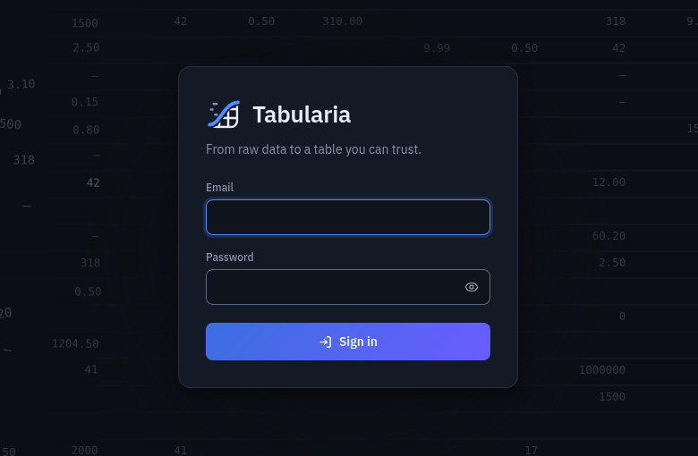

A new installation opens on **Explore**, empty: *No folders yet. Create the first one
with New.*

**Theme and language** are in the gear at the top right: five themes (Dark, Light,
Dracula, Monokai, Imperium) and five languages (English, Italiano, Français, Deutsch,
Español). The choice is kept by your browser. The same menu has *Your sessions*,
*API tokens* and *Sign out*.

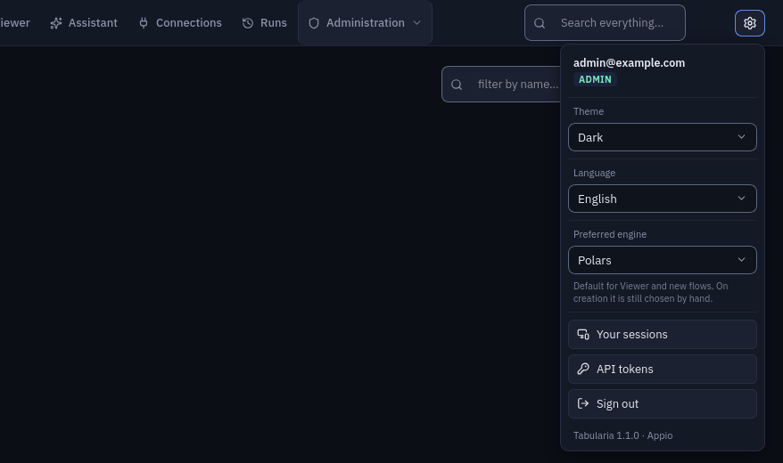

## 6. Load some data

### a. The sample data (recommended)

A fictional cured-meats company: an ERP on PostgreSQL and a CRM on ClickHouse, with a
ready-made `Sample` folder in Tabularia. Turn it on and start again:

```bash
echo "COMPOSE_PROFILES=samples" >> .env
echo "SAMPLES_SCALE=small" >> .env
docker compose up -d
```

This adds three containers: the two databases and `sampledb-init`, which fills them,
signs in to Tabularia as the administrator and builds the folder. At the `small` scale
the data takes seconds; the container then runs the eleven sample flows once. On the
clean run it was done 2 min 30 s after `up` returned (plus about a minute, the first
time, to pull the two database images). Follow it (its log is in Italian):

```bash
docker compose logs -f sampledb-init
```

It ends with `FATTO. Cartella «Sample» pronta: …` (*Done. «Sample» folder ready*) and
exits; `docker compose ps -a` then shows it `Exited (0)`, as it should. It runs again at
every `docker compose up -d` and finds everything already there.

Reload Explore: the `Sample` folder holds the two connections (*Sample ERP (Postgres)*,
*Sample CRM (ClickHouse)*), four saved views, and three folders: *Flows* (eleven flows,
three of them scheduled), *Private tables* (the company's tables and the flows' results)
and *Public tables* (a calendar, the regions).

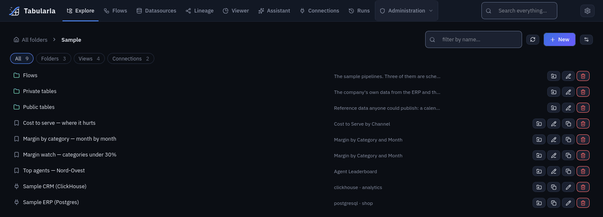

The folder is created with no permissions on it: the administrator sees it, other users
only once the administrator shares it. More: [the sample database](../infrastructure/sampledb/README.md).

### b. Or a file of your own

CSV, TSV, JSON, Excel and parquet files are loaded from the flow editor: in a new flow
(step 7, first two clicks), **Upload file** in the toolbar. The file becomes the flow's
source and the preview shows it at once.

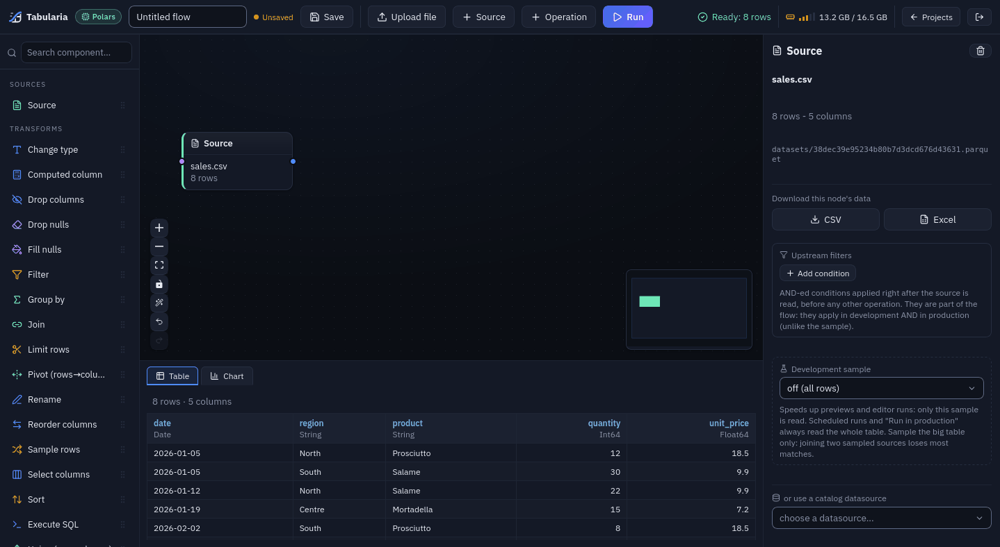

An uploaded file belongs to that flow. To turn it into a datasource others can use,
publish it with an Output node, as in step 7.

## 7. Build your first flow

The flow: from the sample `orders` table, keep the shipped orders, add the order year,
count the orders by sales channel and year, and publish the result as a datasource.
With your own file, the steps are the same with your columns.

**1. A folder.** In **Explore**, at *All folders*, click **New**, type `My first flows`
and click **Create**. The new folder opens.

**2. A flow.** In the folder, **New → New flow**, then pick the engine: **Polars**. The
editor opens with one empty *Source* node.

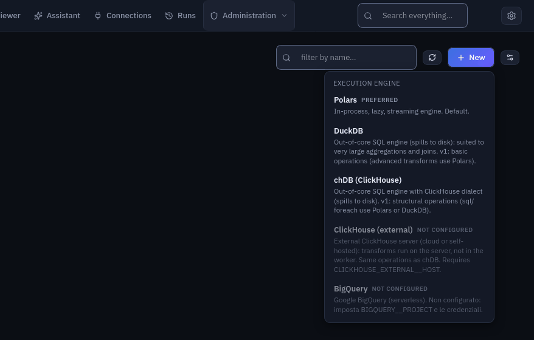

**3. Name it.** Click the name field at the top left (*Untitled flow*) and type
`Orders by channel and year`.

**4. The source.** The *Source* node is selected: in the right panel, under
*or use a catalog datasource*, open **choose a datasource…**, type `orders` and pick
**orders (30000 rows)** *Sample › Private tables*. The grid at the bottom previews the
table.

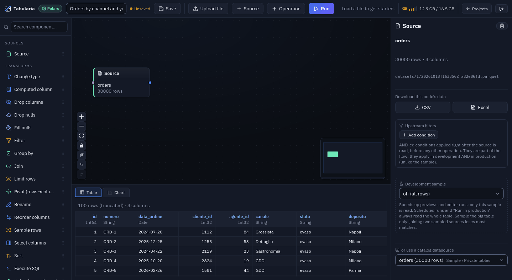

**5. A filter.** Click **+ Operation** in the toolbar. A new step appears after the
selected node, already connected, as *Change type* with a red *required parameter
missing: 'columns'*: it is waiting for its settings. In the right panel set **Type** to
**Filter**, then **Column** `stato`, **Operator** `equals`, **Value** `evaso` (shipped)
and press Enter. The preview shows only shipped orders.

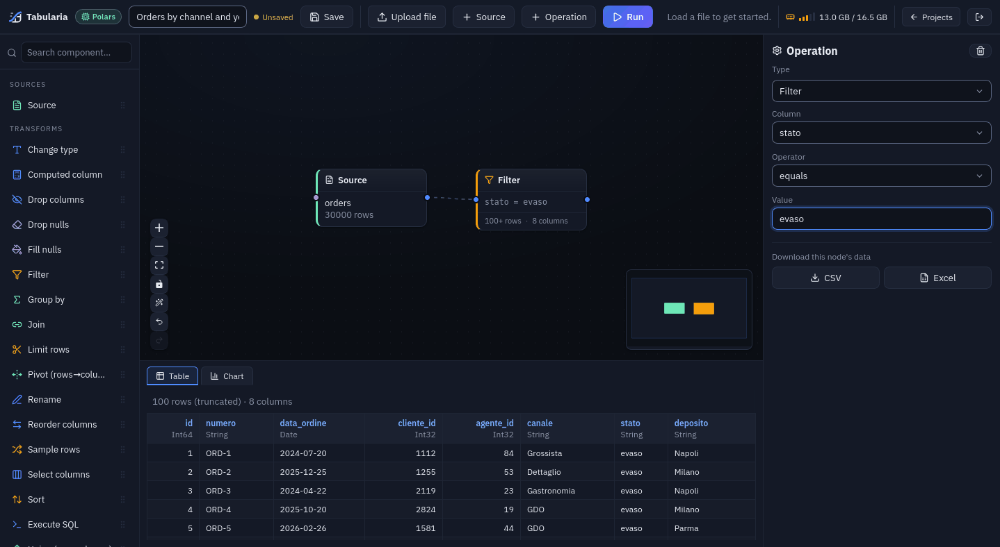

**6. A computed column.** **+ Operation** again, **Type** → **Computed column**. In the
first box type the column name `order_year`, in the second the SQL expression
`EXTRACT(YEAR FROM data_ordine)`, then press Tab. The preview gains an `order_year`
column. A wrong expression is reported in the preview while you type.

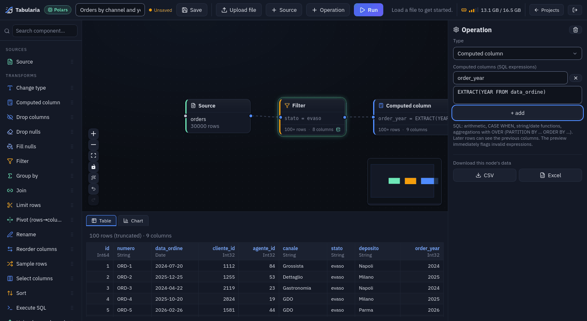

**7. A group by.** **+ Operation**, **Type** → **Group by**. Tick `canale` and
`order_year`. Under *Aggregations* click **+ add**, choose the column `id`, the function
`count`, and type `orders` as the alias. The preview now has one row per channel and
year.

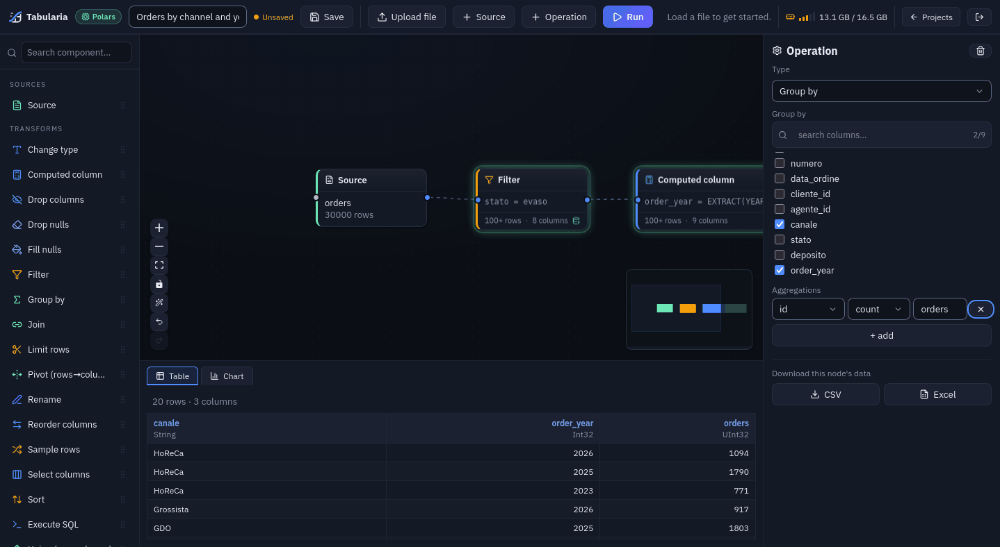

**Preview any step.** Click any node of the canvas: the grid shows that step's output.
The steps already computed are kept in a cache (the green glow), so going back to them
is fast.

**8. The output.** At the bottom of the left sidebar, drag **Output (datasource /
database)** onto the canvas, to the right of *Group by*. Connect them: drag from the
small dot on the right edge of *Group by* to the dot on the left edge of the Output.
With the Output selected, in the right panel:

- **Destination**: *Tabularia Datasource* (the default);
- **Datasource name**: `shipped_orders_by_channel_year`;
- **Folder**: `My first flows`;
- **Description**: `Shipped orders per sales channel and year`;
- tick **Overwrite if it already exists**: every later run, the scheduled ones too,
  refreshes the same datasource.

The wand button in the canvas controls (*Arrange the flow*) lines the nodes up.

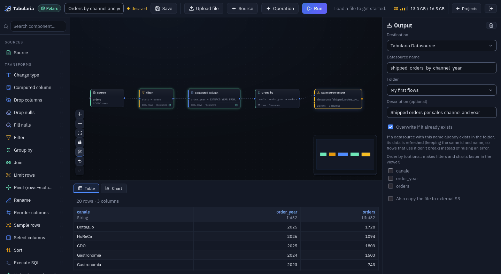

**9. Save.** **Save** in the toolbar (or Ctrl+S): *Flow "Orders by channel and year"
saved*, and the address becomes `/editor?flow=<id>`.

**10. Run.** **Run** in the toolbar opens *Run flow*: the flow runs on the whole dataset,
on a worker, and launches one run per Output. Click **Run**. A couple of seconds later
the toolbar and a notification say *Datasource "shipped_orders_by_channel_year":
completed: 20 rows → datasource "shipped_orders_by_channel_year"*.

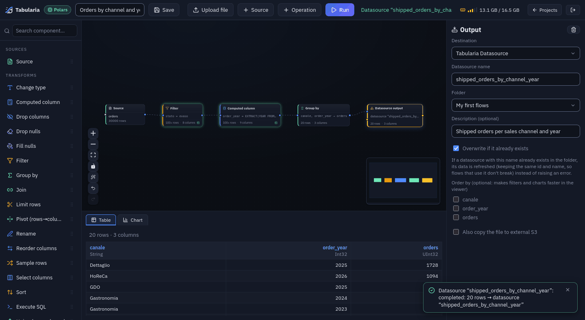

**11. The result.** **Datasources** in the top bar lists it (search `shipped`); click it
to read and edit its description and its fields' descriptions. **Viewer** opens it for
filters, pivots and charts without changing it. **Runs** has the run: the page opens on
*Failed*, click **All**.

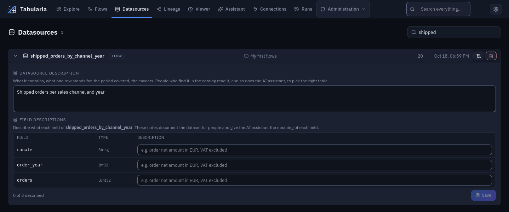

## 8. Schedule it

**Flows** in the top bar lists every flow. On the row of *Orders by channel and year*,
click the calendar button (**Schedule run**).

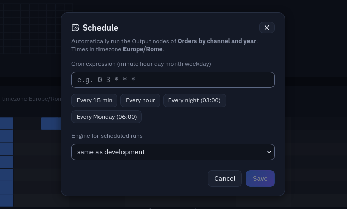

- **Cron expression**: minute, hour, day of month, month, day of week, read in the time
  zone of `APP__TIMEZONE` (the dialog shows it). The presets fill it in: *Every 15 min*,
  *Every hour*, *Every night (03:00)*, *Every Monday (06:00)*. Every day at 06:00 is
  `0 6 * * *`.
- **Engine for scheduled runs**: *same as development* (the engine the flow was built
  with) or another one, for example a ClickHouse or BigQuery engine once configured. The
  editor keeps working with the development engine.

Click **Save**. The row gets a **scheduled** badge (hover it for the cron) and the
*Schedule load* panel above the list places the flow's runs on the coming week.

To see it fire now, set the cron two minutes ahead: at 18:11, `13 18 * * *`. At 18:13
(in `APP__TIMEZONE`) **Runs** shows a new run whose author is **schedule**. Then put
the real schedule back.

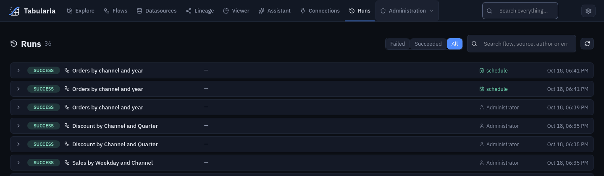

A scheduled run reads the whole table, never the development sample, and with
*Overwrite if it already exists* it refreshes the same datasource each time.

## 9. Where to go next

**Your databases.** In a folder, **New → New connection**: PostgreSQL, MySQL, MariaDB,
ClickHouse, Trino, Oracle, Microsoft SQL Server, S3, SMTP, SharePoint, SFTP, HTTP API.
Then **New → Datasource from a database** reads a table or a query into a snapshot that
flows use and that you refresh by hand or on a schedule. The two sample connections are
working examples. SQL Server needs its driver in the image: [Microsoft SQL Server](sqlserver.md).

**Files on a server.** An SFTP connection reads the files of a folder that match a
pattern, stacks them into one table, and writes flow results back as files:
[SFTP](sftp.md). The same for a bucket: [S3 buckets](s3-datasource.md).

**An HTTP API.** A datasource «API call» turns the answers of a REST/JSON API into a
table. The guide walks through free APIs field by field, starting with the ECB exchange
rates from Frankfurter, no key needed:
[HTTP APIs, examples](api-datasource.md#examples-three-free-apis-field-by-field).

**Dates that move by themselves.** `{today-30}` in an API path, a file name or an
output name becomes a date at each run, in the time zone you choose:
[Dynamic dates in inputs and outputs](placeholders.md).

**Data contracts.** The **Data contract** button of a datasource (in Datasources and
Explore) declares its columns, types and rules on the values; every new load is checked,
with a warning or an error, and the contract exports to ODCS. See the
[overview](../README.md#what-you-get).

**Export to dbt.** On the Flows page, **Export flow → dbt** turns a flow into a dbt
project for your data team, with the data contract as tests. Read its
[limits](dbt-export.md#limits) before relying on it: [Export to dbt](dbt-export.md).

**Production.** Kubernetes and the Helm chart: [Kubernetes and Helm](deploy/kubernetes.md),
then the [install and upgrade checklist](deploy/release-checklist.md).

## 10. Stop, update, back up, reset

All from the `infrastructure` folder.

**Stop and start again**, keeping everything:

```bash
docker compose stop
docker compose start
```

`docker compose down` also removes the containers (not the data); `docker compose up -d`
creates them again.

**Update** to the latest `main`:

```bash
git pull
docker compose up -d --build
```

Compose rebuilds what changed and recreates those containers; the gateway upgrades its
database schema by itself when it starts. With nothing new it takes seconds.

**Back up.** The data lives in Docker volumes named after the folder:
`infrastructure_postgres_data` (users, flows, schedules, connections, runs) and
`infrastructure_minio_data` (the datasets, as parquet files). Stop the stack, archive
both, keep `.env` with them (it holds the encryption key), start again:

```bash
docker compose stop
mkdir -p ~/tabularia-backup
for v in postgres_data minio_data; do
  docker run --rm -v infrastructure_$v:/data -v ~/tabularia-backup:/backup alpine \
    tar czf /backup/$v.tgz -C /data .
done
cp .env ~/tabularia-backup/env
docker compose start
```

**Restore** into empty volumes (after a reset, or on another machine with the same
`.env`): create the containers and volumes without starting them, unpack, start.

```bash
docker compose create
for v in postgres_data minio_data; do
  docker run --rm -v infrastructure_$v:/data -v ~/tabularia-backup:/backup alpine \
    tar xzf /backup/$v.tgz -C /data
done
docker compose up -d
```

**Reset.** `down -v` removes the containers **and every volume**:

```bash
docker compose down -v
```

> **`-v` deletes all the data**: users, flows, schedules, connections, run history,
> every dataset, the sample databases. Only the images and your `.env` remain. Without
> `-v`, `docker compose down` keeps the data.

To also free the disk the images and the build cache take (11–13 GB):

```bash
docker compose down -v --rmi all
docker builder prune -f
```

## Troubleshooting

The messages below are the real ones, reproduced on the clean run.

**`required variable SECURITY__FERNET_KEY is missing a value`.** `docker compose up -d`
stops before starting anything:

```text
error while interpolating services.gateway.environment.[]: required variable SECURITY__FERNET_KEY is missing a value: SECURITY__FERNET_KEY is required even in development - see infrastructure/.env.example
```

Add the key ([step 3](#3-configure)) and run `docker compose up -d` again.

**The gateway never becomes healthy: `SECURITY__FERNET_KEY is not valid`.** The key is
there but is not a key (typed by hand, cut short). `docker compose logs gateway` shows:

```text
RuntimeError: SECURITY__FERNET_KEY is not valid (Fernet key must be 32 url-safe base64-encoded bytes.): …
```

Generate one with the command of [step 3](#3-configure), put it in `.env`, then
`docker compose up -d`.

**A port is already in use.**

```text
Error response from daemon: failed to set up container networking: driver failed programming external connectivity on endpoint dataprep-frontend (…): failed to bind host port 127.0.0.1:3000/tcp: address already in use
```

Another program holds the port (another Tabularia, another dev server). Stop it, then
recreate the container that failed: the container is left running **without** its port,
and a plain `up -d` or `restart` does not bind it again.

```bash
docker compose up -d --force-recreate frontend
```

**The app keeps restarting: `EACCES: permission denied, mkdir '/app/.nuxt'`.** On
Linux, `docker compose ps` shows `frontend  Restarting (1)` and
`docker compose logs frontend` this error. The clone belongs to a user other than id
1000: see the note in [step 2](#2-get-the-code), then
`docker compose up -d --force-recreate frontend`.

**Not enough memory.** A worker that runs out of memory is killed and restarted:
`docker compose ps` shows it `Restarting (137)`, previews or runs never answer, and

```bash
docker inspect -f '{{.State.OOMKilled}}' infrastructure-preview-worker-1
```

prints `true`. Give Docker more memory (Docker Desktop: *Settings → Resources*); the
ceilings of the engine containers are `BACKEND_MEM_LIMIT`, `WORKER_MEM_LIMIT` and
`PREVIEW_WORKER_MEM_LIMIT` in `.env`.

**The browser says *Unable to connect*.** The app is not there yet: the first
`docker compose up -d` is still building (its output shows the build steps), or the app
is still compiling its pages. Wait for the gateway to be `(healthy)` in
`docker compose ps`; `docker compose logs --tail 5 frontend` ends with
`Nuxt Nitro server built` when the app is ready.

**Sign-in fails: *Incorrect email or password*.** Sign in with `AUTH__ADMIN_EMAIL` and
`AUTH__ADMIN_PASSWORD` from `.env`. After repeated failures the sign-in is paused:
*Too many sign-in attempts. Try again in 60 seconds.*

**The gateway does not become `(healthy)`.** `docker compose logs --tail 20 gateway`
names the reason. *Cannot create the administrator* means `AUTH__ADMIN_PASSWORD` is
`admin`, another well-known password or shorter than 12 characters: choose another one
in `.env` and run `docker compose up -d` again.

**The `Sample` folder does not appear.**

- `.env` was edited but the stack not started again: run `docker compose up -d`.
- You are signed in as a user other than an administrator: the folder is shared with
  nobody until an administrator grants it.
<!--  -->
