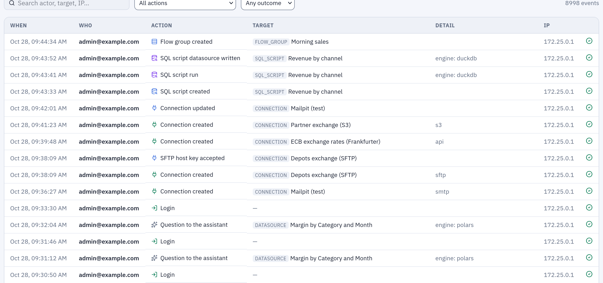

# Audit log

The audit log records, one entry per action, who signed in, who changed what, what ran,
what data left the installation and who changed the permissions. It is for whoever must
answer "who did this, and when": administrators, auditors, the security team. The log is
append-only, outlives the accounts that wrote it, and can be forwarded to a SIEM.

## At a glance

| | |
|---|---|
| Where | **Administration → Audit**: active sessions, sign-ins of the last 24 hours, and the log |
| Who reads it | administrators in full; observers with emails masked and without addresses |
| Over the API | `GET /audit`, with the same rules |
| What an entry holds | when, who, the action, success or failure, the target, a detail, the client address and browser |
| Changing or deleting entries | not possible: only the retention window removes them |
| Retention | forever by default (`AUDIT__RETENTION_MINUTES`); addresses emptied after 90 days (`AUDIT__IP_RETENTION_DAYS`) |
| To a SIEM | Splunk, through the HTTP Event Collector ([Audit log to Splunk](../siem-splunk.md)) |

## How it works

Every action that matters writes one row. Writing it never fails the action: if the
audit cannot be written, the error goes to the gateway's log and the person's action
goes on.

| Field | |
|---|---|
| When | the time of the action, in UTC |
| Who | the account's email at that moment, and its id. The email stays even when the account is later renamed or deleted. A failed sign-in carries the email as typed; an email the scheduler sends carries `scheduler`; the administrator the gateway creates at start from `AUTH__ADMIN_EMAIL` carries `startup` |
| Action | a stable name such as `flow.run` or `permission.grant`, listed below |
| Outcome | `success` or `failure` (a wrong password, a refused send) |
| Target | its kind (`flow`, `datasource`, `connection`, `user`, `permission`, `export`…), id and name at that moment |
| Detail | the context, as JSON: the engine, the cron, the export format, the SQL of a script run, the old and new value of a setting, the reason of a failure |
| Address, browser | the client's IP address and user agent |

**Secrets never go in.** A token appears by its name, never its value; a SIEM token, a
connection password or a scripting variable's value is never written; a setting
change records what changed. When an API token does something, its name is added to
the detail (`"token": "nightly-export"`), so the actions of a leaked token can be found
and undone.

**The client address** is the address of the connection as the gateway's server sees
it. Behind a reverse proxy, the `X-Forwarded-For` header is believed only from the
addresses in `FORWARDED_ALLOW_IPS` (on Kubernetes, the chart's
`gateway.trustedProxies`): anyone else cannot choose the address they appear to come
from.

## The Audit page

**Administration → Audit** has three parts:

- **Active sessions**: one row per open session (a browser, a script), with the
  account, the sign-in method, the last activity and the address. An administrator
  closes one with **Sign out this session**: the next click of whoever uses it lands on
  the sign-in page (`auth.session_revoke`).
- **Access · last 24 hours**: successful and failed sign-ins per hour, in the
  installation's time zone.
- **Audit log**: newest first, 50 per page. **Search actor, target, IP…** searches the
  email, the target's name, the action and the address; **All actions** narrows to one
  action; **Any outcome** to successes or failures.



*The **Audit log** part of the page: each row says when, who, what, on which object, with what detail, from which address, and whether it succeeded.*

## What is recorded

| Area | Actions |
|---|---|
| Sign-in and sessions | `auth.login`, `auth.login_failed`, `auth.sso_login`, `auth.sso_login_failed`, `auth.logout`, `auth.session_revoke`, `auth.password_change`, `auth.first_run_setup`, `auth.bootstrap_login` |
| Accounts and groups | `user.create`, `user.update` (a new name, or the email the identity provider changed), `user.deactivate`, `user.reactivate`, `user.delete`, `group.create`, `group.update` (its description), `group.delete`, `group.member_add`, `group.member_remove` |
| Roles and access | `permission.grant`, `permission.revoke`, `user.promote`, `user.demote`, `group.promote`, `group.demote`, `group.admin_join`, `group.admin_leave`, `user.observer_grant`, `user.observer_revoke`, `group.observer_grant`, `group.observer_revoke` |
| Tokens and integrations | `token.create`, `token.revoke`, `service_account.create`, `service_account.delete`, `webhook.create`, `webhook.update`, `webhook.delete` |
| Folders | `folder.create`, `folder.update`, `folder.move`, `folder.delete` |
| Flows | `flow.create`, `flow.update`, `flow.delete`, `flow.run`, `flow.schedule`, `flow.promote`, `transform.run` (an unsaved flow run from the editor) |
| Datasources and contracts | `datasource.create`, `datasource.update`, `datasource.delete`, `datasource.refresh`, `datasource.schedule`, `contract.save`, `contract.delete` |
| Connections | `connection.create`, `connection.update`, `connection.delete`, `connection.host_key_accept` (an SFTP server's key accepted) |
| Data leaving | `export.download` (a CSV or Excel export), `email.send` (an Output node's email, a Pushmail cell, a contract notice), `sql_script.export` |
| Free queries on the data | `sql_script.run` (with its SQL and what it read), `ai.query` (each query the assistant runs for someone) |
| SQL scripts | `sql_script.create`, `sql_script.update`, `sql_script.delete`, `sql_script.restore`, `sql_script.publish`, `sql_script.schedule` |
| Reports | `report.create`, `report.update`, `report.delete`, `report.move`, `report.rename`, `report.duplicate`, `report.restore`, `report.render` (every render, with its format, the values of its parameters, the outcome and where it came from: the interface, the API, a notebook or a flow group) |
| Python and R scripts | `script.create`, `script.update`, `script.delete`, `script.restore`, `script.run`, `script.schedule`, `scripting.trial` (a Script node run from the editor) |
| Containers | `container.trial` (a Container node run from the editor), `registry.create`, `registry.update`, `registry.delete`, `registry.test`, `registry.cluster_test`, `registry.variable_set`, `registry.variable_delete` |
| Scripting environments | `scripting.storage_update`, `scripting.storage_test`, `scripting.environment_create`, `scripting.environment_update`, `scripting.environment_delete`, `scripting.version_current`, `scripting.variable_set`, `scripting.variable_delete` |
| Saved views and flow groups | `saved_view.create`, `saved_view.update`, `saved_view.delete`, `flow_group.create`, `flow_group.update`, `flow_group.delete`, `flow_group.run`, `flow_group.schedule` |
| Administration | `settings.update`, `settings.rollout`, `settings.rollout_cancel`, `engine_settings.update`, `engine.allow`, `engine.disallow`, `ai.model_enable`, `ai.model_disable`, `ai.prompt_update`, `ai.prompt_reset`, `privacy.update`, `banner.create`, `banner.delete`, `siem.update`, `siem.test`, `backup.update`, `backup.request`, `backup.run`, `backup.download`, `workers.scaling_update`, `workers.scaling_reset`, `queue.job_stop` |

A schedule switched off because someone else widened what it does is recorded too, as
a `flow.schedule` (or the object's own schedule action) with the reason, so "why did my
nightly run stop" has an answer in the log.

**Accounts and groups.** An entry names the account or the group, and what changed from
what to what (`{"full_name": {"from": "Anna", "to": "Anna Bianchi"}}`); a password never
appears. A membership's target is the person, with the group in the detail
(`{"group": "finance", "group_id": 4}`, plus `"admin": true` or `"observer": true` when
the group carries that role). Joining or leaving an administrators' group writes
`group.member_add` (or `group.member_remove`) and then `group.admin_join` (or
`group.admin_leave`): the first action holds a group's whole membership history, the
second every change of privileges. Deleting a group writes one `group.delete` with the
number of its members, not a removal per person, and a role the group carried is
withdrawn as `group.demote` or `group.observer_revoke`. A change that changes nothing (a
form saved again, an account deactivated twice) writes nothing. The first administrator
of a try-it stack, created at the sign-in page, is `auth.first_run_setup`.

**What single sign-on does by itself** goes with the same actions and `"via": "sso"` in
the detail: the account created at its first sign-in (`user.create`), the email or name
the identity provider changed (`user.update`), a group created by
`OIDC__AUTO_CREATE_GROUPS` (`group.create`), each membership the synchronization adds or
removes (`group.member_add`, `group.member_remove`), and the administrator rights of
`OIDC__SUPERUSER_GROUP` (`user.promote`, `user.demote`). Their actor is the person
signing in, the change happening in their sign-in; a sign-in that changes nothing writes
only its `auth.sso_login`.

## Example

An administrator gives the `finance` group VIEW on the **Sales** folder. The entry, as
`GET /audit?action=permission.grant` returns it:

```json
{
  "id": 48213,
  "ts": "2026-10-27T08:14:03.512000+00:00",
  "actor_id": 1,
  "actor_label": "marta.bianchi@example.com",
  "action": "permission.grant",
  "outcome": "success",
  "target_type": "permission",
  "target_id": 57,
  "target_label": "view",
  "detail": {"project_id": 7, "user_id": null, "group_id": 4, "capability": "view"},
  "ip": "10.20.4.17",
  "user_agent": "Mozilla/5.0 (Windows NT 10.0; Win64; x64) …"
}
```

An observer reading the same entry sees `"actor_label": "m***@example.com"`,
`"ip": null` and `"user_agent": null`.

Reading the log from a script, with the token of an administrator or a service account
that may read it:

```bash
curl -s -H "Authorization: Bearer tab_…" \
  "https://tabularia.example.com/api/audit?action=export.download&since=2026-10-01T00:00:00&limit=200" \
  | jq '.items[] | {ts, actor_label, target_label, detail}'
```

The answer is a page, `{"items": […], "total": n}`; the filters are `q`, `action`,
`target_type`, `outcome`, `actor_id`, `since` and `until` (UTC), `limit` (up to 200) and `offset`.
`GET /audit/actions` lists the actions present in the log.

## Permissions

| Who | Sees |
|---|---|
| Administrators | every entry, in full; they close other people's sessions |
| Observers | every entry, with emails masked (`a***@example.com`), no address or browser, and in the detail no hosts, paths, SQL, recipients, identity-provider groups or people's names; their search covers only the action and targets that are not emails; they close nothing |
| Everyone else | nothing; **Your sessions**, in the settings menu, lists their own sessions |

An observer's own actions are recorded without their address and browser: what they did
stays, where they came from does not. A failed sign-in keeps its address whoever it
claims to be, because that is what the defences against password guessing rest on.

## Retention

| What | How long | Setting |
|---|---|---|
| Audit entries | forever, or the window you set, checked once a minute | `AUDIT__RETENTION_MINUTES` (0 = forever; 43200 = 30 days) |
| Client addresses and browsers, in audit entries, sessions and API tokens | 90 days, then emptied once an hour; the entry stays | `AUDIT__IP_RETENTION_DAYS` (0 = forever) |
| A deleted account's addresses | emptied at once, failed sign-ins with its email included; its entries stay with the email | |
| Run logs (what a Script or Container node printed, the engine's full error) | 30 days, then emptied; the run stays with its outcome and short error | `ORCHESTRATOR__LOG_RETENTION_DAYS` |
| The assistant's conversations | deleted 90 days after their last use | `ORCHESTRATOR__AI_CHAT_RETENTION_DAYS` |

Deleting entries is never a person's choice: no route deletes them, and deleting an
account does not delete what it did. Turning on a retention window is the installer's
decision; with SIEM forwarding on, entries older than the window are deleted even if
Splunk has not received them yet ([delivery](../siem-splunk.md#delivery)).

## Privacy notice

**Administration → Privacy** sets the notice shown in a bar at the top of every
page: **Line in the bar**, **Full text (Markdown)**, an optional **Link to your
organisation's policy**, and **show the notice to everyone**. The starting text
describes what the installation really records, for full accounts and for read-only
guests, and where data goes (the assistant sends questions and the rows it reads to the
configured model provider). Rewrite it if your processing differs. The placeholder
`{audit_retention}` becomes the configured audit retention, so the notice cannot drift
from the configuration. Every change is recorded (`privacy.update`).

## Limits and good to know

- **Not recorded**: reading. Opening a flow, a preview, the Viewer, a datasource's
  page are not in the log; exports, SQL script runs and the assistant's queries are.
- **Older entries.** Up to 1.2.2 an account showed only when it was created
  administrator or observer, a deactivation only as the closing of its sessions
  (`auth.session_revoke` with the reason `deactivated`), and the memberships of
  ordinary groups, a deleted group and what single sign-on changed not at all (except
  inside the detail of each `auth.sso_login`, which still carries it).
- **No export button.** Use the API above, or forward the log to a SIEM.
- **Large logs.** Entries are indexed by time, action, actor and target kind; on a busy
  installation set a retention window and keep the long history in the SIEM.

## Related

- [Audit log to Splunk](../siem-splunk.md): forwarding, delivery guarantees, searches.
- [Permissions](permissions.md): administrators, observers, what each action needs.
- [Security and governance](README.md): the map.
- [Configuration: webhooks and audit log](../configuration.md#webhooks-and-audit-log).
