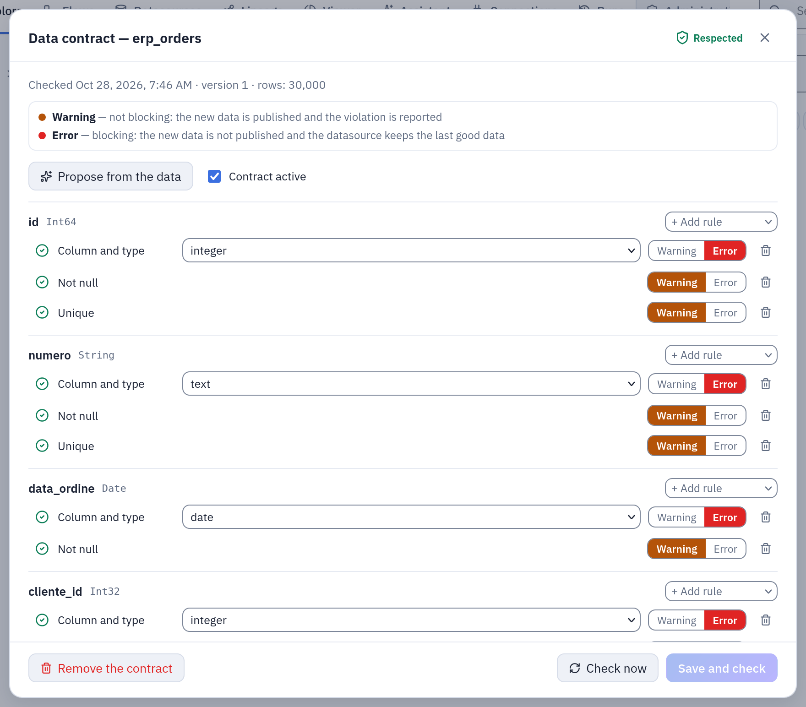

# Data contracts

A data contract is what a datasource promises to whoever uses it: which columns it has,
of which type, and which rules its values follow. Tabularia checks the rules every time
new data arrives, before it is published: a broken blocking rule refuses the new data,
and the datasource keeps serving the last good data. It is for whoever owns a
datasource that reports, flows and other teams depend on.

## At a glance

| | |
|---|---|
| Where | **Datasources**, or Explore: the **Data contract** button on a datasource's row |
| On what | any datasource: imported from a database or a file source, or written by a flow or a SQL script |
| Rules | column and type, not null, unique, accepted values, range, pattern, row count, freshness, SQL condition; up to 200 |
| Severity | **Warning** (reported, data published) or **Error** (blocking: data not published) |
| Checked | at every refresh, at every flow run or SQL script write into the datasource, when the contract is saved, on demand, and as time passes for freshness |
| Notifications | an email when the contract's state changes, through an SMTP connection |
| Open format | export as ODCS v3.0.2 (YAML) |
| Permissions | read with VIEW on the datasource's folder; write, check and remove with EDIT |

## How it works

### The rules

| Rule | In the interface | Holds when |
|---|---|---|
| `column` | **Column and type** | the column exists and, if a type is chosen, is of that type: integer, number, text, boolean, date, date and time. An integer column satisfies "number" |
| `not_null` | **Not null** | no row has a null in the column |
| `unique` | **Unique** | no two rows share the same value of one column, or of several together (nulls count as values) |
| `accepted_values` | **Accepted values** | every non-null value is one of a list (up to 500 values) |
| `range` | **Range** | every non-null value lies between a minimum and a maximum; either may be left empty |
| `pattern` | **Pattern** | every non-null value matches a regular expression in full |
| `row_count` | **Row count** | the number of rows lies between a minimum and a maximum |
| `freshness` | **Freshness** | the data is at most so many hours old: since the last update, or since the newest value of a date column |
| `expression` | **SQL condition** | a condition, in Polars SQL, is true on every row; a null result counts as a violation |

Every rule has a severity. **Warning** is not blocking: the new data is published and
the violation is reported. **Error** is blocking: the new data is not published and the
datasource keeps the last good data.

A rule that cannot be evaluated (the column is gone, the type does not fit, the SQL does
not compile) does **not** hold, and says why: a contract never passes because it could
not be checked.

### When it is checked, and what happens

| Moment | Trigger in the history | Can block |
|---|---|---|
| A refresh of a database datasource, by hand or scheduled | **Refresh** | yes |
| A flow run that publishes into the datasource, a SQL script that writes it | **Flow run** | yes |
| The contract is saved | **Contract saved** | no: it says whether the data already there respects it |
| **Check now** | **Checked by hand** | no |
| Time passing, for a freshness rule on the last update (checked every minute) | **Freshness over time** | no |

On new data, the worker that wrote it evaluates the contract on the result, whatever
engine produced it, before the gateway swaps the datasource to it:

- **every rule holds, or only warnings fail**: the data is published and the report
  becomes the contract's state;
- **a blocking rule fails**: the run ends as failed with the rules that did not hold,
  the datasource stays exactly as it was (same rows, same file), the refused file is
  deleted, and the contract shows **Update refused** until an update succeeds;
- **the evaluation itself fails** (the storage does not answer): with even one blocking
  rule the data is not published; with warnings only it is, and the report says why it
  could not check.

The state shows next to the datasource wherever it is listed: **Not checked**,
**Respected**, **Warning**, **Violated**, **Update refused**. Opening the contract shows
each rule's outcome, how many rows violate it and up to five sample values, and
**History of the checks** lists every evaluation with its trigger.

### Writing one

**Data contract** on the datasource's row opens the editor, with the rules grouped by
column and a **Whole table** group for row count, freshness and SQL conditions.

- **Propose from the data** writes a starting contract from the current data. It is
  careful on purpose: what is structural (every column and its type, at least one row)
  is proposed as **Error**; what is only true today (no nulls, no duplicates, a short
  list of values) as **Warning**, so the next refresh is not stopped by a case never
  seen. Review it before saving.
- **Add rule** adds one; each rule has its own **Severity of the rule**.
- **Contract active**, unticked, keeps the contract without checking it.
- **Save and check** (or **Create the contract** the first time) saves it and checks it
  on the current data. Every save that changes the rules is a new version.
- **Remove the contract** stops the checks; the history of the checks stays.



*A contract proposed from the data of an `erp_orders` datasource: column and type as **Error**, not null and unique as **Warning**, every rule respected at the last check.*

### Notifications

Under **Notifications**, **Addresses to notify** and **SMTP connection to send with**
send an email when the contract's state changes because of new data or of time passing:
an update refused, a rule no longer respected, everything fine again. One message per
change, not one per check: a refresh refused every night sends one email. The first
successful check of a new contract is not news and sends nothing. Each recipient who
is a Tabularia user reads it in the language they chose; other addresses in English.

Choosing the connection, or changing the addresses, needs CONNECT on the connection's
folder, and the addresses must be within the connection's allowed domains. The scheduler
sends the notices, and each is recorded in the audit log (`email.send`, with the reason
`contract_state`).

## Example: the orders of the ERP

The sample data's `orders` datasource (in **Sample / Private tables**, imported from the
ERP's `vendite.ordini`) feeds the margin and cost-to-serve reports. Its owner wants a
broken export from the ERP to stop at the door.

**1. Propose, then tighten.** **Propose from the data** gives every column with its type,
a row count of at least one, and warnings for the columns without nulls. The owner keeps
those, and adds:

- **Unique** on `id`, **Error**;
- **Not null** on `cliente_id`, **Error**;
- **Accepted values** on `canale`: `GDO, HoReCa, Grossista, Dettaglio, Gastronomia`,
  **Error**;
- **Pattern** on `numero`: `ORD-[0-9]+`, **Warning**;
- **Row count** at least `1000`, **Error**;
- **Freshness**: at most `26` hours since the last update, **Warning** (the refresh runs
  every night);
- **SQL condition** `cliente_id > 0 AND agente_id > 0`, **Warning**.

**Save and check**: the current data respects it.

The same contract over the API (datasource 12, with an EDIT token; `id` is optional and
assigned when missing):

```bash
curl -X PUT https://tabularia.example.com/api/datasources/12/contract \
  -H "Authorization: Bearer tab_…" -H "Content-Type: application/json" \
  -d '{
    "enabled": true,
    "notify_emails": "data-team@example.com",
    "notify_connection_id": 3,
    "document": {
      "description": "Order headers for the sales reports: one row per order.",
      "rules": [
        {"kind": "column", "column": "id", "dtype": "integer", "severity": "error"},
        {"kind": "unique", "columns": ["id"], "severity": "error"},
        {"kind": "not_null", "column": "cliente_id", "severity": "error"},
        {"kind": "accepted_values", "column": "canale",
         "values": ["GDO", "HoReCa", "Grossista", "Dettaglio", "Gastronomia"], "severity": "error"},
        {"kind": "pattern", "column": "numero", "regex": "ORD-[0-9]+", "severity": "warning"},
        {"kind": "row_count", "min": 1000, "severity": "error"},
        {"kind": "freshness", "max_age_hours": 26, "severity": "warning"},
        {"kind": "expression", "name": "every order has a customer and an agent",
         "sql": "cliente_id > 0 AND agente_id > 0", "severity": "warning"}
      ]
    }
  }'
```

**2. A bad night.** The ERP starts writing a new channel, `Online`, on three orders. The
nightly refresh reads them, the worker evaluates the contract, and the run fails with:

```
Data contract violated: accepted_values on canale (3 rows). The new data was NOT
published: the datasource still serves the previous snapshot.
```

The reports keep reading yesterday's orders. The datasource shows **Update refused**, the
history shows the refused check with the sample value `Online`, and
`data-team@example.com` receives one email.

**3. The fix.** The owner adds `Online` to the accepted values, or the ERP fixes its
export; the next refresh passes, the data is published, the state goes back to
**Respected**, and a second email says so.

## Exporting as ODCS

**Export as ODCS** downloads the saved contract in the Open Data Contract Standard,
v3.0.2, as YAML (`orders.odcs.yaml`), to hand it to a data catalog or another tool. It
is an export only: the contract in Tabularia stays the source, and there is no import.
Each column becomes a schema property with its logical and physical type and its
description; each rule becomes a `quality` item with its severity, carrying the
Tabularia rule's id and kind; freshness becomes `slaProperties`. An excerpt of the
example above:

```yaml
apiVersion: "v3.0.2"
kind: "DataContract"
id: "urn:tabularia:datasource:12"
name: "orders"
version: "3.0.0"
status: "active"
schema:
  - name: "orders"
    properties:
      - name: "canale"
        logicalType: "string"
        physicalType: "String"
        quality:
          - type: "sql"
            name: "canale has only accepted values"
            query: "SELECT COUNT(*) FROM ${table} WHERE \"canale\" IS NOT NULL AND \"canale\" NOT IN ('GDO', 'HoReCa', 'Grossista', 'Dettaglio', 'Gastronomia')"
            mustBe: 0
            unit: "rows"
            dimension: "conformity"
            severity: "error"
    quality:
      - type: "library"
        rule: "rowCount"
        mustBeGreaterOrEqualTo: 1000
        unit: "rows"
        severity: "error"
slaProperties:
  - property: "latency"
    value: 26
    unit: "h"
```

## Permissions

| Action | Needs |
|---|---|
| See the state and open the contract, its history, the ODCS export | VIEW on the datasource's folder |
| Save, check, propose, remove | EDIT on the datasource's folder |
| See and change who is notified | EDIT on the datasource's folder; CONNECT on the SMTP connection to choose it or to change the addresses |

Saving and removing a contract are in the audit log (`contract.save`,
`contract.delete`). A refused update is a failed run, with the broken rules as its
error, in the run history.

## Limits and good to know

- **One contract per datasource**, up to 200 rules; an accepted-values list holds up to
  500 values, a regular expression up to 500 characters, a SQL condition up to 2,000.
- **Polars dialects.** The regular expressions and SQL conditions are evaluated by
  Polars, whatever engine produced the data. A SQL condition is an expression on one
  row, not a query: it cannot read another table. Compare dates with date columns, not
  with text literals.
- **A check by hand waits two minutes.** On a very large datasource, **Check now** and
  **Save and check** may give up ("The dataset is too large to be checked
  interactively"): the contract is saved and is checked at the next update.
- **Freshness on a date column** is evaluated on the data, so its outcome changes only
  when the data is checked again (new data, or **Check now**); freshness on the last
  update changes with the clock.
- **Python and R scripts** that publish their output as a datasource do not check its
  contract.
- **A contract removed or turned off during a run** decides nothing for that run.

## Related

- [Security and governance](README.md): the map.
- [Permissions](permissions.md): VIEW, EDIT, CONNECT.
- [Audit log](audit-log.md).
- [SQL scripts](../sql-scripts.md): a script that writes a datasource.
- [Connections](../connections/README.md): the SMTP connection for the notices.
