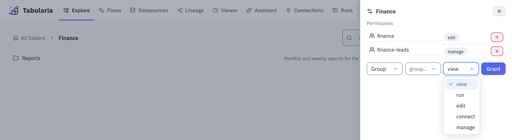

# Permissions

Tabularia decides who may see and do what with folders: every object lives in a folder,
and a permission granted on a folder, to a user or to a group, holds for the folder and
everything below it. This page is for administrators and for whoever looks after a
team's folders: the model, the five capabilities, the administrator and observer roles,
and what each common action needs.

## At a glance

| | |
|---|---|
| Unit of permission | a folder, inherited by its subfolders |
| Subjects | users, groups (a user gets the grants of every group they belong to), service accounts |
| Capabilities | VIEW, RUN, EDIT, MANAGE (each includes the ones before it) and CONNECT (on its own) |
| Kind of rules | grants only: there is no deny |
| Where | Explore → a folder → **Folder settings** → **Permissions** |
| Who grants | whoever has MANAGE on the folder; administrators everywhere |
| Roles above folders | administrator (personal or through a group), observer (reads the administration panels) |

## How it works

### Folders

Flows, datasources, connections, saved views, SQL scripts, Python and R scripts,
notebooks, reports and flow groups all belong to exactly one folder. Folders nest. Only administrators create
top-level folders (the personal folders below aside); whoever has MANAGE on a folder creates
folders inside it.

A permission on a folder holds for every subfolder, however deep. The folders above the
ones you can read show in Explore by **name only**, so the path to your folders can be
walked; their content stays hidden. Because there are only grants, a subfolder cannot
be closed to someone who has a permission above it: keep data that a group must not see
in a branch of its own.

### Personal folders

Every person gets a folder of their own when their account is created: by an
administrator, at the first single sign-on, or as the first administrator at start-up.
It sits at the top level and is named after the part of the email before the @
(`leonardtriv@example.com` gets `leonardtriv`); when a top-level folder has that name
already, it takes a number, as copies do (`leonardtriv (1)`). Accounts created before
this release get theirs at their next sign-in.

The person has EDIT on it: they upload files there, build flows, datasources, views and
reports, run and schedule them, and rename the folder. Nobody else is granted anything,
and a top-level folder inherits nothing: only the person and the administrators see it.
In Explore it comes first, with a key on the folder and the tag **My folder**; an
administrator sees everyone's, after the shared folders, tagged **Personal**.

The person does **not** have MANAGE, and that is deliberate:

- **no CONNECT**: a connection can point at any host the workers reach, so being able to
  create one is what lets someone copy data out of the installation or probe the internal
  network. It stays a right an administrator gives. Data reaches the folder from the
  connections the person was granted elsewhere;
- **no sharing and no subfolders**: a folder its person could share would let a copy of a
  datasource they may only read reach people nobody granted it to.

An administrator can grant more on it, as on any folder: a colleague's access, or
CONNECT or MANAGE to the person. Python and R scripts, notebooks and Container nodes still
need the use of their environment or registry, which the folder does not give.

So that it is not lost by mistake, nobody but an administrator can delete it, move it
under another folder or remove the person's own EDIT, even with MANAGE on it. Should an
administrator delete it or take that grant away, the person gets a new, empty one at
their next sign-in.

When the account is deactivated nothing changes. When it is deleted, an empty folder goes
with it; one holding anything stays, with its content, as an ordinary top-level folder
that only the administrators and whoever it was shared with see: the content belongs to
the organization, as everywhere else.

Service accounts and accounts that only observe get none: a public demo's guest is one
account shared by many visitors, and a folder of its own would let any of them write.
Upgrading from a version where the person held MANAGE lowers that grant to EDIT and
removes the MANAGE and CONNECT grants on these folders; connections already made there
stay, and only the administrators see them.
The creation is in the audit log as `folder.create`, with `"personal": true`.

### The capabilities

| Capability | Lets you | Includes |
|---|---|---|
| **VIEW** | see the folder's content; open flows, datasources, saved views, scripts and reports; preview and export data; read a report and download it; ask the assistant about the datasources | |
| **RUN** | run flows, refresh datasources, write a SQL script's datasource, run scripts and flow groups, and schedule all of them | VIEW |
| **EDIT** | create, change, rename, move, duplicate and delete content; write a datasource's data contract; publish a flow's result into the folder | RUN, VIEW |
| **MANAGE** | grant and revoke permissions on the folder, create subfolders, move and delete folders | EDIT, RUN, VIEW, CONNECT |
| **CONNECT** | see, create, change, test, browse and use the folder's connections | nothing else |

CONNECT stands apart on purpose. Someone with VIEW, RUN or EDIT on a folder does **not
see** its connections; someone with CONNECT alone sees the connections and nothing else.
That is how a team is allowed to import from the ERP database without being able to
change the flows next to the connection, or the other way round.

### Granting

In Explore, open the folder and its **Folder settings** (shown only with MANAGE). The
**Permissions** list shows the grants made on **this** folder, not the ones inherited
from above. Choose **Group** or **User**, the subject, the capability, then **Grant**.
In the interface, administrators grant to single users and to groups, other folder
managers to groups (the API, `POST /projects/{id}/permissions`, takes either). The cross beside a grant revokes it.



***Folder settings** of `Finance`, as in the example below: two grants on this folder, and the form for a third with the five capabilities.*

Prefer groups. A person who changes team changes groups, and the folders follow.
With single sign-on the groups can come from the identity provider
([group mapping](../design/sso-group-mapping.md)).

Every grant and revocation is in the audit log (`permission.grant`,
`permission.revoke`), and so is moving a folder (`folder.move`), which changes what its
whole subtree inherits. Moving a folder needs MANAGE on the folder **and** on its new
parent.

### Administrators

An administrator can do everything, everywhere, whatever the folder grants say. Someone
is an administrator either by their own flag or by membership of an administrators'
group:

- **Administration → Users**: **Make administrator** on the person.
- **Administration → Groups**: **Make the group's members administrators**;
  everyone in the group, and anyone who joins later, is an administrator.

With single sign-on, `OIDC__SUPERUSER_GROUP` names the identity provider's group whose
members are administrators; the personal flag is then rewritten at every SSO sign-in, so
use a Tabularia group for anything that must stick. Nobody can remove their own
administrator rights, by any route: another administrator must do it, which also keeps
at least one administrator in place.

Administrators alone manage users, groups, group membership, service accounts,
webhooks, the engines that may be chosen, the AI models, scripting environments,
container registries, the SIEM forwarding, backups and the settings of the
**Administration** page. The export to dbt is for administrators only, because the
project it produces carries definitions and data from other folders too.

### Observers

An observer reads the administration panels without being able to change anything:
**Admin**, **Queue**, **Monitoring**, **Performance**, **Cluster** and **Audit**, under
**Administration**. It suits an auditor, a security officer or an on-call colleague. The
role is granted like the administrator's, on a person or on a group (the eye button,
**Open the administration panels read-only**).

What an observer sees is masked: emails as `a***@example.com` (the domain stays), no IP
addresses, no browser strings, and in the audit details no hosts, paths, SQL,
recipients or people's names. Their own actions are recorded without their IP address
and browser.

An account that is **only** an observer is treated as a shared account, the kind a
public demo signs everyone in with: it has no personal API tokens, cannot change its
password, sees and closes only its own session, and its questions to the assistant are
not saved. On its folders it has whatever it was granted, usually VIEW.

### Service accounts

A service account is an integration rather than a person: an administrator creates it in
**Administration → Service accounts**; it has no password and signs in only with
its API tokens. It gets permissions like anyone else, from its groups and from folder
grants. A token is never more powerful than its account, and a *Read only* token refuses
every change. The details are in [the API guide](../api.md#signing-in-api-tokens).

### Schedules run with their author's rights

A scheduled flow, refresh, flow group, script or SQL script runs with the rights of the
person who set the schedule, and those rights are checked again every time it fires:

- an author who is disabled or deleted switches the schedule off;
- a right the author no longer has stops the run before it starts: depending on the
  object, the run is recorded as failed with the reason, or the schedule switches
  itself off;
- a change by **someone else** that makes the object reach further (another source,
  another output connection or publish folder, new code in a Script node, another image
  in a Container node, the object moved to another folder) switches the schedule off,
  and the audit log says why. The author's own changes keep it.

So a schedule never does more than its author chose, with rights the author still has.
See [Scheduling](../capabilities/scheduling.md).

## What each action needs

"On the folder" means the folder of the object acted on.

| Action | Needs |
|---|---|
| See a folder's datasources, flows, views, scripts, groups | VIEW on the folder |
| Preview a datasource, open it in the Viewer, export it as CSV or Excel | VIEW on the datasource's folder |
| Upload a file | EDIT on at least one folder |
| Create a datasource from a database, SFTP, S3, an API or SharePoint | EDIT on the destination folder and CONNECT on the connection's folder |
| Refresh a database datasource, or schedule its refresh | RUN on the datasource's folder and CONNECT on the connection's folder |
| Rename, move, delete a datasource | EDIT on its folder (and on the new one, to move it) |
| Read a datasource's data contract | VIEW on its folder |
| Write, check or remove a data contract | EDIT on the datasource's folder |
| Open a flow | VIEW on its folder, and the use of every scripting environment and container image it runs |
| Create, change, delete a flow | EDIT on its folder |
| Run a flow | RUN on its folder, VIEW on every datasource it reads, EDIT on the folder it publishes to, CONNECT on every connection an Output node writes to or sends email through |
| Schedule a flow | RUN on its folder (and all the above, again, at every run) |
| Run an unsaved flow from the editor | RUN on the folders of the data it reads |
| Ask the flow assistant to change a flow | EDIT on the flow's folder |
| Ask the assistant about data | VIEW on the datasources it reads |
| See, create, change, test or browse a connection | CONNECT on the connection's folder |
| Open a flow group, see its runs | VIEW on its folder |
| Create, change, delete a flow group | EDIT on its folder, and RUN on the folder of every flow, datasource or script added as a cell |
| Run or schedule a flow group | RUN on its folder; each cell is checked again when it runs |
| A Pushmail cell | CONNECT on the SMTP connection and VIEW on every datasource it attaches |
| Open a saved view | VIEW on its folder, and VIEW on its datasource to see the data |
| Save a view | EDIT on the destination folder and VIEW on the datasource |
| Open and run a SQL script | VIEW on its folder; on a connection, CONNECT on it; the datasources it names readable by you |
| Write a SQL script's datasource, schedule it | RUN on the script's folder and EDIT on the datasource's folder |
| Save, move, delete a SQL script | EDIT on its folder |
| See a Python or R script | VIEW on its folder and the use of its environment |
| Run or schedule a Python or R script | RUN on its folder; EDIT where it publishes |
| Grant permissions, create subfolders, delete a folder | MANAGE on the folder |
| Delete or move a personal folder, remove its person's MANAGE | administrator |
| Create a top-level folder, export a flow to dbt | administrator |
| Read the audit log and the other administration panels | administrator or observer |

Who may use a scripting environment or a container registry is set by an administrator
per group ([Python and R](../scripting.md#who-can-use-an-environment),
[Container registries](../container-registries.md)). Someone without it cannot open a
flow that uses it: the flow is listed greyed out, with the reason.

## Example: a Finance team

The sales data comes from the ERP and the CRM, imported into a folder **Sales** by the
data team. Finance should read it, build its own flows and reports in its own folder,
and touch nothing else.

**1. Folders.** An administrator creates two top-level folders:

```
Sales                 ← datasources orders, order_rows, customers; the ERP connection
Finance
└── Reports           ← created later by Finance itself
```

**2. Groups.** In **Administration → Groups**, the administrator creates
`finance` and `finance-leads` and adds the people (or lets single sign-on fill them).

**3. Grants.** In **Folder settings** of each folder:

| Folder | Group | Capability | Why |
|---|---|---|---|
| Sales | `finance` | view | read orders and customers, preview, export |
| Finance | `finance` | edit | build flows and views, run them, publish results here |
| Finance | `finance-leads` | manage | create subfolders, grant access to colleagues |

The same grant over the API, with an administrator's token (folder 7 is **Sales**,
group 4 is `finance`):

```bash
curl -X POST https://tabularia.example.com/api/projects/7/permissions \
  -H "Authorization: Bearer tab_…" -H "Content-Type: application/json" \
  -d '{"group_id": 4, "capability": "view"}'
```

**4. What follows.**

- A Finance analyst builds a flow in **Finance/Reports** that joins `orders` and
  `customers` from **Sales** and publishes `Monthly revenue by channel` into
  **Finance/Reports**: VIEW on Sales covers the reads, EDIT on Finance covers the run
  and the publish.
- They do not see the ERP connection in **Sales** (no CONNECT), so they cannot refresh
  `orders` or import new tables: the data team keeps that.
- They schedule the flow every morning. If they later leave the `finance` group, the
  next scheduled run does not start and records why.
- A `finance-leads` member grants VIEW on **Finance/Reports** to the `management`
  group: managers read the reports, and nothing else of Finance.

## Limits and good to know

- **No deny, no per-object grants.** Permissions are on folders only; a datasource
  that a group must not see goes in a folder that group has no grant on, above or below.
- **Moving changes access.** An object moved into another folder takes that folder's
  permissions. Moving a folder takes its whole subtree with it, which is why it needs
  MANAGE at both ends.
- **Changes are immediate.** Rights are read at every request, so a revoked grant, a
  removed group membership or a removed administrator flag takes effect on the next
  click; open sessions are not needed to end.
- **Deleting a user** removes their grants, group memberships, sessions and tokens; what
  they created stays, and their audit entries keep their email.
- **Folder deletion** needs MANAGE and an empty folder: no subfolders, flows,
  datasources, connections or other objects.

## Related

- [Security and governance](README.md): the map.
- [Audit log](audit-log.md): what every grant, run and export leaves behind.
- [Concepts](../concepts.md): folders, flows, datasources and runs.
- [Connections](../connections/README.md): CONNECT, kind by kind.
- [Single sign-on with Keycloak](../sso-keycloak.md) and [group mapping](../design/sso-group-mapping.md).
- [Tabularia API](../api.md): tokens and service accounts.
