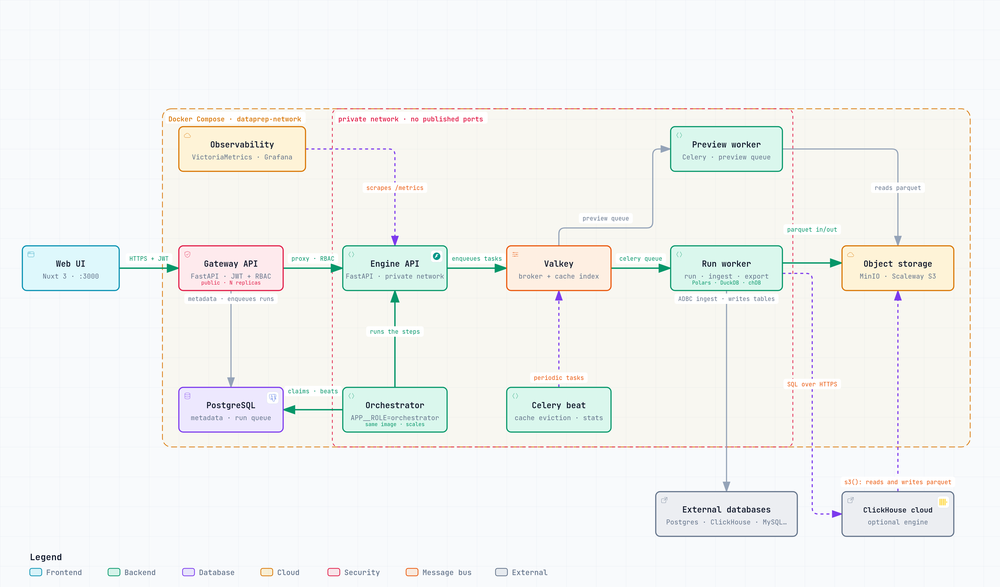

# How Tabularia works

The pieces of an installation, what each one keeps, and the few design decisions that let
the same flow run on a laptop and on a warehouse. For the objects people work with
(folders, datasources, flows, runs) read [Concepts](concepts.md) first; for the settings,
the [configuration reference](configuration.md).

[](architecture/runtime-architecture.html)

**[Open the interactive diagram](architecture/runtime-architecture.html)** (pan and zoom,
light and dark theme, search, guided views, PNG and SVG export). It is generated with
[Archify](https://github.com/tt-a1i/archify) from
[`runtime.architecture.json`](architecture/runtime.architecture.json); every node cites the
source files that implement it.

## At a glance

| Component | Role |
|---|---|
| Web interface | Nuxt 3, server-side rendered; the browser calls the gateway only |
| Gateway | The control plane, in Go: sign-in, permissions, audit log, the metadata, then the call to the engine. Stateless between requests, so it runs in as many copies as you like (`APP__ROLE=api`) |
| Orchestrator | The gateway's image in another role (`APP__ROLE=orchestrator`): fires the schedules, runs flows and flow groups, cleans up. Copies share the work through the database; `APP__ROLE=all` (the default) does both jobs in one process |
| AI service | The Python image (`APP__ROLE=ai`, internal only): the assistants, the SQL parsing behind the guards and lineage, the database migrations |
| PostgreSQL | The metadata: users, groups, folders, versioned flows, encrypted connection credentials, runs, schedules, the audit log. Its schema evolves through Alembic revisions ([database migrations](database-migrations.md)) |
| Engine API | Internal, reached only by the gateway: turns every preview, count, profile and run into a task for the workers |
| Valkey | The Celery broker, the step-cache index, the preview slots, the counters behind the metrics; any Redis-compatible server works |
| Run worker, preview worker | Celery workers on two queues (`celery`: runs, imports, exports; `preview`: interactive previews), running the in-process engines and the clients of the external ones |
| Celery beat | Cache eviction and storage statistics; exactly one copy |
| Object storage | One bucket, all parquet: `raw/` uploads, `datasets/` snapshots, `cache/` steps, `out/` results. MinIO locally; any S3, or Google Cloud Storage through its S3 API |
| External engines *(optional)* | A managed ClickHouse reading and writing the parquet through `s3()`; Google BigQuery reading it as temporary external tables over GCS |
| Kubernetes Jobs *(optional)* | Python, R, notebooks and container images, each in a namespace of its own with limits and network policies; data API pods, one Deployment per active API |

The gateway is the only public entry point. It owns the metadata database and checks
authentication and permissions on every call before it asks the internal engine, which
keeps nothing of its own beyond Valkey and the object storage. Nothing that outlives a
request lives in a gateway process (the run queue, the sign-in throttle and «who has
this flow open» are tables), which is what lets the API tier scale out and the
orchestrators scale separately. On 2 CPUs one Go replica answers about 7,600 requests a
second on `/auth/me` and 3,300 on a folder's list, with a median latency under load of 8
to 45 ms, and uses 10 MB of memory idle (`gateway-go/scripts/bench/bench.sh`).

The metadata database has a diagram of its own:
**[open the metadata database schema](architecture/metadata-schema.html)**, generated from
[`metadata-schema.architecture.json`](architecture/metadata-schema.architecture.json). It
was read from a live database of release 1.1.0 (28 tables); the tables added since by
the later revisions are not drawn yet, and the models in
[`gateway/app/models`](../gateway/app/models/) are the reference.

## The declarative definition

A flow is stored as a **declarative definition**: a JSON list of typed operations, decoupled
from whatever runs it. A Group by is
`{"type": "group_by", "params": {"by": [...], "aggregations": [...]}}` on every engine
([the whole chain of a sample flow](capabilities/flows.md#what-the-engine-receives)).
Adding or swapping an engine touches neither the routes, the workers nor the saved flows.

Each engine is a registry of implementations, one per operation:

| Engine | id | Notes |
|---|---|---|
| **DuckDB** | `duckdb` | In the worker, spilling to disk. The default for new flows since 1.4.0. Full coverage. |
| **Polars** | `polars` | In the worker, lazy and streaming. Full coverage. |
| **chDB** | `chdb` | Embedded ClickHouse, in the worker, in the image built with `WITH_CHDB=true`. Everything but `foreach`. |
| **ClickHouse (external)** | `clickhouse` | Optional: the same dialect as chDB, on a remote server, enabled by `CLICKHOUSE_EXTERNAL__HOST`. Transport `s3` (the server reads and writes the parquet on the object storage) or `push` (a staging table and a streamed result). |
| **BigQuery** | `bigquery` | Optional: GoogleSQL over temporary external tables on GCS, results through the Storage Read API, enabled by `BIGQUERY__PROJECT` and a service-account key. Everything but `foreach` and `median` inside `pivot`. |

DuckDB and chDB are guarded imports: a missing package marks the engine unavailable
without breaking the others, and the external engines are listed but unavailable until
configured. chDB is not safe across `fork`, so it is imported inside the Celery child,
never in the parent. A person's **preferred engine** (Settings) is the default of the
Viewer and of new flows; each flow keeps the engine it was built with, and may carry a
**production engine** used by schedules and «Run in production». Every run records the
engine it ran on. **Administration → Engines** narrows the choice for the whole
installation without stopping the flows already on a disallowed engine
([Engines](capabilities/engines.md)).

The engines follow one data standard (nulls, casts, joins, aggregates, sort order,
pivots), locked by an oracle suite that runs the same hand-computed expectations on all
five; what still differs is listed in [Engine differences](engines/engine-differences.md).

### External engines in detail

**ClickHouse (external).** `CLICKHOUSE_EXTERNAL__HOST`, `__PORT` (8443 with TLS on managed
services), `__USERNAME`, `__PASSWORD`, `__DATABASE`, `__SECURE`, `__TRANSPORT` (`s3` or
`push`), `__S3_ENDPOINT` (the storage endpoint as the server sees it) and, recommended,
`__S3_NAMED_COLLECTION`: a named collection holding the bucket's credentials on the server,
so keys never travel inside a query nor land in `query_log`. On scans the engine raises
`max_threads` to hide the object storage's latency, never on `LIMIT` queries. Interactive
previews carry a `log_comment` tag: when a newer preview supersedes one still running, the
server is told to `KILL` it. With the `s3` transport an aggregation over 25 million rows
answers in 0.6 s instead of 18 s, because the parquet is written with large row groups the
server can skip. Validated on Scaleway's managed ClickHouse.

**BigQuery.** `BIGQUERY__PROJECT`, `BIGQUERY__CREDENTIALS_FILE` (the service-account key's
path in the container) or `BIGQUERY__CREDENTIALS_B64` (the same key, base64 on one line),
`BIGQUERY__LOCATION`, `BIGQUERY__MAXIMUM_BYTES_BILLED` (20 GiB by default: a query that would
bill more is refused before it runs) and `BIGQUERY__CACHE_DATASET` (`tabularia_cache`;
empty turns the step cache off). The object storage must be Google Cloud Storage
(`STORAGE__ENDPOINT=https://storage.googleapis.com`, with HMAC keys). Column names BigQuery
cannot hold (`Importo (€)`) are mapped to safe names inside the query and restored in the
results; computed columns are transpiled from the common dialect with sqlglot. BigQuery
bills the logical bytes of the columns a query touches: the per-query cap and the
development sample are the two guards ([Engines](capabilities/engines.md)).

## The step cache

Every step's result is stored under a key made of its source and its operations, so
editing the last step of a ten-step flow recomputes one step, not ten. The copy is written
*after* the preview has answered, by a separate low-priority task, and only for steps up to
`CACHE__MAX_STEP_ROWS` rows (1 million by default): a step as large as the source is
recomputed from the source's parquet instead of being copied. A preview whose chain has a
step being copied waits for that copy and starts from it. In-process engines and
ClickHouse keep the steps as parquet under `cache/`; BigQuery keeps them as expiring tables.
Entries expire after `CACHE__TTL_SECONDS` unused
([Preview and analysis](capabilities/preview-and-analysis.md#the-step-cache)).

## Storage layout

```
raw/       files as uploaded
datasets/  the datasources, normalized parquet snapshots
cache/     the steps' results, by content
out/       run results, downloadable as CSV or Excel
```

Any S3-compatible storage works, and Google Cloud Storage through its S3 API (the two
things GCS does differently, no batch delete and no chunked request checksums, are handled
by the storage layer). Parquet is written with large row groups
(`INGEST__PARQUET_ROW_GROUP_ROWS`, 1 million by default) and, when a datasource declares
sort keys, ordered on them: that is what lets an external engine skip most of a file on a
filtered query.

### A copy on a bucket that is not Tabularia's

An Output that publishes a datasource can also drop a copy of the same parquet on a bucket
another team already reads ([S3 connections](connections/s3.md)). By default the copy lands
at the same key at every run, always parquet, overwritten: whoever reads it agrees on one
path once. The key may carry [placeholders](placeholders.md), one object per day with
`exports/sales/{today:yyyy/MM/dd}.parquet`. The overwrite is a single object and becomes
visible only when the upload completes, so a reader gets the previous file or the new one
in full, never a mixture. The copy is best effort: one that fails leaves the run successful
and the datasource published, and the error is recorded on the run. Point it at a bucket
other than Tabularia's own: a copy into that one is not checked against the objects already
there.

## The Docker Compose stack

The stack of `infrastructure/` is the development and trial installation
([walkthrough](getting-started-docker-compose.md)):

| Service | Role |
|---|---|
| `frontend` | the interface, on http://localhost:3000 |
| `gateway` | the Go gateway in role `all` (requests, schedules and runs), on :8000 |
| `ai` | the AI service: the assistants, SQL parsing, the migrations |
| `backend` | the engine API |
| `worker`, `preview-worker` | the Celery workers of runs and imports, and of previews |
| `beat` | the clock of the periodic tasks; one copy |
| `chart-renderer` | draws the reports' charts as SVG on the server, for the worker that renders a report; internal |
| `keys-init` | gives the `keys` volume, with the encryption key, to the services, then exits |
| `postgres` | the metadata |
| `redis` | Valkey: broker, cache index, counters |
| `minio` | object storage; console on :9001, S3 API on :9002 |
| `victoriametrics`, `grafana` | metrics and dashboards; Grafana on :3001 |
| `cadvisor`, `node-exporter`, `celery-exporter` | metric exporters |
| `sampledb-postgres`, `sampledb-clickhouse`, `sampledb-init` | the sample ERP and CRM (:5434, :8124) and the container that builds the `Sample` folder, then exits |

On Kubernetes the same images run as the components of
[Deploying on Kubernetes](deploy/kubernetes.md#components), with the Helm chart in
[`infrastructure/helm/tabularia`](../infrastructure/helm/tabularia/).

## Languages and themes

The interface speaks English, Italian, French, German and Spanish, chosen per person and
kept in a cookie so that the server renders the right language. Themes (`dark`, `light`,
`imperium`, `dracula`, `monokai`) are palettes of CSS variables on `:root[data-theme]`,
kept in the browser with a script in the page's head that avoids a flash of the wrong one.
Code and comments are in English; the text people read is translated.

## Related

- [Concepts](concepts.md): folders, connections, datasources, flows, runs
- [Configuration reference](configuration.md): every variable, with its default
- [Deploying on Kubernetes](deploy/kubernetes.md): components, networking, images, probes
- [Engines](capabilities/engines.md): choosing where a flow runs
