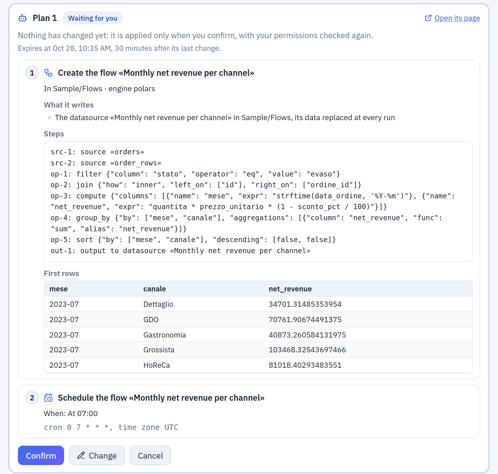
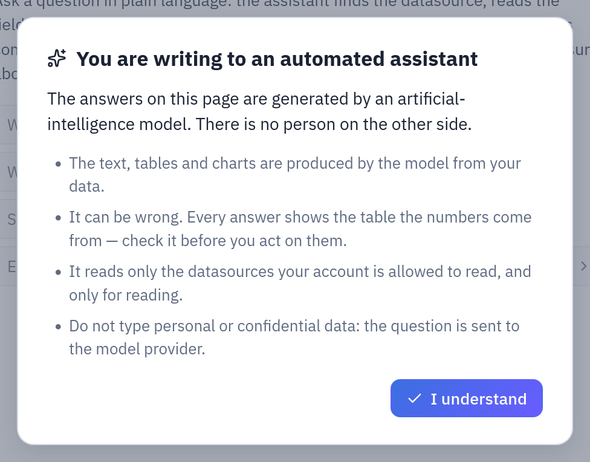
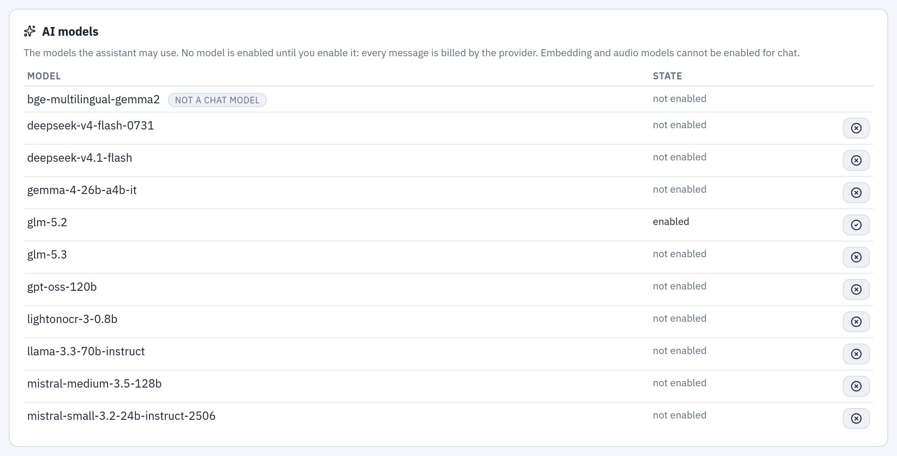

# AI in Tabularia

Tabularia can use a language model in five places: a chat that answers questions on the
datasources, an assistant that builds flows in the editor, one that writes Python and R
scripts, the naming of conversations, and the descriptions and SQL translations of the
dbt export. All of it is optional, off until an administrator points Tabularia at a
model provider, and limited to the models the administrator enables. This page says,
for each use, what goes to the model and what does not, and how to configure, cap and
audit it.

## At a glance

| | |
|---|---|
| Provider | any endpoint that speaks the OpenAI chat-completions protocol, with tool calls, and lists its models at `GET /models` |
| Who talks to it | the gateway only; the engine and the workers never call the provider |
| On | when `AI__BASE_URL` and `AI__SECRET_KEY` are set, and at least one model is enabled in Administration → AI models |
| Models | chosen by the administrator from the provider's catalog; none enabled by default |
| Instructions | six system prompts, editable in Administration → AI models → **Agent instructions** |
| Costs | estimated per answer; caps per answer, per person per day, per installation per day |
| Audit | every query on data, every model enabled or disabled, every instruction changed |

## Where the AI is used

| Use | Where | Sends to the model | Never sends |
|---|---|---|---|
| **Data assistant** | **Assistant** page ([Ask your data](../capabilities/ask-your-data.md)) | the question and the conversation; names, folders, row counts and descriptions of the datasources the person can read; columns, types and field descriptions; 5 sample rows of each datasource it describes; the rows its queries return, up to `AI__MAX_RESULT_ROWS` (200), text cut at 300 characters; when it builds, what the flow assistant gets (the first rows of every step) and the names, types and folders of the connections the person may use | datasources the person cannot read; storage paths and credentials; a connection's address, user or secret |
| **Flow assistant** | flow editor, right panel, **Assistant** tab | the request; the flow on the canvas (its nodes and their settings) and the selected node; the same catalogue tools as the data assistant (sample rows included); the first 5 rows of every step it adds or changes, and up to 30 rows when it previews a node | data the person cannot read; the flow's saved versions |
| **Script assistant** | Script node and saved script editor, **Assistant** (Kubernetes only) | the request; the code; the environment's language, version and packages; the **names** of the variables the script finds; names and types of its inputs' columns; after a failed run, **only the error of its log** (the Python traceback, the R error) | any row of data; the values of variables; what the script printed |
| **Conversation titles** | data assistant | the first question of a conversation (up to 1,000 characters), once | anything else |
| **dbt descriptions** | the dbt export dialog, when ticked ([dbt export](../dbt-export.md)) | each flow's structure (sources, steps with their settings cut at 300 characters, outputs); the columns without a description, with their type and up to 3 sample values of up to 40 characters each | full rows; columns that already have a description |
| **dbt SQL translations** | the dbt export, when a query does not translate to the target dialect | the query (up to 20,000 characters), the two dialects and the output columns; on a second attempt, why the engine rejected the first | data |

The SQL script editor has no assistant.

**The script assistant sees no data.** Its tools cannot read a datasource. When it
fixes a failed run, Tabularia extracts from the log only what the interpreter writes for
an error (the frames and the exception line of the last Python traceback; the last R
`Error…` line, rlang's `!` lines, `Calls:` and `Execution halted`) and drops everything
the script printed, even lines shaped like errors. The error message itself may quote a
value, as errors do («could not convert 'abc'»). Without such an error, the model is
told the exit code only. The editor says so under the input: «The model gets the code,
the names and types of the columns and the error of a failed run: never a row of data.»

**The data and flow assistants do send rows.** As many as a query or a preview returns,
within the caps above. Pick the provider accordingly, and keep personal data out of the
datasources whose readers use the assistant.

**What the assistants can change.** The assistant of the Assistant page changes nothing
by itself: what it builds — flows, their runs and schedules, and the other objects its
tools offer — becomes a plan that the person reads in a card under the answer and applies
with its «Confirm» button (or on the plan's page); the assistant has no way to confirm it,
and the person's permissions are checked again when it is applied. The flow
assistant changes only the canvas in the browser: what it built comes back as one Undo
step, and it never saves, runs or schedules the flow. The script assistant proposes
whole files that the person applies or discards; it never saves or runs the script.



*A plan waiting for **Confirm** on the Assistant page: nothing has changed yet ([the example](../capabilities/ask-your-data.md#asking-it-to-build)).*

### Permissions of each use

| Use | Who |
|---|---|
| Data assistant | anyone signed in; it reads what the person can read (VIEW) and builds only where they may (EDIT, RUN, CONNECT), checked at every call and again when a plan is applied. Observers can ask, reading only, but their conversations are not saved |
| Flow assistant | EDIT on the flow's folder (any signed-in person on a flow not saved yet); not observers |
| Script assistant | the use of the script's environment; not observers |
| dbt export with AI | whoever may export the flow ([dbt export](../dbt-export.md)) |
| Enable models, change the instructions | administrators; observers read them |

## Telling people it is an AI

The three assistants open with the same dialog, «You are writing to an automated
assistant», and stay locked until «I understand». Every answer is labelled «AI
assistant» with its model; under the input, «This is an AI: it can make mistakes.
Always check the results.» A downloaded conversation opens with the same notice. The
acceptance lives in the browser, so every new browser, or a shared account on another
machine, asks again. Details: [Ask your data](../capabilities/ask-your-data.md#telling-people-it-is-an-ai).



*The notice every assistant opens with, until «I understand».*

## Configuration

### The provider

| Variable | Helm value | |
|---|---|---|
| `AI__BASE_URL` | `ai.baseUrl` | the endpoint, ending in `/v1`; empty = AI off |
| `AI__SECRET_KEY` | `secrets.aiSecretKey` | the API key; empty = AI off |
| `AI__ACCESS_KEY` | `ai.accessKey` | the key's identifier, informational only |
| `AI__DEFAULT_MODEL` | `ai.defaultModel` | offered first in the pickers, and used by the dbt export, when enabled |

On Kubernetes, `ai.enabled: true` renders these variables; the chart refuses to render
without `ai.baseUrl` and the secret. The full list, with the caps below, is in
[Configuration](../configuration.md#ai-assistant).

The endpoint must answer `GET {AI__BASE_URL}/models` with its catalog (it is how the
administration page lists the models) and chat completions with tool calls (how the
assistants use their tools). It can be a hosted service or a model server inside your
network: data leaves your network only if the endpoint is outside it.

### The models

Administration → **AI models** lists the provider's catalog. Nothing is enabled by
default: every message is billed by the provider, so an administrator enables each
model people may choose. Embedding, audio and reranker models are listed but cannot be
enabled. A model the provider stops offering stays in the list, marked «no longer
offered», so it can be disabled. The dbt export uses `AI__DEFAULT_MODEL` when it is
enabled, otherwise the first enabled model.



***Administration → AI models**: the catalog of the provider; only the enabled models can be picked.*

### Costs and caps

Under each answer the page shows the tokens and an estimated cost, computed from the
model's public list price as published with the AI library: an estimate, not your
provider's invoice. A dash means the model could not be priced, which is not zero.

| Variable | Default | Caps |
|---|---|---|
| `AI__MAX_REQUESTS` | 12 | model round-trips per question of the data assistant |
| `AI__MAX_FLOW_REQUESTS` | 30 | the same for the assistants that build: the flow assistant, and the Assistant page for whoever may make changes |
| `AI__MAX_COST_PER_TURN_USD` | 0.5 | dollars per question |
| `AI__MAX_INPUT_TOKENS_PER_TURN` | 400000 | input tokens per question |
| `AI__MAX_COST_PER_DAY_USD` | 0 (none) | dollars per person per day |
| `AI__MAX_COST_PER_DAY_TOTAL_USD` | 0 (none) | dollars for the whole installation per day |
| `AI__MAX_RESULT_ROWS` | 200 | rows of a data assistant query, to the model and to the chat |
| `AI__MAX_HISTORY_MESSAGES` | 60 | past messages replayed to the model at each question |
| `AI__DBT_EXPORT_TIMEOUT_SECONDS` | 180 | seconds for all the AI calls of one dbt export |

The daily caps are checked before a question is sent; once reached, the person (or
everyone, for the installation's cap) is told to try again the next day. The dbt
export's calls count in the same ledger and stop at the same caps. Set both daily caps
wherever people you do not know can sign in. All of these can also be changed in
Administration → Settings, without a restart.

### The agents' instructions

Administration → AI models → **Agent instructions** shows the system prompt of each of
the six agents:

| Agent | Purpose |
|---|---|
| Data assistant | the chat on the Assistant page |
| Flow assistant | builds and changes steps in the flow editor |
| Script assistant | writes and fixes Python or R in the script editor |
| Conversation titles | names every new conversation |
| dbt export descriptions | writes the descriptions of flows and columns in the dbt project |
| dbt export SQL translations | translates the queries the engine does not convert |

An administrator can rewrite a text (up to 20,000 characters) or restore the default.
A change applies from the next request, on every gateway replica, and goes to the audit
log. Texts the AI already wrote for a version of a flow in a dbt export stay: the new
text applies to later versions.

What the administrator writes is only the agent's text. At every request Tabularia adds
a context that cannot be edited, shown in the panel with example values: today's date,
the engine's SQL dialect and the row cap, the flow or the script being edited, the
dialects of a translation, and **last, the language**: the answer is written in the
language of the person's interface (English, Italian, French, German or Spanish),
whatever the language of the question, the data or the instructions. The dbt
descriptions get no context and are written in English, as the rest of the dbt
project, unless the instructions say otherwise.

### Conversations

The conversations of the three assistants are saved in Tabularia's database, private to
their author, and hold what was sent and returned, rows included. One untouched for
`ORCHESTRATOR__AI_CHAT_RETENTION_DAYS` (90 by default) is deleted; all of a person's go
with their account. Observers' conversations are never saved. The flow assistant's
conversation reopens with its flow.

## Turning it off

- **Entirely**: leave `AI__BASE_URL` or `AI__SECRET_KEY` empty (on Helm,
  `ai.enabled: false`). The Assistant page says «Assistant not configured», the editors
  show no Assistant tab, and the dbt export offers no AI (it can still reuse the texts
  kept for a flow version).
- **For now**: disable every model in Administration → AI models. The Assistant page
  says «No model enabled»; nothing is sent.
- **One use**: there is no switch per use or per group. Restricting what the data
  assistant can read is done with folder permissions, as for everything else.

## Audit

| Event | When |
|---|---|
| `ai.query` | every query of the data assistant and every preview of the flow assistant, with the SQL, the model, the engine and the rows returned |
| `export.download` | a full result downloaded from a conversation, with the SQL |
| `ai.model_enable`, `ai.model_disable` | a model enabled or disabled |
| `ai.prompt_update`, `ai.prompt_reset` | an agent's instructions changed or restored |

The dbt export's own audit entry names the AI models that wrote its texts
([dbt export](../dbt-export.md)).

## Example: turning it on

**Docker Compose**, in `infrastructure/.env`:

```bash
AI__BASE_URL=https://api.scaleway.ai/v1
AI__SECRET_KEY=<your API key>
AI__DEFAULT_MODEL=gpt-oss-120b
AI__MAX_COST_PER_DAY_USD=2
AI__MAX_COST_PER_DAY_TOTAL_USD=50
```

Then `docker compose up -d` again, from `infrastructure/`: the gateway restarts with
the new settings.

**Helm**, in your values:

```yaml
ai:
  enabled: true
  baseUrl: https://api.scaleway.ai/v1
  defaultModel: gpt-oss-120b
  maxCostPerDayUsd: 2
  maxCostPerDayTotalUsd: 50
secrets:
  aiSecretKey: ""   # or AI__SECRET_KEY in the Secret named by existingSecret
```

Then, as an administrator:

1. Administration → **AI models**: enable `gpt-oss-120b` (and any other model people
   may pick).
2. Optionally, **Agent instructions** → Data assistant: add a line such as «Amounts
   are in euros, net of VAT. The fiscal year starts on 1 April.» and **Save**.
3. Open **Assistant**, accept the notice and ask «Which datasources can I use and what
   do they contain?».
4. On the external ClickHouse, give the assistant its own read-only account:
   [the AI user](../engines/clickhouse-ai-user.md).

## Related

- [Ask your data](../capabilities/ask-your-data.md)
- [Python and R: the assistant](../scripting.md#the-assistant)
- [dbt export](../dbt-export.md)
- [The AI user on ClickHouse](../engines/clickhouse-ai-user.md)
- [Configuration: AI assistant](../configuration.md#ai-assistant)
