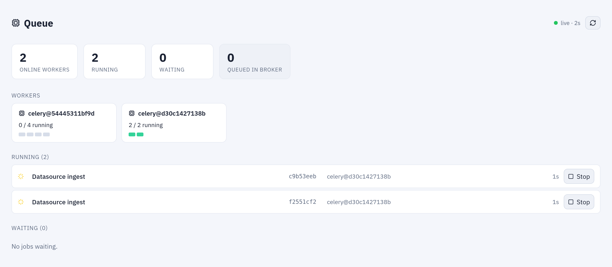

# Monitoring

Tabularia's engine publishes Prometheus metrics on `/metrics`, every service answers a
health check, and the **Administration** menu has the pages an operator watches: a
Grafana dashboard under **Monitoring**, run and preview timings under **Performance**,
the live **Queue**, the **Workers** and, on Kubernetes, the **Cluster**. The Docker
Compose development stack ships a complete monitoring stack; the Helm chart deploys
none, so that you point the monitoring you already run at Tabularia.

## At a glance

| What | Where | Who |
|---|---|---|
| Prometheus metrics | `GET /metrics` on the engine API (port 8000) | no sign-in; kept off the public network (below) |
| Health checks | gateway `GET /health`, engine `GET /healthcheck/`, frontend `GET /login` | probes, load balancers |
| Grafana dashboard | **Administration → Monitoring** (embedded) | administrators and observers; **«Open Grafana»** for administrators |
| Run, preview and warehouse timings | **Administration → Performance** | administrators and observers |
| Jobs running and waiting | **Administration → Queue** | read: administrators and observers; **«Stop»**: administrators |
| Processes per worker | **Administration → Workers** | read: administrators and observers; change: administrators |
| Pods, CPU, memory, warning events | **Administration → Cluster** (Kubernetes only) | administrators and observers |
| Host RAM | the badge in the top bar | everyone signed in; only when a node-exporter is configured |
| Application logs | standard output of every container | your log collector |
| Audit log | **Audit**, and forwarded to a SIEM | see [Audit log to Splunk](../siem-splunk.md) |

## How it works

### The engine's metrics

The engine API (the `backend` service in Compose, the `engine` Deployment of the chart)
exposes `GET /metrics` in the Prometheus text format. It is one of two paths the engine
serves without the gateway's internal token, together with the health checks: every
other request is refused unless the gateway sent it.

It holds the request metrics of
[prometheus-fastapi-instrumentator](https://github.com/trallnag/prometheus-fastapi-instrumentator)
(`http_requests_total`, `http_request_duration_seconds`, `http_request_size_bytes`,
`http_response_size_bytes`, labelled by handler, method and status), the process metrics
of the Prometheus client, and Tabularia's own:

| Metric | Type | Labels | Meaning |
|---|---|---|---|
| `dataprep_preview_duration_ms` | histogram | `engine`, `outcome` | Duration of the previews, in milliseconds. Buckets from 100 ms to 120 s. `outcome` is `ok`, `superseded` (a newer preview of the same step replaced it) or `error`. |
| `dataprep_preview_phase_ms_total` | counter | `engine`, `phase` | Time the previews spent in each phase: `client`, `stepcache`, `sql`, `query`, `decode`. |
| `dataprep_cache_hits`, `dataprep_cache_misses` | gauge | | Step cache: previews that reused a cached step, and those that did not. Totals that only grow. |
| `dataprep_cache_entries` | gauge | | Steps in the cache now. |
| `dataprep_storage_bytes`, `dataprep_storage_objects` | gauge | `prefix` | Size and number of objects under `raw`, `datasets`, `cache` and `out` in the bucket. |

The `dataprep_*` values are kept in Valkey, not in the process: the previews, the runs
and the workers all count in the same place, and each scrape reads it. Two things follow:
the workers need no metrics endpoint of their own, and **every engine replica reports the
same totals**. Aggregate them with `max`, not `sum` (the examples below do). If Valkey
loses its data, the totals start again from zero.

The storage sizes are measured by the scheduler (`beat`) every
`METRICS__STORAGE_STATS_INTERVAL_SECONDS` (60 by default), a listing of the four prefixes.

### Celery workers

The run and preview workers expose no HTTP endpoint. They send Celery task events (they
start with `-E`), which a Celery exporter reads from the broker and turns into metrics:
tasks running per worker, task durations, outcomes, queue length. The two queues are
`celery` (runs, database imports, exports) and `preview` (the previews of the editor and
the Viewer).

### The pages in the interface

- **Monitoring** embeds the Grafana dashboard *Tabularia — Overview* in kiosk mode,
  refreshed every 10 seconds: preview p50 and p95 by engine, previews per minute by
  outcome, where the preview time goes, cache hits and misses, Celery tasks running,
  run durations, storage growth by prefix, memory per container, and which scrape
  targets are up.
- **Performance** needs no metrics stack: it reads the run history (a window of 1 to
  90 days, at most 20,000 runs), the preview counters in Valkey and, when the external
  ClickHouse engine is configured, the heaviest queries of its `query_log`. The *wait*
  column is the time between launch and a worker taking the run: when it grows, the
  workers are not enough.
- **Queue** shows the workers online, the jobs running and the jobs waiting, refreshed
  every 2 seconds. Only the task's name, id, worker and duration are shown, never its
  arguments. **«Stop»** interrupts a job and is written to the audit log.
- **Workers** (a section of **Administration**) shows the processes of each worker and
  changes how many there are, within seconds and without restarts; on Kubernetes, with
  `adminScaling.enabled` and the workers' autoscaling on, also the minimum and maximum
  pods of the two worker Deployments.
- **Cluster** shows, on Kubernetes, the pods of Tabularia and of its users' code, their
  state and restarts, CPU and memory against their limits (with metrics-server in the
  cluster) and the warning events. On Docker Compose the page says it has nothing to show.
- The **RAM badge** of the top bar reads the host's memory directly from a node-exporter
  (`MONITORING__NODE_EXPORTER_URL`), not from the metrics store: it is the live value.
  With the variable empty the badge is not shown.



***Queue** while a flow group refreshes two datasources: one worker has both slots busy, the jobs show their id, worker and time, and **Stop**.*

### Health checks

| Service | Request | Answers |
|---|---|---|
| Gateway (both roles: `api` and `orchestrator`) | `GET /health` | `200 {"status": "ok"}` while the process serves. The chart uses it for the startup, readiness and liveness probes. |
| Engine API | `GET /healthcheck/` | `200 {"status": "healthy"}`. The chart's readiness and liveness probes. |
| Engine API | `GET /healthcheck/redis` | `200`, or `503` when Valkey cannot be reached. |
| Frontend | `GET /login` | the sign-in page. `/` redirects, so the probes ask for the page itself. |

The workers and `beat` have no HTTP endpoint: watch them through the Queue page, the
Celery exporter or the state of their pods.

### Logs

Every process writes its log to standard output at the `INFO` level: collect it with
whatever already collects your containers' logs. What a Script or Container node printed,
and the engine's full traceback of a failed run, are kept with the run and shown on the
**Runs** page, then emptied after `ORCHESTRATOR__LOG_RETENTION_DAYS` (30 days by
default; the run itself stays). The audit log is a different thing, kept in the
database and forwarded to a SIEM if you want: [Audit log to Splunk](../siem-splunk.md).

## Docker Compose: everything included

The development stack in `infrastructure/docker-compose.yml` runs:

| Service | Role |
|---|---|
| `victoriametrics` | Prometheus-compatible store and scraper, every 15 seconds, 3 months of retention. No port on the host. |
| `grafana` | Dashboards on http://localhost:3001, user `GRAFANA_ADMIN_USER` / `GRAFANA_ADMIN_PASSWORD` (`admin` / `admin` by default). |
| `celery-exporter` | Celery task metrics, from the broker. |
| `cadvisor` | CPU, memory, disk and network per container. |
| `node-exporter` | The host: CPU, memory, disk, load. Also the source of the RAM badge. |

The scrape targets are in `infrastructure/monitoring/scrape.yml`; Grafana's data source
and the dashboard are provisioned from `infrastructure/grafana/`. Grafana lets
anonymous visitors view the dashboards (that is what lets the Monitoring page embed it
without a second sign-in): the port is bound to `127.0.0.1`, and if you open the stack
to others, close it or put an authenticating proxy in front of it.

## Kubernetes: bring your own

The chart deploys no Prometheus, Grafana, exporter or `ServiceMonitor`: a cluster usually
runs its own. Two features of the interface depend on them and stay quiet without them:

| Feature | Without monitoring | To turn it on |
|---|---|---|
| RAM badge | not shown | `monitoring.nodeExporterUrl`: your node-exporter's `/metrics` |
| Monitoring page | an empty frame | `frontend.publicGrafanaUrl`: Grafana as the browser reaches it, with the dashboard imported (below) |

To use the dashboard of the Compose stack in your Grafana:

1. Import `infrastructure/grafana/dashboards/dataprep.json` and keep its uid,
   `dataprep-overview`: the Monitoring page opens `/d/dataprep-overview/…` on the Grafana
   you set.
2. Its panels use a Prometheus-type data source with the uid `victoriametrics`: give
   your data source that uid, or replace it in the file before importing.
3. Allow embedding (`GF_SECURITY_ALLOW_EMBEDDING=true`), and make the dashboard visible
   to the people who open the page. The page frames only the site and
   `NUXT_PUBLIC_GRAFANA_URL`, through the frontend's Content-Security-Policy.

The memory panels match the container names of Compose and the Celery panels need a
Celery exporter: on a cluster, edit them for your pod names, or deploy
`danihodovic/celery-exporter` with `CE_BROKER_URL` pointing at the same Valkey or Redis
as Tabularia.

If Grafana is served on the same host as Tabularia, a proxy with forward authentication
can let only administrators and observers through: the gateway's `GET /auth/observer`
(under the API prefix, `/api/auth/observer` with the chart's ingress) answers `204` to
them, from the session cookie, and `401` or `403` to everyone else.

## Examples

### Scrape the engine on Kubernetes

A Prometheus job that finds the engine pods by their labels, assuming the release is
installed in the namespace `tabularia`:

```yaml
scrape_configs:
  - job_name: tabularia-engine
    metrics_path: /metrics
    kubernetes_sd_configs:
      - role: pod
        namespaces:
          names: [tabularia]
    relabel_configs:
      - source_labels: [__meta_kubernetes_pod_label_app_kubernetes_io_component]
        regex: engine
        action: keep
      - source_labels: [__meta_kubernetes_pod_container_port_name]
        regex: http
        action: keep
```

The chart's network policy (`networkPolicy.enabled`, on by default) lets only
Tabularia's own pods reach the engine. A Prometheus in another namespace needs a rule of
its own, here for a namespace called `monitoring`:

```yaml
apiVersion: networking.k8s.io/v1
kind: NetworkPolicy
metadata:
  name: tabularia-engine-metrics
  namespace: tabularia
spec:
  podSelector:
    matchLabels:
      app.kubernetes.io/name: tabularia
      app.kubernetes.io/component: engine
  policyTypes: [Ingress]
  ingress:
    - from:
        - namespaceSelector:
            matchLabels:
              kubernetes.io/metadata.name: monitoring
      ports:
        - protocol: TCP
          port: 8000
```

The rule opens the engine's port, not only `/metrics`; the engine still refuses every
other path without the gateway's internal token.

### Queries and alerts

Preview p95 by engine, in milliseconds (`max` because every engine replica reports the
same totals):

```promql
histogram_quantile(0.95,
  max by (le, engine) (rate(dataprep_preview_duration_ms_bucket{outcome="ok"}[5m])))
```

Failed previews per minute, and the bucket's size by prefix:

```promql
max(rate(dataprep_preview_duration_ms_count{outcome="error"}[5m])) * 60
max by (prefix) (dataprep_storage_bytes)
```

Two alerting rules, for the engine going away and for previews slower than 10 seconds
at the p95 for a quarter of an hour:

```yaml
groups:
  - name: tabularia
    rules:
      - alert: TabulariaEngineDown
        expr: up{job="tabularia-engine"} == 0
        for: 2m
        annotations:
          summary: "The Tabularia engine API is not answering its /metrics"
      - alert: TabulariaSlowPreviews
        expr: |
          histogram_quantile(0.95,
            max by (le, engine) (rate(dataprep_preview_duration_ms_bucket{outcome="ok"}[10m]))) > 10000
        for: 15m
        annotations:
          summary: "Tabularia previews take more than 10 s at the p95"
```

### Check the services by hand

From a container of the Compose network (on Kubernetes, the same paths on the release's
gateway and engine Services):

```bash
curl -s http://gateway:8000/health          # {"status":"ok"}
curl -s http://backend:8000/healthcheck/    # {"status":"healthy"}
curl -s http://backend:8000/metrics | grep '^dataprep_storage_bytes'
```

## Permissions

- The Monitoring, Performance, Queue and Cluster pages, and the Workers section, are
  shown to administrators and observers only, and the gateway refuses their data to
  everyone else. Observers read; stopping a job, changing the workers and the
  **«Open Grafana»** link are for administrators.
- `/metrics` and the health checks ask for no sign-in. In Compose the engine publishes
  no port on the host; on Kubernetes its Service is `ClusterIP` and the network policy
  limits who reaches it. Keep it that way: the metrics name the engines, the request
  paths and the size of the bucket.
- The RAM badge needs only a signed-in user: it is a health indicator, not data.

## Limits

- The gateway exposes no metrics of its own; its health is `/health`, and what it does
  is in the run history (Performance) and the audit log.
- The chart ships no monitoring component, `ServiceMonitor` or `PodMonitor`.
- The dashboard's container and Celery panels are written for the Compose stack.
- `dataprep_cache_hits` and `dataprep_cache_misses` only grow but are exposed as gauges:
  `rate()` works on them; a Valkey that loses its data resets them.
- The preview counters behind Performance and `dataprep_preview_*` live in Valkey: they
  cover every worker of the installation, and start again from zero if Valkey loses
  its data. For history over time, keep the scraped series in your metrics store.

## Related

- [Integrations](README.md)
- [Configuration reference](../configuration.md#monitoring): `MONITORING__*`,
  `METRICS__STORAGE_STATS_INTERVAL_SECONDS`, `NUXT_PUBLIC_GRAFANA_URL`
- [Kubernetes and Helm](../deploy/kubernetes.md)
- [Settings from the panel](../engine-settings.md)
- [Audit log to Splunk](../siem-splunk.md)
