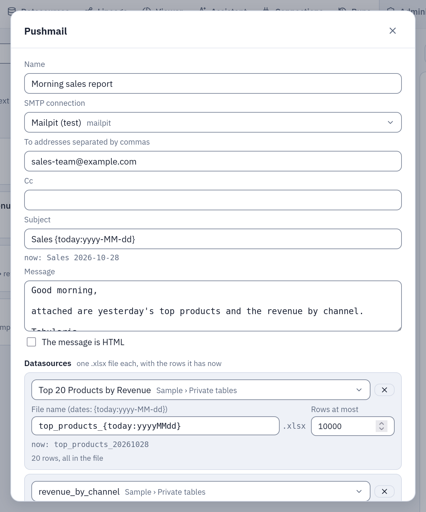
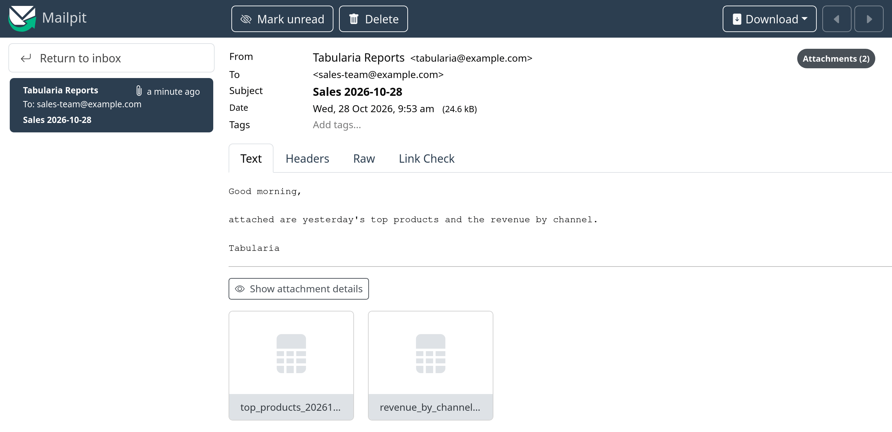

# Pushmail: datasources and reports by email from a flow group

For whoever sets up flow groups that send data to people.

A **Pushmail** cell of a [flow group](capabilities/flow-groups.md) sends one email through an SMTP connection, with
**one `.xlsx` file per datasource** and **one PDF or Excel file per report**, and can put a
report's summary in the message itself. It runs as a step of the group like any other
cell: after the steps before it (a refresh, the flows that publish the datasources), on
the group's schedule, and its failure stops the group. It is the only way a report is
sent by email: a report has no schedule of its own, so it leaves right after the data it
shows is refreshed.

## Before you start

- An SMTP connection exists and you have **CONNECT** on its folder (the same right the
  email of an Output node needs). Its **allowed domains** limit who may receive the email.
- You can read the datasources you attach (**VIEW** on their folders).
- For a report: **VIEW** on its folder, and the right to read every dataset it reads.

The group's catalog offers **Pushmail (datasources and reports by email)** when at least
one SMTP connection is available to you; so does the picker of an empty cell.

## The cell

| Field | |
|---|---|
| **Name** | what the cell shows in the grid |
| **SMTP connection** | one you may send through |
| **To**, **Cc** | addresses separated by commas; at least one in To |
| **Subject** | text with the date placeholders, `Sales {today:yyyy-MM-dd}`; `{flow}` is the group's name |
| **Message** | plain text, or HTML when ticked (sent with a plain-text alternative) |
| **Datasources** | one file each, up to 20: the datasource, the **file name** (a template, `.xlsx` added) and the **rows at most** (1 to 1,000,000; 10,000 by default) |
| **Reports** | one file each, up to 5: the report, **PDF** or **Excel**, the **file name** (a template, the extension added), the values of its **parameters**, and **Summary in the email body** (see [Reports](#reports)) |

A cell needs at least one datasource or one report: a cell with reports only is fine.

The placeholders are those of the Outputs ([placeholders](placeholders.md)): `{today}`,
`{today-1:yyyyMMdd}`, `{now:HHmm}`, `{run_id}`, `{flow}`. The panel shows what each name
gives now.



*The cell of the [morning sales example](capabilities/flow-groups.md#example-the-morning-sales-email): two datasources, each with its file name; under each name, what it gives today.*

**Rows at most.** A datasource with more rows sends its first ones, and the email says
so at the end of the message, in the language of whoever runs the group:

```
Not every row is attached:
sales: the first 10,000 rows of 48,210.
```

**Size.** With more than one datasource, or one sending more than 50,000 rows, the panel
warns that the email may be large. Every SMTP relay limits the size of a message (often
10–25 MB, attachments included, and base64 makes them a third larger): ask the
administrators what yours allows. Tabularia never sends more than 15 MB of files in one
email: over it the cell fails, saying so, and nothing is sent.

## Reports

A report in the cell is rendered when the email leaves, by the worker that writes it,
from the report's **current version**: a change saved in the designer goes out with the
next email.

- **Format.** **PDF** is the report as designed, page by page; **Excel** has its tables,
  groups and subtotals as rows, one sheet per table, and a sheet with the parameters.
- **Parameters.** The panel shows the report's parameters as its form does, two to a line:
  a list for those with choices, a text field for the others. A value left empty takes
  the report's default **when the email leaves** (`{today-30}` is thirty days before the
  send, not before the save). A date may also be a [placeholder](placeholders.md),
  resolved then, in the report's time zone: `{start_of_month-1m}` is the first day of
  last month, `{today-1}` yesterday. A parameter marked `*` needs a value, given here or
  by the report's default.
- **Summary in the email body.** One report per cell can put its summary in the message,
  under the cell's text: its texts, its KPIs, the totals of its first table's groups and
  its charts as images, in an HTML message 640 pixels wide that Outlook and Gmail draw.
  The detail stays in the attached file. With a plain-text message, the text goes on
  top; with an HTML one, the summary goes at the end of its body.
- **Limits.** A report reads at most `REPORTS__MAX_ROWS` rows per dataset (10,000 by
  default) and renders at most `REPORTS__MAX_PAGES` pages: past them the cell fails,
  naming the report and the dataset, and nothing is sent. The files of the reports count
  towards the 15 MB of an email.

The rights are those of every schedule: the report reads with the rights of **whoever
runs the group** (the author of the schedule, for a scheduled run), never the report's
author's. A dataset they may not read stops the cell with its name, before anything is
sent:

```
«Morning sales report»: the report «Monthly sales»: The dataset «orders»: there is no datasource «Salaries» you can read
```

A report that a flow group sends cannot be deleted: the delete says which groups send
it (`409`). Take it out of their Pushmail cells first.

Because a scheduled group sends with its author's rights, someone else who changes what
the report **reads** — a dataset added, or one that reads other SQL, another datasource,
view or filters — switches the schedules of the groups that send it off, as a change to
a SQL script does: the author's rights are not spent on another person's choice. The
Audit page records it (`flow_group.schedule`, with the reason); the author schedules the
group again after looking. A change of the layout alone, or one by the schedule's own
author, keeps it.

## What is checked, and when

When the group is saved, a Pushmail cell that is new or changed is checked with the
rights of whoever saves it: the connection is SMTP and they have CONNECT on it, every
address is an address and within the connection's allowed domains, every datasource
exists and they can read it, none twice; every report exists and they can see it, its
values fit its parameters, and they may read every dataset it reads. A report in a folder
they cannot see is «not found», as a datasource.

When the group runs, all of it is checked again with the rights of whoever runs it (the
author of the schedule, for a scheduled run), and a scheduled group whose author lost a
right does not start at all. A datasource with no data yet (never imported or published)
fails the cell before anything is sent; so does a report whose values no longer fit, or
whose data they may no longer read.

A change to a Pushmail cell made by someone other than the author of the group's
schedule switches the schedule off, as for any cell added by someone else: the schedule
would otherwise send data to recipients its author never chose.

Every email is written to the audit log (`email.send`) when it leaves: who, through
which connection, to whom, which datasources and reports. Every report it carries is a
`report.render` too, from `flow_group`, with its format, its parameters' values, the
group and the cell's run, and the outcome.

## Example: the morning sales email

The [flow group example](capabilities/flow-groups.md#example-the-morning-sales-email)
ends with this cell. Tried with [Mailpit](connections/smtp.md#example-try-it-locally-with-mailpit)
as the SMTP connection:

1. In the group, **Add step**, then in its first cell choose **Pushmail (datasources by
   email)**.
2. Name `Morning sales report`, the SMTP connection, To `sales-team@example.com`,
   Subject `Sales {today:yyyy-MM-dd}`, the message «Good morning, attached are
   yesterday's top products and the revenue by channel.», time zone `Europe/Rome`.
3. **Datasources**: «Top 20 Products by Revenue» as `top_products_{today:yyyyMMdd}`, and
   `revenue_by_channel` as `revenue_by_channel`, 10,000 rows at most each.
4. **Save**, **Run now**. When the cell turns green, the email is in Mailpit: subject
   «Sales 2026-10-28», from the connection's sender, with `top_products_20261028.xlsx`
   and `revenue_by_channel.xlsx`.



*What the recipients get: the message as written, one Excel file per datasource.*

## The run

Each send is a run of its own under the group's run (`pushmail`), with the outcome: the
recipients, the subject, the files and their sizes, the reports and their formats, the
rows sent and the ones cut. The
cell in the grid shows its state and, when it failed, why (the relay refused the
message, the files were over the size cap, a recipient outside the allowed domains).

The **Lineage** page draws the cell's email with the datasources it attaches. With
[OpenLineage](openlineage.md) on, the send is a child job of the group's run, reading
the datasources it attaches and those its reports read, and writing the email as a
dataset `smtp://<host>:<port>` + `/<folder>/<group>/<cell>`: never the recipients'
addresses.
