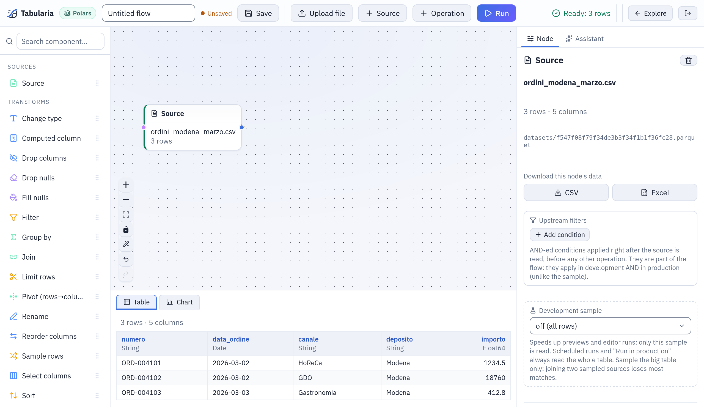

# Uploaded files

A file from your computer — a CSV export, an Excel workbook, a Parquet or JSON file — is
uploaded in the flow editor and becomes the source of a flow at once. Tabularia reads the
CSV's separator, encoding and decimal mark from the file itself, lets you pick the sheets
of a workbook, and converts everything to Parquet. To share the data with other people
and flows, publish it as a datasource from that flow.

## At a glance

| | |
|---|---|
| Where | Flow editor, toolbar: **Upload file**. The file fills the selected Source node (or the first one). |
| Formats | `.csv` `.txt` (CSV), `.tsv`, `.json` (an array of objects), `.ndjson` `.jsonl`, `.xlsx` `.xls`, `.parquet` |
| Size | Up to `UPLOAD__MAX_BYTES` (1 GiB by default). Up to 50 MB the file is ready when the upload ends; above, it is converted in the background. |
| Permissions | EDIT on at least one folder to upload. A fresh upload is readable only by you. |
| Refresh | None: a file is a fixed copy. Upload the new version to replace it. |
| In the catalog | Through a flow: an Output node «Tabularia Datasource», or **Run → Publish the output as a datasource**. |

For files that arrive by themselves every day, read them where they land instead: an
[SFTP folder](../sftp.md), an [S3 folder](../s3-datasource.md) or
[Excel on SharePoint](sharepoint.md) are datasources that refresh on a schedule.

## How it works

The upload streams to the engine; nothing is held in memory whole. The original file is
kept in the installation's object storage (`raw/`), and a Parquet copy (`datasets/`) is
what flows, previews and the Viewer read. Files up to 50 MB are converted while you wait
and the source shows its rows when the upload ends; larger ones go to a worker and the
status bar says «Converting (task …)» until they are ready.

### CSV: what is read from the file

The editor sends the file alone, so a CSV is read the way it was written:

- **Encoding**: UTF-8 when the whole file is valid UTF-8, otherwise Windows-1252 (the
  encoding of Excel's CSV export in Western European languages). Either way the data is
  stored as UTF-8: «Città» stays «Città».
- **Separator**: among `;` `,` tab and `|`, the one that splits the first 50 lines into
  the same number of columns, outside quotes; `,` when none does.
- **Decimal comma**: with a separator other than `,`, numbers written `16,125` are read
  as decimals. With `;` — the separator Excel uses where the comma is the decimal mark —
  a value such as `1.234,50` is read as 1234.5 and `1.500` as 1500. A column becomes
  numeric only when every value in it is such a number; one that is not (a code such as
  `00144`, a note) keeps the column as text.
- **Header**: the first row. Spaces around column names are removed.
- **Types**: guessed from the first 10,000 rows; if a later row does not fit (whole
  numbers for 20,000 rows, then a decimal), the types are guessed again on the whole
  file. ISO dates (`2026-03-31`) become dates.

`.tsv` files are always tab-separated. A file that cannot be read as CSV is refused with
the reader's message: «The file could not be read as CSV: …».

### Excel: the sheets

An `.xlsx` or `.xls` workbook is read from its **first visible sheet**: a hidden first
sheet of lookups or settings is skipped. When the workbook has more than one sheet, the
dialog **Sheets to import** lists them all, the hidden ones marked, and every sheet you
tick becomes a source of its own on the canvas, read from the same file. **Keep «…»
only** leaves the one already read.

Excel files are read whole in memory (as JSON arrays are); CSV, NDJSON and Parquet are
converted in streaming.

### Parquet, JSON, NDJSON

A Parquet file is copied as it is, with its types. NDJSON (one JSON object per line) is
converted in streaming. A `.json` file must be an array of objects, one per row; nested
objects stay nested.

## Example: a price list from the sales office

The sales office keeps the price list of the cured meats in an Excel workbook,
`listino_2026.xlsx`, with two sheets: `Listino` (the prices) and `Note` (hidden). They
also export the March orders of one depot from their ERP as `ordini_modena_marzo.csv`,
written by an Italian Excel:

```text
numero;data_ordine;canale;deposito;importo
ORD-004101;2026-03-02;HoReCa;Modena;1.234,50
ORD-004102;2026-03-02;GDO;Modena;18.760,00
ORD-004103;2026-03-03;Gastronomia;Modena;412,80
```

1. In Explore, open the folder `Sales office`, choose **New → New flow** and an engine.
2. In the toolbar, **Upload file** and pick `ordini_modena_marzo.csv`. The source shows
   three rows and five columns; `importo` is a number (1234.5, 18760, 412.8), not text,
   because the separator `;` and the decimal comma were read from the file.

   

   *`ordini_modena_marzo.csv` right after the upload: `data_ordine` is a date, `importo` a number (`Float64`), read from an Italian-style file.*

3. Add a second source (**Source**) and, with it selected, upload `listino_2026.xlsx`.
   `Listino` is read; the dialog **Sheets to import** shows `Note` as hidden. Leave it.
4. Build the flow: filter, join, compute. Then add an **Output** node, destination
   **Tabularia Datasource**, name `ordini_modena_2026_03`, folder `Sales office`.
5. Save the flow (Ctrl+S) and **Run**. When the run ends, `ordini_modena_2026_03` is in
   the catalog: other flows, saved views, SQL scripts and the AI assistant can read it.

Next month, upload the April file into the same source and run again: with **Overwrite
if it already exists** ticked on the Output node, the datasource keeps its id and name
and its readers keep working. See [Flow and SQL script results](flow-outputs.md).

## Permissions

| To | You need |
|---|---|
| Upload a file | EDIT on at least one folder (an account that can only view has nowhere to put it) |
| Read an uploaded file | Being the person who uploaded it; once a **saved** flow references it, VIEW on that flow's folder |
| Publish it as a datasource | RUN on the flow's folder and EDIT on the datasource's folder |

Sharing a flow shares the files its sources reference: whoever can open the flow can
read them.

## Limits and good to know

- **Size**: `UPLOAD__MAX_BYTES` (1 GiB by default, 0 = no ceiling), also in
  Administration → Settings as «Largest file uploaded». The gateway refuses a larger
  file before it reaches the engine. The file is spooled on the engine's disk and
  converted there, so keep the engine's temporary space above that size.
- **Conversion time**: a background conversion is bounded by `CELERY__TASK_TIME_LIMIT`
  (one hour by default), and the editor waits for it up to an hour.
- **Memory**: Excel and JSON arrays are read whole; a very large workbook needs a worker
  with the memory for it. Prefer CSV or Parquet for large tables.
- **No refresh**: an uploaded file never changes. Data that is updated elsewhere belongs
  in a datasource that reads it there ([databases](databases.md), [SFTP](../sftp.md),
  [S3](../s3-datasource.md), [SharePoint](sharepoint.md), [APIs](../api-datasource.md)).
- **Not offered by the file picker**: `.xlsm` and `.pq`. Save the workbook as `.xlsx`, or
  rename the Parquet file to `.parquet`. The SFTP, S3 and SharePoint datasources do read
  `.xlsm`.
- The CSV options (separator, encoding, header) are not asked for: they are read from the
  file. A file without a header row is read with its first row as the header.

## Related

- [All sources](README.md): snapshots, refreshes, descriptions and permissions common to every datasource.
- [Flow and SQL script results](flow-outputs.md): publishing what a flow computes.
- [Low-code flows](../capabilities/flows.md): sources, operations and Output nodes.
- [Configuration](../configuration.md): `UPLOAD__MAX_BYTES` and the worker limits.
