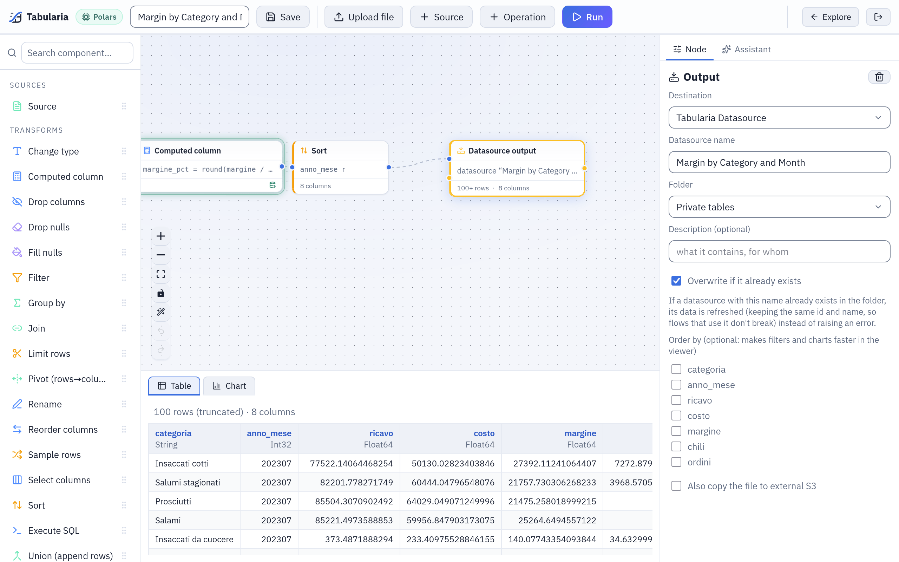

# Flow and SQL script results

A flow, a SQL script or a saved Python or R script can write its result into a
datasource of the catalog, where other flows, saved views, scripts, the Viewer and the AI
assistant read it like any other. The first write creates the datasource; every later
write replaces its data and keeps its id, so whatever reads it keeps working. This is
how cleaned, joined and aggregated tables are shared.

## At a glance

| Writer | Where it is set | When it writes | Overwrites an existing datasource |
|---|---|---|---|
| Flow, Output node | Output node, destination **Tabularia Datasource**: name, folder, description, «Overwrite if it already exists», «Order by» | At every run: **Run** in the editor, «Run now with the production engine» in the Flows page, the flow's schedule, a flow group | Only with «Overwrite if it already exists» ticked |
| Flow without Output nodes | **Run** → **Publish the output as a datasource**: name, folder, description | That run | Never: an existing name is refused |
| SQL script | The **Datasource** card beside the editor: name and folder | **Refresh now**, the script's schedule, a flow group | Always |
| Saved Python or R script | **Also publish it as a datasource** on the script's page | At every run of the script | As chosen: «Replace it at every run» |

Written datasources carry the tag «flow» in the Datasources page. They have no refresh
button: they change when their writer runs.

## How it works

### The Output node «Tabularia Datasource»

An Output node at the end of a chain, with destination **Tabularia Datasource**, has:

| Field | Meaning |
|---|---|
| Datasource name | The name in the catalog. Unique in its folder. |
| Folder | Where the datasource lives, and so who can read it. |
| Description (optional) | Written on the datasource at every run. |
| Overwrite if it already exists | Ticked: a datasource with this name in the folder gets the new data, keeping its id and name. Not ticked: a run finding the name taken is refused before it starts («There is already a datasource … in this folder»). |
| Order by | Columns, in order: the result is sorted before it is written, and the datasource keeps them as its sort keys. |
| Also copy the file to external S3 | A copy of the same Parquet file to an S3 connection, at a fixed key or one with [placeholders](../placeholders.md). If the copy fails the run still succeeds, and the error is in the run's history. |

The flow must be saved: Output nodes run through the run history. **Run** launches one
run per Output node; the run reads the flow's sources, computes the chain on a worker
and writes a new Parquet file. When the flow has no Output node, **Run** offers
**Publish the output as a datasource** for the result of its last step instead.



*The Output node of the sample flow «Margin by Category and Month»: it publishes the datasource of the same name in `Sample / Private tables`, overwriting it at every run.*

### What an overwrite does

At the end of a successful run the datasource is pointed at the new file in one step:

- its **id and name stay**, so flows, saved views, SQL scripts and saved Python or R
  scripts that read it keep working;
- its rows, columns, description and sort keys are those of this run;
- its **field descriptions stay**, for the columns that are still there;
- the previous file is deleted after a grace period, since a run that started earlier
  may still be reading it.

**The data contract is checked first.** When the datasource has a contract, the worker
evaluates it on the new data before anything is replaced; a failing rule of severity
*error* refuses the data, the datasource keeps the last good snapshot and the run says
which rule failed. See [Data contracts](../governance/data-contracts.md).

**The later read wins.** When two runs write the same datasource and overlap, the one
that started later wins, even if the other finishes after it: a run that read older data
never replaces newer data.

### Who may overwrite what

Only datasources that a flow or a script wrote can be overwritten. A datasource imported
from a database, a file folder, SharePoint or an API is never replaced by a flow or a
script: the run is refused before it starts («… is a datasource of kind «database»: a
flow cannot overwrite it, choose another name»). An import keeps its own refresh, its
schedule and its connection.

Between writers there is no such barrier: a flow can overwrite a datasource a SQL script
wrote, and the other way round. Give each written datasource one writer.

When the name is free at launch but another run takes it before this one ends, the
datasource is created as «name (xxxxxxxx)», with the start of the task's id.

### SQL scripts

A [SQL script](../sql-scripts.md) keeps its whole result in a datasource: in the
**Datasource** card give it a name and a folder, **Save**, then **Refresh now**. The
saved version is written, not the text in the editor. The script's engine computes it on
the catalog, or the database computes it when the script runs on a connection. The card
shows the last write: when, how many rows, who started it, and why it failed.

A script always overwrites its datasource, under the same rules as a flow: the contract
first, the id kept, never an imported datasource. Each write sets the datasource's
description to «Written by the SQL script «name»» and clears its sort keys. **Schedule**
writes it on a cron with the rights of whoever set it; in a flow group the script is a
cell that writes in its step. The details are in
[Writing the result into a datasource](../sql-scripts.md#writing-the-result-into-a-datasource).

### Python and R scripts

A saved script writes a Parquet file at `TABULARIA_OUTPUT`; with **Also publish it as a
datasource** it becomes a datasource in the folder you choose, replaced at every run or
not. Its description says «Written by the saved script «name»». Scripting runs on
Kubernetes installations with scripting environments turned on: see
[Python and R](../scripting.md#output).

## Examples

### A flow that publishes revenue by channel, every morning

With the sample datasources `orders` and `order_rows` (folder `Sample / Private tables`):

1. **New → New flow** in `Sample / Flows`. Add two sources, `order_rows` and `orders`,
   join them on the order id, keep the orders whose `stato` is not `annullato`.
2. Compute `ricavo_netto = quantita * prezzo_unitario * (1 - sconto_pct / 100)`, then
   group by `canale` and the month of `data_ordine`, summing `ricavo_netto`.
3. Add an **Output** node: **Tabularia Datasource**, name `revenue_by_channel_month`,
   folder `Sample / Public tables`, description *Net revenue by sales channel and
   month, cancelled orders excluded*, **Overwrite if it already exists** ticked,
   **Order by** the month column.
4. Save, **Run**. `revenue_by_channel_month` appears in `Sample / Public tables`.
5. Schedule the flow (`0 6 * * *`), or put it in a flow group after a step that
   refreshes `orders` and `order_rows`, so it always reads the morning's data.

People with VIEW on `Sample / Public tables` read the result without seeing the order
lines it comes from.

### A SQL script that keeps the cancelled orders by depot

**New → SQL script** in `Sample / Flows`, on the catalog:

```sql
SELECT deposito, canale, count(*) AS ordini_annullati
FROM "orders"
WHERE stato = 'annullato'
GROUP BY deposito, canale
ORDER BY ordini_annullati DESC
```

In the **Datasource** card: name `cancelled_orders_by_depot`, folder
`Sample / Public tables`. **Save**, then **Refresh now**. **Schedule** `30 6 * * *`
writes it again every morning, after the orders are refreshed.

### Calling it from outside

A scheduler of your own can run the flow and so rewrite its datasource, with a token of
an account that has RUN on the flow's folder and EDIT on the datasource's:

```bash
curl -X POST -H "Authorization: Bearer tab_…" \
  https://tabularia.example.com/api/flows/42/run-now
# 202 {"run_id": 1234}: then GET /runs/1234
```

See [API](../api.md).

## Permissions

| To | You need |
|---|---|
| Write a datasource from a flow | RUN on the flow's folder and EDIT on the datasource's folder (and VIEW on what the flow reads) |
| Write it from a SQL script | RUN on the script's folder and EDIT on the datasource's folder; the datasources the SQL names readable, or CONNECT on the script's connection |
| Choose the folder of a SQL script's datasource | EDIT on that folder |
| Read the result | VIEW on the datasource's folder only: not on the flow, the script or their sources |
| Rename, describe, move, delete the datasource | EDIT on its folder |

Scheduled runs and writes act with the rights of whoever set the schedule, checked again
every time. Every write of a SQL script is in the audit log (`sql_script.publish`), with
its SQL; every flow run is in the run history.

## Limits and good to know

- **Settings live on the writer.** The description and the sort keys of a written
  datasource are set again at every write, from the Output node (or, for a SQL script,
  to the fixed description and no sort keys). Change them on the node; a description
  edited in the Datasources page lasts until the next write. Field descriptions are kept.
- **A scheduled flow needs «Overwrite if it already exists»**: without it, the first run
  creates the datasource and every later run is refused because the name is taken.
- **No refresh from the Datasources page**: refresh, schedule and «Datasources to
  refresh» in a flow group are for imported datasources. A written one is updated by
  running its writer.
- **Deleting the flow** keeps the datasources it published: they stay as they were, and
  nothing updates them any more.
- **One file per write**: the whole result is written again each time; a write never
  appends to the previous data.
- A datasource used by saved views cannot be deleted until the views are.

## Related

- [All sources](README.md): snapshots, descriptions, contracts, permissions.
- [Low-code flows](../capabilities/flows.md): sources, operations, Output nodes.
- [SQL scripts](../sql-scripts.md) and [Python and R](../scripting.md).
- [Scheduling](../capabilities/scheduling.md) and [Data contracts](../governance/data-contracts.md).
- [Permissions](../governance/permissions.md).
