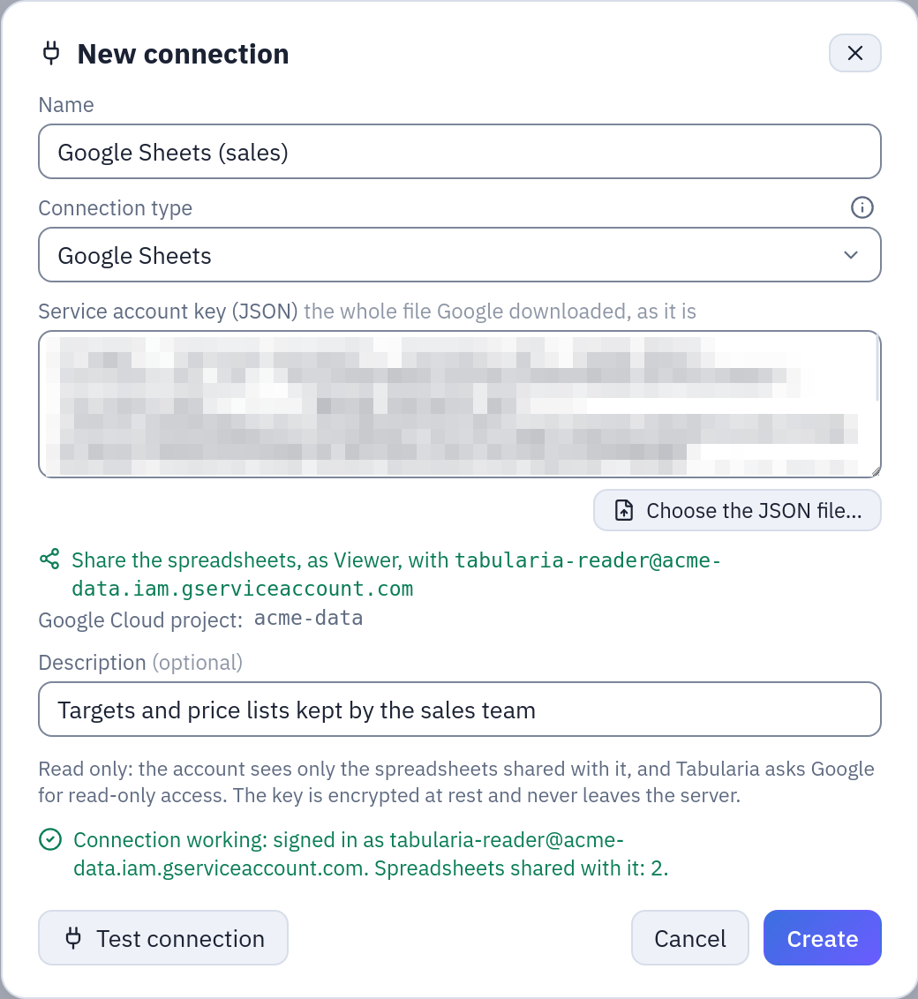

# Google Sheets

A **Google Sheets connection** reads spreadsheets through a Google Cloud **service
account**, with read-only access. A **Google Sheets datasource** takes one tab of a
spreadsheet (or a range of it), turns it into a table, and keeps it as a snapshot,
refreshed by hand or on a schedule. It suits the sheets a team keeps up to date by hand:
targets, price lists, mappings, a budget kept in Google Workspace.

## At a glance

| | |
|---|---|
| Connection | A service account's JSON key |
| Datasource | Explore, in a folder: **New → Datasource from a database**, then the Google Sheets connection |
| Reads | One tab of a Google Sheets spreadsheet, whole or a range (`A1:F500`, `B3:H`, `A:F`) |
| Writes | Nothing: the access asked of Google is read-only, and the spreadsheet stays where it is |
| Updated | **Refresh snapshot now**, a cron schedule, or a flow group step |
| Permissions | CONNECT on the connection's folder; EDIT on the destination folder to create, RUN to refresh |
| Status | Built and tested against the documented contract of the Google Sheets and Drive APIs, not yet against a production Google Cloud project |

## Before you start: the service account

Tabularia reads as a **service account**, a Google Cloud identity of its own with an
email such as `tabularia-reader@acme-data.iam.gserviceaccount.com`, not as a person. A
service account sees only the spreadsheets someone shares with that email: no one's
Drive, no domain-wide access. In the [Google Cloud console](https://console.cloud.google.com/):

1. **Choose or create a project** (the selector at the top). The project only holds the
   account and the APIs; the spreadsheets can belong to anyone.
2. **Enable the APIs.** *APIs & Services → Library*: enable **Google Sheets API**.
   Enable **Google Drive API** as well if you want the datasource dialog to list the
   spreadsheets shared with the account; without it, you paste each spreadsheet's link.
3. **Create the service account.** *IAM & Admin → Service accounts → Create service
   account*: a name such as `tabularia-reader`. It needs no role in the project: skip
   the optional steps.
4. **Create a key.** Open the account, *Keys → Add key → Create new key → JSON*. The
   browser downloads a `.json` file: this is the credential. Keep it like a password,
   and delete it from your computer once the connection is saved.
5. **Share the spreadsheets.** In Google Sheets, **Share**, add the account's email (it
   is in the JSON as `client_email`, and the connection form shows it) with the role
   **Viewer**. Untick «Notify people»: nobody reads that mailbox.

If your organisation forbids service account keys (the policy
`iam.disableServiceAccountKeyCreation`), the key step fails: ask your Google Cloud
administrators for an exception on this project.

## The connection

From a folder in Explore: **New → New connection**, type **Google Sheets**.

| Field | Meaning |
|---|---|
| Service account key (JSON) | The whole file downloaded at step 4: paste it, or **Choose the JSON file…**. When editing, empty keeps the stored key. |

As soon as the key is in the form, the dialog shows **Share the spreadsheets, as Viewer,
with** and the account's email, and the Google Cloud project. Both are read from the key
when it is saved, and the Connections page lists the connection under that email: a
connection is one account.

*A Google Sheets connection with a made-up key: the email to share the spreadsheets with, and a working test.*

**Test connection** asks Google for a token with the key, checks that the Google Sheets
API is enabled in the project, and counts the spreadsheets shared with the account
(through Drive). What it says when something is wrong:

| Message | What to do |
|---|---|
| Google refused the key of … it was deleted or revoked | The key was deleted in the console, or belongs to another account: create a new JSON key and paste it into the connection. |
| The service account … does not exist any more, or is disabled | The account was deleted or disabled in *IAM & Admin → Service accounts*. |
| Enable the Google Sheets API in the Google Cloud project … | Follow the link in the message, **Enable**, wait a few minutes, test again. |
| The worker's clock is wrong | Google refuses a token signed at the wrong time: fix the server's time (NTP). |
| Connection working … no spreadsheet is shared with it yet | Share a spreadsheet with the email shown, as Viewer. |
| Connection working … the Google Drive API is not enabled | The connection works; only the list of spreadsheets is missing. Enable the Drive API, or paste links. |

The key is encrypted at rest with the same Fernet key as every other connection secret
(`SECURITY__FERNET_KEY`), travels encrypted to the worker and is decrypted only to sign
the token request. The API never returns it, and it is never written to a log. The
Google addresses are fixed in Tabularia: the `token_uri` written in the key's file is
not used, and whoever creates a connection cannot point it elsewhere. The token asks
for two read-only scopes, `spreadsheets.readonly` and `drive.metadata.readonly`
(Drive's file names and dates only, never their content).

## The datasource

**New → Datasource from a database**, choose the Google Sheets connection, then:

| Field | Meaning |
|---|---|
| Spreadsheet | One of the spreadsheets shared with the account, from a list with a search (needs the Drive API), or **Paste a link instead**: the address from the browser, `https://docs.google.com/spreadsheets/d/…`, or the bare spreadsheet ID. **Open** reads its tabs. A link that ends with `#gid=…` selects that tab. |
| Tab | The tab to read; charts on a tab of their own are not offered. The tab is remembered by its ID too: renaming it in Google Sheets does not break the datasource. |
| Range | Optional, in A1 notation inside the tab: `A1:F500`, `B3:H` (from row 3 to the last row), `A:F`. Empty = the whole tab. |

**Preview the first rows** reads the first rows exactly as the import will, and shows
each column with its type: a header problem shows here, before anything is saved.
**Create & import** starts the first import.

### How the cells become a table

- **The header is the first row** of the tab, or of the range. Every column needs a
  name, no name twice (regardless of case), no title above the table. A value to the
  right of the last named column is refused too, naming its cell: give the column a
  name, or narrow the range. Nothing is skipped or renamed silently.
- **Numbers are read as numbers**, whatever the spreadsheet's locale shows: `1.234,50 €`
  in an Italian sheet is `1234.5`. A percentage is its fraction (`15%` is `0.15`).
- **Dates come back as dates.** Google Sheets keeps dates as numbers of days; a column
  whose cells are formatted as dates becomes a date column, as date-times a date-time
  column (as shown in the sheet, without a time zone), as times a time column. A
  duration of 24 hours or more stays a number of days.
- **The types are then guessed as for an uploaded CSV**: whole numbers become integers,
  numbers with decimals become decimals, `TRUE`/`FALSE` booleans, and a column mixing
  numbers and words becomes text. One exception: a column Google Sheets holds as **text
  in every cell** stays text, so codes such as `00123` keep their leading zeros. To have
  numbers, format the column as a number in Google Sheets.
- **Empty cells are empty** (NULL), and **empty rows are dropped**.
- **Formula errors** (`#N/A`, `#REF!`, `#DIV/0!`…) become empty cells; the run counts
  them.

Large tabs are read in pages of about 200,000 cells. The rules of every imported
datasource apply: snapshot swap at success, one refresh at a time, scheduled refresh,
data contract. Google Sheets datasources take no sort keys: rows keep the sheet's order.

## Example: the sales targets kept by the sales team

The sales managers keep the monthly targets in a spreadsheet, `Targets 2026`, on a tab
`By agent`:

| agent_code | agent | month | target_eur | confirmed |
|---|---|---|---|---|
| 00412 | Marta Bianchi | 2026-01-01 | 48000 | TRUE |
| 00417 | Luca Verdi | 2026-01-01 | 35500 | FALSE |

1. In Google Cloud, project `acme-data`: enable the Google Sheets and Google Drive APIs,
   create the service account `tabularia-reader` and a JSON key for it.
2. In Google Sheets, share `Targets 2026` with
   `tabularia-reader@acme-data.iam.gserviceaccount.com` as Viewer.
3. In Tabularia, folder `Sales`: **New → New connection**, type **Google Sheets**, name
   `Google Sheets (sales)`, **Choose the JSON file…** and pick the downloaded key.
   **Test connection** says it is signed in and that one spreadsheet is shared with it.
   **Create**.
4. In the folder `Sales / Tables`: **New → Datasource from a database**, name
   `sales_targets_2026`, the connection `Google Sheets (sales)`. Choose `Targets 2026`
   in the list, the tab `By agent`, no range. **Preview the first rows** shows
   `agent_code` as String (the codes keep their zeros), `month` as Date, `target_eur` as
   Int64 and `confirmed` as Boolean.
5. **Create & import**, then **Schedule automatic refresh (cron)**: `0 6 * * 1-5`, every
   working day at six, before the morning reports.

A flow then joins `sales_targets_2026` with the invoiced sales on `agent_code` and
`month`, and computes how far each agent is from the target.

## Permissions

| To | You need |
|---|---|
| Create, test, change or delete the connection | CONNECT on its folder |
| List the spreadsheets, open one, preview a tab | CONNECT on the connection's folder |
| Create the datasource | CONNECT on the connection's folder and EDIT on the destination folder |
| Refresh it, schedule it | RUN on its folder and CONNECT on the connection's folder |
| Read it in flows, views, scripts | VIEW on its folder |

What the account can read is decided in Google Sheets, by sharing; who in Tabularia can
read through it is decided by CONNECT. Every spreadsheet shared with the account is
readable by whoever has CONNECT on the connection's folder: one account per team keeps
those two lists the same.

## Limits and good to know

- **Quota**: Google allows 60 read requests a minute for each service account. One
  refresh makes a few (one per page of about 200,000 cells, plus two); a 429 is retried,
  waiting what Google asks. Many large tabs refreshed at the same minute can still hit
  it: spread the schedules.
- **Excel files in Drive** are not Google Sheets spreadsheets: the API refuses them, and
  the message says so. Open the file and choose *File → Save as Google Sheets*, or use
  the [SharePoint](sharepoint.md) or [SFTP](../sftp.md) datasources for Excel files.
- **The source is fixed**: the spreadsheet, tab and range cannot be changed once the
  datasource exists; create another one.
- **Not tried on a production Google Cloud project**: the connector follows the
  documented Google APIs and is tested against a simulation of them. Try it on your
  project before relying on a schedule.
- OpenLineage reports a refresh with the spreadsheet's address and the tab as its input;
  the dbt export turns a Google Sheets datasource into a seed.

## Related

- [All sources](README.md): snapshots, refreshes, descriptions, contracts, permissions.
- [Excel on SharePoint](sharepoint.md): the same idea for workbooks in Microsoft 365.
- [Connections](../connections/README.md).
