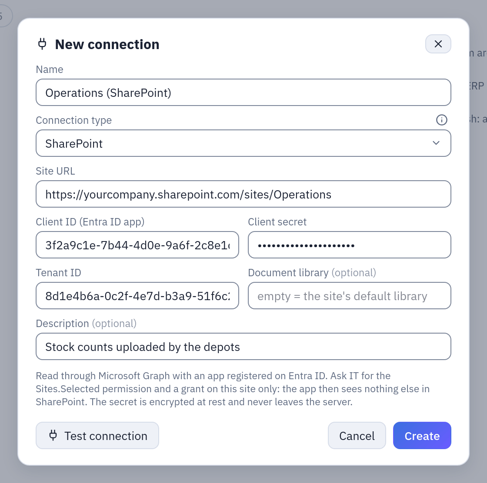

# Excel on SharePoint

A **SharePoint connection** reads the Excel and CSV files of a document library through
Microsoft Graph, with an application registered in Entra ID. A **SharePoint datasource**
takes the files that match a path or a glob, stacks them into one table, and keeps it as
a snapshot, refreshed by hand or on a schedule. It suits the workbooks finance and
operations keep on SharePoint: monthly closings, budgets, stock counts.

## At a glance

| | |
|---|---|
| Connection | Site URL, document library, and an Entra ID app: tenant ID, client ID, client secret |
| Datasource | Explore, in a folder: **New → Datasource from a database**, then the SharePoint connection |
| Reads | `.xlsx` `.xlsm` `.xlsb` `.xls`, and `.csv` `.tsv`; a path, or a glob (`*` within one folder, `**` any depth) |
| Writes | Nothing: the app only reads, and the files stay where they are |
| Updated | **Refresh snapshot now**, a cron schedule, or a flow group step |
| Permissions | CONNECT on the connection's folder; EDIT on the destination folder to create, RUN to refresh |
| Status | Built and tested against the documented contract of Microsoft Graph, not yet against a production tenant |

## Before you start: the app in Entra ID

Tabularia signs in to Microsoft Graph as an **application** (OAuth2 client credentials),
not as a person. Ask your Microsoft 365 administrators for:

1. An app registration in Entra ID, with a **client secret**. Its overview page shows the
   **Application (client) ID** and the **Directory (tenant) ID**.
2. The Microsoft Graph **application** permission **`Sites.Selected`**, with admin
   consent. On its own it gives access to no site at all.
3. A grant of **read** access for that app on the one site that holds the files
   (Microsoft documents it through Graph's `POST /sites/{site-id}/permissions`, or PnP
   PowerShell's `Grant-PnPAzureADAppSitePermission`).

The app then sees that site and nothing else in SharePoint. Read access is enough:
Tabularia only lists folders and downloads files.

## The connection

From a folder in Explore: **New → New connection**, type **SharePoint**.

| Field | Meaning |
|---|---|
| Site URL | `https://yourcompany.sharepoint.com/sites/Finance`. It must start with `https://`. |
| Client ID (Entra ID app) | The app's Application (client) ID. |
| Client secret | The secret created for the app. |
| Tenant ID | The Directory (tenant) ID. |
| Document library | The library's name, as SharePoint shows it; empty = the site's default library («Documents»). Matched regardless of case; a wrong name is refused with the list of the site's libraries. |

**Test connection** asks Microsoft for a token, then finds the site and the library:
everything that can be wrong with the connection shows here. A token refused says to
check the tenant, client ID and secret; an access denied names `Sites.Selected` and the
grant on the site.



*A SharePoint connection with example values: the site, the app's client ID and tenant ID, its secret (hidden), the default library.*

The client secret is encrypted at rest with the same Fernet key as every other
connection secret (`SECURITY__FERNET_KEY`), travels encrypted to the worker and is
decrypted only to ask Microsoft for a token. The API never returns it. The Microsoft
endpoints are not part of the connection: whoever creates a connection cannot point it
at another address. On a sovereign cloud the installation sets them for everyone with
`SHAREPOINT__GRAPH_BASE` and `SHAREPOINT__LOGIN_BASE` (see
[Configuration](../configuration.md)).

## The datasource

**New → Datasource from a database**, choose the SharePoint connection, then:

| Field | Meaning |
|---|---|
| Path in the library | A file (`Budget/2026/budget.xlsx`), or a glob: `*` and `?` within one folder name (`Budget/2026/*.xlsx`), `**` for any depth (`**/chiusura_*.xlsx`). Matched regardless of case, as SharePoint does. **Check files** lists what it takes. |
| Format | **Excel and CSV, from each file's extension** (the default), or **Excel** only, or **CSV** only. The format decides which files the path takes: with Excel only, a `*` does not pick up the CSV next to the workbooks. |
| CSV separator, encoding, header | For the CSV files: a one-character separator; UTF-8, UTF-8 with invalid bytes replaced, or Windows-1252; whether the first row is the header. `.tsv` files are tab-separated. |
| Sheet name | For the workbooks: empty = the first sheet of each workbook. After **Check files** the field becomes a list of the sheets of the first workbook found (one of 50 MB at most is downloaded for it), the hidden ones marked. |
| Time zone, variables, initial last refresh | The path may hold [placeholders](../placeholders.md) and the datasource's variables: `Chiusure/{today-1m:yyyy-MM}.xlsx` is last month's closing. |
| Refresh | **Snapshot** (the table is rebuilt), or **append by key** (the rows whose key columns come again replace the old ones): see [placeholders](../placeholders.md#refreshing-snapshot-or-append-by-key). |

### How the files become one table

At every refresh, every file that matches is downloaded and read, and the rows are
stacked into one table, **united by column name**: a column missing in a file is empty
there, and a column found only in some files is logged. Two files with the same column
holding incompatible types fail the refresh, saying so.

Every row says where it comes from, in the last two columns:

- `_file`: the file's path in the library, with SharePoint's own capitalisation
  (`Magazzino/Inventari/2026/inventario_modena.xlsx`), however the glob was written;
- `_file_modified_at`: when the file was last modified on SharePoint (UTC).

With variables there is one `_param_<name>` column per variable as well. Office lock
files (`~$name.xlsx`, present while someone has the workbook open) are skipped. A file
with a header row and nothing below it (an empty template of the month) is counted but
adds no rows; when every file is like that, the refresh fails.

### Files must be machine readable

The header is the **first row**, one name per column, no name twice (regardless of case),
no `_file` or `_file_modified_at` among them. A workbook with a title above the table, an
empty column name or a repeated one is **refused**, naming the file and the columns:
nothing is skipped or renamed silently, because two half-empty columns from a typo in a
header are worse than an error. Spaces around names are removed, so `Importo ` and
`Importo` are one column. Fix the file at the source.

The import reports its progress («file *i* of *n*», «saving»), and the rules of every
imported datasource apply: snapshot swap at success, one refresh at a time, scheduled
refresh, data contract. SharePoint datasources take no sort keys: rows keep the order of
the files.

## Example: the depots' monthly stock count

Each depot of the company uploads its stock count to the site `Operations`, library
`Documents`, folder `Magazzino/Inventari/2026`: `inventario_modena_2026-03.xlsx`,
`inventario_napoli_2026-03.xlsx`, and so on, each with a sheet `Inventario`:

| codice | nome | giacenza_kg | valore_eur |
|---|---|---|---|
| PRS-PARMA-24 | Prosciutto di Parma 24 mesi intero | 1260.5 | 31512.50 |
| MRT-BOL-IGP | Mortadella Bologna IGP | 845.0 | 9295.00 |

1. In the folder `Operations`, **New → New connection**, type **SharePoint**: site
   `https://yourcompany.sharepoint.com/sites/Operations`, library empty, and the three
   values of the app. **Test connection**, then save.
2. In the folder `Operations / Tables`, **New → Datasource from a database**, name
   `stock_counts_2026`, the SharePoint connection.
3. Path `Magazzino/Inventari/2026/inventario_*.xlsx`, format **Excel**. **Check files**
   lists the workbooks found; the sheet field now offers their sheets: choose
   `Inventario`.
4. **Create & import**. The table holds every depot's rows, with `_file`
   (`Magazzino/Inventari/2026/inventario_napoli_2026-03.xlsx`) telling them apart.
5. **Schedule automatic refresh (cron)**: `0 7 * * 1-5`, every working day at seven.

A flow can then take the depot from `_file` (a regular expression on the name) and join
the stock with the `products` datasource on `codice`.

To read the files of the last three months by their name, with a variable instead of a
glob over the whole year:

```text
Variables:   month = today-3m .. today step 1m
Path:        Magazzino/Inventari/{month:yyyy}/inventario_*_{month:yyyy-MM}.xlsx
Refresh:     append by key, keys: _file
```

`month` takes three values, from three months ago to last month (the current month is
excluded). Every refresh reads those files again: a corrected file replaces all its old
rows, the files of older months stay in the table, and a month without a file is listed
on the run instead of failing it (only no file at all fails the refresh).

## Permissions

| To | You need |
|---|---|
| Create, test, change or delete the connection | CONNECT on its folder |
| Check files | CONNECT on the connection's folder |
| Create the datasource | CONNECT on the connection's folder and EDIT on the destination folder |
| Refresh it, schedule it | RUN on its folder and CONNECT on the connection's folder |
| Read it in flows, views, scripts | VIEW on its folder |

What the app can read on SharePoint is decided in Entra ID (the site grant); who in
Tabularia can read through it is decided by CONNECT. Give CONNECT on the connection's
folder to the people who may see that site's files.

## Limits and good to know

- **Caps**, fixed: at most **500 files** per refresh, a glob that walks more than
  **2,000 folders** stops, and the matching files together may weigh at most **2 GB**.
  Each workbook is read whole in memory by the worker.
- **Throttling**: when Microsoft answers 429 or 503, a request is retried up to three
  times, waiting what `Retry-After` says (30 seconds at most each time). A token is
  reused until a minute before it expires.
- **Sheet**: an empty sheet field reads the first sheet of each workbook, hidden or not
  (an upload in the flow editor skips a hidden first sheet; this datasource does not).
  Name the sheet when the workbooks start with a hidden one.
- **The source is fixed**: the path, format and sheet cannot be changed once the
  datasource exists; create another one.
- **Not tried on a production tenant**: the connector follows the documented Microsoft
  Graph API and is tested against a simulation of it. Try it on your tenant before
  relying on a schedule.
- OpenLineage reports a SharePoint refresh with the file path as its input; the dbt
  export turns a SharePoint datasource into a seed.

## Related

- [All sources](README.md): snapshots, refreshes, descriptions, contracts, permissions.
- [Dynamic dates](../placeholders.md): placeholders, variables, append by key.
- [SFTP folders](../sftp.md) and [S3 buckets](../s3-datasource.md): the same file rules on other storage.
- [Uploaded files](files.md): a one-off workbook from your computer.
- [Connections](../connections/README.md).
