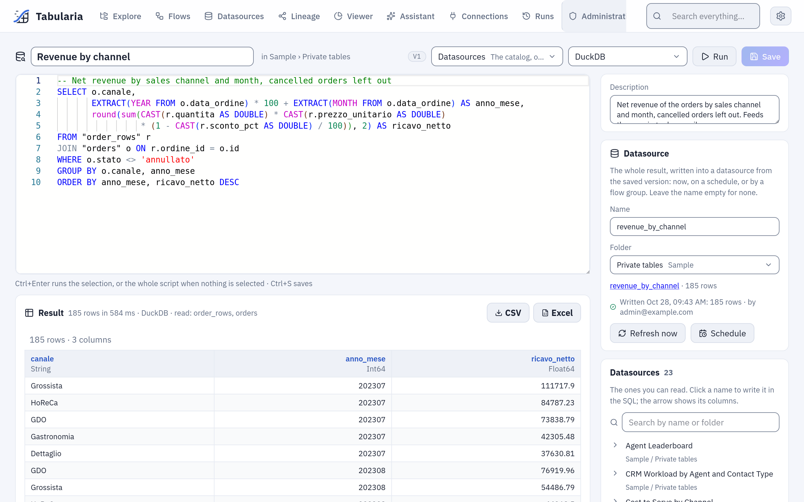

# SQL scripts

A SQL script is SQL kept in a folder, like a flow or a saved view: written in an editor,
run with one key, saved with its versions and shared through the folder's permissions.
It reads the datasources of the catalog on the engine you choose, or a database through
one of its connections. Every installation has it, Docker Compose included. The design is
in [the spec](specs/sql-scripts.md).

## Writing one

Explore → **New → SQL script** in a folder. The page has the editor, the result under it,
and on the side the datasources you can read with their columns: a click on a name writes
it where the cursor is, the arrow shows the columns, a click on a column writes it too.
The editor also completes names and columns as you type.



*The script of the example below: the SQL, the result with its time and the datasources it read, and on the side the **Datasource** card and the catalog.*

A datasource is a table by its **name**. A name with spaces or capitals goes in double
quotes; unquoted names match regardless of case:

```sql
SELECT c.canale, count(*) AS ordini
FROM "orders" o
JOIN "customers" c ON o.cliente_id = c.id
GROUP BY c.canale
ORDER BY ordini DESC
```

A name is unique only in its folder. When two datasources you can read share it, write the
folder's name in front, `"Marketing"."Clienti"`: the error says so and lists the folders.
When the two folders have the same name too (`Vendite / Dati` and `Acquisti / Dati`), the
folder's name does not tell them apart: the error says so, and one of the folders or of the
datasources needs another name. Renaming a datasource breaks the scripts that name it, as
it would any SQL.

The dialect is the engine's: Polars SQL, DuckDB, ClickHouse or BigQuery, chosen at the top
of the page (the administrator decides which engines may be chosen). On BigQuery a name is
quoted in backticks, `` `Importo totale` `` (in double quotes it is a text): the list
beside the editor writes it so. `--` and `/* */` comments are fine.

## On a database connection

**Where the SQL runs**, at the top of the page, is either **Datasources** (the catalog) or
one of the database connections you may use: PostgreSQL, MySQL, MariaDB, ClickHouse,
Trino, Oracle or SQL Server. On a connection:

- the SQL goes to the database **as it is**, in the database's own dialect, and the
  database's own message comes back when it refuses it;
- the side lists the connection's tables; the arrow reads a table's columns and their
  types, and a click writes the name in the database's quoting
  (`catalogo.prodotti`, `` `Orders 2024` ``, `[dbo].[Orders]`);
- there is no engine to choose: the database computes.

```sql
SELECT p.categoria, count(*) AS prodotti
FROM catalogo.prodotti p
GROUP BY p.categoria
ORDER BY prodotti DESC
```

Running SQL on a connection needs the **CONNECT** permission on the connection's folder,
as importing from it does. A script is shared with its folder as any other, but a person
with VIEW on the folder and no CONNECT on the connection reads its SQL and cannot run it;
choosing a connection for a script needs CONNECT on it too.

The SQL runs inside `SELECT * FROM (…)`, as a SQL datasource's, so a statement that is not
a query fails. That is not the barrier: the barrier is a **read-only database user** on
the connection, as for database datasources. Give that user a time limit on the database
too (PostgreSQL: `ALTER ROLE lettore SET statement_timeout = '60s'`; MySQL:
`max_execution_time`; ClickHouse: a settings profile with `max_execution_time`). Tabularia
stops waiting after the preview time limit (`PREVIEW_TIMEOUT_SECONDS`) and asks the
database for no more rows than it shows, but a query the database is still computing ends
only by the database's own limit.

## Running

**Run**, or **Ctrl+Enter** in the editor, runs the selection when there is one, otherwise
the whole script, and shows the first 200 rows with the time taken and the datasources
read (or the connection). On the catalog only one query that reads data runs: a `SELECT`
(a `WITH` before it too). It reads the datasources you name and nothing else: the engine
checks every table against the ones the gateway resolved, as for the SQL step of a flow.
A new run of the same script stops the one still running.

A run reads with **your** permissions, whoever wrote the script: a datasource you cannot
read gives the same error as one that does not exist. Every run is in the audit log
(`sql_script.run`) with its SQL and the datasources it read, or the connection.

## Exporting the whole result

The run shows the first 200 rows; **CSV** and **Excel**, beside the result, download all
of them. The export runs what *Run* runs (the selection, or the whole script), with the
same checks: the datasources you may read, CONNECT on the connection. A worker writes the
file, as for the Viewer's export, and the browser saves it when it is ready, named after
the script. Every export is in the audit log (`sql_script.export`) with its SQL.

The caps are the Viewer's: a CSV holds at most `EXPORT__MAX_ROWS` rows (5 million by
default), an Excel file the format's ~1 million. Over the cap the export stops and says
so; on a connection the database is asked for no more rows than the cap and one. A result
larger than that belongs in a datasource.

## Writing the result into a datasource

A script can keep its whole result in a datasource, for flows, saved views and the
other scripts to read. In the **Datasource** card beside the editor give it a name and a
folder, then **Save**: the name and the folder are part of the script, and of its
versions. Choosing the folder needs Edit on it; a datasource already there under that
name is overwritten only when a flow or a script wrote it, never a database's or a
file's.

**Refresh now** writes the whole result of the **saved** version (save first: unsaved
changes are not written). The first write creates the datasource; every write after
replaces its data and keeps its id, so whatever reads it keeps working. The datasource
changes only when a write succeeds, and its data contract, when it has one, is checked
before. A description written on the datasource stays across the writes (the first one
says which script writes it). On the catalog the script's engine writes it; on a connection the database's
whole result is read, as for a SQL datasource. The card shows the last write: when, how
many rows, who started it, and why it failed.

Writing needs **Run** on the script's folder and **Edit** on the datasource's, and what
a run needs: the datasources the SQL names readable by whoever writes, CONNECT on the
connection. One write at a time: a second one waits for the first to end. Every write is
in the audit log (`sql_script.publish`) with its SQL.

### On a schedule

**Schedule** sets a cron ([scheduling](capabilities/scheduling.md)): the scheduler writes the datasource from the saved version,
with the rights of whoever set it, checked again every time. A write that those rights
no longer allow is not started: it shows as a failed write with its reason, and the
schedule stays, to write again once the rights are back. When someone else changes the
script's SQL, its connection or the datasource's folder, or moves the script, the
schedule switches itself off (the audit log says why), because it would run their SQL
with the author's rights; the author's own changes keep it.

### In a flow group

A script that writes a datasource goes in a [flow group](capabilities/flow-groups.md) as a cell
(**SQL scripts** in the panel on the right): the cell writes the datasource in its step,
after the steps before it, and the next step reads the new data. Its failure stops the
group as any cell's. Use a group when the script reads what flows produce: the group
runs them first, then the script, on one schedule. A script in a group cannot be
deleted, nor lose its datasource, until it is taken out.

### Lineage

The **Lineage** page draws a SQL script with the datasources its SQL names (or the
connection it runs on), the datasource it writes and the flow groups that run it.
With [OpenLineage](openlineage.md) on, every write is a run of the job
`<folder>/<name> (SQL script)`: the datasources the write read (on a connection, the
tables of the SQL), the datasource it wrote, the SQL in the `sql` facet.

## Example: the revenue by channel, every morning

On the sample data ([the «Sample» folder](getting-started-docker-compose.md#a-the-sample-data-already-there)):
the net revenue of the orders by sales channel and month, kept as a datasource that the
other flows, the Viewer and the assistant can read.

1. In Explore, open `Sample / Private tables`, then **New → SQL script**. At the top,
   **Where the SQL runs** stays on **Datasources**; choose the engine **DuckDB**.
2. Write the SQL (a click on `order_rows` or `orders` in the side list writes the name):

   ```sql
   -- Net revenue by sales channel and month, cancelled orders left out
   SELECT o.canale,
          EXTRACT(YEAR FROM o.data_ordine) * 100 + EXTRACT(MONTH FROM o.data_ordine) AS anno_mese,
          round(sum(CAST(r.quantita AS DOUBLE) * CAST(r.prezzo_unitario AS DOUBLE)
                    * (1 - CAST(r.sconto_pct AS DOUBLE) / 100)), 2) AS ricavo_netto
   FROM "order_rows" r
   JOIN "orders" o ON r.ordine_id = o.id
   WHERE o.stato <> 'annullato'
   GROUP BY o.canale, anno_mese
   ORDER BY anno_mese, ricavo_netto DESC
   ```

3. **Ctrl+Enter**. The result says «185 rows in 584 ms · DuckDB · read: order_rows,
   orders»: one row per channel and month, the biggest channel of each month first.
4. **Create**, with the name `Revenue by channel`. In the **Datasource** card write the
   name `revenue_by_channel`, keep the folder `Sample / Private tables`, **Save**.
5. **Refresh now**. The card shows «Written …: 185 rows · by» you, and
   `revenue_by_channel` is in the catalog.
6. **Schedule** → `0 6 * * 1-5` → **Save**: every working day at six the datasource is
   written again from the saved SQL. When it must wait for fresh orders, put it in a
   [flow group](capabilities/flow-groups.md#example-the-morning-sales-email) after the
   refreshes instead.

## Saving and sharing

**Create** the first time, then **Save** (Ctrl+S): a save that changes the SQL, the
engine, the connection or the datasource is a new version. **Versions** on the side lists them; *View*
shows an older one read-only, *Restore* makes it the newest. Old versions beyond
`ORCHESTRATOR__VERSIONS_KEPT` are pruned, the current one never.

| On the script's folder | You can |
|---|---|
| View | open it, read its SQL, run it (on a connection: with CONNECT on it), try changes without saving them |
| Run | write its datasource now, schedule it |
| Edit | save, rename, move, duplicate, delete it |

Administrators see every script. SQL scripts show in Explore and in the search. A folder
that holds one cannot be deleted until it is moved or deleted.
